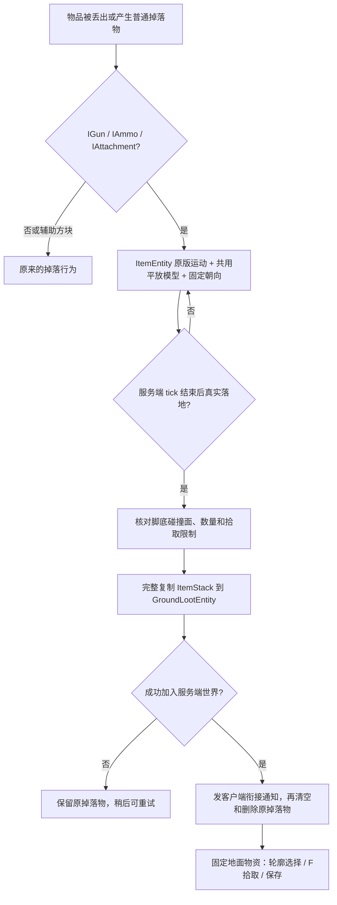

# TaCZ 掉落物静态姿态、落地物资与动画衔接

更新：2026-10-18。Minecraft 1.21.1 / NeoForge 21.1.259 / TaCZ NeoForge r7。

同日后续更新：范围已扩展到已保存物品概率列表的全部普通物品/方块（含权重 0），玩家主动抛出朝向改为视角 ±15°；地面模型改为只读实际网格流程，749 项资源已审核。模型及 Z 装配补丁见[更新说明](配置物品掉落与模型对齐更新.md)。**当前已恢复原版空中运动与落地才转换，地面小碰撞箱为 0.22×0.13 格并保留重力，协议为 4；下文“永久固定载体”及 150ms 固定落点过渡属于早期记录，现为支撑移除后继续下落、数据齐备立即衔接。** 当前规则与验证见[恢复小碰撞箱与抛出停顿修复](恢复小碰撞箱与抛出停顿修复.md)。

## 实施结果

TaCZ 的实际枪械、散装弹药和配件在普通抛出阶段保持固定水平朝向，没有原版自旋、上下浮动和按堆叠数量复制多份模型的效果。空中保留原版抛物线、重力、碰撞、流体与拾取处理；实际碰到支撑面后，服务端将其转换为与 `itemRespawn` 相同的 `GroundLootEntity`，实体注册名为 **`tacz_pubg:ground_loot`**。

转换后原地平放、保持数量、可被现有轮廓选择和空手 F 拾取；潜行主手右键入口也保留。地面载体不自动吸入背包、不自然消失、不自动合堆，与原有生成物资行为一致。玩家丢下的物品单独记录来源，之后的 `itemRespawn` 只替换自动生成物资，不清掉这些转换物。

本次是功能实现和构建验证，没有启动游戏、客户端或服务器。实际画面、全部光影及高延迟联机下的最终表现未做游戏内验证。

## 范围与生命周期

`DroppedLootPolicy.isConvertible(ItemStack, Level)` 将 TaCZ 官方 `IGun`、`IAmmo`、`IAttachment` 接口与已保存普通物品 ID 集合合并判断，包含其他枪包通过这些接口提供的资产。普通 `BlockItem` 只要在概率列表中也接管。工作台、靶子等不会被默认目录自动加入；显式配置的条目按配置处理，不按显示名称或固定枪 ID 列表猜测。

服务端监听官方游戏事件总线的 `EntityTickEvent.Post`。这个时间点原版已经完成本 tick 的移动、合并与过期处理，因此先排除已删除实体，再读取最终数量，避免给已合并消失的旧堆重复生成物品。不会在可能早于 FULL 区块状态的 `EntityJoinLevelEvent` 中读取地形或转换。

落地必须同时满足 `onGround()` 和真实方块碰撞形状顶面支撑脚底。使用 `getOnPos()` 找支撑方块，核对碰撞形状世界坐标与原载体脚底；保留原 X/Z 和 `boundingBox.minY`，不把 Y 取整或固定成方块坐标加一。因此半砖、台阶、1.5 格高栅栏等不会被统一抬到错误高度。水面漂浮、空中和只碰墙侧不触发转换；水底有真实支撑面时可以转换。

## 连贯动画的实现

空中和地面调用同一个 `GroundLootRenderer.renderStack`，使用相同模型、原生 GROUND 大小、平放校正及 0.002 格抬升。按最新要求，概率列表物品不再额外乘薄片、二维模型或图标缩小系数；细节见[原生掉落物尺寸](物资使用原生掉落物尺寸.md)。玩家主动丢弃时以视角加 ±15° 随机偏移确定一次朝向，之后不随年龄改变，也不在落地时重新随机。保留原版实体调度器对空中位置的逐帧插值。

只换模型仍可能因旧实体删除包和新实体生成/物品数据包的到达时间不同而闪一下，所以增加 `tacz_pubg:drop_landed` 客户端通知：

1. 渲染器记录旧掉落物最后一帧实际绘制的位置和朝向。
2. 服务端新载体加入成功后，向正在追踪旧实体的玩家发送源与目标的 ID、UUID、落点、朝向和一份外观物品。
3. 客户端隐藏匹配的旧源，建立一个只有客户端存在的临时视觉载体，从最后绘制位置经过 3 个 tick（正常 20 TPS 下约 150 毫秒）移动到落点。它继续走普通实体渲染管线与同一个模型，不另外使用 HUD/世界叠加层。
4. 第 4 个客户端 tick 起，确认真实目标 ID、UUID 一致且物品数据已同步，再移除临时载体并显示真实地面物资；最后一段位置插值不会被提前截断。

朝向沿用客户端最后可见值；若没有旧源记录，使用实体生成包的字节角度量化规则，避免新旧载体之间微小角度跳变。模型不变形、不在落地时翻转或缩放。

临时视觉载体不是另一份可拿走的物品：只有客户端负 ID，无物理，不可选中、拾取或保存，不发给服务端，不参与 F 拾取。目标提前删除立即清理，最长等待 10 个客户端 tick；换维度、退出、超时也清理。最多 128 个过渡、256 条最近帧记录，帧记录保留 20 tick；源/目标均同时核对 ID 和 UUID，防止复用 ID 误隐藏其他实体。超过上限时移除最旧过渡，真实物资照常显示。网络异常可能退回直接显示真实载体，不影响服务端物品数量。

## 物品、拾取与刷新安全

完整 `ItemStack.copy()` 保留 TaCZ 逻辑 ID、已装弹量、膛内弹、配件、耐久、自定义名称及物品组件。仍使用一个 count=1 的外观堆和独立 `Quantity`，真实数量原样保留；不自动补充弹药、不按 30 发重分堆、不根据配置重新随机物品。

先验证持久化、成功加入新载体，再清空/删除原载体。失败保留原物；若事件监听器在加入后抛异常，则回滚新载体。视觉通知失败不会留下两份服务端物品。假展示物、永不拾取的 `PickupDelay=32767` 物品以及超出 1～4096 数量边界的异常堆不转换、不截断数量。

原版 ItemEntity 的剩余 `PickupDelay` 和受限拾取 UUID `target` 转移到地面物资，在服务端 F 和右键拾取路径统一核对，防止借转换绕过限制。延迟逐 tick 递减并保存，重登不会清零。

地面载体保存 `Origin=respawn/drop`、`PickupDelay`、可选 `PickupTarget`，既有保存格式的数量版本仍为 2。缺少 Origin 的旧载体按原有 respawn 来源恢复；未知来源值拒绝加载，避免静默改成会被刷新删除的来源。`isManagedLoot()` 仍代表合法地面载体，F 拾取接受两种来源；`isRespawnManaged()` 仅供刷新清理使用。

普通物品在空中仍可能被原版提前拾取、合并或销毁；真正落地转换后才切换为固定地面物资。这里保留的是原版小型 ItemEntity 运动碰撞，不是完整长枪刚体模拟：长枪边缘在墙角或支撑面边缘的碰撞表现不等于整把枪都有物理碰撞盒。

## Jade 准心考察

已安装 [Jade 15.10.6+neoforge](https://modrinth.com/mod/jade/version/eYz2YBGT)，硬依赖仅 NeoForge，当前版本满足。`GroundLootEntity.getName()` 已返回内部 `ItemStack.getHoverName()`，因此 Jade 能取得具体枪械、弹药、配件名称，而不是统一显示一个地面载体名称。

如需实体/方块注册 ID，在 Jade 配置 → 调试 → 注册名改为 ON。实体类型仍是 `tacz_pubg:ground_loot`，不同枪械的 TaCZ 逻辑 GunId/AmmoId/AttachmentId 不是实体注册名；本次没有添加专用 Jade 逻辑 ID 提供器。详见[安装说明](Jade准心信息安装说明.md)。

## 对应代码与验证

| 位置 | 作用 |
|---|---|
| `lootspawn/DroppedLootPolicy.java` | 物品接口范围、固定朝向、数量/延迟边界、支撑顶面判断 |
| `lootspawn/DroppedLootService.java` | 服务端 Post tick 落地检查、数据转移和唯一转换 |
| `lootspawn/GroundLootEntity.java` | 来源、延迟/Owner、物品名称、存档与拾取 |
| `lootspawn/GroundLootPayloads.java` | F 请求和仅客户端视觉衔接通知；此通道协议版本为 2 |
| `lootspawn/client/DroppedLootRenderer.java` | 条件替换 ItemEntity 渲染；其他物品委托原版 |
| `lootspawn/client/GroundLootRenderer.java` | 空中与地面共用物品绘制 |
| `lootspawn/client/DroppedLootTransitionClient.java` | 有界客户端临时载体及包间衔接 |
| `lootspawn/client/DroppedLootTransitionMath.java` | 过渡时序与网络角度规则 |
| `lootspawn/LootRespawnService.java` | 只替换 respawn 来源，不删除玩家掉落转换品 |

官方扩展点使用 `EntityRenderersEvent.RegisterRenderers`、`EntityTickEvent.Post`、`RegisterPayloadHandlersEvent` 和 `PacketDistributor`；已按本机 21.1.259 的匹配源码核对。该版本没有 `RenderItemEntityEvent`，无需为此增加 Mixin。参考 [NeoForge 1.21.1 事件文档](https://docs.neoforged.net/docs/1.21.1/concepts/events/)与[网络 Payload 文档](https://docs.neoforged.net/docs/1.21.1/networking/payload/)。

2026-10-18 构建成功，新增掉落规则检查 **308 项**、衔接数学检查 **57 项**通过；已有地面数量/姿态、配置、区域、枪械方案、地图和备份检查也通过。日志：[dropped-loot-build.log](../logs/dropped-loot-build.log)。这些检查覆盖代码编译、碰撞几何、数量边界、来源迁移与过渡时序，不等于实际网络或光影画面测试。

产物：`neoforge-1.21.1/build/libs/tacz_pubg-1.0.0.jar`。开发实例下次启动直接加载当前源码；不要把此 JAR 再放入同一开发实例的 run/mods。修改前文件保存在 `logs/source-backups/2026-10-18-dropped-loot/`。Jade 原始下载与安装证据见 `downloads/jade/`。本次未改动来源 HMCL 安装、枪包或存档。
