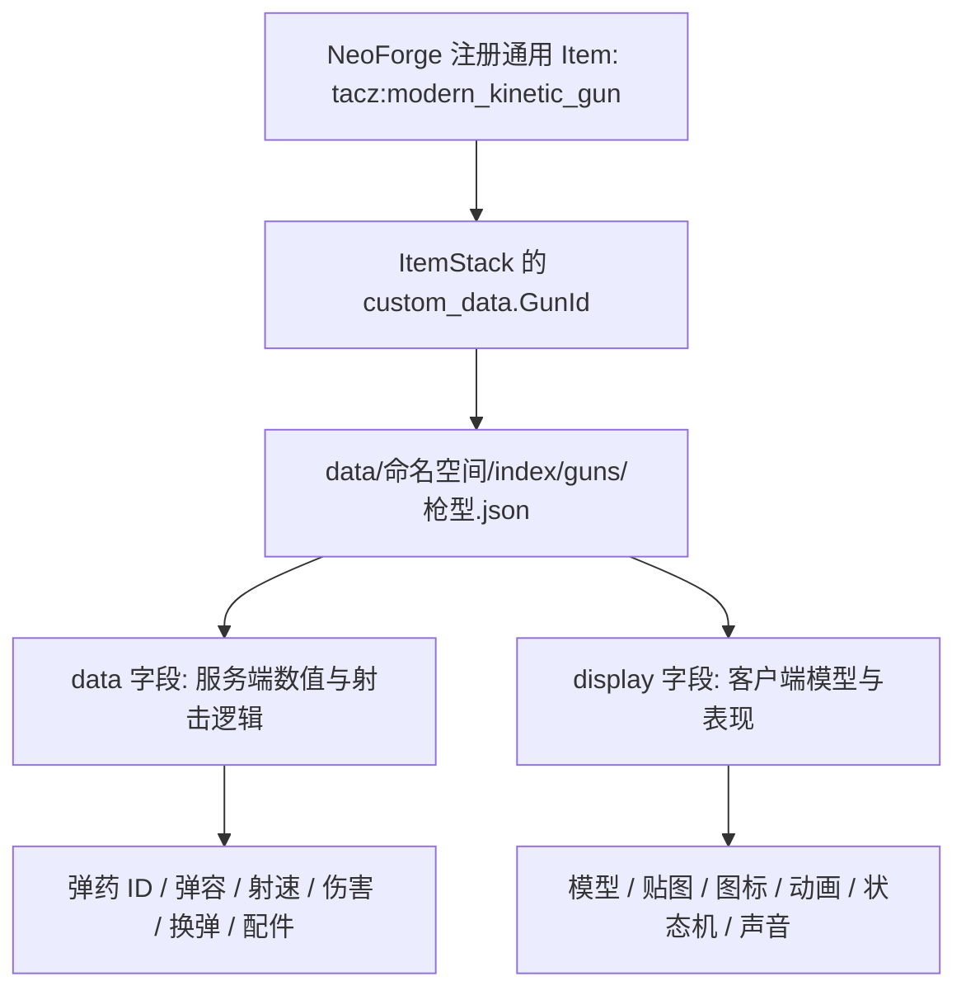

# TaCZ 枪械如何注册，以及怎样制作一把枪

核对日期：2026-10-17。本文锁定本工作区实际安装的 **Minecraft 1.21.1 / NeoForge / TaCZ 1.1.8-hotfix-r7 非官方移植版**。制作说明依据匹配的 sources JAR、实际默认枪包和官方 Wiki；没有启动游戏。本文是注册机制与制作流程说明，PUBG 枪包的安装、枪单缺口另见本轮枪包调查文档。

## 1. 最关键的结论：Item 注册与枪型注册是两层

TaCZ 没有为 AK47、M4A1 等每把枪各注册一个 NeoForge `Item`。

- NeoForge 物品注册表中，现代动能枪共用 **`tacz:modern_kinetic_gun`**。
- 枪包为每种枪定义独立的资源 ID，例如 **`tacz:ak47`**。它由 `data/tacz/index/guns/ak47.json` 的命名空间与文件路径决定。
- `ItemStack` 的 `minecraft:custom_data` 组件里保存 `GunId: "tacz:ak47"`，还保存当前弹量、开火模式、配件等状态。
- 运行时先根据 `GunId` 查询枪械索引，再取得它的数值数据和客户端表现。

因此，在我们的物资配置里选 `tacz:ak47` 才能指定 AK47；仅写 `tacz:modern_kinetic_gun` 只能指向通用枪械物品。**`GunId` 是物品状态中的字段；枪包 JSON 不需要额外添加一个 `gun_id` 字段来注册枪型。**



## 2. 对应的类分别负责什么

下面的链接指向从匹配 r7 sources JAR 提取的只读参考源码。它们不是当前附属模组要编辑的源文件。

| 类 | 职责 |
| --- | --- |
| [ModItems](../downloads/tacz/r7-source-inspection/com/tacz/guns/init/ModItems.java) | 用 NeoForge `DeferredRegister.Items` 注册通用枪械、弹药、配件 Item；`MODERN_KINETIC_GUN` 对应 `modern_kinetic_gun`。 |
| [GunItemManager](../downloads/tacz/r7-source-inspection/com/tacz/guns/api/item/gun/GunItemManager.java) | 把 `item_type`（默认 `modern_kinetic`）映射到实际枪械 Item 类型。通常制作新枪包不用改它。 |
| [GunPackLoader](../downloads/tacz/r7-source-inspection/com/tacz/guns/resource/GunPackLoader.java) | 扫描游戏目录的 `tacz/`，读取根级 `gunpack.meta.json`，检查模组依赖，组合枪包资源。r7 直接扫描文件夹和 `.zip`。 |
| [CommonAssetsManager](../downloads/tacz/r7-source-inspection/com/tacz/guns/resource/CommonAssetsManager.java) | 加载服务端枪械数值、弹药/配件索引、逻辑 Lua；先加载 data，再加载依赖 data 的 index，并向客户端同步通用数据缓存。 |
| [GunIndexPOJO](../downloads/tacz/r7-source-inspection/com/tacz/guns/resource/pojo/GunIndexPOJO.java) | 对应枪械 index JSON 的 `name/data/display/type/item_type/sort/tooltip` 字段。 |
| [CommonGunIndex](../downloads/tacz/r7-source-inspection/com/tacz/guns/resource/index/CommonGunIndex.java) | 将 index 与 `GunData` 关联；校验弹药、弹容、枪栓、射速、换弹和开火模式等；解析服务端逻辑脚本。 |
| [ClientAssetsManager](../downloads/tacz/r7-source-inspection/com/tacz/guns/client/resource/ClientAssetsManager.java) | 加载客户端 display、`geo_models`、动画、客户端 Lua 和枪包信息。 |
| [ClientIndexManager](../downloads/tacz/r7-source-inspection/com/tacz/guns/client/resource/ClientIndexManager.java) / [ClientGunIndex](../downloads/tacz/r7-source-inspection/com/tacz/guns/client/resource/index/ClientGunIndex.java) | 根据已同步的通用枪型建立客户端索引，连接 display 与枪型。客户端单独有模型，不代表服务端已经注册了这把枪。 |
| [GunDisplayInstance](../downloads/tacz/r7-source-inspection/com/tacz/guns/client/resource/GunDisplayInstance.java) | 把 display 解析为可用的模型、纹理、动画控制器、状态机、声音等运行时资源；r7 对模型和动画使用延迟加载。 |
| [TimelessAPI](../downloads/tacz/r7-source-inspection/com/tacz/guns/api/TimelessAPI.java) | 附属查询枪械/弹药/配件索引与显示实例的公开入口；使用 API 比直接操作内部 Map 稳妥。 |
| [IGun](../downloads/tacz/r7-source-inspection/com/tacz/guns/api/item/IGun.java) / [GunItemDataAccessor](../downloads/tacz/r7-source-inspection/com/tacz/guns/api/item/nbt/GunItemDataAccessor.java) | 识别枪械，并读写 GunId、弹药、枪膛、配件等状态。r7 的实现使用 `DataComponents.CUSTOM_DATA`。 |
| [GunItemBuilder](../downloads/tacz/r7-source-inspection/com/tacz/guns/api/item/builder/GunItemBuilder.java) | 根据枪型索引构造实际 `ItemStack`。`build(provider)` 在枪型/Item 类型不存在时返回空物品；附带配件时需要注册表访问器。 |
| [ModernKineticGunItem](../downloads/tacz/r7-source-inspection/com/tacz/guns/item/ModernKineticGunItem.java) | 现代动能枪的射击、换弹、拉栓等入口，按已配置逻辑 Lua 的函数执行行为。 |

我们的 [LootCatalog](../neoforge-1.21.1/src/main/java/com/example/examplemod/lootconfig/LootCatalog.java) 按这个机制枚举服务端枪型，用 Builder 创建物品并读取弹药和基础弹匣容量。当前配置使用唯一 `kind + id` 的独立物品条目，没有 128 条业务上限。每次服务器运行首次初始化存档配置时，补入全部真实加载的 TaCZ 枪械、弹药和配件，新增枪械/配件权重 1、独立弹药权重 0；制造台、靶、箱等辅助物品不自动加入。已有权重保留，旧配置先备份再迁移。详情见[物品配置与全存档刷新](枪组配置与全图刷新.md)。

## 3. 默认 AK47 的完整资源链

下表核对的是 JAR 内原始 r7 默认包，已提取至 `downloads/tacz/r7-default-reference/` 供只读参考。安装 CBRG 后，运行目录的默认包已有作者覆盖与兼容修正，不能再把该处参数当原始 r7 参数。

| 内容 | 文件或引用 |
| --- | --- |
| 枪型 ID | `tacz:ak47` ← `data/tacz/index/guns/ak47.json` |
| 数值引用 | index 的 `"data": "tacz:ak47_data"` → `data/tacz/data/guns/ak47_data.json` |
| 表现引用 | index 的 `"display": "tacz:ak47_display"` → `assets/tacz/display/guns/ak47_display.json` |
| 弹药 | data 的 `"ammo": "tacz:762x39"` → `data/tacz/index/ammo/762x39.json` |
| 基础弹容 | data 的 `ammo_amount = 30`；扩容等级容量为 `[34,37,40]`。这是默认 TaCZ AK47 参数，**不是 PUBG AKM 的参数证明**。 |
| 枪械逻辑 Lua | data 的 `"script": "tacz:xmag_reload_logic"` → `data/tacz/scripts/xmag_reload_logic.lua` |
| 主模型 | display 的 `"model": "tacz:gun/ak47_geo"` → `assets/tacz/geo_models/gun/ak47_geo.json` |
| 主贴图 | `"texture": "tacz:gun/uv/ak47"` → `assets/tacz/textures/gun/uv/ak47.png` |
| 背包图标 | `"slot": "tacz:gun/slot/ak47"` → `assets/tacz/textures/gun/slot/ak47.png` |
| HUD 图标 | `"hud": "tacz:gun/hud/ak47"` → `assets/tacz/textures/gun/hud/ak47.png` |
| 低精度模型 | `lod.model = "tacz:gun/lod/ak47"` → `assets/tacz/geo_models/gun/lod/ak47.json` |
| 动画 | `"animation": "tacz:ak47"` → `assets/tacz/animations/ak47.animation.json` |
| 动画状态机 Lua | `"state_machine": "tacz:ak47_state_machine"` → `assets/tacz/scripts/ak47_state_machine.lua` |
| 开枪声音 | `sounds.shoot = "tacz:ak47/ak47_shoot"` → `assets/tacz/tacz_sounds/ak47/ak47_shoot.ogg` |
| 可用配件筛选 | `data/tacz/tacz_tags/attachments/allow_attachments/ak47.json` |
| 枪械工作台配方 | `data/tacz/recipe/gun/ak47.json`；类型 `tacz:gun_smith_table_crafting`，结果 `type=gun,id=tacz:ak47`。 |

**r7 的目录应写 `geo_models`、`tacz_sounds`、`recipe`（单数）**。默认 display 的部分中文注释和官方教程正文还保留 `models/sounds/guns/data/recipes` 等历史说法；不要按这些旧注释建文件夹。资源 ID 通常省略该加载器指定的目录前缀与后缀，例如模型字段不写 `geo_models/` 或 `.json`，纹理字段不写 `textures/` 或 `.png`。

## 4. 制作新枪包的最小结构

使用自己的命名空间，例如 `pubg_arsenal`。它与 Java 模组的 `tacz_pubg` 可以不同；一套枪型资源不要求对应一个新 Java 模组。

```text
pubg_arsenal_pack/
├─ gunpack.meta.json
├─ assets/pubg_arsenal/
│  ├─ display/guns/akm_display.json
│  ├─ geo_models/gun/akm_geo.json
│  ├─ textures/gun/uv/akm.png
│  ├─ textures/gun/slot/akm.png
│  └─ lang/zh_cn.json
└─ data/pubg_arsenal/
   ├─ index/guns/akm.json
   └─ data/guns/akm_data.json
```

这是能够描述枪型、数据和静态外观的骨架，不是具备完整换弹手感的成品。成品通常还需要：

```text
assets/pubg_arsenal/
  animations/akm.animation.json
  scripts/akm_state_machine.lua
  tacz_sounds/akm/*.ogg
  textures/gun/hud/akm.png
  geo_models/gun/lod/akm.json
data/pubg_arsenal/
  scripts/akm_logic.lua                       # 需要特殊逻辑时添加
  tacz_tags/attachments/allow_attachments/akm.json
  recipe/gun/akm.json                        # 需要合成时添加
assets/pubg_arsenal/gunpack_info.json          # 枪包作者、版本、描述等
```

`gunpack.meta.json` 的最小内容：

```json
{"namespace":"pubg_arsenal"}
```

可加 `dependencies`（模组 ID → Maven 版本范围）。它检查模组版本，不能代替枪型、模型、脚本等资源引用检查。这里不随意填写“支持所有版本”的范围。

`data/pubg_arsenal/index/guns/akm.json` 的结构示例：

```json
{
  "name": "pubg_arsenal.gun.akm.name",
  "data": "pubg_arsenal:akm_data",
  "display": "pubg_arsenal:akm_display",
  "type": "rifle",
  "item_type": "modern_kinetic",
  "sort": 10
}
```

这是制作目录示例。它不会因为填写了 AKM 名称就自动拥有 PUBG AKM 的模型与数值；引用的文件需要真实存在。

`assets/pubg_arsenal/display/guns/akm_display.json` 的基本结构：

```json
{
  "model": "pubg_arsenal:gun/akm_geo",
  "texture": "pubg_arsenal:gun/uv/akm",
  "slot": "pubg_arsenal:gun/slot/akm",
  "third_person_animation": "default"
}
```

基础 display 可以不指定 `animation`，但完整操作动画需要制作后再添加。r7 未指定 `state_machine` 时会尝试使用 `tacz:default_state_machine`。`use_default_animation` 仍兼容，但源码标为弃用、优先采用 `default_animation`；默认动画也不能替代与新骨骼匹配的换弹动画。

## 5. 数值文件应填写什么

不要把所有可选字段都堆入第一把练习枪。先对照实际 [ak47_data.json](../downloads/tacz/r7-default-reference/data/tacz/data/guns/ak47_data.json) 理解以下部分，再为自己的武器确定参数。

| 字段 | 含义及 r7 注意事项 |
| --- | --- |
| `ammo` | 关联的 TaCZ 弹药资产 ID；需同时被服务端加载。例如默认 AK47 用 `tacz:762x39`。 |
| `ammo_amount` | 基础弹匣容量，必须 ≥1；不是掉落时应直接携带的总备弹量。 |
| `extended_mag_ammo_amount` | 扩容等级对应的总容量；如果提供，r7 至少要求 3 个元素。 |
| `bolt` | `closed_bolt/open_bolt/manual_action` 等枪栓模式，与武器换弹/上膛设计保持一致。 |
| `rpm` / `fire_mode` | 射速及 `semi/auto/burst` 开火模式；有效模式不得为空或 UNKNOWN。连发另有 `burst_data`。 |
| `bullet` | 伤害、速度、寿命、重力、阻力、霰弹数量、穿透、额外伤害等。1 点 MC 伤害通常对应半颗心；PUBG 的生命值与护甲机制不能只按相同数字照搬。 |
| `reload` | 供弹类型、实际加弹时间 `feed` 和总动作时间 `cooldown`，必须与动画/逻辑一致。 |
| `draw_time/put_away_time/aim_time/sprint_time` | 拔枪、收枪、瞄准、疾跑切换时间。 |
| `recoil` / `inaccuracy` | 枪口/视角后坐与散布；需要按 TaCZ 的表达和实际体验转换 PUBG 表现。 |
| `allow_attachment_types` | 允许的配件槽类型；与该枪允许的配件标签共同决定可安装范围。 |
| `script/script_param` | 服务端行为 Lua 与参数。默认 AK47 的扩容换弹逻辑就通过脚本协调不同弹匣。 |

`CommonGunIndex` 的结构校验只保证部分字段合法，不能证明动画时机、后坐力曲线、配件兼容和 PUBG 数值还原已正确。本轮只检查源码与资源，不运行游戏。

## 6. 模型、贴图、动画怎样制作

建议用 Blockbench 建模，按官方模型指南选择 **Minecraft Bedrock Model** 工作流，导出 TaCZ 支持的基岩模型 JSON。编辑用的 `.bbmodel` 应保留在制作工程中，导出的 `*_geo.json` 放枪包；不要把 `.bbmodel` 当成游戏模型。

1. 建立枪身、枪机、弹匣、扳机等可动骨骼，做 UV 与纹理。比例、握持位置、枪口位置先统一，批量制作时才能复用规则。
2. 按官方“特殊组名”“手臂定位组”“视觉定位组”布置骨骼。实际 AK47 含 `muzzle_pos`、`muzzle_flash`、`bullet_in_barrel`、`magazine`、`lefthand_pos`、`righthand_pos`、`idle_view`、`iron_view`、`thirdperson_hand` 等；名称有功能含义，不能只按外形随便命名。
3. 制作 idle/draw/put_away/aim/shoot/reload/inspect 等所需动画，空仓与战术换弹分开处理。弹匣插入的视觉时间需对应服务端 `reload.feed`；状态机触发的动画名必须与动画文件一致。
4. `assets/<ns>/scripts/` 里的 Lua 是客户端动画状态机；`data/<ns>/scripts/` 里的 Lua 是服务端枪械逻辑。两者作用不同，不要放反。AK47 状态机按空仓状态和扩容等级选择不同换弹动画。
5. 分别制作 slot/HUD 图标和远距离 LOD，减少物资实体较多时的模型开销。枪械地面显示可利用 `ground` 定位/缩放；本附属重建普通掉落物 GROUND 的三维大小，另做静态姿态、薄轴平放及最低点贴地补偿，薄片或二维后备图标额外缩放 0.38。每个物资独立采用连续 0～360° 水平朝向。加装或修改枪包后需更新服务端数值占地清单，详见[地面物品展示与拾取](地面枪弹平放与弹匣分组.md)。
6. 声音采用作者有权使用的 OGG；射击第一/第三人称、消音、换弹/检视事件分开引用。r7 的 TaCZ 音效加载器读取 `tacz_sounds/*.ogg`，不要误放普通 `sounds/`。

完整素材劳动主要集中在模型、UV、动画、定位与音效；枪械 ID 和数值 JSON 适合用清单批量生成，但不能自动生成“已经验证正确”的握持和操作表现。

## 7. 新增弹药、配件和合成

### 弹药

默认弹药可直接按现有 ID 引用，不需要重复注册。如果制作新弹药，需要：

- `data/<ns>/index/ammo/<id>.json`：名称、display、stack_size 等。
- `assets/<ns>/display/ammo/<id>_display.json`：slot 图标、弹药模型/纹理、弹壳等表现。
- 对应模型与纹理，按需要加 `data/<ns>/recipe/ammo/<id>.json`。

弹药通常仍共用 `tacz:ammo` Item，用 `AmmoId` 区分。**弹药 Item 的 stack_size、枪的基础弹匣容量、当前已装弹量是不同概念。** 本附属先生成全部主物品，再对每把枪读取 `GunData.getAmmoAmount()` 基础容量，以 `ceil(容量/30)` 份、每份 30 发补充对应弹药，默认在水平距离 1～1.5 格的已标地板内随机摆放；半径可配，配弹不占主物品密度。拾取再遵循合法背包堆叠上限，主手空按 F 仅拾本附属物资，旧潜行右键入口保留。

### 配件

新增配件的基本链是 `data/<ns>/index/attachments/` → `data/<ns>/data/attachments/` + `assets/<ns>/display/attachments/`，再关联模型、纹理。默认 ACOG 示例见 [scope_acog_ta31.json](../downloads/tacz/r7-default-reference/data/tacz/index/attachments/scope_acog_ta31.json)。

配件安装还需要枪允许对应类型，以及 `data/<枪型ns>/tacz_tags/attachments/allow_attachments/<枪型路径>.json` 的适配筛选。默认 AK47 使用 `#tacz:scope` 等标签。模型上也要有正确的定位点；只开放槽位不代表瞄具自然对准瞄准视角。

### 配方（本环境是 1.21.1）

位置采用 `data/<ns>/recipe/`，**不是官方 Forge 1.20.1 文档中的 `recipes/`**。可以先使用实际默认配方同款的普通物品/`c:` 标签材料：

```json
{
  "type": "tacz:gun_smith_table_crafting",
  "materials": [
    {"item": {"tag": "c:ingots/iron"}, "count": 38}
  ],
  "result": {"type": "gun", "id": "pubg_arsenal:akm"}
}
```

该示例只演示当前版本的配方结构，不代表 PUBG 的获取方式。大逃杀地图可以直接通过物资系统生成，不要求玩家合成。旧教程的 `forge:partial_nbt`、Item 旧 `nbt`、`forge:` 通用标签不能直接视为 NeoForge 1.21.1 已兼容；需要匹配当前组件和 Ingredient 体系逐项转换。

## 8. Java 附属怎样创建一把已经注册的枪

以下写法对应当前 r7 API，与本项目 `LootCatalog.gunPreview` 一致；应在枪包数据已经加载后、服务端环境使用：

```java
ResourceLocation gunId = ResourceLocation.fromNamespaceAndPath("tacz", "ak47");
CommonGunIndex index = TimelessAPI.getCommonGunIndex(gunId).orElseThrow();
FireMode mode = index.getGunData().getFireModeSet().stream()
        .filter(value -> value != null && value != FireMode.UNKNOWN)
        .findFirst().orElseThrow();
ItemStack gun = GunItemBuilder.create()
        .setId(gunId)
        .setFireMode(mode)
        .setAmmoCount(0)
        .setAmmoInBarrel(false)
        .build(level.registryAccess());
```

对应 imports：`net.minecraft.resources.ResourceLocation`、`net.minecraft.world.item.ItemStack`、`com.tacz.guns.api.TimelessAPI`、`com.tacz.guns.api.item.builder.GunItemBuilder`、`com.tacz.guns.api.item.gun.FireMode`、`com.tacz.guns.resource.index.CommonGunIndex`。

这个 Builder 创建物品，**不会注册缺失的枪型**。不要通过 `forceBuild` 绕过索引检查来假装新枪已加载：r7 注释明确说明这可能生成不完整物品。需要新型枪械行为且 Lua/API 无法满足时，才考虑新增 Java 枪械 Item 实现与 `item_type`，普通 PUBG 枪型通常优先采用已有 `modern_kinetic`。

## 9. 安装、重载与版本边界

新枪包部署位置是 **`neoforge-1.21.1/run/tacz/`**。可使用独立文件夹，或把 `assets/`、`data/`、`gunpack.meta.json` **直接放 ZIP 根目录**；不能再套一层 `pubg_arsenal_pack/` 文件夹。这里讨论 r7 自身直接支持的 ZIP/文件夹形式；Java 附属 JAR 放 `run/mods/`，两者不要混淆。

r7 的 `/tacz reload` 在客户端重载资源，并在存在内置服务器时请求重载通用数据；专用服务器执行则重载通用数据。手动开发时可用它，但客户端资源与服务端数据必须一致。新增包后重启客户端是更完整的加载方式；**本轮没有代用户启动或重载游戏**。

不要直接编辑 `tacz_default_gun` 制作自己的包：默认资源在启动时可能重新导出覆盖，默认包 README 也说明此事。使用独立目录和命名空间可以保留原包并避免 ID 冲突。

两种迁移必须分开：

1. **TaCZ 旧枪包格式 → 1.1.4+ 现代目录格式**：官方 `/tacz convert` 面向历史 `config/tacz/custom/` 包，调整 assets/data 布局等。
2. **Forge 1.20.1 枪包 → 本 NeoForge 1.21.1 移植版**：配方目录、标签、物品 NBT/组件等仍可能需要额外适配。移植作者 README 明确提示第三方旧配方需要升级工具；这不是移植 Java 附属的工具，也不能保证任意特殊 Lua/效果都兼容。

1.20 的 `/give ...{GunId:...}` 旧语法和 `new ResourceLocation(...)` Java 示例也不应直接照抄。优先使用当前 API Builder 与 ResourceLocation 工厂方法。

## 10. 批量制作 PUBG 武器的实际分工

可行的生产线是“武器清单 → 可校验的数据表 → 自动生成枪包 JSON → 按武器家族制作素材 → 逐把调校”，而不是每把写一个 NeoForge 类。

| 内容 | 批量化程度 | 仍需人工判断 |
| --- | --- | --- |
| 枪型 ID、名称、本地化、目录、index、配方 | 高 | ID 唯一性、引用是否存在、版本匹配。 |
| 弹容、射速、弹速、弹药种类、基础动作时长 | 高 | PUBG 版本与资料基线，以及到 MC/TaCZ 的单位与机制转换。 |
| 同类枪的后坐与散布参数 | 中 | PUBG 与 TaCZ 表达不同，不能把参数名称相同当成行为相同。 |
| 模型、UV、贴图、声音 | 中到低 | 必须有授权素材或原创素材；轮廓、细节、尺寸和声音仍需制作。 |
| 骨骼、第一人称定位、弹匣/枪机动画 | 中到低 | 可按枪族复用骨架，但无托、栓动、单发装填、鼓匣等不能套同一换弹动画。 |
| 瞄具适配、扩容弹匣、单发/连发/自动模式 | 中 | 同时检查模型外观、逻辑与时序。 |
| PUBG 配件、护甲、伤害、战局规则 | 另一个层次 | 需要附属模组规则与数值体系，枪包本身不等同于整套 PUBG 战斗系统。 |

建议先确定目标是“武器名单齐全”“外观接近”还是“弹道/后坐/配件/伤害也还原”，再分批验收。第一批选择一种步枪、一种手枪、一种栓狙、一种霰弹枪，验证不同机构，之后再扩展名单。已有枪包如果覆盖了多数模型，仍需逐项核对它的弹药、弹容、开火模式和数值；同名不等于还原。

## 11. 素材来源与许可事实

官方 TaCZ 仓库 README 将 **代码列为 GPL-3.0，资产列为 CC BY-NC-ND 4.0**；默认枪包 `gunpack_info.json` 同样填写 CC BY-NC-ND 4.0。两者不是同一种许可。不能把“Java 代码开源”当成“默认模型、贴图、动画可任意修改并作为原创枪包发布”。

本说明只引用必要的目录、字段和简短结构示例，**没有复制或改写官方模型、贴图、动画来冒充自制 PUBG 包**。准备发布枪包时，应为每一类素材记录作者、来源和适用授权；PUBG 名称、官方模型/音效等也不会因制作在 Minecraft 内自动变成自由素材。

## 12. 来源与后续阅读

- 当前版本的直接证据：[r7 sources JAR](../downloads/tacz/tacz-neoforge-1.21.1-1.1.8-hotfix-r7-sources.jar)、[r7 提取源码](../downloads/tacz/r7-source-inspection/SOURCE.md)、[默认枪包元数据](../downloads/tacz/r7-default-reference/gunpack.meta.json)。
- [官方创建第一个枪包](https://tacwiki.mcma.club/zh/gunpack/02_first_pack.html)：命名空间、根目录、元数据和 assets/data 的作用。
- [官方创建第一把枪](https://tacwiki.mcma.club/zh/gunpack/gun/02_first_gun.html)：制作流程和素材链；其中部分正文历史路径/`tac:` 弹药拼写应以本文核实的 r7 路径为准。
- [官方旧格式迁移](https://tacwiki.mcma.club/zh/gunpack/-2_convert_from_legacy.html)：TaCZ 自身格式转换的背景。
- [官方合成配方](https://tacwiki.mcma.club/zh/gunpack/60_recipe.html)：理解配方类型与输出概念；其 Forge 1.20.1 目录与 Ingredient 示例不能原样套用当前环境。
- [TaCZ 官方源码与许可说明](https://github.com/MCModderAnchor/TACZ#license)。
- [1.21.1 移植作者仓库](https://github.com/MUKSC/TACZ-1.21.1)：移植边界和兼容性说明；本地对应 [已保存 README](../downloads/tacz/port-readme.md)。
- 已有 [官方中文制作教程离线全集](TaCZ-官方附属制作教程.md)，含模型、特殊骨骼、动画、配件等章节。优先看现代教程，旧版文档只在迁移旧包时参考。

本文的注册研究以原始 r7 JAR、只读源码和原始默认资源为依据。随后的 CBRG 部署已备份并覆盖工作区默认包，详见 [部署与缺失对照](PUBG枪包部署与缺失对照.md)。未修改 TaCZ JAR 或用户原 HMCL 实例；未启动游戏。静态路径和字段一致，不代表已验证每把枪的运行与动画效果。
