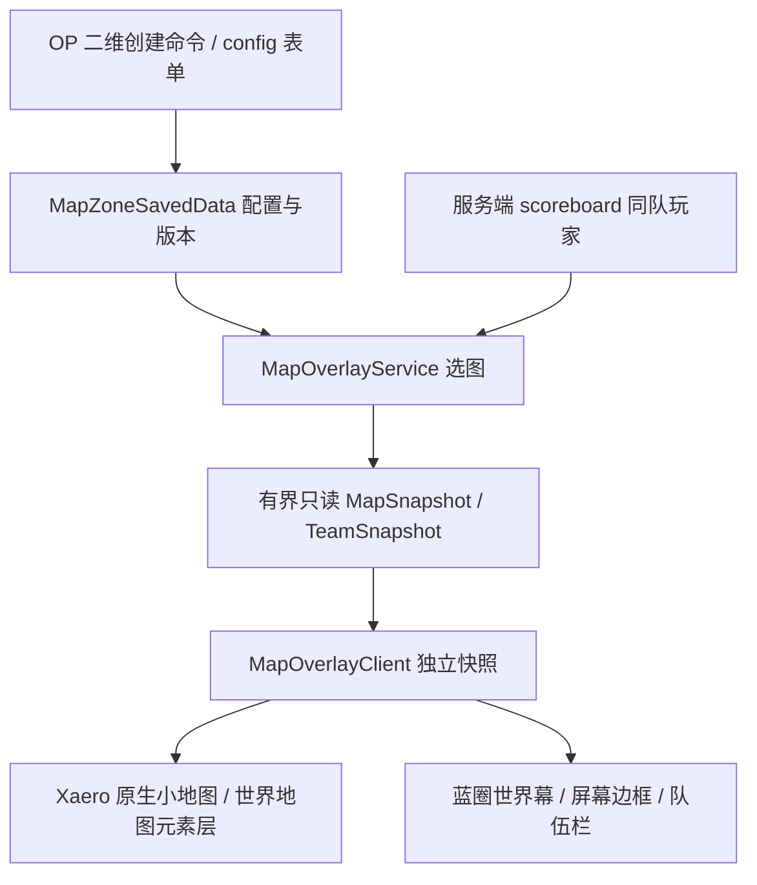

# Xaero 地图叠加、蓝圈视觉与 PUBG 玩法差距

更新：2026-10-18。Minecraft 1.21.1 / NeoForge 21.1.259 / TaCZ PUBG Addon。

## 本轮实施结果

当前 Xaero 小地图与世界地图可以叠加本附属的地图和圈。已实现原生元素层适配，不是导出静态图片或另盖一个小地图窗口。

| 内容 | 当前显示 |
|---|---|
| 地图范围 | 灰色矩形边界 |
| 安全区 | 白色圆周，越界部分裁剪 |
| 蓝圈 | 地图内、安全圆外的透明深蓝填色与稀疏闪电；不会覆盖安全区 |
| 轰炸区 | 完整透明红色圆面与圆周，可同时显示多个；越界部分裁剪 |
| 航线 | 黄色虚线与起点→终点方向箭头 |
| 队友 | 同维度、地图内彩色标记和编号；世界地图另有名字 |
| 队伍状态 | 屏幕右侧同队名单、生命条与普通死亡标记 |
| 蓝圈世界效果 | 深蓝透明圆柱边界，白色亮芯、蓝晕与分叉闪电 |
| 蓝圈内屏幕效果 | 四周深蓝渐变和闪电纹路，中央留空 |

**平时只显示配置预览；明确开局后启用蓝圈伤害。** `/pubgdebug startMatch [地图编号]` 开始，`endMatch` 结束，`matchInfo` 查看状态，均有地图编号补全。HUD 区分“配置预览”和“对局进行中”。尚未实现自动缩圈、投弹、飞机、跳伞或胜负结算。红区仍表示已配置区域，当前不轰炸。完整规则见[蓝圈对局命令](蓝圈对局命令.md)。

图层跟随 Xaero 平移、缩放和小地图旋转，支持圆形/方形裁剪；不同维度不混画。不改原 Xaero JAR，不写它的航点和地图区块缓存。

## 颜色与透明程度

`/pubgdebug config → 地图/圈 → 选择地图 → 颜色`。

六个颜色输入分别控制安全区边界、蓝圈、轰炸区、闪电、地图边界与航线。可以输入六位 RGB（例如 `1549D8` 或 `#1549D8`），也可以点击右侧色块打开 24 色色板；大小写都接受。实时色块显示当前输入，格式错误时保留原文并阻止保存，不会悄悄替换成默认值。

四个 **不透明度** 输入范围为 0–100%：地图蓝区、地图轰炸区、世界蓝幕、圈内屏幕边缘。0 表示完全透明，100 表示完全不透明。默认蓝色 `#1549D8`、红色 `#EF3038`；对应四项默认值为 38%、38%、34%、26%。世界闪电和圈内闪电的可见程度跟随相应蓝幕/屏幕不透明度。

选择色板、输入、切标签和窗口缩放只修改草稿。**保存地图**后才更新当前地图，最多约 10 个服务端 tick 同步给其他玩家。原生地图编辑器先显示草稿配色；恢复默认只改当前草稿。每张地图独立保存配色，新增/移除圈或航线不重置已选颜色；旧地图没有颜色字段时采用新默认值。

### 本次填充缺失的原因

用户截图中只有白/红圈线，是旧填色面的顶点顺序与 Minecraft GUI 正面顺序相反，被默认背面剔除隐藏。现统一为原版 GUI 的正面绕序；没有通过关闭全局剔除来掩盖问题。轰炸圆改为裁剪后的完整三角扇，避免小圆被旧扫描条带漏掉。蓝区闪电整条笔画裁剪到蓝区、地图及小地图蒙版，圆内保持清楚。

根因依据与离线检查见[填充修复证据](../logs/xaero-zone-fill-fix-evidence.md)。GUI 使用 [NeoForge 1.21.1 Screen / GuiGraphics](https://docs.neoforged.net/docs/1.21.1/gui/screens/)，保存沿用 [SavedData](https://docs.neoforged.net/docs/1.21.1/datastorage/saveddata/) 与既有权限/版本检查。

## 离完整 PUBG 游玩还差什么

按当前源码和 `run/mods` 核查，不把配置字段或研究报告当作已运行的玩法。

| 环节 | 当前已有 | 尚缺内容 | 建议顺序 |
|---|---|---|---|
| 对局生命周期 | 明确开始/结束、独立 UUID、运行快照、服务器重启不续局 | 报名、准备、结束清理、自动重开和胜负驱动 | 1 |
| 缩圈 | 静态安全圆、范围判断和显示 | 当前圈/下一目标圈、阶段表、等待/预警/收缩计时、抽圈规则 | 2 |
| 蓝圈伤害 | 仅开局后服务端结算，地图/圆周/维度裁剪、创造/旁观免疫、重叠取最大 | 分阶段伤害、与缩圈/淘汰流程联动 | 2 |
| 投送 | 二维航线、GUI、方向箭头 | 飞机、上机、跳出、自由落体、开伞、落地保护 | 3 |
| 队伍 | scoreboard 同队、远处队友位置和生命同步 | 房间/组队流程、人数和友伤规则、队伍存活判定 | 4 |
| 击倒、救援、淘汰 | Minecraft 普通生命和死亡 | DBNO、流血、救援动作/计时、中断和淘汰身份 | 4 |
| 胜负、观战 | 有运行态和独立 UUID | 存活人数/队伍、击杀归属、排名、获胜、队友观战和重连策略 | 4 |
| 轰炸结算 | 红区、频率/伤害/半径参数、叠加显示 | 随机落点、预警、导弹/爆炸、范围伤害和屋顶遮挡；按约定保护建筑 | 5 |
| 物资流程 | 地板标记、面积密度、独立权重、配弹、F 拾取 | 开局自动刷新与本局关联、地图/阶段物资表、补给箱/空投调度 | 6 |
| 死亡物资 | 普通丢弃物可转为地面物资 | 有归属的死亡盒、整理界面、淘汰后背包转移 | 6 |
| 医疗、能量、护具 | 原生生命、背包、护甲和 TaCZ 武器 | PUBG 治疗/能量、使用动作、负重、背包等级、头盔/防弹衣耐久与伤害映射 | 7 |
| 投掷物 | 已完成调查 | 当前未部署对应投掷物模组；手雷、烟雾、震爆和燃烧等尚未接入本玩法 | 7 |
| 载具与移动 | Minecraft 原有移动 | 汽车/摩托、乘员、燃油、翻车；姿态和声音策略 | 后续 |
| 弹药、配件统一 | 瞄具实验适配、枪械平衡及弹药研究表 | 子弹与其他配件实验选项尚未执行完整统一兼容规则 | 后续 |
| 地形改变与赛后恢复 | 方块/方块实体备份、哈希跳过相同区块 | 对局破坏规则、来源/预算、结束后自动恢复与失败恢复 | 后续 |
| 假人战斗 | Carpet 可提供假玩家 | 寻路、搜物资、瞄准、射击、战术与协作 AI；地图标记不会提供 AI | 后续 |

最小可玩下一步应先接通“本局状态 → 圈阶段 → 伤害/淘汰 → 胜负”，再扩充飞机、医疗和载具。圈的显示不能替代一局可结束、可重开的游戏。

PUBG 官方玩法介绍将跳伞、搜物资和收缩扣血的蓝圈列为基本流程；遥测还区分当前安全圈、预警圈、红区及击倒/救援事件。这是上述拆分的参考，不是声称已复刻全部模式。[官方玩法介绍](https://www.pubg.com/en/game-info/overview)、[遥测对象](https://documentation.pubg.com/en/telemetry-objects.html)、[遥测事件](https://documentation.pubg.com/en/telemetry-events.html)

缩圈数值应先固定普通/排位和目标版本。PUBG 在 42.1 曾修改早期安全区和动态蓝圈规则，不能直接照搬多年前的阶段表；本次没有硬编码阶段数、时长和伤害递增表。[官方 42.1 更新](https://www.pubg.com/en-asia/news/10179?category=patch_notes)

## 二维创建命令与配置

管理命令仍要求玩家身份及权限等级 2。以下参数中**没有 Y**：

```mcfunction
/pubgdebug createMap -512 -512 512 512
/pubgdebug createSafeZone 0 0 400
/pubgdebug createBombingZone 120 -80 40
/pubgdebug createFlightPath -512 0 512 0
```

依次为矩形两角 X/Z、安全圆心 X/Z 与半径、轰炸圆心 X/Z 与半径、航线两端 X/Z。创建地图后自动选中，圆和航线归属它。已有安全区/航线不会被创建命令覆盖，在 config 调整，航线另可：

```mcfunction
/pubgdebug removeFlightPath
```

二维相对坐标也支持：

```mcfunction
/pubgdebug createMap ~-128 ~-128 ~128 ~128
/pubgdebug createBombingZone ~ ~ 24
```

采用 `Vec2Argument.vec2(false)`，整数不加 0.5，`~` 相对执行位置解算；不支持 `^`。以前带 Y 的语法停用。航线两端必须在地图内且不能重合。

`/pubgdebug config` → **地图/圈**含地图、安全/蓝圈、轰炸区、航线、颜色，以及“地图编辑”原生 Xaero 界面。航线可创建、调整、移除、保存，预览画黄色箭头。旧地图缺少航线时保持为空，存档格式版本和原地图编号保留。

## 原生地图编辑与配置地图物品

取得附魔地图物品：

```mcfunction
/give @s tacz_pubg:pubg_config_map
```

右键打开完整 config，服务端仍检查 OP 权限。物品只借用原版已使用地图的模型，不分配或修改原版地图存档。

`地图/圈 → 新建或选择地图 → 地图编辑` 打开真实 Xaero `GuiMap`，由其原生代码绘制已记录地形、地图样式、缩放和平移。需要已安装的 World Map 1.47.0 及已就绪、维度匹配的地图会话；不会用错误维度底图。若要编辑其他维度，先在 Xaero 地图切换到对应维度。

- 工具 1–6：平移、选择、地图矩形、安全区、轰炸区、航线。
- 地图矩形拖两个角；圆从圆心向外拖出半径；航线从起点拖到终点。
- 选择圆面、航线或地图边界后拖动移动；方形手柄调整圆半径、矩形角和航线端点。
- Delete/“删除选中”删除草稿对象；地图本身的删除回到原服务器删除确认流程。未保存新地图只放弃草稿。
- Ctrl+Z / Ctrl+Y 撤销、重做，最多保留 64 步；Esc/右键先取消当前拖拽，放弃编辑会明确确认。
- “应用草稿并返回”只更新 config 草稿；必须再点“保存地图”才提交服务器。边界调整使既有圆心或航线出界时，操作回滚并提示，不偷偷删除已有对象。

编辑器不走 Xaero 的建航点/导出/设置快捷路径。正常世界地图仍显示服务器配置，编辑器世界图层优先显示本地草稿。原生接口核对见[编辑器 API 证据](../logs/native-editor-api-evidence.json)。小地图注册修复了兼容包装子类的父字段查找错误，证据见[小地图注册核对](../logs/xaero-minimap-registration-fix-evidence.md)。

## 选图与队友

优先显示当前位置实际生效的运行地图：在多个运行蓝圈内时选择每秒伤害最高的一张，再按最早编号；否则选择当前位置内的运行地图。没有命中运行地图时，管理员显式选择的同维度地图优先，走出矩形后状态栏显示“地图外”；其他情况选择包含玩家的最小面积地图，再按最早编号。普通玩家不需要 OP 即可接收只读显示数据，不能借此编辑地图。

地图外的普通玩家不自动选图；没有安全圆不绘制蓝圈。保存/创建/删除、开始/结束后最多约 10 个服务端 tick 更新。地图只在版本、运行状态、选择或维度变化时同步，不每帧传整张配置，也不发送地形区块。每张运行地图有独立 Match UUID；同时显示一张，重叠蓝圈伤害在服务端取最高值，不相加。编辑器仍独立显示本地草稿，不被普通 HUD 的运行地图优先规则覆盖。

队友按本次确认使用 **Minecraft scoreboard 同队**，例如管理员可将现有玩家/Carpet 假人加入同队：

```mcfunction
/team add pubg_squad1
/team join pubg_squad1 @s
/team join pubg_squad1 Bot1
```

将 `Bot1` 替换成实际名称。无队伍时无队友标记；不发送敌人、无队伍玩家或旁观玩家的位置。仅同步同维度队友，排除自己；Carpet 假人作为服务端玩家时采用相同规则。

位置和普通生命值每 10 个服务端 tick 更新，编号按全队 UUID 排序，各客户端一致。右侧名单最多 8 名，地图同步列表最多 256 名。超过 60 个未暂停客户端 tick 无更新则清除旧队友；退出服务器也清空。生命条/灰色死亡标记表示 Minecraft 普通生命状态，不是 PUBG 击倒条或本局淘汰身份；原版复活后会再次按存活玩家显示。

## 蓝圈视觉实现

沿用已确认定义：安全区为地图矩形与安全圆的交集，蓝圈为地图内、安全圆外的部分；必须匹配维度。

**安全侧看向蓝圈：**围绕安全圆绘制深蓝透明竖直幕，叠加在幕后的场景上形成透明蓝色着色，边界附亮芯、蓝晕与分叉闪电。保留深度测试，前方建筑与地形可以遮住效果；相机上下 192 格覆盖，上下渐隐；闪电按世界高度锚定，蹲下或下落时不拖动闪电。不替换整个世界的天空、雾或光影颜色。

只生成附近圆弧，最多 160 段、16 条世界闪电，距离上限 256 格并受当前渲染距离限制，先裁剪到地图矩形。不为显示远处边界加载区块；太远的世界幕不画，地图上的圈仍显示。闪电按游戏时间连续缓变，不做全屏突闪。

**摄像机处于蓝圈：**按实际相机 X/Z 判定，支持第三人称/旁观镜头。屏幕四周显示深蓝渐变带与白色折线纹路，中央透明，四角不重复叠加多倍透明度。没有安全区、地图外、维度不匹配、隐藏 HUD 或打开界面时不染屏。

这些客户端效果只消费只读快照。开局后地图和 HUD 使用该局不可变快照，服务端独立结算伤害；结束后回到配置预览。运行中的地图禁止保存/删除，避免编辑时改变伤害范围。

## 实现结构与 Xaero 适配



`MapOverlayPayloads`校验地图大小、队友数量、有限坐标、维度、重复 UUID 和顺序；无服务端写入请求。`MapOverlayClient`处理旧包、退出、队友过期和当前维度。`BlueZoneVisuals/BlueZoneVisualGeometry`负责世界/HUD及有界裁剪，`MapOverlayHud`负责状态和队伍栏。

适配固定为已安装的 **Xaero Minimap 26.6.0 / World Map 1.47.0**。两端使用公开元素渲染入口；小地图投影还需要反射读取私有字段，因此版本精确门控。缺少模组、版本不同或接口异常，仅停用对应可选适配并记录原因，不阻止游戏加载。

无 Mixin、不捆绑 Xaero 类，不安装额外桥接库。原生回调平移、缩放和旋转已核对；世界地图使用原始像素平面，标签连同字体宽高/阴影完整裁剪。证据见 [API 与字节码核对](../logs/xaero-overlay-api-evidence.md)、[投影字段签名](../logs/xaero-overlay-field-signatures.txt)。开发者说明见 [Xaero 作者页面](https://modrinth.com/plugin/xaeros-world-map)；网络接口遵循 [NeoForge 1.21.1 payload 文档](https://docs.neoforged.net/docs/1.21.1/networking/payload/)。

## 验证与边界

统一 `build` 成功，产物 `neoforge-1.21.1/build/libs/tacz_pubg-1.0.0.jar`。开发实例下次自行启动加载当前源码，不需重复放入同实例 `run/mods`。配置协议升级，联机双方需当前构建。

- 地图、二维解析、航线、持久化：888 项通过。
- 六位 RGB、旧地图默认、配色保存/同步及命令保留：2,086 项通过。
- 颜色草稿、无效输入、百分比边界、恢复默认：170 项通过。
- 选图、维度、只读编码、运行标识、重叠运行地图优先与边界：50 项通过。
- 原生小地图兼容层字段绑定：42 项通过。
- 开局状态与伤害几何：6,194 项通过。
- 原生地图编辑事务与坐标投影：75,048 项通过。
- Xaero 投影、旋转、裁剪、完整标签、面绕序、整圆填充与完整闪电笔画：81,119 项通过。
- 蓝圈附近圆弧、地图裁剪、中央透明、连续闪电：24,096 项通过。
- 既有物资、拾取、枪械方案、区域、备份及哈希检查通过。

记录：[本次统一构建](../logs/native-map-match-drop-build.log)，[上轮颜色与填充构建](../logs/zone-colors-build.log)，[早期叠加构建](../logs/map-overlays-build.log)。本次修改前备份：`logs/source-backups/2026-10-18-native-map-editor/`。

统一构建共 39 个任务，成功完成。产物检查确认包含配置地图、蓝圈伤害类型及标签、原生编辑器和小地图父字段适配；尺寸资源为 v4，未捆绑 Xaero 类或其嵌套库。见[产物核对](../logs/native-map-match-drop-artifact-audit.json)。同轮物品大小调整见[原生掉落物尺寸](物资使用原生掉落物尺寸.md)。

**没有启动 Minecraft、客户端、服务器或世界。** 使用原版/NeoForge 渲染接口，但未实测 Iris 下最终颜色、深度遮挡或地图图层位置。构建与几何检查不能替代游戏内画面验收。
