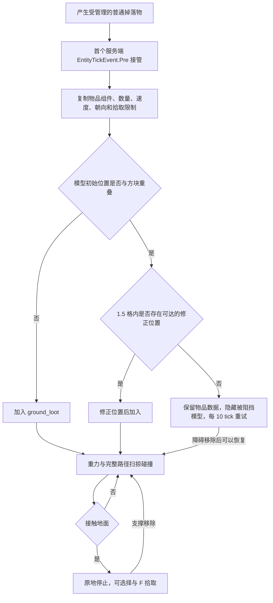

# 地面物资重力与防穿模方案

更新：2026-10-18。Minecraft 1.21.1 / NeoForge 21.1.259 / TaCZ NeoForge r7。

**本文以下为上一轮的大模型碰撞方案记录，已按用户反馈撤回相关尺寸及空中提前转换。当前已恢复 0.22×0.13 格小箱，允许模型边缘穿模，空中采用原版运动、落地后转换，同时保留地面重力。运行时不再读取下文装配包围资源。当前实现、停顿原因与验证请阅读[恢复小碰撞箱与抛出停顿修复](恢复小碰撞箱与抛出停顿修复.md)。**

## 原因与结果

此前本附属为固定地面物资设置了 `noPhysics=true`、`NoGravity=true`，并逐 tick 清零速度。这样虽然停止了落地物品的运动，也让移除支撑后的物品停在空中。这是本附属的物理实现问题。

现在抛出后的空中运动与落地后的静止统一由 **`tacz_pubg:ground_loot`** 管理。它继承原来的抛出速度，受到重力，碰地停止；脚下支撑被移走后继续下落。固定水平朝向、玩家视角 ±15°、模型大小、完整组件、数量和拾取限制继续保留。

注册名不变，也不需要重新注册几百种物品实体。接管范围继续为 TaCZ 的枪械、弹药、配件，以及当前存档已保存物品概率列表中的普通物品和方块，包含权重为 0 的条目。

## 处理流程



不会等待原版小碰撞箱先落地再转换。否则长枪的枪口已经可能穿进墙里，而原版 `ItemEntity` 在自身小箱重叠时还有临时关闭碰撞、尝试脱离的路径，不适合作为完整枪械的物理载体。

## 重力与连续碰撞

服务端每 tick 执行：

```text
本次位移速度 = 上次速度 + (0, -0.04, 0)
扫描完整模型包围盒沿本次位移经过的全部空间
计算最早碰撞时刻，只移动到接触位置
被阻挡方向的速度归零；其余方向乘 0.98
若向下碰到支撑面，全部速度归零，进入静止状态
```

`.04` 与 `.98` 分别采用原版普通掉落物的重力和阻尼数值。不新增持续旋转、翻滚或落地弹跳。

`GroundLootPhysics` 使用连续扫掠 AABB 的首次接触计算，不只检查终点，也不把斜向移动拆成互不相连的三个轴路径。因此高速物品不会因一 tick 跨过薄墙而漏掉碰撞，客户端在同一段路径上做直线插值时也有对应的安全路径。碰墙后剩余切向速度留到下一 tick 处理；向下撞地则按用户要求直接停在接触处。

静止状态仍逐 tick 探测重力，支撑消失后自然转为下落。旧存档中保存的 `NoGravity` 会在读取时取消，合法 `Motion` 保留；旧物资下次加载时重新检查支撑，无需执行 `itemRespawn` 才能恢复重力。

## 碰撞尺寸与模型

`GroundLootFootprints.physicsBounds` 给服务端提供数值包围，随固定 yaw 转为世界坐标 AABB。既覆盖地面姿态，也覆盖整个空中路径。真实方块的碰撞形状参与计算，半砖、台阶、栅栏不按整方块处理。F3+B 显示的载体范围现已随模型包围更新。

| 物品情况 | 碰撞依据 |
|---|---|
| 普通未装配枪械 | 已审核的当前默认模型数值包围 |
| 有装弹、膛内弹、显式配件或可用 LOD 的枪械 | 离线装配包围，包含枪体变体、装弹部件、配件挂点及可用 LOD |
| TaCZ 弹药、配件 | 已审核的实际三维或图标包围，沿用薄片 0.38 规则 |
| 已配置的普通物品、方块 | 保守的一格立方包围；特殊第三方动态模型需要单独适配 |

装配资源覆盖 424 把枪、211 个有效立体配件模型、193 个实际存在的 LOD。178 个声明但没有资源的 LOD 按 TaCZ 原有回退行为处理。资源由 `scripts/generate-ground-loot-assembly-envelopes.py` 生成，服务端不加载客户端 GPU 模型，也不接受客户端上报的碰撞尺寸。

本次另外发现两个配件将激光光束当成了实体外形：`classicr:sight_canted_laser` 和 `suffuse:sight_dbala2`。后者旧深度约 256.26 格。现在按确切资源 ID 与骨骼名排除特效光束，同时保留激光盒及镜身；绘制、默认尺寸生成和装配包围使用一致规则。749 项默认资源中仅这两项尺寸发生变化。

AABB 是模型的保守外包围，不是逐三角形刚体：斜放长枪、某些大附件在窄处可能提前碰墙。包围不会为了塞进房间而缩小枪模。新增枪包、动态模型或改动模型后，需要重新生成默认占地及装配包围并构建。

## 初始重叠与缺少空间

玩家可以贴着墙丢出一把长枪，原版小载体起点合法，但完整模型可能已在墙内。新实体首包发送前先运行 `prepareSpawn`，只修正初始位置，不提前推进一 tick 的速度。

恢复算法检查附近障碍边界，最多考察 125 个平移候选，距离不超过 1.5 格；候选必须让完整模型脱离重叠，同时原小载体沿直线路径可达，防止把枪挤过薄墙搬到另一间房。允许必要的向上或向下修正，但不能越过实际地板或天花板。

找不到可达空位时进入 `BLOCKED`：数据保留、模型隐藏、速度暂停、每 10 tick 重试，并首次记录日志。这种极窄位置需要移开障碍，不能同时保证完整长枪仍在原起点、可见且完全不穿墙。不会删除物品或随机传到远处。旧实体加载时若已有重叠，使用相同恢复规则。

只读取已加载区块。模型可能经过的未加载区块作为临时边界，等待区块自然加载；不为掉落物强制加载远处地形。单次查询设有 32,768 格预算，超预算先停止速度，防止异常数据造成无界扫描。

## 同步、拾取与刷新

- 服务端独立计算物理，实体位置更新间隔为 1 tick；客户端真实实体只插值，不重复施加重力。
- 转换通知增加初始速度，网络协议从 3 升到 4。新旧模组版本不能混用。
- 等待真实实体时，临时客户端视觉体用相同重力和碰撞预测；目标同步后跟随目标，准备完成 1 tick 后交接。它不拥有服务端物品、不能拾取或保存。
- 初始模型重叠、路径不可达或目标被阻挡时隐藏过渡模型，避免展示穿墙插值。真实客户端实体首两 tick 另有重叠保护。
- 落地后才能轮廓选择及 F 拾取，服务端也核对静止状态、距离、遮挡、拾取延迟与受限 UUID。
- 加入新实体成功后才清空删除原掉落物。插入失败保留原物，不重新随机数量、配件或装弹状态。
- 自动生成物资即使后来掉到楼下，`itemRespawn` 仍按原始区域锚点清理；玩家丢弃来源继续排除在刷新清理之外。
- `itemRespawn` 的初始放置也采用相同物理包围，避免先生成在合法小箱位置、随后发现完整模型穿墙。空间不足仍按已有整区域刷新失败与旧物资保留规则处理。

目前采用方块碰撞和固定姿态，不模拟实体之间的堆叠、流体漂浮、刚体翻滚或扭矩。与此前原版空中载体相比，水中也由统一重力接管。

## 代码与验证

| 文件 | 作用 |
|---|---|
| `lootspawn/GroundLootEntity.java` | 物品持久化、物理状态、模型碰撞箱、服务端 tick 和客户端插值 |
| `lootspawn/GroundLootPhysics.java` | 无世界依赖的重力、阻尼、连续扫掠求解 |
| `lootspawn/GroundLootWorldPhysics.java` | 已加载方块形状、世界边界、初始重叠恢复与物理调度 |
| `lootspawn/GroundLootFootprints.java` | 默认与装配数值包围、朝向转换 |
| `lootspawn/DroppedLootService.java` | 首次原版 tick 前转移物品所有权与速度 |
| `lootspawn/client/DroppedLootTransitionClient.java` | 网络到达期间的临时视觉预测和交接 |
| `assets/tacz_pubg/ground_loot_assembly_envelopes.json` | 424 把枪的装配包围资源 |

统一 `build` 成功，日志见 [loot-gravity-build.log](../logs/loot-gravity-build.log)。主要离线结果：

- 重力与完整路径扫掠：13,333 项，包括高速、斜向、薄墙、地板、台阶、栅栏、天花板和持续静止。
- 初始重叠恢复：11 项，包括贴墙、低顶、地板与墙角、薄墙不可穿越、封闭窄走廊。
- 客户端过渡：57 项；网格几何与特效过滤：79 项。
- 装配包围包含性随机检查：50,000 项；资源覆盖：424 项，见 [数值检查记录](../logs/ground-loot-envelope-interval-checks.json)。
- 既有数量、配置目录、区域、枪械方案、地图、备份和哈希检查全部通过。

按用户要求，没有启动 Minecraft、客户端、服务器或世界；以上结果不代表全部模型、光影及延迟环境已经完成游戏内画面验收。产物为 `neoforge-1.21.1/build/libs/tacz_pubg-1.0.0.jar`，开发实例下次自行启动时直接加载源码编译结果，不要重复放入同实例 `run/mods`。

修改前文件保存在 `logs/source-backups/2026-10-18-loot-gravity/`。来源 HMCL 安装、原枪包、用户键位和存档文件未改写。

使用的官方接口依据：[NeoForge 实体数据同步](https://docs.neoforged.net/docs/1.21.1/networking/entities/)、[事件总线](https://docs.neoforged.net/docs/1.21.1/concepts/events/)，以及本地展开的 Minecraft/NeoForge 1.21.1 源码。物理状态通过本模组自己的 `SynchedEntityData` 定义，物理算法由本附属实现。
