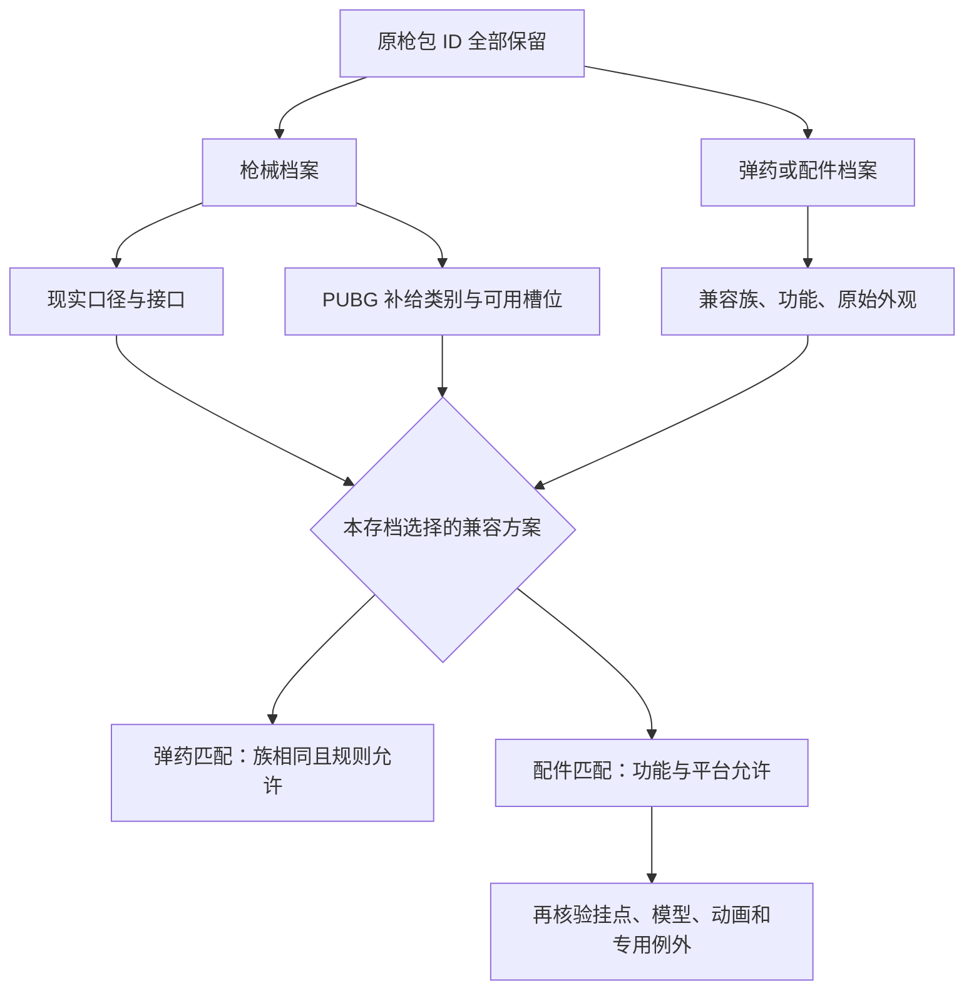

# 弹药与配件统一兼容：清单、建议和实现边界

调查日期：2026-10-18（Asia/Shanghai）。对象：本工作区 Minecraft 1.21.1 / NeoForge / TaCZ 1.1.8-hotfix-r7，当前 `run/tacz/` 的默认包目录与八个 ZIP。目标是**保留全部注册 ID，扩大有理由的供弹和配件兼容关系**。本轮没有改运行枪包、存档配置或业务代码，也没有启动 Minecraft。

## 先看这些文件

| 文件 | 用途 |
| --- | --- |
| [全枪械当前兼容逐项](compatibility/全枪械当前兼容逐项.md) | 每把枪的当前弹药 ID、开放槽位、允许附件、固定内置附件和专属属性记录 |
| [全弹药与配件注册清单](compatibility/全弹药与配件注册清单.md) | 全部弹药/配件索引及反向使用枪械，包含缺资源和无使用者的条目 |
| [枪械表 CSV](compatibility/guns.csv) | 可搜索、筛选的枪械总表 |
| [弹药表 CSV](compatibility/ammo.csv) | 弹药 ID、当前显示名、引用枪械和来源 |
| [配件表 CSV](compatibility/attachments.csv) | 配件类别、参数、模型声明、隐藏标记和来源 |
| [枪械—配件关系 CSV](compatibility/gun-attachment-edges.csv) | 按当前数据规则推导的可安装关系 |
| [完整 JSON](compatibility/compatibility-inventory.json) | 机器可读取的索引、原始引用、关系及异常记录 |
| [现实依据与建议](弹药配件现实依据与兼容建议.md) | 现实口径/接口与 PUBG 玩法抽象的详细依据、官方来源 |
| [配件模型兼容审查](配件模型兼容审查.md) | 全部配件分类，以及挂点、转接模型、动画、LOD 的限制 |

TaCZ 的这些 ID 是枪包资产索引；并非每种弹药或配件各注册一个 NeoForge Item。通常分别共用 `tacz:ammo`、`tacz:attachment`，用物品组件里的 AmmoId / AttachmentId 区分资产。保留注册在这里主要指保留这些原资产 ID、索引和引用。

完整清点脚本为 [`scripts/audit-ammo-attachment-compatibility.py`](../scripts/audit-ammo-attachment-compatibility.py)，本轮数据/链接核对记录为 [`logs/ammo-attachment-compatibility-report.json`](../logs/ammo-attachment-compatibility-report.json)。脚本只读运行资源，将报告写入 `docs/compatibility/`；这些报告中的 `run/...` 来源路径相对于 `neoforge-1.21.1/`，`ZIP!entry` 表示压缩包内资源。

以下关系来自当前文件和固定 r7 源码的静态分析。配件表的“当前允许”指**资产可解析、枪械开放该类型槽位、允许标签匹配**；不代表已经实机验证模型、动画、枪械锁或特殊附属逻辑。空槽情况下的允许范围与当前玩家那把枪实际装了什么也不同。

## 本轮实际清点结果

| 内容 | 结果 |
| --- | ---: |
| 当前枪包 | 9 个（1 个目录、8 个 ZIP） |
| 另行检查的模组 JAR | 43 个，未发现额外直接枪/弹药/附件索引 |
| 枪械索引 | 431 个；424 个通过本轮服务端索引/数据静态条件，7 个缺枪械数据 |
| 弹药 | 81 次索引声明，去重后 78 个 ID；424 条枪械供弹关系使用其中 68 个 |
| 配件 | 247 个 ID，均有合法类型与 data 引用；包含 12 个 hidden 条目 |
| 枪械—配件当前允许关系 | 29,290 条 |
| 标签允许、但槽位关闭 | 450 条，单独标记，不作为可装配关系 |
| 核心枪/弹药/配件索引及 data 语义冲突 | 0 |
| 同路径附件标签不同数组 | 32 组，按 r7 并集合并 |
| 缺失引用标签 / 标签环 | 11 / 0 |

这里的 247 是当前附件索引/data 的结构候选数，不能沿用此前地面模型清点中的 245 作为全部附件注册数。模型文件是否存在、是否有意仅用图标、是否依赖枪内骨骼是另一组检查；例如 `classicr:muzzle_silencer_default` 的模型引用缺文件，结构索引仍可以存在。

七个缺数据的声明是 `hamster:colt1873_lb`、`hamster:coltm1851_chain`、`hamster:lebel1886_07c`、`hamster:lugerp08_artillerie`、`hamster:m1887_hc`、`hamster:uppercut`、`suffuse:knife`。报告保留其声明和错误，不把它们伪装成已成功注册的枪。

十种没有有效枪引用的弹药也保留在反向清单中，包括 `tacz:762x39copper`、`tacz:762x54r` 等。无引用不等于应删除；它们恰好可能成为新增别名后可以使用的补给。

## 我建议采用的总体规则

建议采用两层身份：**原物品 ID + 兼容族**。原 ID、外观和来源继续保留；供弹/安装时判断兼容族及该枪的平台能力。不要把模型、伤害、容量、配件效果和兼容身份全部压成一个字段。

另为每把枪保存两种分类：`real_caliber_family` 表示核验过的现实口径，`pubg_supply_family` 表示这局游戏使用的补给类别。这样能明确表达“AKM、M24 在 PUBG 共用 7.62 补给”，同时保留 ×39 与 ×51 等现实区别。PUBG 档只影响明确加入 PUBG 武器池的枪；额外历史、科幻枪不凭名字自动改口径。

## 弹药：建议统一哪些类型

下面是**建议名单，不是已经应用的补丁**。同一个族允许多个原 ID 被相应枪械接受，不要求删除任何索引。名称中的缩写只作为候选线索；当前显示覆写、专用效果和未知口径须保留人工核验。

| 建议族 | 当前 ID 示例 | 建议程度与边界 |
| --- | --- | --- |
| PUBG 5.56 | `cbrg:ammo_556`、`tacz:556x45`、`ccrp:556x45_m855`、`ccrp:556x45_m995` | 优先统一普通补给；M855/M995 先保留弹种身份。如决定保留特殊弹种效果，不把其效果随别名一起抹掉 |
| 9mm / 9×19 游戏补给 | `cbrg:ammo_9mm`、`tacz:9mm` | 优先统一。不能把 `cib:9x39mm`、`tacz:9x39` 只因含 9 字样就加入现实 9×19 族 |
| .45 ACP | `cbrg:ammo_45acp`、`tacz:45acp` | 优先统一同类补给；不把所有 .45 枪弹或所有手枪弹合并 |
| 12 Gauge | `cbrg:ammo_12g`、`tacz:12g` | 优先统一普通霰弹补给。与 .410、23mm、独头弹效果分开 |
| 5.7×28 | `cbrg:ammo_57mm`、`tacz:57x28` | 优先统一已确认的 5.7 类；与 5.56、4.6×30 分开 |
| 5.45×39 | `tacz:545x39`、`suffuse:545x39` | 同完整口径的跨包候选；`ccrp:545x39_beans` 是特殊条目，先不作为普通弹药别名 |
| 7.62×39 | `tacz:762x39`、`tacz:762x39copper` | 适合现实分类档中的同口径候选；是否保留铜壳外观可独立决定 |
| 7.62×54R | `tacz:762x54`、`tacz:762x54r` | 合并候选；前者名字省略 R，需要结合其引用枪型确认，不能只看数字 |
| 9×39 | `tacz:9x39`、`cib:9x39mm` | 同完整口径的跨包候选，与 9×19 分开 |
| .22 WMR | `tacz:22wmr`、`suffuse:.22wmr` | 同类候选，与 `suffuse:.22lr` 分开 |
| 12.7×108 | `cib:127x108`、`suffuse:12.7x108mm` | 同类候选；与 .50 BMG / 12.7×99、12.7×55 分开 |
| 6.8 TVCM | `ccrp:68x51tvcm`、`suffuse:6.8tvcm` | 同名完整型号的候选；不能未经确认把 `tacz:68x51fury` 也当作完全相同的现实标准 |
| PUBG 7.62 统一补给 | `cbrg:ammo_762`，以及选定 PUBG 枪使用的 `tacz:308`、×39、×54R 候选 | **最能减少补给碎片，但属于主动玩法抽象**。建议仅在 PUBG 武器池按逐枪配置启用；不据此声称现实 ×39/×51/×54R 可互换 |

`.223 / 5.56`、`.308 / 7.62×51` 可作为游戏近似类别；现实中不是凭名称近似就能声明所有产品无条件双向通用。[SAAMI FAQ](https://saami.org/faqs/)、[SAAMI 2026-10-12 公告](https://saami.org/saami-announces-acceptance-of-a-new-cartridge-556comm/)

PUBG 官方 30.1 将自然刷新的 SMG 统一为 9mm，包含 Tommy Gun 与 UMP。这需要**逐枪指定 PUBG 补给类别**，不能简单把 `.45 ACP → 9mm` 做成全局弹药别名，否则原本应继续使用 .45 的手枪也会一起被改掉。P90 另保留 5.7 类；本文依据官方公告记录其设计来源，并不把历史公告的全部数值当作未来版本保证。[PUBG 30.1](https://www.pubg.com/en-asia/news/7424)、[PUBG 13.2](https://www.pubg.com/en-asia/news/1369)

需要单列的条目：

- `tacz:338` 当前索引指向 `.300 Magnum` 名称。不能把它自动当作 .338 Lapua，更不能与 `tacz:300blk` 混成一个“.300”族。
- `hamster:compact_ammo / medium_ammo / long_ammo` 缺少足够的完整口径信息，保留待核验。通用名字不是现实制式证据。
- 电池、能量弹、火箭、信号弹、榴弹以及特殊投射物继续独立；18.4、23mm 等也不因看起来像霰弹就并入普通 12 Gauge。
- `7.62×25` 与 `7.62×39`、`7.65×20` 与 `.32 ACP` 等，不能按前两位数字截断归类。

基础 r7 的 `AmmoIndexPOJO` 主要定义名称、显示和堆叠；伤害等弹道参数主要在枪械 `GunData.bullet`。因此，“某个弹药 ID 名为穿甲弹”不自动证明它有独立的逐发穿甲机制。若要保留不同弹种效果，需要核验现有脚本/附属实现，再单独设计效果通道；不要用显示名推断效果。[AmmoIndexPOJO](../downloads/tacz/r7-source-inspection/com/tacz/guns/resource/pojo/AmmoIndexPOJO.java)、[GunData](../downloads/tacz/r7-source-inspection/com/tacz/guns/resource/pojo/data/gun/GunData.java)

## 配件：统一使用范围，保留不同功能

这里的统一首先是扩大同一功能配件的适用枪型，不是把不同功能都做成一种物品。例如垂直握把、半截握把、拇指握把保留各自效果；同一个垂直握把可以适用于更多已确认的平台。

| 建议类别 | 建议范围 | 必须保留的边界 |
| --- | --- | --- |
| 公共导轨红点/全息/低倍镜 | 优先跨包放通有瞄具挂点、眼位合适的现代枪；`cbrg:red_dot`、`holographic_sight` 等作为公共效果候选 | 手枪底座/高度与步枪不同；隐藏内置镜、AUG/SUSAT/专用侧导轨镜不能自动全通用 |
| 公共中高倍镜 | 先覆盖允许换镜的步枪、DMR、狙击枪，逐枪确认倍率与瞄准定位 | 不因枪有 scope 槽就让所有手枪装 15 倍镜；PUBG 档保留逐枪倍率限制。偏侧镜占唯一 scope 槽，当前不能凭标签变成独立副镜 |
| 普通握把 | 垂直、直角、半截、轻型、拇指等保持不同效果，扩大到有正确下挂结构的枪 | 下挂榴弹器、隐藏结构、带额外行为的模块单独处理；有 grip 权限不等于有 grip_pos |
| 枪口附件 | PUBG 档可按步枪/冲锋枪手枪/狙击/霰弹枪类别共享消音、补偿等效果 | 现实分类还需口径和安装接口；专用枪管、刺刀、鞭子、默认内置枪口不是普通补偿器 |
| 激光器 | 适用于明确有激光安装点的枪，保留激光方向、底座和特殊渲染检查 | `cbrg:laser_sight` 在 grip 槽，不能不改资源/逻辑就挪成独立 laser 槽并与握把叠装 |
| 枪托/托腮板 | PUBG 档按允许换托/托腮板的平台扩大兼容，保留重型/战术等不同效果 | 折叠托、AR 型枪托、SPAS12 专用托、盾牌技能、导气调节件不能仅按 stock 槽统一 |
| 快速/扩容/快速扩容弹匣 | **最值得统一的玩法类别之一**：同枪种共享效果物品，装到枪上仍使用该枪自己的容量、弹匣模型及装填动画 | 相同口径不意味着现实弹匣互换；管式、固定弹仓、弹链和专用换弹机构保留例外 |

从历史型号保真角度，建议把“原型配置”和“现代化改型”分开记录。若某把旧式枪的当前模型没有导轨、握把挂点或可换弹匣结构，不因它也被分类为 rifle 就全开现代配件；以后新增带转接结构的现代化变体，可以共享原枪资产族，但用独立的平台能力表决定安装。这是本模组的分类建议，具体原型接口仍应逐型号找证据。

建议弹匣先按两个维度命名：`适用武器类别 × 功能`。功能固定分成快速换弹、扩容、快速扩容，不能把数字级别当成容量越大越好的等级。

- `cbrg:quickdraw_mag_rifle / extended_mag_rifle / extended_quickdraw_mag_rifle` 当前分别编码为等级 1/2/3。
- 当前 `tacz:light_extended_mag_1/2/3`、`tacz:sniper_extended_mag_1/2/3` 也被赋予快速/扩容/快速扩容语义。
- 当前 AK47 的对应容量数组为 `[30,42,40]`，说明“快速扩容”并非容量最多。
- 其他枪包中同样的 level 可能表示另一套容量/动画，不能直接跨包全放通而不做逐枪效果映射。
- `ammo_mod_*`、`cib:change` 不属于普通弹匣，应保留独立功能类别；详见[模型审查](配件模型兼容审查.md)。

现实弹匣按具体平台区分，不能把上述玩法类别写成 AR、AK、AUG 弹匣实际通用的结论。[Magpul 官方平台目录](https://magpul.com/instructions)

## 可以优先讨论的具体新增关系

这些例子均对照了本轮当前矩阵，**目前未兼容**；右栏是建议，不是已经应用或实机验收的结果。

| 当前情况 | 建议新增关系 | 原因与限制 |
| --- | --- | --- |
| `ccrp:aks74u` 只匹配 `tacz:545x39` | 同时接受 `suffuse:545x39` | 完整口径名称相同的跨包候选；不改变该枪自己的弹道参数 |
| `cib:asval` 只匹配 `cib:9x39mm` | 同时接受 `tacz:9x39` | 9×39 族直接互认；不扩大到普通 9mm 族 |
| `tacz:ak47` 只匹配 `cbrg:ammo_762` | PUBG 档接受核准的 ×39/×51/×54R 补给别名 | 这是 PUBG 7.62 池的便利规则；现实分类档则只选其真实 ×39 族 |
| `tacz:ak47` 不允许 `tacz:sight_t2`，但允许公共 CBRG 红点 | 将 T-2 作为新增公共红点候选 | AK 当前模型有 scope_pos，T-2 display 不要求特定 adapter；仍须核对眼位、导轨显隐与模型碰撞，不能只改标签就宣称适配完成 |
| `tacz:ak47` 允许 `cbrg:extended_mag_rifle`，不允许 `tacz:extended_mag_2` | 将原 TaCZ 二级扩容作为同效果候选 | 两者都选 level 2，可沿该枪的 42 发容量及自身弹匣模型；原附件还有重量/ADS 参数，统一效果时要明确保留或统一这些参数 |
| `tacz:hk416d` 有激光模型挂点，但 data 没开放 laser 槽 | 现实分类档可讨论独立激光槽 | PUBG 档的 `cbrg:laser_sight` 当前与握把共享 grip 槽；开独立槽会改变能否叠装的玩法，不能偷偷一起开放 |

当前也有非常宽的现存关系，例如 `gz:1st_vector45acp` 的标签允许 15 倍镜和多种步枪枪口件。这是枪包目前的游戏规则，不能作为“现实可装”证据。统一工作不能只做加法：若要严格复刻 PUBG，仍需独立的逐枪规则档；默认方案是否收紧既有宽松关系应另行决定，本轮没有改动它们。

## 按固定 r7 实现，需要改哪一层

### 弹药别名必须进入真正的供弹判断

当前 `GunData.ammo` 是单个 ID。`AmmoItemDataAccessor.isAmmoOfGun`、`AmmoBoxItemDataAccessor.isAmmoBoxOfGun` 做完整 ID 相等判断，没有可直接添加的 `ammo_aliases` 数组或弹药标签。

若要求**原 ID 的子弹直接都能装进原枪**，建议附属增加一个窄范围兼容桥：把两边 ID 解析为兼容族，再根据枪械选择的方案判断。保留所有原索引和物品身份，不把所有原数据覆盖成同一个名字。弹药盒也必须同步处理；只改普通弹药判断会留下一半不兼容。

`GunReloadEvent` 不能单独解决这件事：r7 先做 `canReload`，成功后才发事件，不认识的别名会在事件之前被挡住。可选实现是两个匹配入口的定点 Mixin，或使用自定义 `IAmmo` 物品实现；后者需要额外处理原 TaCZ 弹药物品的接入。退弹、库存计数、自动配弹、容器与联机同步都要使用同一张族表，不能只让 UI 显示“兼容”。

对应源码：[普通弹药匹配](../logs/analysis-src/tacz-r7/com/tacz/guns/api/item/nbt/AmmoItemDataAccessor.java)、[弹药盒匹配](../logs/analysis-src/tacz-r7/com/tacz/guns/api/item/nbt/AmmoBoxItemDataAccessor.java)、[换弹事件时序](../logs/analysis-src/tacz-r7/com/tacz/guns/entity/shooter/LivingEntityReload.java)。

较简单的另一条路线是覆盖枪械的单个 `ammo` 为统一 ID，并在刷新/拾取时把旧弹药转换成统一物品。它减少补给种类，但**没有让未经转换的原 ID 弹药直接兼容**，不完全等价于你本次提出的目标，因此不作为首选。

### 配件先加允许标签，再核验槽和效果

当前匹配源是 `data/<namespace>/tacz_tags/attachments/allow_attachments/<gun path>.json`。内容为附件 ID 或 `#配件标签`，递归 OR 匹配；枪械另用 `allow_attachment_types` 开放六类槽。

`exclusive_attachments` **不是白名单或黑名单**，而是某把枪对某个附件的专属属性记录。r7 有专属记录时整体替代全局附件数据，不能假定逐字段合并；嵌套 modifier 的解析也与正常附件 data 不完全相同。组合平衡建议使用已存在的 `AttachmentPropertyEvent`，并核对 r7 实际支持的字段。

对应源码：[允许标签](../logs/analysis-src/tacz-r7/com/tacz/guns/resource/manager/AttachmentsTagManager.java)、[递归匹配](../logs/analysis-src/tacz-r7/com/tacz/guns/util/AllowAttachmentTagMatcher.java)、[槽位判断](../logs/analysis-src/tacz-r7/com/tacz/guns/api/item/gun/AbstractGunItem.java)、[附件属性事件](../logs/analysis-src/tacz-r7/com/tacz/guns/api/event/common/AttachmentPropertyEvent.java)。

增加兼容时还要记录：正常模型与 LOD 的挂点、转接模型名称、瞄具眼位、默认部件显隐、扩容容量、换弹 Lua/动画、特殊 extras 消费者。`display.adapter` 只选择枪本体已有的转接模型子组，不会自动生成转接器。

### 不依赖枪包文件夹名字决定覆盖顺序

固定 r7 的枪包扫描没有排序；重复资源的目录扫描与直接读取还存在不同覆盖次序。普通附件标签按多来源并集处理，新增空列表不能删除旧允许项。后续实施应使用明确优先级的数据包或附属自己的兼容桥，避免修改原包和靠 `zzz` 目录碰运气；标签递归也必须禁止环。

本轮的完整清单会标明重复定义、缺失引用及静态解析边界。动态占槽、附件锁和第三方附属条件不属于“默认空槽兼容矩阵”。

## 实施优先级建议

1. 同完整口径的跨包别名，以及公共红点/全息/普通握把：收益明显、规则易解释。
2. 确定 PUBG 武器池后，按逐枪补给类别统一 5.56、7.62、9mm 等；不把 .45 全局重定向到 9mm。
3. 统一快速/扩容/快速扩容的效果语义，再为每把枪给出容量与换弹映射。
4. 核对枪口、枪托、专用底座和 LOD；转换套件、内置件、下挂武器继续显式适配。

最终玩家面对的是少量清晰的补给类别与配件功能，但所有原 ID 和各枪独特模型仍可保留。以上是可审阅的建议，不是本轮已部署的兼容补丁。
