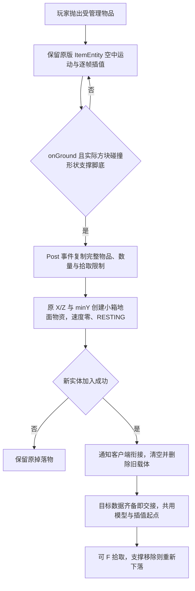

# 恢复小碰撞箱与抛出停顿修复

更新：2026-10-18。Minecraft 1.21.1 / NeoForge 21.1.259 / TaCZ NeoForge r7。

## 当前行为

地面物资恢复原来的实体尺寸：**宽 0.22、深 0.22、高 0.13 格**。这个小碰撞箱不因枪械大小、配件或水平角度扩大。F3+B 显示这一个小箱，枪械显示大小保持不变。

枪口、枪托、镜身等超出小箱的可见部分允许与墙体、地形局部重叠。大范围模型包围只用于可见性判断、准星选取和原有生成摆放检查，不参与运动碰撞，也不会因枪口伸进墙里隐藏整把枪。

重力保留：地面载体的脚下支撑移除后继续下落，小箱通过连续扫掠检测地板、台阶等方块碰撞。落地停止，不持续自旋或弹跳；玩家主动抛出的水平角度仍是视角加 ±15°。

## 抛出停顿的原因

上一轮提前在空中更换实体，引入了两条可以从源码确认的运动暂停路径：

1. 在 `EntityTickEvent.Pre` 中取消原 `ItemEntity` 的 tick，而新加入的载体不会在同一轮实体列表迭代中执行 tick，因此接管这一刻漏走了一次物理更新。
2. 新载体的客户端 tick 只在有位置包时插值，没有沿初始速度移动。生成后到第一份位移包之间，它会停在初始位置；临时过渡模型已经向前预测，又可能追赶这个陈旧位置，形成回退或顿挫。

此外，两个渲染器按整枪包围查询方块碰撞，增加每帧工作量；模型太大时还会隐藏它。这部分开销已经移除，但没有测量帧时间，不能把所有性能卡顿都归因于它。

首次绘制某个枪型或配件组合仍可能产生正常的模型测量与缓存开销。本次没有预热几百种模型，也没有以未经实测的性能结论替代原因分析。

## 修复流程

空中是原版 `minecraft:item`，真正落地后才变为 **`tacz_pubg:ground_loot`**。空中不更换实体，也不取消原版物理 tick。转换时采用已经完成运动后的最终位置，不再额外推进一个物理 tick。

原版物品在落地 tick 中会设置反弹速度；转换时明确清零并初始化静止状态，避免把反弹带进平放地面物资。半砖、台阶和栅栏按实际碰撞顶面核对，不把高度取整。

客户端目标数据到齐后立即交接，取消额外 1 tick 等待，移除反复追赶旧生成点的过程。目标首帧沿用过渡模型的上一位置作为插值起点，终点仍是服务端位置。过渡体只在客户端存在，不持有可拾取物品；等待数据时使用同一个小碰撞箱预测。

已经存在的地面物资也使用新尺寸，下次启动或加载实体时生效，无需重新执行 `itemRespawn`。原版空中物品继续具有原版拾取、合并、流体与生命周期；转换后仍按本附属的 F 拾取、数量和持久化规则处理。玩家丢弃来源继续不被 `itemRespawn` 清理。

## 实现与边界

| 代码 | 改动 |
|---|---|
| `GroundLootFootprints` / `LootSpawnRegistration` | 统一原尺寸常量及客户端临时载体的小箱模板；移除运行时装配包围加载 |
| `GroundLootEntity` | 使用原版按注册尺寸建立碰撞箱；模型可见性范围独立保留 |
| `DroppedLootService` | 改回 `EntityTickEvent.Post`、真实落地后转换；初始化速度零和静止状态 |
| `DroppedLootRenderer` / `GroundLootRenderer` | 移除渲染阶段方块扫描及整模型碰墙隐藏 |
| `DroppedLootTransitionClient` / `DroppedLootTransitionMath` | 立即衔接、保留插值起点、小箱视觉预测 |
| `LootSpawnPlacement` | 恢复此前默认模型占地，不使用上一轮更大的装配上界 |

上一轮生成的装配包围资源、生成脚本和检查记录作为研究历史保留，运行时不再读取它们来扩大碰撞箱。小箱重力仍由服务端计算；客户端真实地面载体只做位置插值。若世界编辑把小箱本身完整埋入方块，既有阻挡保护仍保留数据并等待，不是依据枪械外形判断阻挡。

## 验证

统一 `build` 成功，日志：[small-hitbox-build.log](../logs/small-hitbox-build.log)。

- 重力与连续碰撞检查 **13,342 项**通过，包括新增的小箱穿窄缝、模型边缘可重叠、地板阻挡及移除支撑后恢复下落。
- 客户端过渡 **57 项**通过，覆盖数据未就绪时保留过渡、就绪立即交接、超时边界和角度量化。
- 既有数量、目录、几何、区域、配置、枪械方案及地图备份检查通过。

按用户要求，未启动 Minecraft、客户端、服务器或世界。已修复可以从代码确定的停顿路径，实际动画与帧时间尚未进行游戏内复测。

修改前源码与文档备份：`logs/source-backups/2026-10-18-small-hitbox/`。来源 HMCL 安装、枪包、用户键位和存档未改写。产物为 `neoforge-1.21.1/build/libs/tacz_pubg-1.0.0.jar`，开发实例下次启动直接加载源码编译结果。
