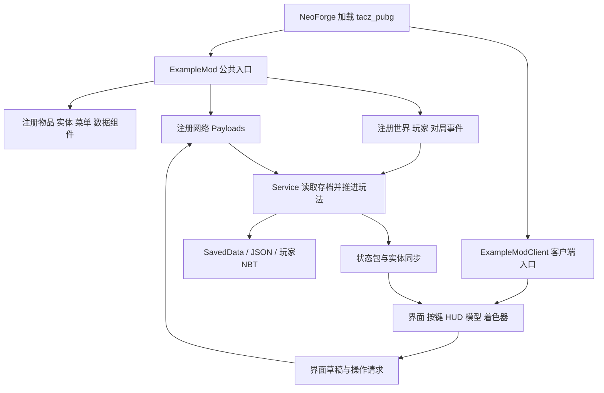

# TaCZ PUBG Addon：代码、玩法与依赖结构

这份文档把工作区按三个层次展开：**一个类保存什么、提供什么；一组类怎样协作；一项玩法从入口到世界变化经过哪些文件。**

源码基准：2026-11-15，`neoforge-1.21.1/src/main/java/com/example/examplemod` 中的451个 Java 文件，以及119个测试源文件。模组 ID 为 `tacz_pubg`，源码包为 `com.example.examplemod`。构建参数与接入声明分别以 [gradle.properties](../neoforge-1.21.1/gradle.properties)、[build.gradle](../neoforge-1.21.1/build.gradle)、[neoforge.mods.toml](../neoforge-1.21.1/src/main/templates/META-INF/neoforge.mods.toml) 为依据。

## 阅读顺序

1. 从[工作区分区](#workspace)和[依赖关系](#dependencies)认识项目的组成。
2. 从[启动与数据流](#lifecycle)理解服务端、客户端、存档和网络的关系。
3. 从[玩法定位表](#gameplay)找到一项玩法的代码入口。
4. 到[共用能力](#core)、[地图与对局](#world)、[枪械与物资](#loot-guns)、[玩家与战斗](#player)阅读模块协作，再查逐类说明。
5. 用[注入配置索引](#mixins)、[资源与存档](#resources)、[验证代码](#checks)继续追踪外部接入、数据来源和验证入口。

逐类说明把字段按用途分组。`record` 的组件就是它保存的数据，并自带同名访问器；`enum` 的常量代表可选状态或策略。普通类以 `Object` 为基础，record 以 `Record` 为基础，枚举以 `Enum` 为基础；具体的 `extends`、`implements` 和 Mixin 目标在条目中展开。条目中的接口包括公共方法、受保护的框架回调、包内协作方法，以及向框架注册的事件或注入回调。

## 常见名字怎么读

|名字|在项目中通常承担的工作|阅读时关注什么|
|---|---|---|
|`Model`、`Settings`、`Rules`、`Policy`|表达数据、可调参数和判定规则|输入字段、默认值、边界条件和返回结果|
|`SavedData`、`Store`|将状态写入世界存档或 JSON|文件名、版本、加载、保存和迁移|
|`Service`|把规则接到服务器、玩家和世界事件|注册入口、tick、登录、死亡、开局与结束|
|`Payloads`、`Wire`|组织网络数据和传输格式|消息方向、字段、编解码、处理线程和接收器|
|`State`、`Snapshot`、`Session`|保存同步快照或某个生命周期内的状态|所属服务器、连接、玩家、对局以及清理时机|
|`Client`、`Screen`、`Hud`|接收本地状态、输入和绘制|界面草稿、按键、服务端消息与显示数据|
|`Geometry`、`Layout`|计算空间形状、姿态或界面坐标|单位、坐标系、输入尺寸和结果范围|
|`Registration`|声明物品、实体、菜单和数据组件|注册 ID、工厂与注册总线|
|`Mixin`、`Accessor`|把附属逻辑接到 Minecraft 或外部模组的执行点|目标类、目标方法、注入位置和实际装载配置|

## 工作区分区

|路径|保存的内容与用途|
|---|---|
|[neoforge-1.21.1](../neoforge-1.21.1)|正式模组工程、Gradle 配置、主代码和测试代码|
|[src/main/java](../neoforge-1.21.1/src/main/java)|模组注册、玩法、网络、界面、渲染和外部接入|
|[src/main/resources](../neoforge-1.21.1/src/main/resources)|Mixin 配置、模型、图标、网格、着色器、语言、玩法资源数据|
|[src/main/templates](../neoforge-1.21.1/src/main/templates)|构建时展开版本号和依赖版本的模组元数据模板|
|[src/test/java](../neoforge-1.21.1/src/test/java)|规则、几何、数据格式、接口接入与游戏测试入口|
|[scripts](../scripts)|构建、启动、资源制作、枪包整理、数据研究和验证工具|
|[model-workflows](../model-workflows)|模型加工工具、工作流配置和模型处理说明|
|[assets-workbench](../assets-workbench)|源素材、参考模型和美术加工项目|
|[downloads](../downloads)|外部模组 JAR、枪包、下载记录和参考源码|
|[external](../external)|参与本地构建或研究的外部项目，例如 Voxy|
|[docs](.)|维护说明、玩法设计、研究数据和本结构文档|
|[logs](../logs)|构建与检查记录、研究材料和历史源码备份|
|[exports](../exports)|导出文件和供其他工具使用的产物|
|[.runtime](../.runtime)|客户端运行快照、启动请求和快照清单|
|[neoforge-1.21.1/run](../neoforge-1.21.1/run)|开发实例的模组、枪包、配置、世界和运行日志|
|[MC3DBeads](../MC3DBeads)、[prototypes](../prototypes)|同一工作区中的工具项目和实验原型|
|[.vscode/settings.json](../.vscode/settings.json)|Java 21 工具链与正式工程导入范围|
|[.gitignore](../.gitignore)、[仓库边界](repository/BOUNDARY.md)|源码、维护工具与本地运行材料的版本管理规则|

构建入口是 `neoforge-1.21.1`。从工作区根打开 VS Code 时，`gradle.nestedProjects` 指向这个工程；历史备份与外部源码保存在各自的资料目录中。

### 主代码的目录分工

共同根为 `neoforge-1.21.1/src/main/java/com/example/examplemod`。文件数按当前目录及其子目录合计；每个目录的逐类说明位于最后一列。

|目录或入口|文件数|承担的功能|阅读位置|
|---|---:|---|---|
|`ExampleMod.java`、`ExampleModClient.java`、`Config.java`|3|公共入口、客户端入口和基础配置规格|[共用能力](#core)|
|`commands`|3|命令帮助、别名、地图上下文和补全|[共用能力](#core)|
|`configui`|2|配置页签、草稿会话与共用布局|[共用能力](#core)|
|`localization`|3|翻译 token、组件与中文资源回退|[共用能力](#core)|
|`modelscale`|9|双风格模型比例、几何、存档和编辑页|[共用能力](#core)|
|`operatorpermissions`|2|管理员玩法权限和游戏规则同步|[共用能力](#core)|
|`originalicons`|9|原图标、精细网格、像素模型与穿戴绘制|[共用能力](#core)|
|`pubgsettings`|6|管理员其他设置、字段规格、同步与编辑|[共用能力](#core)|
|`spawn`|17|物资旗帜、楼层区域、建筑组和等级标记|[地图与对局](#world)|
|`backup`|18|地图保护、改动日志、实体基线和恢复|[地图与对局](#world)|
|`zones`|110|地图、圈、房间、对局、人机、航线、轰炸、观战和地图画面|[地图与对局](#world)|
|`gunbalance`|62|枪数据、弹药、弹道、配件、换弹和后坐力|[枪械与物资](#loot-guns)|
|`lootconfig`|23|物资目录、配置、概率、适配与编辑|[枪械与物资](#loot-guns)|
|`lootspawn`|37|生成任务、地面实体、物理、拾取和轮次身份|[枪械与物资](#loot-guns)|
|`visibility`|22|玩家与标靶距离、实体跟踪和客户端绘制|[枪械与物资](#loot-guns)|
|`armor`|7|头盔、防弹衣、减伤、耐久与穿戴显示|[玩家与战斗](#player)|
|`backpack`|16|容量、容器、槽位传输和玩家快照|[玩家与战斗](#player)|
|`inventory`|23|武器和装备槽、配件转移、弹药堆叠与快捷操作|[玩家与战斗](#player)|
|`combat`|14|倒地、救援、伤害归属、击杀和助攻|[玩家与战斗](#player)|
|`vitals`|24|生命、药品、能量、恢复预算和进度显示|[玩家与战斗](#player)|
|`throwables`|31|投掷物、引信、部署、原生实体接入和轨迹预览|[玩家与战斗](#player)|
|`hud`|10|状态组件布局、编辑草稿和 Xaero 布局桥接|[玩家与战斗](#player)|

### 构建与启动

|入口|执行的事情|
|---|---|
|[scripts/build.bat](../scripts/build.bat)|调用正式工程的 `gradlew build`，产出模组并执行挂到 `check` 的验证任务|
|[scripts/run-client.bat](../scripts/run-client.bat) → [run-client.ps1](../scripts/run-client.ps1)|执行 `prepareClientSnapshot`，读取专属快照清单，再调用快照中的客户端启动器|
|[scripts/create-client-snapshot.ps1](../scripts/create-client-snapshot.ps1)|整理启动所需类、资源、JAR、参数与启动脚本，写入 `.runtime` 下的独立快照|
|[scripts/run-server.bat](../scripts/run-server.bat)|调用 Gradle 的 `runServer` 启动开发服务器|
|[build.gradle](../neoforge-1.21.1/build.gradle) 中 `generateModMetadata`|将版本、模组名和依赖参数展开到生成资源，并加入 IDE 同步任务|
|同文件中 `neoForge.runs`|定义 client、server、gameTestServer、data 四种运行配置|

构建使用 Java 21、Gradle 9.2.1、ModDevGradle 2.0.148、Minecraft 1.21.1、NeoForge 21.1.259、Parchment 2024.11.17。Gradle 的 `compileOnly files(...)` 通过本机 JAR 提供编译接口；开发实例通过 `run/mods` 提供运行时模组。

## 依赖关系

### 直接参与玩法与接入的外部组件

|组件|本机版本／声明范围|向附属提供什么|附属在哪些地方使用|
|---|---|---|---|
|Minecraft + NeoForge|1.21.1；NeoForge 21.1.259，声明 `[21.1.259,)`|世界、实体、物品、存档、网络、事件总线、屏幕、注册表|全部模块的基础执行环境|
|TaCZ|本机 `1.1.8-hotfix-r7`，声明 `[1.1.8,)`、双端必需|枪械/弹药/配件身份，枪数据加载，射击、子弹、枪械动画与渲染接口|`gunbalance`、`inventory`、`lootconfig`、`lootspawn`、`combat`、`armor`、`hud`、`originalicons`、`zones/heavy`、`zones/bombing`|
|LesRaisins Tactical Equipements（LR）|本机0.4.3，声明 `[0.4.3,0.5)`、双端必需|投掷物物品、实体、引信、爆炸与第一人称模型/动画|`throwables`、`combat`、`originalicons`，以及物资目录中的投掷物条目|
|NeoForge Carpet|本机 `1.0.8+v251027`，声明 `[1.0.8,)`、可选|假人玩家及动作控制能力|`zones/match/bot` 在可用时建立和控制对局人机|
|Xaero Minimap|26.6.0，本机编译接口|小地图、队友显示、地图位置与渲染器接入|`zones/client/xaero`、比赛 HUD 与小地图锚点计算|
|Xaero World Map|1.47.0，本机编译接口|世界地图屏幕、地图渲染、投影和覆盖层|`zones/client/xaero/editor` 的原生地图编辑器和地图叠加|
|Xaerolib|1.7.3，从 Xaero 内嵌 JAR 提取编译副本|Xaero 通用屏幕等运行接口|`NativeXaeroEditorScreen` 所依赖的屏幕基类体系|
|Voxy|本机 `0.2.14-alpha-d005d67`|远景地形渲染和深度纹理|`VoxyBlueZoneDepthMixin` 与 `VoxyBlueZoneDepth` 把远景深度交给蓝圈效果|
|Commons Math|3.6.1，从 TaCZ 内嵌 JAR 提取编译副本|多项式和样条曲线类型|`PersistentRecoilClient`、`CameraPersistentRecoilMixin` 采样 TaCZ 后坐力曲线|
|LuaJ Figura|3.0.8-figura，从 TaCZ 内嵌 JAR 提取编译副本|TaCZ Lua 状态机类型|弹匣与换弹状态机参数接入|
|SimpleBedrockModel|2.2.1-neoforge+mc1.21.1，从 TaCZ 内嵌 JAR 提取编译副本|基岩模型和动画类型|LR 第一人称渲染及附属投掷模型接入|

Minecraft、NeoForge、TaCZ、LR、Carpet 的加载顺序与依赖类型写在 [模组元数据模板](../neoforge-1.21.1/src/main/templates/META-INF/neoforge.mods.toml)。具体本机 JAR 位置写在 [build.gradle](../neoforge-1.21.1/build.gradle)，文件来源和校验值见 [dependencies.json](repository/dependencies.json)。

### 资源包与运行环境

TaCZ 枪包为枪械 ID、弹药 ID、配件 ID、模型、贴图、动画和原始参数提供资源。附属按资源 ID 建立物资目录，并在资源加载时应用选中的实验规则。`assets/tacz_pubg` 中的映射与策略 JSON 将枪包资源映射到附属规则；`run/tacz` 保存当前实例使用的枪包。

开发实例中的 Connector、Forgified Fabric API 参与跨加载器运行环境。`build.gradle` 为 Connector 提供 `minecraft-clean-1.21.1.jar` 路径。Sodium、Iris、Voxy、EntityCulling 等参与画面与渲染；Carpet 与 Carpet AMS 提供假人和扩展工具；Jade、JEI、键位与配置界面组件提供日常操作辅助。完整本机 JAR 文件名放在文末的[运行实例清单](#runtime-jars)，便于逐个定位。

## 启动与数据流

### 两条注册路径

一条从 `ExampleMod`、`ExampleModClient` 显式调用 `register`。另一条由 `@EventBusSubscriber` 自动发现订阅者，例如模型比例的 `ModelScalePayloads`、`ModelScaleEvents`、`ModelScaleClient`。阅读入口时，把显式注册和注解订阅合在一起，就能得到完整启动关系。

模组总线承担注册表、网络类型、菜单、渲染器、按键和着色器等装配工作；游戏总线承担服务器 tick、玩家登录、交互、伤害、物品掉落和存档生命周期。Mixin 则在 Minecraft 或外部模组的方法内部接入附属计算。

### 一次设置保存

`Screen` 保存原始输入与 `baseline` → `Payloads.Save` 携带设置及版本 → 服务器主线程检查权限和版本 → `Store/SavedData` 更新数据 → 相关服务应用新规则 → 状态包广播 → `Client/State` 更新显示。

`revision` 表示数据版本；`requestId` 将回应关联到一次读写操作；`baseline` 是草稿的比较基准；`submitted` 是发出请求时的快照。`PubgSettingsScreen` 是这组设计的集中实例。不同模块按照各自消息结构使用这些字段。

### 一局比赛

地图和房间定义 → 地图/实体准备 → 玩家与人机就位 → 运输机航线 → 跳伞 → 地面搜集与战斗 → 缩圈、轰炸、淘汰判定 → 结算 → 地图改动恢复与玩家状态恢复。

其中，`MatchService` 连接服务器世界；`MatchSession` 固定会话 UUID、开局 tick 与地图快照；`MatchEngine` 保存并推进阶段、圈和参赛者状态；`MatchRuntimeState` 按地图组织运行与结束会话。`MapResetService` 处理地图生命周期；`RoundLootService` 给本局物资建立身份；`MatchInventoryService` 和背包模块处理玩家物品切换；`CombatService`、`MatchVitalsService`、`MatchBotService`、`MatchFlightService` 等推进具体玩法。

## 玩法定位表

路径以 `src/main/java/com/example/examplemod/` 为共同根。完整字段、接口和协作说明见对应模块索引。

|想理解的玩法|首先读这些类|接着追踪|外部与接入|
|---|---|---|---|
|五档物资区域与楼层标记|`spawn/ItemSpawnAreaStick`、`SpawnStickEvents`、`SpawnAreaService`|`SpawnFloorGeometry`、`SpawnAreaSavedData`、区域配置界面|物品交互、方块形状查询、客户端覆盖层|
|类别概率与逐物品概率|`lootconfig/LootConfigModel`、`LootConfigStore`、`TwoStageLootSampler`|配置 Payloads、编辑页、`lootspawn/LootRespawnService`|TaCZ 资源目录、JSON 世界配置|
|地面枪械、弹药与拾取|`lootspawn/GroundLootEntity`、`DroppedLootService`、`GroundLootPickup`|物理、摆放、模型范围、渲染器|实体注册、物品掉落事件、拾取网络消息|
|一局物资的身份与清理|`lootspawn/RoundLootService`、`RoundLootData`|`RoundLootStackMixin`、合成与酿造注入|ItemStack 数据组件及生成产物路径|
|枪械实验参数|`gunbalance/GunBalanceService`、`GunDataExperimentPipeline`|弹药映射、枪种定位、弹道和配件策略|TaCZ 资源管理器与数据加载 Mixin|
|弹匣、换弹和瞄准|`gunbalance/PubgMagazinePolicy`、`gunbalance/client/UniversalScopeAnchor`|TaCZ/Lua 换弹注入、客户端姿态与后坐力计算|TaCZ、LuaJ、枪包动画与模型|
|装备、容量与专用物品栏|`inventory/MatchInventoryService`、`backpack/BackpackService`、`armor/ArmorRules`|物品栏布局、槽位传输、容量、玩家快照|Container、Inventory、ItemStack 和 TaCZ 接口|
|防弹衣、头盔与伤害|`armor/ArmorService`、`ArmorRules`|`combat/CombatService`、TaCZ 伤害事件|原版伤害、TaCZ 身体/头部伤害链|
|倒地、扶起、击杀与助攻|`combat/CombatService`、`CombatRules`|状态包、输入、战斗 HUD|伤害事件、玩家移动和交互注入|
|药品、能量与恢复|`vitals/PubgMedicineService`、`MatchVitalsService`|使用进度、恢复队列、药品轮盘、生命 HUD|物品使用、玩家 tick、生命与饥饿注入|
|投掷物、引信与轨迹|`throwables/ThrowableService`、`ThrowableSettingsService`|LR 适配、客户端输入、投掷轨迹与 C4 放置预览|LR 原生物品/实体/引信与碰撞反弹，Minecraft Projectile 离手判定访问器|
|地图、圈和航线编辑|`zones/MapZoneModel`、`MapZoneSavedData`|`zones/client/xaero/editor/NativeMapEditor`、配置消息|Xaero World Map 屏幕和投影|
|房间、分队与对局参数|`zones/match/lobby/LobbyService`、`LobbyModel`|`MatchConfigModel`、`MatchConfigScreen`|世界存档、玩家身份、配置消息|
|开局、缩圈与胜负|`zones/match/MatchService`、`MatchEngine`、`MatchSession`|圈时钟、边界服务、生命和观战服务|服务器 tick、实体状态与网络同步|
|运输机、自由落体与开伞|`zones/match/flight/MatchFlightService`、`FlightMotion`、`FreefallAerodynamics`|`TransportFormationEntity`、`FlightClient`、伞面与绳索渲染|玩家移动/连接、模型与玩家渲染注入|
|人机战斗与指令|`zones/match/bot/MatchBotService`、`BotBrain`、`PubgPlayerCommands`|地形判断、路径搜索、装备与弹药|Carpet 假人、TaCZ 枪械操作|
|轰炸与重武器|`zones/bombing/BombingService`、`BombingTimeline`|弹药目录、炮弹、`zones/heavy` 策略|TaCZ 弹丸和爆炸计算|
|观战与对局边界|`zones/match/MatchSpectatorService`、`MatchBoundaryService`|观战消息、玩家/连接/投射物 Mixin|ServerPlayer、ServerGamePacketListenerImpl、弹丸碰撞|
|地图保护与赛后恢复|`backup/MapResetService`、`MapResetData`|首次改动日志、实体基线、容器和计划 tick 注入|世界方块、区块、实体存储和存档文件|
|蓝圈画面与地图叠加|`zones/client/visual/BlueZoneVisuals`、`zones/client/xaero/XaeroOverlayIntegration`|蓝圈着色器、地图几何、小地图锚点|NeoForge 渲染事件、Xaero、Voxy 深度注入|
|远处玩家和标靶|`visibility/VisibilityService`、`VisibilityPolicy`|实体跟踪距离、客户端渲染、标靶批次|Minecraft 跟踪/渲染注入、TaCZ 标靶|
|原图标与双风格物品模型|`originalicons/OriginalIconClient`、`DetailedItemRenderer`|`modelscale/ModelScaleService`、穿戴渲染|ItemRenderer、模型 JSON、三角网格、纹理|
|管理员其他设置与权限|`pubgsettings/PubgSettings`、`operatorpermissions/OperatorPermissionsService`|设置页、版本化保存、gamerule|NeoForge GameRules、存档、配置消息|
|语言、命令帮助和页面导航|`localization/Texts`、`commands/PubgCommandHelp`、`configui/client/ConfigUi`|语言索引、命令补全、页面草稿|ClientLanguage 注入、Brigadier、原生 Screen|

## 入口与共用能力：从配置到显示

这一组代码连接模组生命周期、管理员设置、命令、语言和模型。可以沿三条线阅读：`ExampleMod → 各 Service.register` 看服务如何启动；`Screen → Payloads → SavedData → Client` 看设置如何生效；`ItemRenderer → OriginalIconClient / DetailedItemRenderer → ModelScaleService` 看物品如何显示。

### 启动入口

#### [ExampleMod.java](../neoforge-1.21.1/src/main/java/com/example/examplemod/ExampleMod.java)

- **作用**：`@Mod("tacz_pubg")` 标记的公共入口，组装物品注册、网络消息、服务端事件和公共配置。
- **字段**：`MODID` 给注册对象提供命名空间；`LOGGER` 输出日志；`ITEMS`、`CREATIVE_MODE_TABS` 收集延迟注册对象；`ITEM_SPAWN_AREA_STICK` 对应 HIGH 档，和 `ITEM_SPAWN_VERY_LOW`、`ITEM_SPAWN_LOW`、`ITEM_SPAWN_MEDIUM`、`ITEM_SPAWN_VERY_HIGH` 一起组成五档物资标记工具；`PUBG_CONFIG_MAP`、`PARACHUTE` 对应配置地图和降落伞；`PUBG_TOOLS` 定义创造模式物品页。
- **接口与协作**：构造器接收 `IEventBus`、`ModContainer`。它把注册表和 `Payloads.register` 接到模组总线，把对局、掉落、生命、战斗、地图恢复等服务接到 `NeoForge.EVENT_BUS`，并将 `Config.SPEC` 注册为 COMMON 配置。

#### [ExampleModClient.java](../neoforge-1.21.1/src/main/java/com/example/examplemod/ExampleModClient.java)

- **作用**：`@Mod(..., dist = Dist.CLIENT)` 入口装配界面、按键、HUD、实体渲染、着色器和客户端状态接收器。
- **接口与协作**：构造器逐项调用 `SpawnAreaClient`、`MatchConfigClient`、`FlightClient`、`GroundLootClient` 等的注册接口，注册 `IConfigScreenFactory`，在退出连接时清理掉落目录缓存；`onClientSetup` 响应客户端初始化事件并写入日志。运行状态由这些受注册的客户端组件保存。

#### [Config.java](../neoforge-1.21.1/src/main/java/com/example/examplemod/Config.java)

- **作用**：提供 NeoForge COMMON 配置规格及原生配置页中的基础配置项。
- **字段**：`BUILDER` 构建配置规格；`LOG_DIRT_BLOCK` 是布尔配置项；`MAGIC_NUMBER` 是整数配置项；`MAGIC_NUMBER_INTRODUCTION` 是字符串配置项；`ITEM_STRINGS` 是经过物品注册表校验的资源 ID 列表；`SPEC` 汇集上述定义。
- **接口与协作**：`ExampleMod` 使用包级 `SPEC` 完成注册；内部 `validateItemName` 用 `BuiltInRegistries.ITEM` 校验配置中的物品名。玩法参数分别由下述配置系统管理。

### 管理员设置：字段定义、保存、同步、草稿

`PubgSettings` 定义字段名、默认值、类型和范围。`PubgSettingsScreen` 保存用户输入的文本草稿；`PubgSettingsPayloads` 携带请求编号和版本号送到服务器；`PubgSettingsSavedData` 保存成功后增加版本；`PubgSettingsService` 为战斗、药品和 HUD 提供当前值。其他客户端收到广播后刷新显示。

#### [pubgsettings/PubgSettings.java](../neoforge-1.21.1/src/main/java/com/example/examplemod/pubgsettings/PubgSettings.java)

- **作用与类型**：`record PubgSettings` 保存有类型约束的全局玩法调节值，覆盖 `hud`、`medicine`、`dbno`、`rescue`、`combat`、`map` 和 100 个队伍颜色。
- **字段**：组件 `values` 保存相对初始值的覆盖项；`FIELDS` 是完整字段规格表；`MAX_JSON` 限定传输文本长度。`Kind` 的 `NUMBER`、`INTEGER`、`BOOLEAN`、`COLOR` 描述数值解释方式。内部 `Field(key, initial, minimum, maximum, kind)` 分别保存键、初始值、上下界和类型；`group()` 取得字段分组，`validate()` 校验数值。
- **接口**：`initial/with` 构造设置；`field/fields` 查询规格；`number/integer/enabled/color/teamColor` 按调用方需要读取；`toJson/parse` 完成 JSON 往返。构造器统一检查范围、整数约束和生命颜色阈值顺序。

#### [pubgsettings/PubgSettingsSavedData.java](../neoforge-1.21.1/src/main/java/com/example/examplemod/pubgsettings/PubgSettingsSavedData.java)

- **作用与继承**：继承 `SavedData`，在主世界数据存储中持久化 `tacz_pubg_battle_hud`。
- **字段**：`FACTORY` 提供创建与加载入口；`settings` 保存当前设置；`revision` 表示版本；`protectedOriginal` 保留需要原样保存的原始 NBT。
- **接口**：`get` 按服务器取得实例；`settings/revision/readable` 查询当前状态；`update(expected, next)` 按预期版本提交并标记存档变更；`load/save` 读写带版本的 NBT。

#### [pubgsettings/PubgSettingsPayloads.java](../neoforge-1.21.1/src/main/java/com/example/examplemod/pubgsettings/PubgSettingsPayloads.java)

- **作用**：注册 `4-battle-settings` 协议，组织设置请求、保存与广播；字段 `client` 保存客户端消息接收回调。
- **消息类型**：`Request(requestId)` 标识读取事务；`Save(requestId, expectedRevision, settings)` 携带保存事务、预期版本和设置；`State(requestId, revision, settings, status)` 携带回应关联、当前版本、配置和处理状态。三个 record 都实现 `CustomPacketPayload`，各自的 `TYPE` 标识通道、`CODEC` 编解码、`type()` 返回通道类型。
- **接口与协作**：`setClient` 安装接收器；`register` 注册方向和处理函数，服务端通过 `enqueueWork` 处理请求，校验 OP 2 权限和版本后广播；`send` 按请求编号返回状态。`status` 的 0 表示同步、1 表示已保存、2 表示数据或版本需重新读取、3 表示需要管理员权限。

#### [pubgsettings/PubgSettingsService.java](../neoforge-1.21.1/src/main/java/com/example/examplemod/pubgsettings/PubgSettingsService.java)

- **作用与字段**：以 `client` 保存本机收到的设置，为规则计算和渲染提供统一查询入口。
- **接口**：`server` 从存档读取；`client/acceptClient/clearClient` 管理客户端镜像；`register` 在玩家登录时发送当前配置。

#### [pubgsettings/client/PubgSettingsClient.java](../neoforge-1.21.1/src/main/java/com/example/examplemod/pubgsettings/client/PubgSettingsClient.java)

- **作用与字段**：`currentConnection` 关联当前服务器连接，`revision` 记录已接收版本，使配置状态随连接生命周期更新。
- **接口与协作**：`register` 安装消息回调和登录、退出监听；接收新版本时更新 `PubgSettingsService`，将事务响应交给当前 `PubgSettingsScreen.accept`；`revision()` 为界面提供当前版本。

#### [pubgsettings/client/PubgSettingsScreen.java](../neoforge-1.21.1/src/main/java/com/example/examplemod/pubgsettings/client/PubgSettingsScreen.java)

- **作用与继承**：继承 `Screen`，实现 `ConfigUi.DraftPage`，提供按分组与搜索过滤的管理员设置表。
- **字段**：`GROUPS/group/search` 管理筛选；`parent` 记录返回界面；`raw` 保存原始文本输入，`baseline` 保存比较基准；`status/detail` 组织提示；`revision` 标识草稿基准版本；`requested/loaded/saving` 表示操作阶段；`REQUEST_IDS/loadRequest/saveRequest` 关联读写事务；`submitted/submittedRaw` 保存提交快照；`waitingTicks` 计时；`scroll/list` 保存列表状态。
- **接口**：`init/render` 建立与绘制界面；`accept` 按请求编号和版本合并回应；`parseDraft` 解析数字、布尔值与 ARGB；`hasUnsavedChanges` 供共用编辑会话查询；`tick` 更新等待提示；`onClose` 处理草稿确认；`isPauseScreen` 提供界面暂停策略。
- **内部类型**：`FieldList extends ContainerObjectSelectionList<FieldRow>` 的 `refill` 按筛选条件填充行，`getRowWidth/getScrollbarPosition/setScrollAmount` 提供行宽、滚动条位置和滚动位置；`FieldRow extends ...Entry<FieldRow>` 的 `field` 绑定字段规格、`widget` 保存布尔按钮或输入框，`render/children/narratables` 接入绘制、输入和朗读。

### 管理员权限与命令组织

`OperatorPermissions` 把六项权限组织成值对象。配置页与 `/gamerule` 经 `OperatorPermissionsService` 汇入 `LootConfigStore` 中同一份存档配置。命令组通过 `PubgCommandHelp` 组织帮助与别名；地图参数交给 `MapCommandContext`，已有编号交给 `PubgSuggestions` 补全。

#### [operatorpermissions/OperatorPermissions.java](../neoforge-1.21.1/src/main/java/com/example/examplemod/operatorpermissions/OperatorPermissions.java)

- **作用与字段**：record 的 `damageBots/damagePlayers` 控制对局外管理员对人机、玩家的伤害权限；`bypassFriendlyFire/bypassPreparationProtection` 控制管理员对友伤与准备保护规则的处理；`immuneBlueZone` 控制管理员蓝圈免伤；`keepGameMode` 控制管理员参赛时游戏模式的保持。
- **接口**：`defaults/value/with` 提供默认值、按枚举读取和更新副本。内部枚举 `Permission` 的 `DAMAGE_BOTS/DAMAGE_PLAYERS` 管理对人机和真人的攻击权限，`BYPASS_FRIENDLY_FIRE/BYPASS_PREPARATION_PROTECTION` 提供友伤与准备期保护的管理员豁免，`IMMUNE_BLUE_ZONE` 提供蓝圈免伤，`KEEP_GAME_MODE` 保持原游戏模式；`field/gameRule/label/description` 分别提供 JSON 字段、游戏规则名、标题和说明，并通过同名访问器开放。

#### [operatorpermissions/OperatorPermissionsService.java](../neoforge-1.21.1/src/main/java/com/example/examplemod/operatorpermissions/OperatorPermissionsService.java)

- **字段**：`RULES` 映射权限枚举与布尔游戏规则；`registered` 管理注册状态。
- **接口与协作**：`register` 在世界创建前注册六个 gamerule；`current` 读取世界 JSON 配置；`captureGameRules` 收集建图时的游戏规则；`operator/enabled` 判断 OP 2 身份与权限；`applyToGameRules` 将配置写回规则。服务器启动及 gamerule 回调推动两种编辑入口同步。

#### [commands/MapCommandContext.java](../neoforge-1.21.1/src/main/java/com/example/examplemod/commands/MapCommandContext.java)

- **作用与接口**：`resolve` 根据显式地图 ID 或执行者所在位置取得地图，并核验管理员身份；`resolveForCoordinates` 进一步核对维度；`containing` 查找覆盖坐标的地图，按地图 ID 降序排列。它读取 `MapZoneSavedData`，为地图与对局命令提供统一上下文。

#### [commands/PubgCommandHelp.java](../neoforge-1.21.1/src/main/java/com/example/examplemod/commands/PubgCommandHelp.java)

- **字段**：`TOPICS` 定义 `config/map/match/create/destroy/loot/player` 帮助主题。
- **接口**：`show` 发送主题帮助；`group` 建立带 OP 权限与 help 子节点的命令组；`alias` 复制目标命令的要求、执行器和子节点；`attach` 把根帮助接入 Brigadier 命令树。

#### [commands/PubgSuggestions.java](../neoforge-1.21.1/src/main/java/com/example/examplemod/commands/PubgSuggestions.java)

- **字段即接口**：`MAPS` 提供地图编号、名称与维度补全；`REGIONS` 提供物资区域编号、楼层面积、稀有系数与锚点补全；`BOMBING_ZONES` 提供轰炸区编号及所属地图补全。三个字段都是 `SuggestionProvider<CommandSourceStack>`，从当前存档读取内容。

### 配置页共用结构与语言

#### [configui/client/ConfigUi.java](../neoforge-1.21.1/src/main/java/com/example/examplemod/configui/client/ConfigUi.java)

- **作用**：管理四个配置页签的编辑会话，统一原生按钮、输入框、标题和草稿提示。
- **字段**：`TABS_Y/TABS_HEIGHT/CONTENT_TOP` 引用布局尺寸；`LABELS` 提供页签标题；`PAGES` 缓存四页实例；`currentRoot` 关联会话入口；`developerMode` 保存高级展示状态。
- **接口**：`begin/remember/root/remembered` 建立与查询页面关系；`hasOtherDrafts` 收集草稿状态；`forget/end/clear` 结束相应页面或会话；`developerMode/setDeveloperMode` 读写展示状态；`tabs/renderHeader/button/editBox` 创建共用界面元素。
- **内部类型**：`DraftPage` 通过 `hasUnsavedChanges()` 向会话报告草稿；`Tab extends Button` 的 `index/selected/icon` 保存页签编号、选中状态和图标，`renderWidget/renderString` 绘制高亮与文字。

#### [configui/client/ConfigUiLayout.java](../neoforge-1.21.1/src/main/java/com/example/examplemod/configui/client/ConfigUiLayout.java)

- **字段**：`TABS_Y/TABS_HEIGHT/CONTENT_TOP/MARGIN/TAB_GAP` 定义页签位置、内容起点与间距。
- **接口与类型**：`tabs(width)` 将可用宽度分给四个页签；`Rect(x,y,width,height)` 携带矩形位置与尺寸，`right/bottom/contains` 提供边界和命中判断。

#### [localization/Texts.java](../neoforge-1.21.1/src/main/java/com/example/examplemod/localization/Texts.java)

- **作用**：在原生 `Component`、字符串接口、网络包和保存文本之间传递翻译键与参数，在客户端显示时选择语言。
- **字段**：`START/END` 是字符串翻译 token 边界；`MAX_MESSAGE_LENGTH` 是消息长度约束；`JSON` 编码 token 参数；`INDEX/IDS` 提供短编号与翻译键双向索引；`ENGLISH/CHINESE` 保存语言目录。
- **接口**：`of` 构造带英文回退的原生翻译组件；`tr` 把键和参数编码成字符串 token；`component` 还原嵌套组件；`resolve` 服务绘制、搜索和宽度测量；`matches` 识别多语言别名；`limit` 按完整 token 与字符边界截取文本。资源来自 `localization-index.json`、`lang/en_us.json`、`lang/zh_cn.json`。

#### [localization/ChineseLanguageFallback.java](../neoforge-1.21.1/src/main/java/com/example/examplemod/localization/ChineseLanguageFallback.java)

- **作用与接口**：`needsFallback(namespace,path)` 识别 `tacz_pubg` 的中文、粤语和文言语言资源路径，为相应变体选择简体中文基础文本。

#### [localization/mixin/ClientLanguageMixin.java](../neoforge-1.21.1/src/main/java/com/example/examplemod/localization/mixin/ClientLanguageMixin.java)

- **注入**：由 `tacz_pubg.localization.mixins.json` 装载，目标是 `ClientLanguage`；在 `loadFrom` 中重定向 `ResourceManager.getResourceStack` 调用。
- **作用与接口**：内部回调 `taczPubg$chineseFallback` 先加入 `zh_cn.json`，再加入所选语言及资源包的文本，使语言变体在简体基础上覆盖。

### 物品视觉与两套模型比例

`LootConfigStore` 中的图标和风格设置由 `OriginalIconService` 同步。`ItemRenderer` 的入口注入先尝试 PUBG 平面图标，再尝试精细网格模型；像素模型通过 `SeamlessPixelGeometry` 烘焙成原生四边形。穿戴和掉落共用 `ModelScaleSettings`：萌趣世界、像素硬核各保存一套当前比例和用户默认比例。

#### [originalicons/OriginalIconCatalog.java](../neoforge-1.21.1/src/main/java/com/example/examplemod/originalicons/OriginalIconCatalog.java)

- **字段与类型**：`ICONS` 保存 `original_icons.json` 中的精确资源映射；`Icon(texture,width,height)` 提供纹理路径、宽和高并校验资源格式。
- **接口**：`find(kind,id)` 按枪、弹药、配件、物品等类别与资源 ID 查图标；`all()` 提供完整目录。

#### [originalicons/OriginalIconPayloads.java](../neoforge-1.21.1/src/main/java/com/example/examplemod/originalicons/OriginalIconPayloads.java)

- **字段与类型**：`handler` 保存接收器；`State(revision,enabled,lowPolyModels)` 携带版本、原图标开关和像素风格开关，实现 `CustomPacketPayload`，以 `TYPE/CODEC/type` 提供 `original_icons` 通道标识和序列化。
- **接口**：`setClientHandler` 安装客户端回调；`register` 注册服务端发往客户端的状态消息。

#### [originalicons/OriginalIconService.java](../neoforge-1.21.1/src/main/java/com/example/examplemod/originalicons/OriginalIconService.java)

- **字段与作用**：`revision` 为展示设置的每次发送分配版本。
- **接口与协作**：`register(modBus,gameBus)` 接入消息、登录、数据包同步及服务器关闭事件；`sync` 将 `LootConfigStore.gunSettings` 中的原图标和模型风格广播给玩家。

#### [originalicons/OriginalIconState.java](../neoforge-1.21.1/src/main/java/com/example/examplemod/originalicons/OriginalIconState.java)

- **字段**：`enabled` 保存原图标开关；`lowPoly` 保存像素模型开关；`revision` 记录已应用版本。
- **接口**：`accept` 接收较新的状态；`enabled/lowPolyModels` 供渲染读取；`clear` 建立新连接的初始状态。

#### [originalicons/client/OriginalIconClient.java](../neoforge-1.21.1/src/main/java/com/example/examplemod/originalicons/client/OriginalIconClient.java)

- **字段与作用**：`AVAILABLE` 缓存纹理资源可用性。`register` 接入同步、连接生命周期、模型加载器注册和资源重载清理。
- **接口与协作**：`drawGui` 按图标原始比例绘制 HUD 图标；`render` 绘制背包物品栏的平面发光四边形。图标身份由 TaCZ 的 `IGun/IAmmo/IAttachment`、LR 的 `IThrowable` 与物品注册表取得。

#### [originalicons/client/DetailedItemRenderer.java](../neoforge-1.21.1/src/main/java/com/example/examplemod/originalicons/client/DetailedItemRenderer.java)

- **字段与类型**：`CACHE` 缓存物品网格；`Mesh(texture,vertices,geometry,groundBounds)` 保存纹理、三角形顶点、穿戴几何及每个烘焙模型的地面包围盒；`WearableGeometry(bounds,backPanelZ)` 表示模型范围与背包贴背面。局部 `Surface(z,area)` 参与按面积寻找贴背面。
- **接口**：`render` 使用物品显示变换绘制网格；`modelBounds/wearableGeometry/groundBounds` 输出模型、穿戴和地面几何；`transformedBounds` 计算变换后范围；`clear` 清缓存。网格读取 `meshes/item/<物品名>.json`，每顶点包含位置、UV 与法线。

#### [originalicons/client/WearableItemRenderer.java](../neoforge-1.21.1/src/main/java/com/example/examplemod/originalicons/client/WearableItemRenderer.java)

- **字段与类型**：`BAKED_BOUNDS` 缓存烘焙模型的贴身几何；`Placement(scale,x,y,z)` 保存缩放与位移。
- **接口**：`render` 按玩家躯干放置背包或护甲；`placement` 根据模型宽高、贴背面和 `ModelScaleService.worn` 计算变换；`clear` 处理资源重载。精细网格和原生烘焙面都能提供穿戴包围盒。

#### [originalicons/client/SeamlessPixelGeometry.java](../neoforge-1.21.1/src/main/java/com/example/examplemod/originalicons/client/SeamlessPixelGeometry.java)

- **继承与作用**：实现 `IUnbakedGeometry<SeamlessPixelGeometry>`，把离线制作的共边像素表面烘焙为原生物品模型。
- **字段**：`MAX_QUADS` 约束面数；`LOADER_ID/LOADER` 提供 `tacz_pubg:seamless_pixel` 加载入口；`CUTOUT` 指定渲染类型；`quads` 保存几何面。`Quad(face,vertices)` 保存面方向和四组 XYZUV；内部 `Loader implements IGeometryLoader<SeamlessPixelGeometry>` 把 JSON 交给 `read`。
- **接口**：`read` 读取 `seamless_quads` 并校验面、坐标和绕序；`quadCount` 提供面数；`bake` 应用材质、根变换、UV 锁定和法线生成 `BakedModel`；`positionTransform/pack` 提供变换组合与顶点打包。

#### [originalicons/mixin/OriginalIconRendererMixin.java](../neoforge-1.21.1/src/main/java/com/example/examplemod/originalicons/mixin/OriginalIconRendererMixin.java)

- **注入**：由 `tacz_pubg.original_icons.mixins.json` 装载，对 `ItemRenderer.render` 做可取消的 `HEAD` 注入。
- **作用**：回调 `pubg$inventoryIcon` 依次调用 `OriginalIconClient.render`、`DetailedItemRenderer.render`；采用自定义绘制结果时结束当前原生绘制路径。

#### [modelscale/ModelScaleSettings.java](../neoforge-1.21.1/src/main/java/com/example/examplemod/modelscale/ModelScaleSettings.java)

- **类型与字段**：record 的 `current/defaults` 分别保存当前比例和用户默认比例；`PLAYFUL/PIXEL/STYLES` 定义萌趣世界、像素硬核两种风格；`ITEMS` 列出23种可调物品；`ONE` 是单位比例；`HELMET_WORN_SCALE` 为像素头盔初始穿戴比例3.1；`JSON` 完成序列化。`Scale(dropped,worn)` 分别控制地面与穿戴倍率，构造时校验0.1～5范围。
- **接口**：`initial/initialScale/get` 提供初始值和当前值；`supported/wearable` 供界面选择适用项目；`with` 修改一个风格中的一个物品；`setDefault/restoreDefault/restoreInitial` 管理该风格的默认值；`alignHelmetWornScales` 执行旧数据的像素头盔迁移；`toJson/parse` 读写配置。

#### [modelscale/ModelScaleSavedData.java](../neoforge-1.21.1/src/main/java/com/example/examplemod/modelscale/ModelScaleSavedData.java)

- **继承与字段**：继承 `SavedData`；`FACTORY` 提供加载入口，`settings/revision` 保存比例及版本，`unreadable` 保存需原样保留的 NBT，`previousSchema1` 保存迁移前数据。
- **接口**：`get` 取得主世界的 `tacz_pubg_model_scales`；`settings/revision` 提供快照；`save(expectedRevision,next)` 提交设置；`load/save(NBT,registries)` 实现 schema 读取、1→2迁移和存盘。

#### [modelscale/ModelScaleState.java](../neoforge-1.21.1/src/main/java/com/example/examplemod/modelscale/ModelScaleState.java)

- **字段与接口**：`settings/revision` 保存本机同步快照；同名访问器用于渲染；`accept` 按版本应用新快照；`clear` 重置连接状态。

#### [modelscale/ModelScaleService.java](../neoforge-1.21.1/src/main/java/com/example/examplemod/modelscale/ModelScaleService.java)

- **作用与接口**：`clientStyle/style` 从展示状态或服务端配置选择风格；`dropped/worn` 查对应物品的倍率；`scale` 缩放 `AABB`；`groundBounds` 围绕固定地面抬升量缩放包围盒。服务端查询存档比例，客户端查询 `ModelScaleState`。

#### [modelscale/ModelScaleGeometry.java](../neoforge-1.21.1/src/main/java/com/example/examplemod/modelscale/ModelScaleGeometry.java)

- **字段与作用**：`CACHE` 按风格和物品 ID 缓存数值包围盒，供服务器的摆放和拾取计算使用。
- **接口**：`baseGroundBounds` 取得当前风格几何；包级 `load` 读取物品 JSON 的 ground 变换、elements 或精细网格，计算薄轴平放和居中后的范围。模型数值与地面渲染使用一致的尺寸基准。

#### [modelscale/ModelScalePayloads.java](../neoforge-1.21.1/src/main/java/com/example/examplemod/modelscale/ModelScalePayloads.java)

- **字段与消息**：`client` 保存回调；`Request` 表示读取，`Save(expectedRevision,settings)` 表示按版本提交，`State(revision,settings,status)` 表示服务端回应。三者实现 `CustomPacketPayload`，各自 `TYPE/CODEC/type` 定义 `model_scale_*` 通道和编解码。
- **接口**：`setClient` 接客户端；`register` 由 MOD 总线注解自动调用，注册 `2-model-scales` 协议；`send/sync` 发往一个玩家或所有玩家。保存路径核验 OP 2、版本和数据后同步。

#### [modelscale/ModelScaleEvents.java](../neoforge-1.21.1/src/main/java/com/example/examplemod/modelscale/ModelScaleEvents.java)

- **作用与接口**：通过 `@EventBusSubscriber` 自动接入游戏总线；`login` 在玩家进入时发送模型比例，`reload` 在数据包同步事件中发送单人快照或全服广播。

#### [modelscale/client/ModelScaleClient.java](../neoforge-1.21.1/src/main/java/com/example/examplemod/modelscale/client/ModelScaleClient.java)

- **作用与接口**：通过客户端 MOD 总线订阅 `setup`，安装比例回调，将当前连接的状态交给 `ModelScaleState.accept` 和编辑页 `accept`；连接进入、退出时清理本地快照。

#### [modelscale/client/ModelScaleSettingsScreen.java](../neoforge-1.21.1/src/main/java/com/example/examplemod/modelscale/client/ModelScaleSettingsScreen.java)

- **继承与作用**：继承 `Screen`，提供两种风格、逐物品地面倍率与穿戴倍率编辑。
- **字段**：`parent` 记录返回页；`raw` 保存两套风格全部文本草稿；`baseline/draft` 保存基准与编辑对象；`style/search/status` 保存选中风格、查询词和提示；`expectedRevision` 关联存档版本；`requested/loaded/saving` 表示读写阶段；`list/scroll` 保存列表及位置。
- **接口**：`init/render` 构建和绘制编辑页；`accept` 合并服务端回应；`onClose` 处理草稿确认；`isPauseScreen` 提供暂停策略。内部提交逻辑支持保存、保存为默认、恢复默认和恢复初始。
- **内部类型**：`ScaleList extends ContainerObjectSelectionList<ScaleRow>` 的 `refill` 按筛选条件填充行，`getRowWidth/getScrollbarPosition/setScrollAmount` 提供行宽、滚动条位置与滚动位置；`ScaleRow extends ...Entry<ScaleRow>` 的 `id/stack` 绑定物品，`widgets` 保存控件，`dropped/worn` 保存两项输入框；`render/children/narratables` 提供行绘制、交互与朗读。

## 地图、物资区域、对局和世界恢复

这部分由 `zones`、`spawn`、`backup` 三个包组成，共 145 个源码文件、315 个顶层与内部类型。可以从一局游戏的顺序阅读：定义地图，标记物资区域，建立房间与规则，准备地图和参赛者，进入航线与战斗，结算后恢复地图。

### 二级与三级抽象：一局游戏如何由这些类组成

**地图是后续玩法共同使用的空间定义。** [MapZoneModel](../neoforge-1.21.1/src/main/java/com/example/examplemod/zones/MapZoneModel.java) 把维度、矩形边界、安全圆、蓝区伤害、轰炸圆、航线、视觉样式和集结点组合成 `MapDefinition`。[MapZoneSavedData](../neoforge-1.21.1/src/main/java/com/example/examplemod/zones/MapZoneSavedData.java) 保存地图及修改版本；`MapZoneConfigClient → MapZoneConfigPayloads → MapZoneSavedData` 构成配置读写链。写请求携带 `revision`，回包把结果和最新版本交给界面。地图页用 `RawMap/RawBomb` 保留正在输入的文字，确认时构建并校验模型。

**原生地图编辑把世界坐标转换为可拖动的对象。** [NativeXaeroEditorScreen](../neoforge-1.21.1/src/main/java/com/example/examplemod/zones/client/xaero/editor/NativeXaeroEditorScreen.java) 继承 Xaero 的 `GuiMap`。`NativeMapProjection` 做屏幕与世界坐标互换，`NativeMapEditModel` 保存地图草稿、选中对象、控制柄、拖动事务、撤销栈和重做栈，`NativeMapEditorLayout` 排布工具与属性栏。选区工具覆盖地图边界、集结点、安全圈、轰炸区和航线，完成后把模型送回地图配置流程。

**旗帜把建筑里的地板转换为物资生成区域。** [ItemSpawnAreaStick](../neoforge-1.21.1/src/main/java/com/example/examplemod/spawn/ItemSpawnAreaStick.java)、`SpawnStickEvents` 和 `SpawnAreaKeys` 提供角点与快捷操作；`SpawnAreaService` 校验地图归属、站立表面与选区，再交给 `SpawnAreaSavedData` 保存。`SpawnRegionTopology` 随地板增删维护稳定区域编号和区域合并、拆分，`SpawnAreaGroups` 按楼层邻接关系识别建筑组。`SpawnRegionConfigScreen` 编辑稀有系数。客户端收到 `SpawnAreaPayloads.Snapshot` 后，由 `SpawnAreaClientState` 缓存楼层网格，`SpawnAreaClient` 绘制地面预览，`LootMapShading → XaeroLootOverlay` 把物资等级和重叠楼层投到地图上。物资生成服务通过地板、区域、稀有系数和建筑组读取这些标记。

**地图维护把开局准备和结束还原接到同一生命周期。** [MapResetData](../neoforge-1.21.1/src/main/java/com/example/examplemod/backup/MapResetData.java) 的 `Entry` 保存地图身份、状态、方块改动日志、实体基线和本局实体归属。状态包含 `PROTECTED、EDITING、CAPTURING、PREPARED、ACTIVE、RESTORING、FAILED`。`MapResetService.beforeBlockChange` 在一个位置首次变化时记录原方块与方块实体 NBT，后续恢复按原值回放。`EntityBaselineService` 合并磁盘区域候选与内存实体索引，分批捕获、验证、清理和还原实体，并按根实体和乘客关系恢复实体树。`EntityRegionCandidates` 扫描实体区域文件，三个实体存储 Accessor 接通原版存储结构。

`MapResetService.beforeStart` 排队准备，`tickMaintenance` 在时间预算内推进实体准备、物资准备和地形恢复；恢复任务管理区块加载与进度条。`started` 切入对局状态，`ended` 启动还原。`identity` 区分地图实例，`entityRound` 区分实体恢复代次。管理员的冻结、解冻、重试、实体记录选择和分项恢复操作由 `MapJournalCommands` 接入。方块、容器、漏斗、计划 tick 和乘客 tick 的注入共同执行地图保护规则；集成服务器暂停时由 `IntegratedServerMaintenanceMixin` 继续推进维护。

**规则、房间、运行中的比赛各有自己的数据。** [MatchConfigModel](../neoforge-1.21.1/src/main/java/com/example/examplemod/zones/match/MatchConfigModel.java) 组合人数、队伍、准备时长、离线处理、蓝区、友伤、掉落、缩圈阶段、轰炸、流程与飞行规则。`MatchConfigSavedData` 保存地图采用的规则与上次使用名称，`MatchRulePresets` 保存可复用预设。`LobbyModel.Room` 表示真人、人机、队伍与座位，`LobbySavedData` 保存房间，`LobbyService` 协调开局。配置界面的 `RawSettings/RawPhase` 保留表单输入，`MatchRuleDraft` 记录预设选择，`MatchLobbyDraft` 支持成员增删、换座和人机装备设置。

**比赛服务把规则引擎连接到世界对象。** [MatchEngine](../neoforge-1.21.1/src/main/java/com/example/examplemod/zones/match/MatchEngine.java) 用 tick 推进阶段、圈、离线计时、存活状态、暂停、胜负和轰炸时间线，向外给出 `MatchStatus`。`MatchRuntimeState` 按地图维护比赛引擎与蓝区伤害脉冲。[MatchService](../neoforge-1.21.1/src/main/java/com/example/examplemod/zones/match/MatchService.java) 订阅服务器 tick、伤害、死亡、登录、退出、复制和复生事件：提交名单前等待地图与出生点准备，提交时保存装备快照和游戏模式，推进时更新真人与人机状态、飞行、观战、轰炸和蓝区伤害，结束时衔接战斗结算、装备恢复、飞行清理与地图恢复。`MatchSpawnPreparation.Plan` 保存传送前位置，支持准备阶段的提交与回滚。

**航线与跳伞由载具、状态和运动共同实现。** [MatchFlightService](../neoforge-1.21.1/src/main/java/com/example/examplemod/zones/match/flight/MatchFlightService.java) 保存每局航线和每名乘员的阶段；`TransportFormationEntity` 提供编队座位，`MatchFlightPath` 生成路线，`FlightPayloads` 发送状态并接收跳机、开伞请求。`ParachuteItem` 提供可穿戴伞具及飞行阶段标记。`FlightMotion` 接管对应阶段的 `Player.travel`，调用 `FreefallAerodynamics` 分子步计算阻力、升力与速度。`FlightClient` 处理输入与速度显示，`FreefallPose` 和两个模型注入提供俯冲姿态，`ParachuteCanopyRenderer` 与 `ParachuteRopeLod` 绘制伞面、连接带与分距离绳索。

**房间人机把假玩家变为参赛者。** [MatchBotService](../neoforge-1.21.1/src/main/java/com/example/examplemod/zones/match/bot/MatchBotService.java) 使用 Carpet 的假玩家与动作接口创建、准备和绑定人机，使用 TaCZ 枪械接口配置开火与换弹；人机以 UUID 和队伍加入同一份参赛名单。`BotBrain` 在自动、寻敌、拾取、攻击、规避、跟随、守卫、巡逻、移动、驻守和进圈行为间执行决策；`BotRules.Skill` 定义反应、射程、转向和瞄准误差，`Budget` 分配射线与寻路预算；`BotPathfinder` 按步推进 A*，`BotTerrain` 提供已加载地形、站立面、步进和视线查询。`PubgPlayerCommands` 提供人机调度入口。

**圈、边界、观战与掉落共同约束比赛过程。** `MatchEngine.damageAt/exposureMultiplier` 计算圈外伤害与暴露增伤；`MatchCircleClock` 对服务器圈快照插值，`ZoneGaugeGeometry` 把玩家与圈的位置转换为 HUD 仪表。`MatchBoundaryService` 约束实体位移、移动包目标和投射物位置，相关注入覆盖移动、碰撞和箭矢撞击回退。`MatchSpectatorService` 保存淘汰者、击杀者、观战锚点与目标历史，`MatchSpectatorPayloads` 同步目标并接收切换，三个观战注入衔接相机、移动和复生。`MatchDropService` 把当前对局选项应用到方块、容器和实体掉落入口。

**轰炸复用 TaCZ 弹体，并由比赛规则给出时间与作用范围。** [BombingTimeline](../neoforge-1.21.1/src/main/java/com/example/examplemod/zones/bombing/BombingTimeline.java) 生成预警、打击、冷却及当前圆；`BombingPolicy.Rate` 累积发弹额度，策略函数计算落点、碰撞高度、寿命和距离伤害；`BombingService` 创建 `EntityKineticBullet` 并管理在途弹。`BombingProjectile` 是弹体注入提供的配置接口，`ScopedExplosion` 把爆炸实体和方块作用范围连接到比赛策略。`HeavyWeaponCatalog` 从 TaCZ `BulletData` 提取重武器数据，`HeavyWeaponDamageCurve` 计算距离倍率，`HeavyWeaponTerrainPolicy` 合并原生配置与服务器策略。

**地图与画面共享服务器快照。** [MapOverlayService](../neoforge-1.21.1/src/main/java/com/example/examplemod/zones/MapOverlayService.java) 按地图、比赛与配置版本缓存快照，按维度、地图和队伍分发目录、地图与队友消息。`MapOverlayClient` 合并目录分片并维护插值时钟，`MatchHudClient` 消费比赛状态。Xaero 小地图和世界地图通过其 Renderer/Provider/Reader 扩展接口读取同一份圈、航线、队友和物资层；`XaeroMinimapStateFields`、`NativeFields` 读取原生地图视图字段。`BlueZoneVisualGeometry → BlueZoneVisuals → BlueZoneShaders` 生成蓝区光墙、闪电和屏幕效果。Voxy 接点在 `AbstractRenderPipeline.runPipeline` 尾部捕获深度纹理、相机和矩阵，`VoxyBlueZoneDepth` 把这一帧交给蓝区绘制，让远景深度参与遮挡。

### 一级抽象：逐文件、逐类型成员索引

以下“字段”包括 record 组件、静态常量和内部类型状态；同名 record 访问器直接读取对应组件。“接口”列列出源码声明的公共、受保护和包级协作方法，重载合并显示。普通类沿用 Java 的 `Object` 基类；表中额外写出专用父类与实现接口。方法后面的 `(...)` 表示调用参数可沿文件链接查看。Mixin 钩子同时列入接口，目标和实际注入位置集中列在末尾。

### 地图保护、日志与实体恢复

#### [EntityBaselineService](../neoforge-1.21.1/src/main/java/com/example/examplemod/backup/EntityBaselineService.java)

记录地图实体基线，跟踪本局实体归属，分批读取区块实体、清理本局实体并还原基线。State按服务器组织观察表和任务；Sweep合并磁盘候选与内存索引；Task推进验证、清理、根实体与乘客恢复；Loads管理异步加载和区块票据。

| 类型与继承 | 字段用途 | 对外与协作接口 |
|---|---|---|
| `EntityBaselineService`；class | `OWNER`：实体归属NBT键；`STATES`：按服务器隔离的运行状态；`TICKET`：区块加载票据类型；`LOADS`：区块异步加载执行器；`INDEXES`：实体磁盘索引执行器 | 注册事件、网络与渲染入口：`register(...)`；推进状态、维护与生命周期：`freezeTick(...)`, `afterPositionChanged(...)`, `close(...)`, `cancelPreparation(...)`, `maintain(...)`, `captureTick(...)`, `clearTick(...)`, `restoreTick(...)`；建立对象、默认值与准备任务：`initialize(...)`, `prepareTick(...)`；持久化、编辑与变更提交：`remove(...)` |
| `State`；class | `data`：持久化数据对象；`watched`：已观察实体集合；`watching`：待观察实体位置；`tasks`：进行中的恢复任务；`preparations`：开局实体准备任务；`prepared`：已准备的地图集合；`spawning`：恢复实体生成上下文 | 建立对象、默认值与准备任务：`State(...)` |
| `Place`；record（继承`Record`） | `dimension`：所属维度；`chunk`：区块坐标 | 通过同名访问器读取下列组件 |
| `Loads`；class；实现`AutoCloseable` | `server`：所属服务器；`pending`：等待中的请求或加载任务 | 建立对象、默认值与准备任务：`Loads(...)`；持久化、编辑与变更提交：`add(...)`；请求、响应与消息编解码：`ready(...)`；推进状态、维护与生命周期：`release(...)`, `close(...)` |
| `Pending`；record（继承`Record`） | `level`：所属世界；`future`：异步加载结果；`since`：加载起始时间 | 通过同名访问器读取下列组件 |
| `Sweep`；class；实现`AutoCloseable` | `entry`：当前地图恢复记录；`server`：所属服务器；`loads`：区块加载协调器；`bounds`：候选扫描区块边界；`candidates`：候选区块集合；`diskIndex`：磁盘候选扫描任务；`cancelled`：任务取消标志；`places`：待扫描的维度区块位置；`queued`：已排队的位置集合；`next`：下一个扫描位置；`completed`：已完成数量；`total`：记录总数；`entities`：实体基线记录；`entityCursor`：当前区块实体游标 | 建立对象、默认值与准备任务：`Sweep(...)`；推进状态、维护与生命周期：`tick(...)`, `close(...)` |
| `Task`；class；实现`AutoCloseable` | `server`：所属服务器；`state`：所属服务器实体维护状态；`entry`：当前地图恢复记录；`bar`：服务器进度条；`restored`：已恢复实体标识；`sweep`：实体扫描任务；`spawnLoads`：实体生成区块加载器；`roots`：根实体恢复队列；`passengers`：乘客恢复队列；`validated`：已校验实体记录；`cleared`：本局实体清理阶段状态；`rootCursor`：根实体恢复游标；`restoredCount`：已恢复数量；`validationCursor`：记录校验游标；`records`：待回放记录 | 建立对象、默认值与准备任务：`Task(...)`；设置恢复进度接收者：`audience(...)`；推进状态、维护与生命周期：`captureTick(...)`, `clearTick(...)`, `removeTree(...)`, `tree(...)`, `restoreTick(...)`, `collect(...)`, `close(...)`；规则校验与玩法判定：`validate(...)`, `owned(...)` |

#### [EntityChunkSnapshot](../neoforge-1.21.1/src/main/java/com/example/examplemod/backup/EntityChunkSnapshot.java)

从EntitySectionStorage按区块收集实体，并枚举已加载的含实体区块，供实体基线扫描使用。

| 类型与继承 | 字段用途 | 对外与协作接口 |
|---|---|---|
| `EntityChunkSnapshot`；class | 由方法参数与调用上下文提供数据。 | 推进状态、维护与生命周期：`collect(...)`；几何、伤害、寻路与运动计算：`nonEmptyChunks(...)` |

#### [EntityRegionCandidates](../neoforge-1.21.1/src/main/java/com/example/examplemod/backup/EntityRegionCandidates.java)

读取实体区域文件头和NBT结构，生成地图范围内的候选区块集合。Bounds限定区块范围；EntityProbe探测实体列表；CancellableInput、SliceInput分别提供可取消读取和限定文件片段读取。

| 类型与继承 | 字段用途 | 对外与协作接口 |
|---|---|---|
| `EntityRegionCandidates`；class | `REGION`：区域文件名匹配式 | 推进状态、维护与生命周期：`collect(...)`；读取旧区域存储实体：`legacyEntities(...)` |
| `Bounds`；record（继承`Record`） | `minX`：X下界；`minZ`：Z下界；`maxX`：X上界；`maxZ`：Z上界 | 通过同名访问器读取下列组件；规则校验与玩法判定：`contains(...)`；检查几何范围与视口交集：`intersectsRegion(...)` |
| `EntityProbe`；class；实现`SkipAll` | `legacy`：旧版实体存储布局标志；`depth`：NBT遍历深度；`dataVersion`：存档数据版本；`hasEntities`：实体列表存在标志 | 建立对象、默认值与准备任务：`EntityProbe(...)`；界面输入、布局与绘制：`visitEntry(...)`, `visit(...)`, `visitList(...)`, `visitContainerEnd(...)` |
| `CancellableInput`；class；继承`FilterInputStream` | `cancelled`：任务取消标志 | 建立对象、默认值与准备任务：`CancellableInput(...)`；请求、响应与消息编解码：`read(...)`；界面输入、布局与绘制：`skip(...)` |
| `SliceInput`；class；继承`InputStream` | `channel`：区域文件通道；`position`：世界位置；`remaining`：剩余可读字节 | 建立对象、默认值与准备任务：`SliceInput(...)`；请求、响应与消息编解码：`read(...)`；界面输入、布局与绘制：`skip(...)` |

#### [MapJournalCommands](../neoforge-1.21.1/src/main/java/com/example/examplemod/backup/MapJournalCommands.java)

把地图冻结、解冻、恢复重试、实体记录选择和分项跳过恢复接入命令树；Action保存具体动作的命令名与确认预览信息。

| 类型与继承 | 字段用途 | 对外与协作接口 |
|---|---|---|
| `MapJournalCommands`；class | 由方法参数与调用上下文提供数据。 | 注册事件、网络与渲染入口：`attach(...)` |
| `Action`；enum（继承`Enum`） | `SKIP_ENTITIES`：确认本代实体恢复跳过动作枚举项；`SKIP_TERRAIN`：确认本代地形恢复跳过动作枚举项；`SKIP_RESTORE`：确认本代恢复跳过动作枚举项；`RECORD_ENTITIES`：选择记录实体动作枚举项；`IGNORE_ENTITIES`：选择忽略实体动作枚举项；`command`：命令名称；`preview`：预览区域或预览提供者 | 枚举值用于状态、动作或工具选择；建立对象、默认值与准备任务：`Action(...)` |

#### [MapResetData](../neoforge-1.21.1/src/main/java/com/example/examplemod/backup/MapResetData.java)

以SavedData保存地图恢复日志。Entry保存一张地图的状态、首次方块改动原值、实体基线和本局实体记录，identity区分地图版本，entityRound区分对局恢复代次；EntityRecording表达实体记录选择。

| 类型与继承 | 字段用途 | 对外与协作接口 |
|---|---|---|
| `MapResetData`；class；继承`SavedData` | `FACTORY`：SavedData创建与加载工厂；`entries`：按地图编号保存的恢复记录；`protectedOriginal`：原始存档数据保留副本 | 规则校验与玩法判定：`needsEntityRecordingChoice(...)`, `requireWritable(...)`, `sameRange(...)`, `contains(...)`, `lockedAt(...)`；持久化、编辑与变更提交：`recordingForSave(...)`, `load(...)`, `save(...)`, `persist(...)`；读取数据、状态与展示参数：`get(...)`；请求、响应与消息编解码：`readable(...)` |
| `EntityRecording`；enum（继承`Enum`） | `RECORD`：按记录实体策略保存枚举项；`IGNORE`：按忽略实体策略保存枚举项；`PENDING`：等待实体记录选择状态枚举项 | 枚举值用于状态、动作或工具选择 |
| `Entry`；class | `map`：关联地图定义；`state`：当前生命周期状态；`failure`：运行失败详情；`changes`：首次改动位置及原始NBT；`entities`：实体基线记录；`ownedEntities`：本局归属实体记录；`identity`：地图本次实例标识；`entityRound`：实体恢复代次；`entityCapture`：实体捕获阶段标志；`entityReplay`：实体回放阶段标志；`entityRecording`：实体记录选择；`entityRestoreSkipped`：本代实体恢复跳过选择；`terrainRestoreSkipped`：本代地形恢复跳过选择 | 建立对象、默认值与准备任务：`Entry(...)`, `prepare(...)`；规则校验与玩法判定：`managesEntities(...)`, `needsTerrainRestore(...)`, `locked(...)`, `canSkipRecovery(...)`；持久化、编辑与变更提交：`copy(...)`, `editingCopy(...)`, `freeze(...)`, `record(...)`, `activate(...)`, `skipRecovery(...)`；推进状态、维护与生命周期：`end(...)` |

#### [MapResetService](../neoforge-1.21.1/src/main/java/com/example/examplemod/backup/MapResetService.java)

协调地图保护、开局准备和结束恢复。beforeStart排队准备，started切入ACTIVE，ended调度恢复，tickMaintenance按时间预算推进。Runtime关联容器快照、恢复任务和开局回调；Restore按区块回放方块及方块实体原值并显示进度。

| 类型与继承 | 字段用途 | 对外与协作接口 |
|---|---|---|
| `MapResetService`；class | `NOTICE`：地图保护提示标识；`LOGGER`：运行日志；`RUNS`：按服务器维护的执行任务；`CHUNKS`：已载入区块缓存；`TICKET`：区块加载票据类型；`LOADS`：区块异步加载执行器 | 注册事件、网络与渲染入口：`register(...)`；规则校验与玩法判定：`validateSave(...)`, `requireEditable(...)`, `requirePrepared(...)`, `protectedLiveEntity(...)`, `containerLocked(...)`, `isLocked(...)`, `isRestoring(...)`, `beforeBlockChange(...)`, `blockEntityChanged(...)`, `requireNoActiveOverlap(...)`；持久化、编辑与变更提交：`saved(...)`, `unfreeze(...)`, `freeze(...)`, `deleted(...)`, `chooseEntityRecording(...)`, `skipRestoration(...)`, `retry(...)`；生成当前状态或选择说明：`description(...)`；查询待确认的实体记录选择：`entityRecordingPending(...)`；建立对象、默认值与准备任务：`starting(...)`, `beforeStart(...)`, `started(...)`；推进状态、维护与生命周期：`ended(...)`, `tickMaintenance(...)` |
| `Position`；record（继承`Record`） | `level`：所属世界；`pos`：方块位置 | 通过同名访问器读取下列组件 |
| `Launch`；record（继承`Record`） | `ready`：准备完成回调或已准备列表；`failed`：准备失败回调 | 通过同名访问器读取下列组件 |
| `Runtime`；class | `data`：持久化数据对象；`containers`：容器原始快照；`restores`：地图恢复执行器；`launches`：等待开局的回调；`applying`：当前正在回放的位置 | 建立对象、默认值与准备任务：`Runtime(...)` |
| `Restore`；class | `server`：所属服务器；`entry`：当前地图恢复记录；`level`：所属世界；`records`：待回放记录；`chunkCount`：涉及区块总数；`chunks`：按区块分组的索引；`bar`：服务器进度条；`loading`：进行中的区块加载；`cursor`：循环处理游标；`nextChunk`：下一预加载区块 | 建立对象、默认值与准备任务：`Restore(...)`；推进状态、维护与生命周期：`tick(...)`, `close(...)` |
| `Pending`；record（继承`Record`） | `future`：异步加载结果；`since`：加载起始时间 | 通过同名访问器读取下列组件 |

#### [BlockEntityJournalMixin](../neoforge-1.21.1/src/main/java/com/example/examplemod/backup/mixin/BlockEntityJournalMixin.java)

在方块实体数据变动入口记录原值，并依据地图保护状态处理NBT写入。

| 类型与继承 | 字段用途 | 对外与协作接口 |
|---|---|---|
| `BlockEntityJournalMixin`；abstract class | 由方法参数与调用上下文提供数据。 | Mixin接入方法（目标与注入点见下表）：`taczPubg$recordInventory(...)`, `taczPubg$protectData(...)` |

#### [BlockEntityTickProtectionMixin](../neoforge-1.21.1/src/main/java/com/example/examplemod/backup/mixin/BlockEntityTickProtectionMixin.java)

按地图保护状态控制方块实体机器的tick；blockEntity引用目标类所持机器。

| 类型与继承 | 字段用途 | 对外与协作接口 |
|---|---|---|
| `BlockEntityTickProtectionMixin`；abstract class | `blockEntity`：目标类的方块实体引用 | Mixin接入方法（目标与注入点见下表）：`taczPubg$freezeProtectedMachines(...)` |

#### [ContainerProtectionMixin](../neoforge-1.21.1/src/main/java/com/example/examplemod/backup/mixin/ContainerProtectionMixin.java)

把容器取出、放入和清空操作交给地图保护规则判定。

| 类型与继承 | 字段用途 | 对外与协作接口 |
|---|---|---|
| `ContainerProtectionMixin`；abstract class | 由方法参数与调用上下文提供数据。 | Mixin接入方法（目标与注入点见下表）：`taczPubg$protectExtraction(...)`, `taczPubg$protectTake(...)`, `taczPubg$protectInsertion(...)`, `taczPubg$protectClear(...)` |

#### [EntityBaselineEntityStorageAccessor](../neoforge-1.21.1/src/main/java/com/example/examplemod/backup/mixin/EntityBaselineEntityStorageAccessor.java)

取得EntityStorage的SimpleRegionStorage，供实体基线等待磁盘I/O完成。

| 类型与继承 | 字段用途 | 对外与协作接口 |
|---|---|---|
| `EntityBaselineEntityStorageAccessor`；interface | 由方法参数与调用上下文提供数据。 | Mixin接入方法（目标与注入点见下表）：`taczPubg$regionStorage(...)` |

#### [EntityBaselineLevelAccessor](../neoforge-1.21.1/src/main/java/com/example/examplemod/backup/mixin/EntityBaselineLevelAccessor.java)

取得ServerLevel的实体管理器，供地图维护读取、处理实体存储结果。

| 类型与继承 | 字段用途 | 对外与协作接口 |
|---|---|---|
| `EntityBaselineLevelAccessor`；interface | 由方法参数与调用上下文提供数据。 | Mixin接入方法（目标与注入点见下表）：`taczPubg$entityManager(...)` |

#### [EntityBaselinePassengerMixin](../neoforge-1.21.1/src/main/java/com/example/examplemod/backup/mixin/EntityBaselinePassengerMixin.java)

让乘客实体按实体基线保护状态参与tick。

| 类型与继承 | 字段用途 | 对外与协作接口 |
|---|---|---|
| `EntityBaselinePassengerMixin`；abstract class | 由方法参数与调用上下文提供数据。 | Mixin接入方法（目标与注入点见下表）：`taczPubg$freezeBaselinePassenger(...)` |

#### [EntityBaselineStorageAccessor](../neoforge-1.21.1/src/main/java/com/example/examplemod/backup/mixin/EntityBaselineStorageAccessor.java)

取得实体管理器的分段内存索引与持久化存储，连接候选扫描和实体加载。

| 类型与继承 | 字段用途 | 对外与协作接口 |
|---|---|---|
| `EntityBaselineStorageAccessor`；interface | 由方法参数与调用上下文提供数据。 | Mixin接入方法（目标与注入点见下表）：`taczPubg$sectionStorage(...)`, `taczPubg$permanentStorage(...)` |

#### [HopperProtectionMixin](../neoforge-1.21.1/src/main/java/com/example/examplemod/backup/mixin/HopperProtectionMixin.java)

让漏斗的拉取和推送遵循源容器、目标容器的地图保护规则。

| 类型与继承 | 字段用途 | 对外与协作接口 |
|---|---|---|
| `HopperProtectionMixin`；abstract class | 由方法参数与调用上下文提供数据。 | Mixin接入方法（目标与注入点见下表）：`taczPubg$protectPull(...)`, `taczPubg$protectPush(...)` |

#### [IntegratedServerMaintenanceMixin](../neoforge-1.21.1/src/main/java/com/example/examplemod/backup/mixin/IntegratedServerMaintenanceMixin.java)

在单人集成服务器暂停周期继续推进地图恢复维护。

| 类型与继承 | 字段用途 | 对外与协作接口 |
|---|---|---|
| `IntegratedServerMaintenanceMixin`；abstract class | 由方法参数与调用上下文提供数据。 | Mixin接入方法（目标与注入点见下表）：`taczPubg$maintainPausedMaps(...)` |

#### [LevelChunkJournalMixin](../neoforge-1.21.1/src/main/java/com/example/examplemod/backup/mixin/LevelChunkJournalMixin.java)

在区块写入方块、替换或移除方块实体前记录首次原值，并执行地图保护判定。

| 类型与继承 | 字段用途 | 对外与协作接口 |
|---|---|---|
| `LevelChunkJournalMixin`；abstract class | 由方法参数与调用上下文提供数据。 | Mixin接入方法（目标与注入点见下表）：`taczPubg$recordBeforeWrite(...)`, `taczPubg$protectBlockEntity(...)`, `taczPubg$recordEntityReplacement(...)` |

#### [LevelProtectionMixin](../neoforge-1.21.1/src/main/java/com/example/examplemod/backup/mixin/LevelProtectionMixin.java)

在世界销毁方块入口应用地图保护规则。

| 类型与继承 | 字段用途 | 对外与协作接口 |
|---|---|---|
| `LevelProtectionMixin`；abstract class | 由方法参数与调用上下文提供数据。 | Mixin接入方法（目标与注入点见下表）：`taczPubg$preventDrops(...)` |

#### [ScheduledTickProtectionMixin](../neoforge-1.21.1/src/main/java/com/example/examplemod/backup/mixin/ScheduledTickProtectionMixin.java)

让方块计划tick和流体计划tick遵循地图保护状态。

| 类型与继承 | 字段用途 | 对外与协作接口 |
|---|---|---|
| `ScheduledTickProtectionMixin`；abstract class | 由方法参数与调用上下文提供数据。 | Mixin接入方法（目标与注入点见下表）：`taczPubg$protectScheduledBlock(...)`, `taczPubg$protectScheduledFluid(...)` |

### 物资区域标记与楼层显示

#### [SpawnAreaClient](../neoforge-1.21.1/src/main/java/com/example/examplemod/spawn/client/SpawnAreaClient.java)

注册客户端绘制事件，绘制保存地板、选区预览与外围线，并显示标记工具提示。

| 类型与继承 | 字段用途 | 对外与协作接口 |
|---|---|---|
| `SpawnAreaClient`；class | `RENDER_DISTANCE`：地板显示距离；`CHUNK_RADIUS`：地板绘制区块半径；`SURFACE_OFFSET`：地板表面绘制偏移；`OVERLAY`：地板叠加渲染类型；`registered`：事件处理器注册状态；`outlineRevision`：轮廓缓存版本；`outline`：合并后的地板轮廓 | 注册事件、网络与渲染入口：`register(...)` |

#### [SpawnAreaClientState](../neoforge-1.21.1/src/main/java/com/example/examplemod/spawn/client/SpawnAreaClientState.java)

接收服务器地板快照，维护按区块分组的绘制网格、楼层等级与地图调色板，按tick分摊几何刷新；FloorMesh保存一个地板位置及周围状态和顶面。

| 类型与继承 | 字段用途 | 对外与协作接口 |
|---|---|---|
| `SpawnAreaClientState`；class | `CHECKS_PER_TICK`：每tick地板检查预算；`MAX_PREVIEW_BLOCKS`：选区预览地板预算；`ACTIVE_CHUNK_RADIUS`：地板几何检查区块半径；`NEIGHBOURS`：地板邻接检查方向；`saved`：已保存地板网格；`preview`：预览区域或预览提供者；`activeChecks`：当前待检查的地板网格；`boundLevel`：缓存绑定的客户端世界；`dimension`：所属维度；`pos1`：选区第一角点；`pos2`：选区第二角点；`activeOrigin`：当前检查中心；`checksDirty`：几何检查队列刷新标志；`visible`：覆盖显示开关；`truncated`：快照容量截断标志；`revision`：数据修改版本；`checkCursor`：地板检查游标；`savedCount`：已保存地板数；`geometryRevision`：几何缓存版本；`floorTiers`：地板物资等级索引；`mapFloorTiers`：地图预览地板等级；`mapFloorDimension`：预览楼层所属维度；`mapFloorRevision`：预览楼层版本；`selectionTier`：当前旗帜选区等级；`lootPalette`：物资等级调色板；`overlapBlackLayers`：重叠楼层黑色阈值；`globalLootPalette`：使用全局物资配色标志 | 读取数据、状态与展示参数：`lootPalette(...)`, `overlapBlackLayers(...)`, `globalLootPalette(...)`, `selectionTier(...)`, `geometryRevision(...)`, `visible(...)`, `pos1(...)`, `pos2(...)`, `savedCount(...)`, `truncated(...)`；读取楼层、物资等级与区域索引：`mapFloors(...)`, `tier(...)`；请求、响应与消息编解码：`accept(...)`；推进状态、维护与生命周期：`tick(...)`；刷新世界绑定与区块几何缓存：`bindLevel(...)`, `invalidateChunk(...)`；持久化、编辑与变更提交：`clear(...)`, `savedChunks(...)`, `selectedArea(...)`；几何、伤害、寻路与运动计算：`previewChunks(...)` |
| `FloorMesh`；class | `position`：世界位置；`states`：周围方块状态快照；`surfaces`：地板顶面几何 | 查询房间成员、座位与空位：`position(...)`；读取数据、状态与展示参数：`surfaces(...)` |

#### [SpawnAreaKeys](../neoforge-1.21.1/src/main/java/com/example/examplemod/spawn/client/SpawnAreaKeys.java)

注册清除、保存、擦除快捷键，按旗帜上下文把按键转成ToolRequest。

| 类型与继承 | 字段用途 | 对外与协作接口 |
|---|---|---|
| `SpawnAreaKeys`；class | `CATEGORY`：快捷键分类；`AIR_TOOL`：旗帜空中操作按键上下文；`CLEAR`：清空选区动作或按键；`SAVE`：保存选区动作或按键；`ERASE`：擦除地板动作或按键 | 注册事件、网络与渲染入口：`registerKeyMappings(...)`；规则校验与玩法判定：`hasBlockTarget(...)`；推进状态、维护与生命周期：`tick(...)`；界面输入、布局与绘制：`onInteraction(...)`；生成当前按键提示：`clearLabel(...)`, `saveLabel(...)`, `eraseLabel(...)` |

#### [SpawnRegionConfigClient](../neoforge-1.21.1/src/main/java/com/example/examplemod/spawn/client/SpawnRegionConfigClient.java)

协调区域配置页的请求、保存、回包和超时；pending关联本次请求，active关联当前界面。

| 类型与继承 | 字段用途 | 对外与协作接口 |
|---|---|---|
| `SpawnRegionConfigClient`；class | `registered`：事件处理器注册状态；`active`：当前活动界面或活动状态；`pending`：等待中的请求或加载任务；`pendingTicks`：请求等待tick | 注册事件、网络与渲染入口：`register(...)`；界面输入、布局与绘制：`open(...)`；请求、响应与消息编解码：`request(...)`；持久化、编辑与变更提交：`save(...)`；推进状态、维护与生命周期：`closed(...)` |

#### [SpawnRegionConfigScreen](../neoforge-1.21.1/src/main/java/com/example/examplemod/spawn/client/SpawnRegionConfigScreen.java)

分页编辑区域稀有系数，显示面积与估计物资量，保存草稿并处理版本更新。

| 类型与继承 | 字段用途 | 对外与协作接口 |
|---|---|---|
| `SpawnRegionConfigScreen`；class；继承`Screen` | `parent`：返回时显示的父界面；`density`：每单位面积物资密度；`draft`：当前编辑草稿；`originals`：修改前数值或位置；`regions`：区域列表；`revision`：数据修改版本；`selectedId`：选中区域编号；`total`：记录总数；`offset`：分页起始偏移；`pageSize`：每页记录数；`leftWidth`：左栏宽度；`pending`：等待中的请求或加载任务；`saving`：保存状态；`conflicted`：数据版本冲突状态；`error`：操作错误状态；`saveConfiguration`：保存按钮；`message`：界面提示文字 | 建立对象、默认值与准备任务：`SpawnRegionConfigScreen(...)`；读取数据、状态与展示参数：`parent(...)`, `pageSize(...)`, `offset(...)`；读取地图、参赛者、赛况与时钟：`revision(...)`；界面输入、布局与绘制：`init(...)`, `onClose(...)`, `renderBackground(...)`, `render(...)`；提取区域编辑差异：`changes(...)`；持久化、编辑与变更提交：`setPending(...)`；请求、响应与消息编解码：`requestFailed(...)`, `accept(...)`；规则校验与玩法判定：`isPauseScreen(...)` |

#### [ItemSpawnAreaStick](../neoforge-1.21.1/src/main/java/com/example/examplemod/spawn/ItemSpawnAreaStick.java)

把旗帽物品与LootTier绑定；useOn选择角点，提示文字显示对应物资等级。

| 类型与继承 | 字段用途 | 对外与协作接口 |
|---|---|---|
| `ItemSpawnAreaStick`；class；继承`Item` | `tier`：物资等级 | 读取楼层、物资等级与区域索引：`tier(...)`；建立对象、默认值与准备任务：`ItemSpawnAreaStick(...)`；规则校验与玩法判定：`isFoil(...)`；界面输入、布局与绘制：`onItemUseFirst(...)`, `useOn(...)`, `appendHoverText(...)` |

#### [LootMapShading](../neoforge-1.21.1/src/main/java/com/example/examplemod/spawn/LootMapShading.java)

按XZ列汇总标记楼层的等级数量，再按调色板和叠层阈值计算地图颜色；Column保存列坐标与等级计数。

| 类型与继承 | 字段用途 | 对外与协作接口 |
|---|---|---|
| `LootMapShading`；class | 由方法参数与调用上下文提供数据。 | 几何、伤害、寻路与运动计算：`columns(...)`, `color(...)` |
| `Column`；record（继承`Record`） | `x`：X坐标；`z`：Z坐标；`counts`：各等级楼层计数 | 通过同名访问器读取下列组件；建立对象、默认值与准备任务：`Column(...)`；几何、伤害、寻路与运动计算：`layers(...)` |

#### [MapSpawnBounds](../neoforge-1.21.1/src/main/java/com/example/examplemod/spawn/MapSpawnBounds.java)

判断单个地板点或矩形选区在地图范围内的归属，供标记操作校验。

| 类型与继承 | 字段用途 | 对外与协作接口 |
|---|---|---|
| `MapSpawnBounds`；class | 由方法参数与调用上下文提供数据。 | 规则校验与玩法判定：`contains(...)`, `containedByOneMap(...)` |

#### [SpawnAreaGroups](../neoforge-1.21.1/src/main/java/com/example/examplemod/spawn/SpawnAreaGroups.java)

以楼层相邻关系和垂直距离把地板归为建筑组；GroupIndex提供地板到组的索引及组总数。

| 类型与继承 | 字段用途 | 对外与协作接口 |
|---|---|---|
| `SpawnAreaGroups`；class | `VERTICAL_LINK_DISTANCE`：建筑楼层垂直连接距离 | 几何、伤害、寻路与运动计算：`compute(...)` |
| `GroupIndex`；record（继承`Record`） | `groupByFloor`：地板到建筑组索引；`groupCount`：建筑组总数 | 通过同名访问器读取下列组件 |

#### [SpawnAreaPayloads](../neoforge-1.21.1/src/main/java/com/example/examplemod/spawn/SpawnAreaPayloads.java)

传输旗帜快捷动作与地板显示快照；ToolRequest从客户端提交动作和预览维度，Snapshot把选点、等级、颜色、可见状态送回客户端。

| 类型与继承 | 字段用途 | 对外与协作接口 |
|---|---|---|
| `SpawnAreaPayloads`；class | `SYNC_CHUNK_RADIUS`：附近楼层同步区块半径；`MAX_SYNC_FLOORS`：地板快照容量；`clientHandler`：客户端回包处理回调 | 注册事件、网络与渲染入口：`setClientHandler(...)`, `register(...)` |
| `ToolAction`；enum（继承`Enum`） | `CLEAR`：清空选区动作或按键枚举项；`SAVE`：保存选区动作或按键枚举项；`ERASE`：擦除地板动作或按键枚举项；`MAP_PREVIEW`：地图地板预览动作枚举项；`END_MAP_PREVIEW`：结束地图预览动作枚举项 | 枚举值用于状态、动作或工具选择 |
| `ToolRequest`；record（继承`Record`）；实现`CustomPacketPayload` | `action`：请求或命令动作；`previewDimension`：地板预览维度；`TYPE`：网络消息类型标识；`STREAM_CODEC`：流式编解码器 | 通过同名访问器读取下列组件；建立对象、默认值与准备任务：`ToolRequest(...)`；请求、响应与消息编解码：`type(...)` |
| `Snapshot`；record（继承`Record`）；实现`CustomPacketPayload` | `dimension`：所属维度；`visible`：覆盖显示开关；`revision`：数据修改版本；`floors`：标记地板集合；`pos1`：选区第一角点；`pos2`：选区第二角点；`truncated`：快照容量截断标志；`floorTiers`：地板物资等级索引；`selectionTier`：当前旗帜选区等级；`lootPalette`：物资等级调色板；`lootOverlapBlackLayers`：物资叠层黑色阈值；`globalLootPalette`：使用全局物资配色标志；`TYPE`：网络消息类型标识；`STREAM_CODEC`：流式编解码器 | 通过同名访问器读取下列组件；建立对象、默认值与准备任务：`Snapshot(...)`；请求、响应与消息编解码：`type(...)` |

#### [SpawnAreaSavedData](../neoforge-1.21.1/src/main/java/com/example/examplemod/spawn/SpawnAreaSavedData.java)

以SavedData保存地板集合、稳定区域编号、等级、稀有系数与显示偏好；chunks提供附近查询，regionById与regionByFloor提供双向定位，groupCache缓存建筑分组。

| 类型与继承 | 字段用途 | 对外与协作接口 |
|---|---|---|
| `SpawnAreaSavedData`；class；继承`SavedData` | `MAX_FLOORS_PER_DIMENSION`：单维度地板容量；`MAX_TOTAL_FLOORS`：存档地板总容量；`MAX_RARITY`：稀有系数校验上限；`FILE_NAME`：存档数据名称；`FACTORY`：SavedData创建与加载工厂；`floors`：标记地板集合；`chunks`：按区块分组的索引；`groupCache`：建筑组缓存；`regionById`：编号到区域索引；`regionByFloor`：地板到区域编号索引；`visibleAuthors`：启用标记显示的玩家集合；`totalFloors`：总地板数；`revision`：数据修改版本；`nextRegionId`：下一可分配区域编号；`owner`：所属服务器引用 | 读取数据、状态与展示参数：`get(...)`, `floors(...)`；持久化、编辑与变更提交：`load(...)`, `save(...)`, `setRarities(...)`, `setShowPreference(...)`, `add(...)`, `remove(...)`, `clear(...)`；读取地图、参赛者、赛况与时钟：`revision(...)`；读取楼层、物资等级与区域索引：`totalCount(...)`, `count(...)`, `dimensions(...)`, `regions(...)`, `region(...)`, `regionAt(...)`, `groups(...)`, `nearby(...)`；规则校验与玩法判定：`contains(...)`；界面输入、布局与绘制：`showPreference(...)` |
| `Region`；record（继承`Record`） | `id`：对象编号；`dimension`：所属维度；`floors`：标记地板集合；`rarity`：区域稀有系数；`anchor`：区域或观战锚点；`tier`：物资等级 | 通过同名访问器读取下列组件；建立对象、默认值与准备任务：`Region(...)`；计算面积与坐标边界：`area(...)`, `min(...)`, `max(...)` |

#### [SpawnAreaService](../neoforge-1.21.1/src/main/java/com/example/examplemod/spawn/SpawnAreaService.java)

处理玩家两角选择、保存、擦除、显示切换与地图预览，按服务器tick向订阅玩家发送快照；AuthorState保存个人选区和上次同步信息。

| 类型与继承 | 字段用途 | 对外与协作接口 |
|---|---|---|
| `SpawnAreaService`；class | `MAX_SELECTION_FLOORS`：单次选择地板容量；`AUTHORS`：各玩家标记工具状态 | 注册事件、网络与渲染入口：`register(...)`, `registerCommands(...)`；查询旗帜工具与当前等级：`holdsTool(...)`, `heldTier(...)`；读取数据、状态与展示参数：`currentSelection(...)`；持久化、编辑与变更提交：`selectFirst(...)`, `selectSecond(...)`；请求、响应与消息编解码：`handleShortcut(...)` |
| `AuthorState`；class | `dimension`：所属维度；`visible`：覆盖显示开关；`mapPreview`：地图预览开关；`previewDimension`：地板预览维度；`first`：第一选点；`second`：第二选点；`selectionRevision`：选区修改版本；`lastDimension`：上次同步维度；`lastChunk`：上次同步中心区块；`lastDataRevision`：上次同步地板数据版本；`lastConfigRevision`：上次同步配置版本；`lastSelectionRevision`：上次同步选区版本；`lastVisible`：上次同步显示状态；`lastSubscribed`：上次同步订阅状态；`lastFullSnapshot`：上次同步为完整快照标志；`lastTier`：上次同步旗帜等级 | 通过所属模块的方法参与协作。 |

#### [SpawnFloorBoundary](../neoforge-1.21.1/src/main/java/com/example/examplemod/spawn/SpawnFloorBoundary.java)

把地板顶面的边转换为合并后的外轮廓线；Surface表示面，Segment表示线段，Line作为同线归并键。

| 类型与继承 | 字段用途 | 对外与协作接口 |
|---|---|---|
| `SpawnFloorBoundary`；class | 由方法参数与调用上下文提供数据。 | 几何、伤害、寻路与运动计算：`outline(...)` |
| `Surface`；record（继承`Record`） | `minX`：X下界；`minZ`：Z下界；`maxX`：X上界；`maxZ`：Z上界；`y`：Y坐标 | 通过同名访问器读取下列组件 |
| `Segment`；record（继承`Record`） | `alongX`：线段沿X轴标志；`fixed`：线段固定轴坐标；`y`：Y坐标；`start`：起点；`end`：终点 | 通过同名访问器读取下列组件 |
| `Line`；record（继承`Record`） | `alongX`：线段沿X轴标志；`fixed`：线段固定轴坐标；`y`：Y坐标 | 通过同名访问器读取下列组件 |

#### [SpawnFloorGeometry](../neoforge-1.21.1/src/main/java/com/example/examplemod/spawn/SpawnFloorGeometry.java)

从方块碰撞体计算可站立顶面，检查地板上方空间；Surface保存平面范围与高度。

| 类型与继承 | 字段用途 | 对外与协作接口 |
|---|---|---|
| `SpawnFloorGeometry`；class | `EPSILON`：几何浮点比较容差；`MIN_CLEARANCE`：地板上方站立净高 | 几何、伤害、寻路与运动计算：`topSurfaces(...)`；规则校验与玩法判定：`isValidFloor(...)` |
| `Surface`；record（继承`Record`） | `minX`：X下界；`minZ`：Z下界；`maxX`：X上界；`maxZ`：Z上界；`y`：Y坐标 | 通过同名访问器读取下列组件 |

#### [SpawnRegionConfigPayloads](../neoforge-1.21.1/src/main/java/com/example/examplemod/spawn/SpawnRegionConfigPayloads.java)

分页传输区域编号、面积、边界和稀有系数，并用revision处理保存版本；Summary用于列表，Request/Save提交请求，Snapshot返回页面和操作结果。

| 类型与继承 | 字段用途 | 对外与协作接口 |
|---|---|---|
| `SpawnRegionConfigPayloads`；class | `MAX_PAGE_SIZE`：单页记录容量；`MAX_CHANGES`：单次区域修改数量上限；`PAGE`：读取分页结果码；`SAVED`：保存完成结果码；`CONFLICT`：版本冲突结果码；`FAILED`：请求失败结果码；`clientHandler`：客户端回包处理回调 | 注册事件、网络与渲染入口：`setClientHandler(...)`, `register(...)`；请求、响应与消息编解码：`request(...)`；持久化、编辑与变更提交：`save(...)` |
| `Summary`；record（继承`Record`） | `id`：对象编号；`dimension`：所属维度；`area`：区域面积或轰炸圆；`min`：最小边界；`max`：最大边界；`rarity`：区域稀有系数 | 通过同名访问器读取下列组件；建立对象、默认值与准备任务：`Summary(...)` |
| `Snapshot`；record（继承`Record`）；实现`CustomPacketPayload` | `request`：请求关联标识；`revision`：数据修改版本；`total`：记录总数；`offset`：分页起始偏移；`pageSize`：每页记录数；`regions`：区域列表；`outcome`：操作结果码；`message`：界面提示文字；`TYPE`：网络消息类型标识；`CODEC`：消息编解码器 | 通过同名访问器读取下列组件；建立对象、默认值与准备任务：`Snapshot(...)`；请求、响应与消息编解码：`type(...)` |
| `Request`；record（继承`Record`）；实现`CustomPacketPayload` | `request`：请求关联标识；`revision`：数据修改版本；`offset`：分页起始偏移；`pageSize`：每页记录数；`TYPE`：网络消息类型标识；`CODEC`：消息编解码器 | 通过同名访问器读取下列组件；请求、响应与消息编解码：`type(...)` |
| `Save`；record（继承`Record`）；实现`CustomPacketPayload` | `request`：请求关联标识；`revision`：数据修改版本；`offset`：分页起始偏移；`pageSize`：每页记录数；`changes`：首次改动位置及原始NBT；`TYPE`：网络消息类型标识；`CODEC`：消息编解码器 | 通过同名访问器读取下列组件；请求、响应与消息编解码：`type(...)` |

#### [SpawnRegionTopology](../neoforge-1.21.1/src/main/java/com/example/examplemod/spawn/SpawnRegionTopology.java)

在地板集合变化后重建连通区域，沿用区域编号、稀有系数和等级，处理区域合并与拆分；Result同时返回区域列表和下一编号。

| 类型与继承 | 字段用途 | 对外与协作接口 |
|---|---|---|
| `SpawnRegionTopology`；class | `POSITION_ORDER`：地板坐标稳定排序 | 持久化、编辑与变更提交：`reconcile(...)` |
| `Result`；record（继承`Record`） | `regions`：区域列表；`nextRegionId`：下一可分配区域编号 | 通过同名访问器读取下列组件；建立对象、默认值与准备任务：`Result(...)` |

#### [SpawnStickEvents](../neoforge-1.21.1/src/main/java/com/example/examplemod/spawn/SpawnStickEvents.java)

接收旗帜左键点击方块事件，把角点选择交给SpawnAreaService。

| 类型与继承 | 字段用途 | 对外与协作接口 |
|---|---|---|
| `SpawnStickEvents`；class | 由方法参数与调用上下文提供数据。 | 界面输入、布局与绘制：`onLeftClickBlock(...)` |

### 地图定义、持久化与同步

#### [MapDefaultNames](../neoforge-1.21.1/src/main/java/com/example/examplemod/zones/MapDefaultNames.java)

根据现有地图编号和名字生成下一个地图默认名；Existing提供命名输入。

| 类型与继承 | 字段用途 | 对外与协作接口 |
|---|---|---|
| `MapDefaultNames`；class | 由方法参数与调用上下文提供数据。 | 生成名称或初始规则选择：`next(...)` |
| `Existing`；record（继承`Record`） | `id`：对象编号；`name`：显示名称 | 通过同名访问器读取下列组件 |

#### [MapOverlayPayloads](../neoforge-1.21.1/src/main/java/com/example/examplemod/zones/MapOverlayPayloads.java)

同步地图目录、当前地图状态和队友位置。CatalogPart分片传目录，MapSnapshot带圈、航线与赛况，TeamSnapshot带Teammate列表。

| 类型与继承 | 字段用途 | 对外与协作接口 |
|---|---|---|
| `MapOverlayPayloads`；class | `MAX_TEAMMATES`：队友快照容量；`mapHandler`：地图快照回调；`catalogHandler`：地图目录分片回调；`teamHandler`：队友快照回调 | 注册事件、网络与渲染入口：`setCatalogHandler(...)`, `setClientHandlers(...)`, `register(...)`；校验网络坐标的有限值与范围：`coordinate(...)` |
| `CatalogPart`；record（继承`Record`）；实现`CustomPacketPayload` | `revision`：数据修改版本；`index`：对象或分片索引；`count`：分片总数；`map`：该目录分片携带的地图快照；`TYPE`：网络消息类型标识；`CODEC`：消息编解码器 | 通过同名访问器读取下列组件；建立对象、默认值与准备任务：`CatalogPart(...)`；请求、响应与消息编解码：`type(...)` |
| `MapSnapshot`；record（继承`Record`）；实现`CustomPacketPayload` | `sequence`：快照序号；`dimension`：所属维度；`json`：配置JSON文本；`running`：运行中会话或运行状态；`nextCircle`：预告安全圈；`flightProgress`：航线显示进度；`matchStatus`：比赛状态快照；`TYPE`：网络消息类型标识；`CODEC`：消息编解码器 | 通过同名访问器读取下列组件；建立对象、默认值与准备任务：`MapSnapshot(...)`；请求、响应与消息编解码：`type(...)` |
| `Teammate`；record（继承`Record`） | `id`：对象编号；`name`：显示名称；`dimension`：所属维度；`x`：X坐标；`y`：Y坐标；`z`：Z坐标；`health`：当前生命值；`maxHealth`：生命值上限；`alive`：存活状态；`slot`：队伍席位；`color`：绘制颜色；`online`：在线状态或在线玩家列表 | 通过同名访问器读取下列组件；建立对象、默认值与准备任务：`Teammate(...)`；判断队友地图标记显示状态：`mapMarkerVisible(...)` |
| `TeamSnapshot`；record（继承`Record`）；实现`CustomPacketPayload` | `sequence`：快照序号；`dimension`：所属维度；`teammates`：队友状态列表；`TYPE`：网络消息类型标识；`CODEC`：消息编解码器 | 通过同名访问器读取下列组件；建立对象、默认值与准备任务：`TeamSnapshot(...)`；请求、响应与消息编解码：`type(...)` |

#### [MapOverlayService](../neoforge-1.21.1/src/main/java/com/example/examplemod/zones/MapOverlayService.java)

按服务器地图、对局和设置版本缓存叠加快照，再按玩家所在维度、地图与队伍分发；Viewer保存每个接收者的序号和订阅位置。

| 类型与继承 | 字段用途 | 对外与协作接口 |
|---|---|---|
| `MapOverlayService`；class | `STATES`：按服务器隔离的运行状态；`COLORS`：队伍或页面颜色集合 | 注册事件、网络与渲染入口：`register(...)`；持久化、编辑与变更提交：`choose(...)`, `chooseRuntime(...)`；读取数据、状态与展示参数：`currentMapFor(...)` |
| `SnapshotCache`；class | `maps`：地图集合；`activeMaps`：运行中的地图；`packets`：待复用网络消息 | 建立对象、默认值与准备任务：`SnapshotCache(...)`；请求、响应与消息编解码：`packet(...)` |
| `State`；class | `revision`：数据修改版本；`matchRevision`：比赛状态版本；`settingsRevision`：通用设置版本；`snapshots`：地图叠加快照缓存；`viewers`：接收玩家或观战者状态 | 通过所属模块的方法参与协作。 |
| `Viewer`；class | `revision`：数据修改版本；`matchRevision`：比赛状态版本；`settingsRevision`：通用设置版本；`mapId`：地图编号；`mapSequence`：地图快照序号；`teamSequence`：队友快照序号；`catalogSequence`：目录快照序号；`dimension`：所属维度 | 通过所属模块的方法参与协作。 |

#### [MapVisualStyle](../neoforge-1.21.1/src/main/java/com/example/examplemod/zones/MapVisualStyle.java)

集中表达安全区、蓝区、轰炸区、闪电、边界、航线和物资等级颜色，以及地图、世界、屏幕透明度；parseHex/hex/argb完成颜色转换。

| 类型与继承 | 字段用途 | 对外与协作接口 |
|---|---|---|
| `MapVisualStyle`；record（继承`Record`） | `safeZoneRgb`：安全圈颜色；`blueZoneRgb`：蓝圈颜色；`bombingZoneRgb`：轰炸区颜色；`lightningRgb`：闪电颜色；`mapBorderRgb`：地图边界颜色；`flightPathRgb`：航线颜色；`blueMapOpacity`：地图蓝区透明度；`bombingMapOpacity`：地图轰炸区透明度；`blueWorldOpacity`：世界蓝幕透明度；`blueScreenOpacity`：圈外屏幕透明度；`lootTierRgb`：各物资等级配色；`lootOverlapBlackLayers`：物资叠层黑色阈值；`DEFAULT`：默认视觉样式 | 通过同名访问器读取下列组件；建立对象、默认值与准备任务：`MapVisualStyle(...)`；取得物资等级配色：`defaultLootTierRgb(...)`, `lootRgb(...)`；几何、伤害、寻路与运动计算：`parseHex(...)`, `hex(...)`, `argb(...)` |

#### [MapZoneCommands](../neoforge-1.21.1/src/main/java/com/example/examplemod/zones/MapZoneCommands.java)

维护玩家选中的地图编号，把地图范围、圈、轰炸区、航线、配置与恢复操作接到命令树。

| 类型与继承 | 字段用途 | 对外与协作接口 |
|---|---|---|
| `MapZoneCommands`；class | `SELECTIONS`：每名玩家所选地图 | 注册事件、网络与渲染入口：`register(...)`, `attach(...)`；持久化、编辑与变更提交：`selectedMap(...)`, `select(...)` |
| `MapAction`；interface | 由方法参数与调用上下文提供数据。 | 执行关联命令动作：`run(...)` |
| `CircleAction`；interface | 由方法参数与调用上下文提供数据。 | 执行关联命令动作：`run(...)` |

#### [MapZoneConfigPayloads](../neoforge-1.21.1/src/main/java/com/example/examplemod/zones/MapZoneConfigPayloads.java)

传输地图分页、详情、保存、删除和实体记录选择；所有写操作携带revision，Snapshot附带操作结果、建议名称和实体记录选择状态。

| 类型与继承 | 字段用途 | 对外与协作接口 |
|---|---|---|
| `MapZoneConfigPayloads`；class | `MAX_PAGE_SIZE`：单页记录容量；`PAGE`：读取分页结果码；`SAVED`：保存完成结果码；`CONFLICT`：版本冲突结果码；`FAILED`：请求失败结果码；`DELETED`：删除完成结果码；`ENTITY_RECORDING_DECIDED`：实体记录选择完成结果码；`MAX_C2S_BYTES`：客户端请求字节上限；`clientHandler`：客户端回包处理回调 | 注册事件、网络与渲染入口：`setClientHandler(...)`, `register(...)`；请求、响应与消息编解码：`request(...)`；持久化、编辑与变更提交：`save(...)`, `delete(...)`, `chooseEntityRecording(...)` |
| `Summary`；record（继承`Record`） | `id`：对象编号；`name`：显示名称；`dimension`：所属维度；`minX`：X下界；`minZ`：Z下界；`maxX`：X上界；`maxZ`：Z上界；`hasSafeZone`：已配置安全区标志；`bombingZoneCount`：轰炸区数量 | 通过同名访问器读取下列组件；建立对象、默认值与准备任务：`Summary(...)`；计算面积与坐标边界：`area(...)` |
| `Snapshot`；record（继承`Record`）；实现`CustomPacketPayload` | `request`：请求关联标识；`revision`：数据修改版本；`total`：记录总数；`offset`：分页起始偏移；`pageSize`：每页记录数；`maps`：地图集合；`selectedMapId`：选中地图编号；`detail`：地图完整详情；`outcome`：操作结果码；`message`：界面提示文字；`suggestedMapName`：建议地图名称；`entityRecordingPending`：等待实体记录选择状态；`TYPE`：网络消息类型标识；`CODEC`：消息编解码器 | 通过同名访问器读取下列组件；建立对象、默认值与准备任务：`Snapshot(...)`；请求、响应与消息编解码：`type(...)` |
| `Request`；record（继承`Record`）；实现`CustomPacketPayload` | `request`：请求关联标识；`revision`：数据修改版本；`offset`：分页起始偏移；`pageSize`：每页记录数；`detailMapId`：请求详情地图编号；`TYPE`：网络消息类型标识；`CODEC`：消息编解码器 | 通过同名访问器读取下列组件；请求、响应与消息编解码：`type(...)` |
| `Save`；record（继承`Record`）；实现`CustomPacketPayload` | `request`：请求关联标识；`revision`：数据修改版本；`offset`：分页起始偏移；`pageSize`：每页记录数；`json`：配置JSON文本；`TYPE`：网络消息类型标识；`CODEC`：消息编解码器 | 通过同名访问器读取下列组件；请求、响应与消息编解码：`type(...)` |
| `EntityRecordingChoice`；record（继承`Record`）；实现`CustomPacketPayload` | `request`：请求关联标识；`revision`：数据修改版本；`offset`：分页起始偏移；`pageSize`：每页记录数；`mapId`：地图编号；`record`：实体记录选择值；`TYPE`：网络消息类型标识；`CODEC`：消息编解码器 | 通过同名访问器读取下列组件；建立对象、默认值与准备任务：`EntityRecordingChoice(...)`；请求、响应与消息编解码：`type(...)` |
| `Delete`；record（继承`Record`）；实现`CustomPacketPayload` | `request`：请求关联标识；`revision`：数据修改版本；`offset`：分页起始偏移；`pageSize`：每页记录数；`mapId`：地图编号；`TYPE`：网络消息类型标识；`CODEC`：消息编解码器 | 通过同名访问器读取下列组件；请求、响应与消息编解码：`type(...)` |

#### [MapZoneModel](../neoforge-1.21.1/src/main/java/com/example/examplemod/zones/MapZoneModel.java)

定义地图的几何和配置结构，负责JSON解析、生成与数值校验。Circle定义圆，BombingZone定义轰炸参数，FlightPath定义航线，MapDefinition把维度、矩形边界、圈、航线、风格与集结点组合为地图。

| 类型与继承 | 字段用途 | 对外与协作接口 |
|---|---|---|
| `MapZoneModel`；class | `MAX_MAPS`：地图定义数量上限；`MAX_BOMBING_ZONES`：轰炸区数量上限；`MAX_JSON_BYTES`：JSON内容字节上限；`MAX_COORDINATE`：地图坐标校验上限；`MAX_RADIUS`：地图圆半径校验上限；`MAX_DAMAGE`：伤害校验上限；`MAX_MISSILES_PER_MINUTE`：每分钟落弹量校验上限；`MAX_BLAST_RADIUS`：爆炸半径校验上限；`DEFAULT_BLUE_DAMAGE_PER_SECOND`：默认蓝区每秒伤害；`DEFAULT_MISSILES_PER_MINUTE`：默认每分钟落弹量；`DEFAULT_MISSILE_DAMAGE`：默认弹体伤害；`DEFAULT_BLAST_RADIUS`：默认爆炸半径；`GSON`：JSON序列化工具 | 规则校验与玩法判定：`validate(...)`；持久化、编辑与变更提交：`toJson(...)`, `parse(...)` |
| `Circle`；record（继承`Record`） | `centerX`：圆心X；`centerZ`：圆心Z；`radius`：半径 | 通过同名访问器读取下列组件；规则校验与玩法判定：`contains(...)` |
| `BombingZone`；record（继承`Record`） | `id`：对象编号；`area`：区域面积或轰炸圆；`missilesPerMinute`：每分钟发射数；`missileDamage`：轰炸弹伤害；`blastRadius`：爆炸半径 | 通过同名访问器读取下列组件 |
| `FlightPath`；record（继承`Record`） | `startX`：起点X；`startZ`：起点Z；`endX`：终点X；`endZ`：终点Z | 通过同名访问器读取下列组件 |
| `MapDefinition`；record（继承`Record`） | `id`：对象编号；`name`：显示名称；`dimension`：所属维度；`minX`：X下界；`minZ`：Z下界；`maxX`：X上界；`maxZ`：Z上界；`safeZone`：初始安全区；`blueDamagePerSecond`：蓝区每秒伤害；`bombingZones`：轰炸区列表；`flightPath`：航线定义；`visualStyle`：地图视觉风格；`stagingSpawn`：集结出生点定义 | 通过同名访问器读取下列组件；建立对象、默认值与准备任务：`MapDefinition(...)`；规则校验与玩法判定：`contains(...)`, `isSafe(...)`, `isBlue(...)`, `isInBombingZone(...)`；计算面积与坐标边界：`area(...)` |

#### [MapZoneSavedData](../neoforge-1.21.1/src/main/java/com/example/examplemod/zones/MapZoneSavedData.java)

持久化地图定义和修改版本，分配地图与轰炸区编号；saveMap/deleteMap把地图变更同步给相关运行服务。

| 类型与继承 | 字段用途 | 对外与协作接口 |
|---|---|---|
| `MapZoneSavedData`；class；继承`SavedData` | `FILE_NAME`：存档数据名称；`FACTORY`：SavedData创建与加载工厂；`maps`：地图集合；`revision`：数据修改版本；`nextBombingZoneId`：下一轰炸区编号；`loadError`：读取状态详情；`protectedOriginal`：原始存档数据保留副本；`runtimeOwner`：运行中的服务器引用 | 读取数据、状态与展示参数：`get(...)`, `maps(...)`, `loadError(...)`；读取地图、参赛者、赛况与时钟：`revision(...)`, `map(...)`；持久化、编辑与变更提交：`saveMap(...)`, `deleteMap(...)`, `load(...)`, `save(...)` |

#### [PubgConfigMapItem](../neoforge-1.21.1/src/main/java/com/example/examplemod/zones/PubgConfigMapItem.java)

提供配置地图物品，用作物品注册和配置界面入口的游戏对象。

| 类型与继承 | 字段用途 | 对外与协作接口 |
|---|---|---|
| `PubgConfigMapItem`；class；继承`Item` | 由方法参数与调用上下文提供数据。 | 建立对象、默认值与准备任务：`PubgConfigMapItem(...)`；规则校验与玩法判定：`isFoil(...)`；界面输入、布局与绘制：`use(...)`, `onItemUseFirst(...)`, `useOn(...)`, `appendHoverText(...)` |

#### [ZoneSettings](../neoforge-1.21.1/src/main/java/com/example/examplemod/zones/ZoneSettings.java)

组合通用轰炸参数、全局视觉风格、重武器地形策略和伤害曲线；effectiveStyle/forDisplay生成当前显示配置，BombingProperties定义弹种、伤害、半径、高度与穿透策略。

| 类型与继承 | 字段用途 | 对外与协作接口 |
|---|---|---|
| `ZoneSettings`；record（继承`Record`） | `bombing`：轰炸配置或时间线；`useGlobalVisualStyle`：使用全局视觉风格开关；`visualStyle`：地图视觉风格；`heavyWeaponTerrain`：逐重武器地形作用覆盖；`heavyWeaponDamageCurves`：逐重武器伤害曲线 | 通过同名访问器读取下列组件；建立对象、默认值与准备任务：`ZoneSettings(...)`, `defaults(...)`；几何、伤害、寻路与运动计算：`effectiveStyle(...)`, `forDisplay(...)`；持久化、编辑与变更提交：`parse(...)` |
| `BombingProperties`；record（继承`Record`） | `ammoId`：弹药标识；`damage`：伤害数值；`damageRadius`：伤害半径；`edgeDamageMultiplier`：爆炸边缘伤害倍率；`destroyBlocks`：地形破坏开关；`spawnHeight`：轰炸生成高度；`passThroughBlocks`：方块穿透开关；`WORLD_HEIGHT`：按世界高度取生成点的标识 | 通过同名访问器读取下列组件；建立对象、默认值与准备任务：`BombingProperties(...)`, `defaults(...)`；几何、伤害、寻路与运动计算：`damageAt(...)` |

### 地图配置界面

#### [MapEntityRecordingScreen](../neoforge-1.21.1/src/main/java/com/example/examplemod/zones/client/MapEntityRecordingScreen.java)

在地图保存流程中展示实体记录选择，并把用户选择交给回调；WrappedOption负责自动换行选项按钮。

| 类型与继承 | 字段用途 | 对外与协作接口 |
|---|---|---|
| `MapEntityRecordingScreen`；class；继承`Screen` | `parent`：返回时显示的父界面；`map`：关联地图定义；`choose`：选择结果回调；`description`：说明文字；`descriptionY`：说明绘制位置 | 建立对象、默认值与准备任务：`MapEntityRecordingScreen(...)`；界面输入、布局与绘制：`init(...)`, `optionHeight(...)`, `onClose(...)`, `render(...)`；规则校验与玩法判定：`isPauseScreen(...)` |
| `WrappedOption`；class；继承`Button` | `lines`：换行后的文字 | 建立对象、默认值与准备任务：`WrappedOption(...)`；界面输入、布局与绘制：`renderWidget(...)` |

#### [MapNameScreen](../neoforge-1.21.1/src/main/java/com/example/examplemod/zones/client/MapNameScreen.java)

编辑新地图名称，按确认回调提交名字。

| 类型与继承 | 字段用途 | 对外与协作接口 |
|---|---|---|
| `MapNameScreen`；class；继承`Screen` | `parent`：返回时显示的父界面；`defaultName`：默认地图名称；`accept`：确认结果回调；`value`：当前值；`name`：显示名称；`left`：左侧位置；`top`：顶部位置；`panelWidth`：面板宽度 | 建立对象、默认值与准备任务：`MapNameScreen(...)`；界面输入、布局与绘制：`init(...)`, `keyPressed(...)`, `onClose(...)`, `render(...)`；规则校验与玩法判定：`isPauseScreen(...)` |

#### [MapOverlayClient](../neoforge-1.21.1/src/main/java/com/example/examplemod/zones/client/MapOverlayClient.java)

合并地图目录分片和最新队友快照，维护客户端赛况时钟，为地图与HUD提供插值后的圈和航线状态。

| 类型与继承 | 字段用途 | 对外与协作接口 |
|---|---|---|
| `MapOverlayClient`；class | `map`：关联地图定义；`maps`：地图集合；`catalog`：已接收地图目录；`pending`：等待中的请求或加载任务；`catalogRevision`：目录数据版本；`nextPart`：下一分片编号；`nextCircle`：预告安全圈；`teammates`：队友状态列表；`dimension`：所属维度；`mapSequence`：地图快照序号；`teamSequence`：队友快照序号；`tick`：当前tick；`teamsAt`：队友快照接收时间；`registered`：事件处理器注册状态；`running`：运行中会话或运行状态；`clocks`：按地图保存的赛况时钟 | 取得地图目录与插值后的比赛图层：`allMaps(...)`, `frameFor(...)`, `targetFor(...)`, `runningFor(...)`；注册事件、网络与渲染入口：`register(...)`；读取数据、状态与展示参数：`current(...)`, `teammates(...)`；规则校验与玩法判定：`isMatchRunning(...)`；几何、伤害、寻路与运动计算：`flightProgressFor(...)` |
| `Clock`；record（继承`Record`） | `status`：比赛状态快照；`receivedTick`：快照接收tick | 通过同名访问器读取下列组件 |
| `CircleFrame`；record（继承`Record`） | `status`：比赛状态快照；`current`：当前圈或当前快照；`target`：目标圈或目标实体；`elapsedTicks`：阶段已过tick；`remainingTicks`：阶段剩余tick；`animationTicks`：动画时钟 | 通过同名访问器读取下列组件 |

#### [MapOverlayHud](../neoforge-1.21.1/src/main/java/com/example/examplemod/zones/client/MapOverlayHud.java)

注册地图叠加HUD层，连接当前地图、队友显示与HUD位置布局。

| 类型与继承 | 字段用途 | 对外与协作接口 |
|---|---|---|
| `MapOverlayHud`；class | 由方法参数与调用上下文提供数据。 | 注册事件、网络与渲染入口：`register(...)` |

#### [MapZoneColorPicker](../neoforge-1.21.1/src/main/java/com/example/examplemod/zones/client/MapZoneColorPicker.java)

提供预设色板与十六进制颜色输入，将选定颜色写回地图草稿。

| 类型与继承 | 字段用途 | 对外与协作接口 |
|---|---|---|
| `MapZoneColorPicker`；class；继承`Screen` | `PALETTE`：颜色选择器预设颜色；`parent`：返回时显示的父界面；`edit`：字段编辑回调；`raw`：颜色输入原文；`input`：输入控件；`left`：左侧位置；`top`：顶部位置；`cellWidth`：色板单元宽度；`palettePage`：色板页码；`paletteRows`：色板行数；`palettePages`：色板总页数 | 建立对象、默认值与准备任务：`MapZoneColorPicker(...)`；界面输入、布局与绘制：`init(...)`, `render(...)`, `onClose(...)`, `renderBackground(...)`；规则校验与玩法判定：`isPauseScreen(...)` |

#### [MapZoneConfigClient](../neoforge-1.21.1/src/main/java/com/example/examplemod/zones/client/MapZoneConfigClient.java)

协调地图列表、详情、保存、删除、实体记录选择的异步请求与界面回包。

| 类型与继承 | 字段用途 | 对外与协作接口 |
|---|---|---|
| `MapZoneConfigClient`；class | `registered`：事件处理器注册状态；`active`：当前活动界面或活动状态；`pending`：等待中的请求或加载任务；`pendingTicks`：请求等待tick | 注册事件、网络与渲染入口：`register(...)`；界面输入、布局与绘制：`open(...)`；请求、响应与消息编解码：`request(...)`；持久化、编辑与变更提交：`save(...)`, `delete(...)`, `chooseEntityRecording(...)`；推进状态、维护与生命周期：`closed(...)` |

#### [MapZoneConfigScreen](../neoforge-1.21.1/src/main/java/com/example/examplemod/zones/client/MapZoneConfigScreen.java)

组织地图列表、几何表单、颜色与预览页面，保存RawMap/RawBomb草稿，并衔接原生地图编辑器、实体记录选择和创建游戏流程。

| 类型与继承 | 字段用途 | 对外与协作接口 |
|---|---|---|
| `MapZoneConfigScreen`；class；继承`Screen`；实现`ConfigUi.DraftPage` | `parent`：返回时显示的父界面；`maps`：地图集合；`revision`：数据修改版本；`total`：记录总数；`offset`：分页起始偏移；`pageSize`：每页记录数；`fieldPage`：字段页码；`fieldsPerPage`：每页字段数；`selectedBomb`：选中的轰炸区；`view`：当前子页面；`draft`：当前编辑草稿；`original`：编辑基准字段；`originalMap`：编辑基准地图；`pending`：等待中的请求或加载任务；`writing`：写入请求状态；`conflicted`：数据版本冲突状态；`error`：操作错误状态；`entityRecordingPendingMapId`：等待实体记录选择的地图编号；`entityChoiceReturnTo`：实体选择完成返回界面；`developerForm`：开发者表单显示标志；`openGraphicalAfterLoad`：详情读取后打开图形编辑器标志；`createGameAfterSave`：保存后进入创建游戏流程标志；`message`：界面提示文字；`suggestedMapName`：建议地图名称；`saveButton`：地图保存按钮 | 建立对象、默认值与准备任务：`MapZoneConfigScreen(...)`；读取数据、状态与展示参数：`parent(...)`, `pageSize(...)`, `offset(...)`；读取地图、参赛者、赛况与时钟：`revision(...)`；界面输入、布局与绘制：`showMapList(...)`, `init(...)`, `openEntityRecordingChoice(...)`, `onClose(...)`, `renderBackground(...)`, `render(...)`；规则校验与玩法判定：`hasUnsavedChanges(...)`, `validatedDraft(...)`, `isPauseScreen(...)`；持久化、编辑与变更提交：`saveNativeDraft(...)`, `deleteNativeDraft(...)`, `setPending(...)`；请求、响应与消息编解码：`navigateNativeDraft(...)`, `listNativeDraft(...)`, `discardNativeDraft(...)`, `navigateConfigTab(...)`, `requestFailed(...)`, `accept(...)`；查询待确认的实体记录选择：`entityRecordingPending(...)` |
| `View`；enum（继承`Enum`） | `LIST`：地图列表页面枚举项；`MAP`：地图矩形工具或页面枚举项；`SAFE`：安全区工具或页面枚举项；`BOMB`：轰炸区工具或页面枚举项；`FLIGHT`：航线工具或页面枚举项；`COLORS`：队伍或页面颜色集合枚举项；`PREVIEW`：地图预览页面枚举项 | 枚举值用于状态、动作或工具选择 |
| `Field`；record（继承`Record`） | `label`：字段标题；`value`：当前值；`edit`：字段编辑回调；`text`：文本输入标志；`color`：绘制颜色；`bombardmentRadius`：字段属于轰炸半径的标志 | 通过同名访问器读取下列组件；建立对象、默认值与准备任务：`Field(...)` |
| `RawMap`；class | `id`：对象编号；`dimension`：所属维度；`name`：显示名称；`minX`：X下界；`minZ`：Z下界；`maxX`：X上界；`maxZ`：Z上界；`safeX`：安全圈圆心X文本；`safeZ`：安全圈圆心Z文本；`safeRadius`：安全圈半径文本；`blueDamage`：蓝区伤害文本；`flightStartX`：航线起点X文本；`flightStartZ`：航线起点Z文本；`flightEndX`：航线终点X文本；`flightEndZ`：航线终点Z文本；`safeRgb`：安全圈颜色文本；`blueRgb`：蓝区颜色文本；`bombRgb`：轰炸区颜色文本；`lightningRgb`：闪电颜色；`borderRgb`：地图边界颜色文本；`flightRgb`：航线颜色文本；`lootRgb`：物资等级颜色文本映射；`lootLayers`：叠层阈值文本；`blueMapPercent`：地图蓝区透明度文本；`bombMapPercent`：地图轰炸区透明度文本；`blueWorldPercent`：世界蓝区透明度文本；`blueScreenPercent`：屏幕蓝区透明度文本；`safe`：安全圈开关；`flight`：航线开关；`stagingSpawn`：集结出生点定义；`bombs`：轰炸区草稿列表 | 建立对象、默认值与准备任务：`RawMap(...)`, `fresh(...)`, `createSafe(...)`, `createFlight(...)`；把表单草稿转换为配置模型或字段快照：`model(...)`, `visualStyle(...)`, `values(...)`；持久化、编辑与变更提交：`setVisualStyle(...)`；更新地图矩形草稿：`rectangle(...)` |
| `RawBomb`；class | `id`：对象编号；`x`：X坐标；`z`：Z坐标；`radius`：半径；`missiles`：每分钟落弹量文本；`damage`：伤害数值；`blast`：爆炸半径文本 | 建立对象、默认值与准备任务：`RawBomb(...)`, `fresh(...)`；把表单草稿转换为配置模型或字段快照：`model(...)` |

#### [MapZonePreview](../neoforge-1.21.1/src/main/java/com/example/examplemod/zones/client/MapZonePreview.java)

把MapDefinition绘制成表单内的小型平面预览。

| 类型与继承 | 字段用途 | 对外与协作接口 |
|---|---|---|
| `MapZonePreview`；class | 由方法参数与调用上下文提供数据。 | 界面输入、布局与绘制：`draw(...)` |

### Xaero 地图接入与原生编辑

#### [NativeMapEditModel](../neoforge-1.21.1/src/main/java/com/example/examplemod/zones/client/xaero/editor/NativeMapEditModel.java)

维护地图几何草稿、选择、拖动、工具模式和撤销重做；begin/update/finish组成拖动事务，Tool与Kind描述编辑工具和对象类别。

| 类型与继承 | 字段用途 | 对外与协作接口 |
|---|---|---|
| `NativeMapEditModel`；class | `initial`：初始地图快照；`undo`：撤销栈；`redo`：重做栈；`draft`：当前编辑草稿；`tool`：当前编辑工具；`selected`：当前选中对象；`drag`：阻力系数或拖动事务；`zoneTools`：圈与轰炸编辑工具开关；`message`：界面提示文字 | 读取数据、状态与展示参数：`zoneTools(...)`, `draft(...)`, `selected(...)`, `tool(...)`, `message(...)`, `undo(...)`, `redo(...)`；建立对象、默认值与准备任务：`NativeMapEditModel(...)`, `begin(...)`；读取拖动、修改与控制柄状态：`dragging(...)`, `dirty(...)`, `handles(...)`；规则校验与玩法判定：`canUndo(...)`, `canRedo(...)`；持久化、编辑与变更提交：`select(...)`, `properties(...)`, `stagingRadius(...)`, `bombingProperties(...)`, `update(...)`, `deleteSelection(...)`；推进状态、维护与生命周期：`finish(...)`, `cancelDrag(...)`；生成当前状态或选择说明：`describeSelection(...)` |
| `Tool`；enum（继承`Enum`） | `PAN`：地图平移工具枚举项；`SELECT`：对象选择工具枚举项；`MAP`：地图矩形工具或页面枚举项；`SPAWN`：集结点工具枚举项；`SAFE`：安全区工具或页面枚举项；`BOMB`：轰炸区工具或页面枚举项；`FLIGHT`：航线工具或页面枚举项；`title`：显示标题 | 枚举值用于状态、动作或工具选择；建立对象、默认值与准备任务：`Tool(...)`；读取数据、状态与展示参数：`title(...)` |
| `Kind`；enum（继承`Enum`） | `MAP`：地图矩形工具或页面枚举项；`SPAWN`：集结点工具枚举项；`SAFE`：安全区工具或页面枚举项；`BOMB`：轰炸区工具或页面枚举项；`FLIGHT`：航线工具或页面枚举项 | 枚举值用于状态、动作或工具选择 |
| `Selection`；record（继承`Record`） | `kind`：对象类别；`index`：对象或分片索引 | 通过同名访问器读取下列组件 |
| `Handle`；record（继承`Record`） | `point`：几何点；`index`：对象或分片索引 | 通过同名访问器读取下列组件 |
| `Drag`；record（继承`Record`） | `before`：操作前快照；`start`：起点；`selected`：当前选中对象；`handle`：拖动控制柄；`creating`：拖动新建状态 | 通过同名访问器读取下列组件 |

#### [NativeMapEditor](../neoforge-1.21.1/src/main/java/com/example/examplemod/zones/client/xaero/editor/NativeMapEditor.java)

打开原生Xaero地图编辑页，管理编辑期间的地图预览提供者，并向调用者返回已编辑地图。

| 类型与继承 | 字段用途 | 对外与协作接口 |
|---|---|---|
| `NativeMapEditor`；class | `previewOwner`：持有编辑预览的界面；`preview`：预览区域或预览提供者；`lastError`：最近打开编辑器结果 | 界面输入、布局与绘制：`open(...)`；读取数据、状态与展示参数：`lastError(...)`, `currentMap(...)`；生成原生地图接入状态说明：`unavailable(...)`；注册事件、网络与渲染入口：`attach(...)`, `detach(...)`；规则校验与玩法判定：`isEditing(...)`；取得地图目录与插值后的比赛图层：`allMaps(...)`；读取正在编辑的地图：`editing(...)` |

#### [NativeMapEditorLayout](../neoforge-1.21.1/src/main/java/com/example/examplemod/zones/client/xaero/editor/NativeMapEditorLayout.java)

按屏幕尺寸计算地图区域与属性栏，提供命中测试和属性行数。

| 类型与继承 | 字段用途 | 对外与协作接口 |
|---|---|---|
| `NativeMapEditorLayout`；record（继承`Record`） | `mapRight`：地图显示区右边界；`top`：顶部位置；`bottom`：底部位置；`inspectorWidth`：属性栏宽度；`compact`：紧凑布局状态 | 通过同名访问器读取下列组件；计算界面、席位与视口布局：`of(...)`, `propertyRows(...)`；检查几何范围与视口交集：`inMap(...)` |

#### [NativeMapProjection](../neoforge-1.21.1/src/main/java/com/example/examplemod/zones/client/xaero/editor/NativeMapProjection.java)

在世界XZ、帧缓冲与GUI坐标间换算，提供鼠标选取容差与集结点标记大小。

| 类型与继承 | 字段用途 | 对外与协作接口 |
|---|---|---|
| `NativeMapProjection`；record（继承`Record`） | `cameraX`：相机X坐标或字段；`cameraZ`：相机Z坐标或字段；`pixelsPerBlock`：每世界格对应像素；`framebufferWidth`：帧缓冲宽度；`framebufferHeight`：帧缓冲高度；`guiWidth`：GUI宽度；`guiHeight`：GUI高度 | 通过同名访问器读取下列组件；检查几何范围与视口交集：`valid(...)`；几何、伤害、寻路与运动计算：`screen(...)`, `world(...)`, `tolerance(...)`, `stagingMarkerRadiusPixels(...)` |
| `Point`；record（继承`Record`） | `x`：X坐标；`z`：Z坐标 | 通过同名访问器读取下列组件 |

#### [NativeXaeroEditorScreen](../neoforge-1.21.1/src/main/java/com/example/examplemod/zones/client/xaero/editor/NativeXaeroEditorScreen.java)

继承Xaero GuiMap，把拖动、缩放、选择手柄、属性栏、物资楼层、保存与创建游戏操作组合进实际地图底图；NativeFields绑定原生相机与鼠标状态。

| 类型与继承 | 字段用途 | 对外与协作接口 |
|---|---|---|
| `NativeXaeroEditorScreen`；class；继承`GuiMap` | `FIELDS`：Xaero原生字段访问表；`parent`：返回时显示的父界面；`model`：地图编辑状态模型；`onAccept`：地图保存回调；`onDeleteMap`：地图删除回调；`editorButtons`：编辑器按钮；`toolButtons`：工具选择按钮；`availableTools`：当前工具集合；`lootRevision`：物资楼层缓存版本；`lootColumns`：物资楼层列缓存；`inspectorButtons`：属性栏按钮；`inspectorInputs`：属性栏输入框；`propertyText`：属性文本草稿；`propertyErrors`：属性输入校验结果；`properties`：轰炸或表单属性；`originalZoom`：进入编辑前的缩放；`originalAttached`：进入编辑前的相机跟随状态；`originalHidden`：进入编辑前的地图隐藏状态；`editorZoom`：编辑器当前缩放；`initialized`：界面初始化状态；`nativePan`：原生地图平移状态；`terrainMatches`：底图与编辑维度对应状态；`topHeight`：顶部工具栏高度；`propertyPage`：属性页码；`inspectorOpen`：属性栏展开状态；`inspectorSelection`：当前属性对象标识；`lastMouse`：最近鼠标地图坐标；`layout`：当前界面布局；`undoButton`：撤销按钮；`redoButton`：重做按钮；`deleteButton`：删除按钮；`acceptButton`：保存按钮；`gameButton`：创建游戏按钮；`projection`：当前地图坐标变换 | 界面输入、布局与绘制：`open(...)`, `init(...)`, `render(...)`, `mouseClicked(...)`, `mouseDragged(...)`, `mouseReleased(...)`, `mouseScrolled(...)`, `keyPressed(...)`, `charTyped(...)`, `keyReleased(...)`, `mapClicked(...)`, `onClose(...)`；规则校验与玩法判定：`isPauseScreen(...)`；持久化、编辑与变更提交：`removed(...)` |
| `Property`；record（继承`Record`） | `key`：字段标识；`title`：显示标题；`value`：当前值；`edit`：字段编辑回调 | 通过同名访问器读取下列组件 |
| `NativeFields`；class | `cameraX`：相机X坐标或字段；`cameraZ`：相机Z坐标或字段；`scale`：投影比例；`userScale`：原生用户缩放字段；`destScale`：原生目标缩放字段；`shouldResetCameraPos`：原生相机重置标志字段；`attachedCamera`：原生相机跟随字段；`zoomAnim`：原生缩放动画字段；`cameraDestinationAnimX`：原生相机X目标动画字段；`cameraDestinationAnimZ`：原生相机Z目标动画字段；`leftMouseButton`：原生左键状态字段；`mouseDownPosX`：原生按下鼠标X字段；`mouseDownPosY`：原生按下鼠标Y字段 | 读取原生地图反射字段：`number(...)`, `flag(...)`；请求、响应与消息编解码：`read(...)`, `write(...)` |

#### [XaeroHudAnchor](../neoforge-1.21.1/src/main/java/com/example/examplemod/zones/client/xaero/XaeroHudAnchor.java)

计算Xaero小地图实际可见矩形，将它对齐到自定义HUD布局模块。

| 类型与继承 | 字段用途 | 对外与协作接口 |
|---|---|---|
| `XaeroHudAnchor`；class | 由方法参数与调用上下文提供数据。 | 取得小地图HUD位置：`defaultMinimap(...)`, `minimap(...)`；界面输入、布局与绘制：`placement(...)`, `moduleForVisible(...)` |
| `Bounds`；record（继承`Record`） | `x`：X坐标；`y`：Y坐标；`width`：宽度；`height`：高度 | 通过同名访问器读取下列组件；检查几何范围与视口交集：`overlaps(...)` |

#### [XaeroLootOverlay](../neoforge-1.21.1/src/main/java/com/example/examplemod/zones/client/xaero/XaeroLootOverlay.java)

按标记楼层和地图风格生成分区块着色缓存，绘制物资等级与多层叠加颜色。

| 类型与继承 | 字段用途 | 对外与协作接口 |
|---|---|---|
| `XaeroLootOverlay`；class | `cachedFloors`：上次标记楼层输入；`cachedPalette`：上次调色板输入；`cachedLayers`：上次叠层阈值；`cachedMaps`：地图风格缓存；`chunks`：按区块分组的索引 | 查询旗帜工具与当前等级：`holdingFlag(...)`；界面输入、布局与绘制：`draw(...)` |
| `Palette`；record（继承`Record`） | `id`：对象编号；`minX`：X下界；`minZ`：Z下界；`maxX`：X上界；`maxZ`：Z上界；`colors`：区域调色板；`blackLayers`：叠层黑色阈值 | 通过同名访问器读取下列组件；规则校验与玩法判定：`contains(...)` |
| `Cell`；record（继承`Record`） | `x`：X坐标；`z`：Z坐标；`color`：绘制颜色 | 通过同名访问器读取下列组件 |

#### [XaeroMinimapOverlay](../neoforge-1.21.1/src/main/java/com/example/examplemod/zones/client/xaero/XaeroMinimapOverlay.java)

实现Xaero小地图元素渲染扩展；Provider提供本帧元素，Reader提供元素属性，Context保存本帧地图投影信息。

| 类型与继承 | 字段用途 | 对外与协作接口 |
|---|---|---|
| `XaeroMinimapOverlay`；class；继承`MinimapElementRenderer<Boolean, XaeroMinimapOverlay.Context>` | `REGISTERED`：已注册渲染器的外部实例集合；`handler`：小地图渲染处理器；`stateFields`：外部字段访问器；`disabled`：适配器当前启用状态 | 注册事件、网络与渲染入口：`install(...)`；读取数据、状态与展示参数：`getOrder(...)`；规则校验与玩法判定：`shouldRender(...)`；界面输入、布局与绘制：`preRender(...)`, `postRender(...)`, `renderElement(...)` |
| `Context`；class | `info`：外部地图渲染上下文；`available`：本帧上下文可用状态 | 通过所属模块的方法参与协作。 |
| `Provider`；class；继承`MinimapElementRenderProvider<Boolean, Context>` | 由方法参数与调用上下文提供数据。 | 建立对象、默认值与准备任务：`begin(...)`；规则校验与玩法判定：`hasNext(...)`；读取数据、状态与展示参数：`getNext(...)`；推进状态、维护与生命周期：`end(...)` |
| `Reader`；class；继承`MinimapElementReader<Boolean, Context>` | 由方法参数与调用上下文提供数据。 | 规则校验与玩法判定：`isHidden(...)`, `isInteractable(...)`, `shouldScaleBoxWithOptionalScale(...)`；读取数据、状态与展示参数：`getRenderX(...)`, `getRenderY(...)`, `getRenderZ(...)`, `getCoordinateScale(...)`, `getInteractionBoxLeft(...)`, `getInteractionBoxRight(...)`, `getInteractionBoxTop(...)`, `getInteractionBoxBottom(...)`, `getRenderBoxLeft(...)`, `getRenderBoxRight(...)`, `getRenderBoxTop(...)`, `getRenderBoxBottom(...)`, `getLeftSideLength(...)`, `getMenuName(...)`, `getFilterName(...)`, `getMenuTextFillLeftPadding(...)`, `getRightClickTitleBackgroundColor(...)` |

#### [XaeroMinimapStateFields](../neoforge-1.21.1/src/main/java/com/example/examplemod/zones/client/xaero/XaeroMinimapStateFields.java)

定位小地图处理器及其父类中的旋转、缩放和视口字段，读出Frame供叠加投影使用。

| 类型与继承 | 字段用途 | 对外与协作接口 |
|---|---|---|
| `XaeroMinimapStateFields`；class | `ps`：投影旋转正弦；`pc`：投影旋转余弦；`zoom`：地图缩放；`halfWidth`：视口半宽；`halfHeight`：视口半高；`circle`：圆形视口标志 | 建立对象、默认值与准备任务：`XaeroMinimapStateFields(...)`；请求、响应与消息编解码：`read(...)`；读取原生地图反射字段：`inheritedField(...)` |
| `Frame`；record（继承`Record`） | `ps`：投影旋转正弦；`pc`：投影旋转余弦；`zoom`：地图缩放；`halfWidth`：视口半宽；`halfHeight`：视口半高；`circle`：圆形视口标志 | 通过同名访问器读取下列组件 |

#### [XaeroOverlayDraw](../neoforge-1.21.1/src/main/java/com/example/examplemod/zones/client/xaero/XaeroOverlayDraw.java)

统一绘制地图边界、安全圈、下圈虚线、蓝红区填色、航线与队友元素。

| 类型与继承 | 字段用途 | 对外与协作接口 |
|---|---|---|
| `XaeroOverlayDraw`；class | 由方法参数与调用上下文提供数据。 | 界面输入、布局与绘制：`draw(...)` |

#### [XaeroOverlayGeometry](../neoforge-1.21.1/src/main/java/com/example/examplemod/zones/client/xaero/XaeroOverlayGeometry.java)

提供世界到地图投影、矩形/圆形视口裁剪、圆轮廓、虚线、多边形求交与填色几何。

| 类型与继承 | 字段用途 | 对外与协作接口 |
|---|---|---|
| `XaeroOverlayGeometry`；class | 由方法参数与调用上下文提供数据。 | 几何、伤害、寻路与运动计算：`circleOutline(...)`, `circleDashes(...)`, `previewStrokeWidth(...)`, `previewOutlineWidth(...)`, `circleRow(...)`, `polygonRow(...)`, `signedArea(...)`, `clipConvex(...)`, `circlePolygon(...)`, `viewportPolygon(...)`, `outsideCircle(...)`, `clipRectangle(...)`, `clipViewport(...)`；规则校验与玩法判定：`needsGuiWindingReverse(...)` |
| `Point`；record（继承`Record`） | `x`：X坐标；`y`：Y坐标 | 通过同名访问器读取下列组件 |
| `Segment`；record（继承`Record`） | `start`：起点；`end`：终点 | 通过同名访问器读取下列组件 |
| `Interval`；record（继承`Record`） | `min`：最小边界；`max`：最大边界 | 通过同名访问器读取下列组件；检查几何范围与视口交集：`present(...)`；求区间交集：`intersect(...)` |
| `Projection`；record（继承`Record`） | `centerX`：圆心X；`centerZ`：圆心Z；`scale`：投影比例；`ps`：投影旋转正弦；`pc`：投影旋转余弦 | 通过同名访问器读取下列组件；几何、伤害、寻路与运动计算：`project(...)`, `unproject(...)`；检查几何范围与视口交集：`valid(...)` |
| `Viewport`；record（继承`Record`） | `halfWidth`：视口半宽；`halfHeight`：视口半高；`circle`：圆形视口标志 | 通过同名访问器读取下列组件；计算界面、席位与视口布局：`row(...)`；规则校验与玩法判定：`contains(...)`；检查几何范围与视口交集：`containsBox(...)` |

#### [XaeroOverlayIntegration](../neoforge-1.21.1/src/main/java/com/example/examplemod/zones/client/xaero/XaeroOverlayIntegration.java)

按客户端tick检测Xaero组件，通过Bridge绑定对应适配器并注册叠加绘制。

| 类型与继承 | 字段用途 | 对外与协作接口 |
|---|---|---|
| `XaeroOverlayIntegration`；class | `MINIMAP`：小地图适配桥；`WORLD_MAP`：大地图适配桥；`ticks`：累计tick | 推进状态、维护与生命周期：`tick(...)` |
| `Bridge`；class | `mod`：外部模组ID；`version`：外部模组适配版本；`adapter`：适配器类名；`disabled`：适配器当前启用状态；`install`：适配器安装方法 | 建立对象、默认值与准备任务：`Bridge(...)`；读取数据、状态与展示参数：`install(...)` |

#### [XaeroOverlayLightning](../neoforge-1.21.1/src/main/java/com/example/examplemod/zones/client/xaero/XaeroOverlayLightning.java)

按时间生成地图蓝区边缘闪电线段与透明度。

| 类型与继承 | 字段用途 | 对外与协作接口 |
|---|---|---|
| `XaeroOverlayLightning`；class | 由方法参数与调用上下文提供数据。 | 几何、伤害、寻路与运动计算：`opacity(...)`, `build(...)` |
| `Segment`；record（继承`Record`） | `a`：线段起点；`b`：线段终点 | 通过同名访问器读取下列组件 |

#### [XaeroWorldMapOverlay](../neoforge-1.21.1/src/main/java/com/example/examplemod/zones/client/xaero/XaeroWorldMapOverlay.java)

实现Xaero世界地图元素渲染扩展；Provider/Reader/Context把叠加内容接入大地图渲染流程。

| 类型与继承 | 字段用途 | 对外与协作接口 |
|---|---|---|
| `XaeroWorldMapOverlay`；class；继承`ElementRenderer<Boolean, XaeroWorldMapOverlay.Context, XaeroWorldMapOverlay>` | `REGISTERED`：已注册渲染器的外部实例集合；`disabled`：适配器当前启用状态 | 注册事件、网络与渲染入口：`install(...)`；读取数据、状态与展示参数：`getOrder(...)`；规则校验与玩法判定：`shouldBeDimScaled(...)`, `shouldRenderHovered(...)`, `shouldRender(...)`；界面输入、布局与绘制：`preRender(...)`, `postRender(...)`, `renderElementShadow(...)`, `renderElement(...)` |
| `Context`；class | `info`：外部地图渲染上下文；`available`：本帧上下文可用状态 | 通过所属模块的方法参与协作。 |
| `Provider`；class；继承`ElementRenderProvider<Boolean, Context>` | 由方法参数与调用上下文提供数据。 | 建立对象、默认值与准备任务：`begin(...)`；规则校验与玩法判定：`hasNext(...)`；读取数据、状态与展示参数：`getNext(...)`；推进状态、维护与生命周期：`end(...)` |
| `Reader`；class；继承`ElementReader<Boolean, Context, XaeroWorldMapOverlay>` | 由方法参数与调用上下文提供数据。 | 规则校验与玩法判定：`isHidden(...)`, `isInteractable(...)`, `isRightClickValid(...)`, `shouldScaleBoxWithOptionalScale(...)`；读取数据、状态与展示参数：`getRenderX(...)`, `getRenderZ(...)`, `getInteractionBoxLeft(...)`, `getInteractionBoxRight(...)`, `getInteractionBoxTop(...)`, `getInteractionBoxBottom(...)`, `getRenderBoxLeft(...)`, `getRenderBoxRight(...)`, `getRenderBoxTop(...)`, `getRenderBoxBottom(...)`, `getLeftSideLength(...)`, `getMenuName(...)`, `getFilterName(...)`, `getMenuTextFillLeftPadding(...)`, `getRightClickTitleBackgroundColor(...)` |

### 蓝区世界绘制与 Voxy 深度

#### [BlueZoneShaders](../neoforge-1.21.1/src/main/java/com/example/examplemod/zones/client/visual/BlueZoneShaders.java)

注册蓝区近景和远景着色器，并向蓝幕绘制提供ShaderInstance。

| 类型与继承 | 字段用途 | 对外与协作接口 |
|---|---|---|
| `BlueZoneShaders`；class | `shader`：蓝幕近景着色器；`lodShader`：蓝幕远景着色器 | 读取数据、状态与展示参数：`shader(...)`, `lodShader(...)`；注册事件、网络与渲染入口：`register(...)` |

#### [BlueZoneVisualGeometry](../neoforge-1.21.1/src/main/java/com/example/examplemod/zones/client/visual/BlueZoneVisualGeometry.java)

按视点与地图矩形生成蓝幕圆弧线段，计算裁剪、屏幕边缘强度和闪电强度。

| 类型与继承 | 字段用途 | 对外与协作接口 |
|---|---|---|
| `BlueZoneVisualGeometry`；class | `MAX_SEGMENTS`：蓝圈几何细分预算；`MAX_DETAIL_DISTANCE`：蓝区细节绘制距离；`BASE_SEGMENTS`：蓝圈基准细分数；`TWO_PI`：圆周角常量 | 生成蓝区幕墙与闪电几何参数：`curtain(...)`, `edgeStrength(...)`, `lightningStrength(...)`, `ribbonFits(...)`；几何、伤害、寻路与运动计算：`clip(...)` |
| `Point`；record（继承`Record`） | `x`：X坐标；`z`：Z坐标 | 通过同名访问器读取下列组件 |
| `Segment`；record（继承`Record`） | `start`：起点；`end`：终点 | 通过同名访问器读取下列组件 |
| `Rectangle`；record（继承`Record`） | `minX`：X下界；`minZ`：Z下界；`maxX`：X上界；`maxZ`：Z上界 | 通过同名访问器读取下列组件；规则校验与玩法判定：`contains(...)` |
| `Arc`；record（继承`Record`） | `start`：起点；`end`：终点；`priority`：圆弧采样优先级 | 通过同名访问器读取下列组件 |

#### [BlueZoneVisuals](../neoforge-1.21.1/src/main/java/com/example/examplemod/zones/client/visual/BlueZoneVisuals.java)

注册世界与屏幕绘制事件，按当前地图和圈状态绘制蓝幕、闪电、圈外屏幕效果，并缓存圆弧几何。

| 类型与继承 | 字段用途 | 对外与协作接口 |
|---|---|---|
| `BlueZoneVisuals`；class | `CURTAIN`：近景蓝幕RenderType；`LIGHTNING`：近景闪电RenderType；`CURTAIN_LOD`：远景蓝幕RenderType；`LIGHTNING_LOD`：远景闪电RenderType；`WALL_HALF_HEIGHT`：蓝区光墙半高；`BOLT_CELL_HEIGHT`：闪电网格高度；`LIGHTNING_DETAIL_DISTANCE`：闪电细节绘制距离；`mapSource`：当前地图提供者；`registered`：事件处理器注册状态；`cachedCircle`：上次用于生成几何的圆；`cachedBounds`：上次地图矩形边界；`cachedCamera`：上次相机位置；`cachedCurtain`：缓存蓝幕线段 | 注册事件、网络与渲染入口：`register(...)` |

#### [VoxyBlueZoneDepthMixin](../neoforge-1.21.1/src/main/java/com/example/examplemod/zones/client/visual/mixin/VoxyBlueZoneDepthMixin.java)

在Voxy渲染管线完成后捕获深度帧，连接远景地形与蓝幕深度显示。

| 类型与继承 | 字段用途 | 对外与协作接口 |
|---|---|---|
| `VoxyBlueZoneDepthMixin`；abstract class | 由方法参数与调用上下文提供数据。 | Mixin接入方法（目标与注入点见下表）：`pubg$captureBlueZoneDepth(...)` |

#### [VoxyBlueZoneDepth](../neoforge-1.21.1/src/main/java/com/example/examplemod/zones/client/visual/VoxyBlueZoneDepth.java)

通过反射取得Voxy普通/Iris管线的深度纹理、矩阵与相机，向蓝区远景着色器提供本帧深度；TextureBinding管理纹理绑定状态。

| 类型与继承 | 字段用途 | 对外与协作接口 |
|---|---|---|
| `VoxyBlueZoneDepth`；class | `ENABLED`：Voxy深度联动配置；`NORMAL`：普通Voxy管线类名；`IRIS`：Iris联动管线类名；`requested`：当前帧捕获请求；`incompatible`：当前反射访问兼容状态；`reported`：兼容性日志记录状态；`access`：Voxy管线反射访问器；`frame`：当前深度帧 | 界面输入、布局与绘制：`beginFrame(...)`, `capture(...)`, `take(...)` |
| `Frame`；record（继承`Record`） | `level`：所属世界；`textureId`：深度纹理编号；`width`：宽度；`height`：高度；`transform`：视图投影矩阵；`camera`：相机位置 | 通过同名访问器读取下列组件 |
| `Access`；class | `pipelineType`：渲染管线类型；`depthFramebuffer`：深度帧缓冲字段的反射字段句柄；`textureId`：深度纹理编号的反射字段句柄；`width`：宽度的反射字段句柄；`height`：高度的反射字段句柄；`mvp`：视图投影矩阵字段的反射字段句柄；`cameraX`：相机X坐标或字段的反射字段句柄；`cameraY`：相机Y坐标或字段的反射字段句柄；`cameraZ`：相机Z坐标或字段的反射字段句柄；`getDepthTex`：深度纹理读取方法；`isShadow`：阴影帧判断方法 | 建立对象、默认值与准备任务：`Access(...)`；读取当前阴影绘制状态：`shadowActive(...)` |
| `TextureBinding`；class；实现`AutoCloseable` | `activeTexture`：原活动纹理单元；`texture`：原纹理绑定；`sampler`：原采样器绑定 | 建立对象、默认值与准备任务：`TextureBinding(...)`；推进状态、维护与生命周期：`close(...)` |

### 轰炸与重武器策略

#### [BombingAmmoCatalog](../neoforge-1.21.1/src/main/java/com/example/examplemod/zones/bombing/BombingAmmoCatalog.java)

从TaCZ枪械索引识别轰炸可用弹药及对应发射器，提供弹药选择目录。

| 类型与继承 | 字段用途 | 对外与协作接口 |
|---|---|---|
| `BombingAmmoCatalog`；class | `DEFAULT_AMMO`：默认轰炸弹药；`ROCKET_TYPES`：火箭发射器类型集合；`GRENADE_AMMO`：榴弹弹药标识集合；`GRENADE_LAUNCHERS`：榴弹发射器标识集合 | 提供轰炸弹药和发射器目录：`ids(...)`, `launchers(...)`；规则校验与玩法判定：`isSupported(...)`, `isRocketLauncher(...)` |

#### [BombingPolicy](../neoforge-1.21.1/src/main/java/com/example/examplemod/zones/bombing/BombingPolicy.java)

计算每tick发射额度、落点采样、垂直速度、寿命与爆炸距离伤害；Rate用credit累积发射配额。

| 类型与继承 | 字段用途 | 对外与协作接口 |
|---|---|---|
| `BombingPolicy`；class | `TICKS_PER_MINUTE`：每分钟tick数；`MAX_PER_TICK`：服务器每tick发弹预算；`MAX_PER_SESSION_TICK`：单局每tick发弹预算；`MAX_IN_FLIGHT_SESSION`：单局在途轰炸弹体预算；`MAX_IN_FLIGHT_TOTAL`：服务器在途轰炸弹体预算；`MAX_LIFE_TICKS`：弹体最大生命周期；`GRAVITY`：重力加速度；`NO_CONTACT`：碰撞采样空结果标识；`POINT_ATTEMPTS`：轰炸落点抽样次数 | 几何、伤害、寻路与运动计算：`sample(...)`, `damage(...)`, `verticalVelocity(...)`, `ceiling(...)`, `highestAir(...)`, `firstContactY(...)`；规则校验与玩法判定：`active(...)`, `expired(...)` |
| `Point`；record（继承`Record`） | `x`：X坐标；`z`：Z坐标 | 通过同名访问器读取下列组件 |
| `Rate`；class | `credit`：累计发射额度 | 建立对象、默认值与准备任务：`Rate(...)`；推进状态、维护与生命周期：`advance(...)`；重置本轮发射状态与在途弹体：`reset(...)` |

#### [BombingProjectile](../neoforge-1.21.1/src/main/java/com/example/examplemod/zones/bombing/BombingProjectile.java)

定义轰炸弹体需要提供的状态接口，由TaCZ弹体注入实现连接轰炸服务。

| 类型与继承 | 字段用途 | 对外与协作接口 |
|---|---|---|
| `BombingProjectile`；interface | 由方法参数与调用上下文提供数据。 | Mixin接入方法（目标与注入点见下表）：`taczPubg$configureBombingProjectile(...)` |

#### [BombingService](../neoforge-1.21.1/src/main/java/com/example/examplemod/zones/bombing/BombingService.java)

按比赛会话创建TaCZ实体弹体、更新下落、处理命中并施加范围伤害；Run跟踪发射速率和在途弹，ScopedExplosion限定爆炸作用实体和地形位置。

| 类型与继承 | 字段用途 | 对外与协作接口 |
|---|---|---|
| `BombingService`；class | `MARKER`：玩法状态NBT标记；`RUNS`：按服务器维护的执行任务 | 注册事件、网络与渲染入口：`register(...)`；建立对象、默认值与准备任务：`started(...)`；推进状态、维护与生命周期：`stop(...)`, `suspend(...)`, `stopped(...)`, `tick(...)`；规则校验与玩法判定：`isBombing(...)`, `canTick(...)`；几何、伤害、寻路与运动计算：`fallingTick(...)`, `hitBlock(...)`, `detonate(...)`；持久化、编辑与变更提交：`loadedBlastWindow(...)` |
| `Run`；class | `engine`：当前比赛引擎；`properties`：轰炸或表单属性；`random`：随机数生成器；`rates`：各轰炸区速率器；`inFlight`：在途弹体集合；`passThrough`：穿透中的弹体集合；`unavailable`：当前弹药可用状态；`nextZone`：下一个发射区域 | 建立对象、默认值与准备任务：`Run(...)`；规则校验与玩法判定：`active(...)`；重置本轮发射状态与在途弹体：`discardProjectiles(...)` |
| `ScopedExplosion`；class；继承`Explosion` | `eligible`：参与资格或可作用实体集合；`allowedBlock`：爆炸可作用方块判定 | 建立对象、默认值与准备任务：`ScopedExplosion(...)` |

#### [BombingTimeline](../neoforge-1.21.1/src/main/java/com/example/examplemod/zones/bombing/BombingTimeline.java)

根据比赛时间、阶段、安全区和种子生成轰炸预警与打击节奏；Frame返回当前轰炸区、阶段和倒计时。

| 类型与继承 | 字段用途 | 对外与协作接口 |
|---|---|---|
| `BombingTimeline`；class | `OFF`：轰炸静息帧；`CENTER_ATTEMPTS`：轰炸中心抽样次数；`map`：关联地图定义；`settings`：比赛规则；`seed`：本局随机种子；`selectedCycle`：已采样轰炸周期；`selected`：当前选中对象 | 建立对象、默认值与准备任务：`BombingTimeline(...)`；几何、伤害、寻路与运动计算：`frame(...)` |
| `Frame`；record（继承`Record`） | `zones`：当前轰炸区域；`striking`：当前打击状态；`stage`：生命周期阶段；`secondsRemaining`：阶段剩余秒 | 通过同名访问器读取下列组件；建立对象、默认值与准备任务：`Frame(...)` |

#### [HeavyWeaponCatalog](../neoforge-1.21.1/src/main/java/com/example/examplemod/zones/heavy/HeavyWeaponCatalog.java)

从TaCZ原生枪械与子弹数据提取重武器目录和当前爆炸属性。

| 类型与继承 | 字段用途 | 对外与协作接口 |
|---|---|---|
| `HeavyWeaponCatalog`；class | `TYPES`：重武器类型集合 | 规则校验与玩法判定：`isHeavyType(...)`, `isHeavy(...)`, `isGrenade(...)`, `isGrenadeType(...)`；界面输入、布局与绘制：`capture(...)`；几何、伤害、寻路与运动计算：`fromNative(...)` |

#### [HeavyWeaponDamageCurve](../neoforge-1.21.1/src/main/java/com/example/examplemod/zones/heavy/HeavyWeaponDamageCurve.java)

用damageRadius与p/q描述重武器径向伤害曲线，multiplierAt返回距离对应倍率。

| 类型与继承 | 字段用途 | 对外与协作接口 |
|---|---|---|
| `HeavyWeaponDamageCurve`；record（继承`Record`） | `damageRadius`：伤害半径；`p`：伤害曲线形状参数p；`q`：伤害曲线形状参数q | 通过同名访问器读取下列组件；建立对象、默认值与准备任务：`HeavyWeaponDamageCurve(...)`；几何、伤害、寻路与运动计算：`multiplierAt(...)` |

#### [HeavyWeaponInfo](../neoforge-1.21.1/src/main/java/com/example/examplemod/zones/heavy/HeavyWeaponInfo.java)

封装弹药、直击与爆炸伤害、半径、地形爆炸能力和实验平衡标志，STREAM_CODEC用于网络传输。

| 类型与继承 | 字段用途 | 对外与协作接口 |
|---|---|---|
| `HeavyWeaponInfo`；record（继承`Record`） | `ammoId`：弹药标识；`directDamage`：直击伤害；`explosionDamage`：爆炸伤害；`damageRadius`：伤害半径；`nativeDestroyBlocks`：原生弹体地形破坏属性；`terrainPower`：地形爆炸强度；`experimentalBalance`：实验平衡状态；`STREAM_CODEC`：流式编解码器 | 通过同名访问器读取下列组件；建立对象、默认值与准备任务：`HeavyWeaponInfo(...)` |

#### [HeavyWeaponTerrainPolicy](../neoforge-1.21.1/src/main/java/com/example/examplemod/zones/heavy/HeavyWeaponTerrainPolicy.java)

综合弹体原生设置、管理员覆盖与服务端地形破坏规则，得出最终地形作用策略。

| 类型与继承 | 字段用途 | 对外与协作接口 |
|---|---|---|
| `HeavyWeaponTerrainPolicy`；class | 由方法参数与调用上下文提供数据。 | 几何、伤害、寻路与运动计算：`resolve(...)` |

### 比赛规则、状态与服务

#### [MatchBoundaryService](../neoforge-1.21.1/src/main/java/com/example/examplemod/zones/match/MatchBoundaryService.java)

按地图矩形裁剪实体水平位移与玩家/载具移动包目标，服务端缓存地图版本，客户端读取叠加目录。

| 类型与继承 | 字段用途 | 对外与协作接口 |
|---|---|---|
| `MatchBoundaryService`；class | `TRANSPORT`：运输载具实体注册引用或标识；`SERVER_MAPS`：服务端地图边界缓存 | 几何、伤害、寻路与运动计算：`constrain(...)`, `clipAxis(...)`, `constrainTargetX(...)`, `constrainTargetZ(...)` |
| `CachedMaps`；record（继承`Record`） | `revision`：数据修改版本；`maps`：地图集合 | 通过同名访问器读取下列组件 |
| `ClientMaps`；class | 由方法参数与调用上下文提供数据。 | 通过所属模块的方法参与协作。 |

#### [MatchCircleClock](../neoforge-1.21.1/src/main/java/com/example/examplemod/zones/match/MatchCircleClock.java)

把MatchStatus快照推进到当前显示时刻，给出当前圈、目标圈与精确剩余tick。

| 类型与继承 | 字段用途 | 对外与协作接口 |
|---|---|---|
| `MatchCircleClock`；class | 由方法参数与调用上下文提供数据。 | 几何、伤害、寻路与运动计算：`sample(...)` |
| `Frame`；record（继承`Record`） | `current`：当前圈或当前快照；`target`：目标圈或目标实体；`elapsedTicks`：阶段已过tick；`remainingTicks`：阶段剩余tick；`animationTicks`：动画时钟 | 通过同名访问器读取下列组件 |

#### [MatchCirclePreview](../neoforge-1.21.1/src/main/java/com/example/examplemod/zones/match/MatchCirclePreview.java)

根据赛况阶段和地图编号选取下一圈预览。

| 类型与继承 | 字段用途 | 对外与协作接口 |
|---|---|---|
| `MatchCirclePreview`；class | 由方法参数与调用上下文提供数据。 | 几何、伤害、寻路与运动计算：`target(...)` |

#### [MatchCommands](../neoforge-1.21.1/src/main/java/com/example/examplemod/zones/match/MatchCommands.java)

把比赛开始、结束、暂停、继续、状态与配置入口接到命令树。

| 类型与继承 | 字段用途 | 对外与协作接口 |
|---|---|---|
| `MatchCommands`；class | 由方法参数与调用上下文提供数据。 | 注册事件、网络与渲染入口：`attach(...)` |
| `Action`；interface | 由方法参数与调用上下文提供数据。 | 执行关联命令动作：`run(...)` |

#### [MatchConfigModel](../neoforge-1.21.1/src/main/java/com/example/examplemod/zones/match/MatchConfigModel.java)

定义人数、队伍、准备期、缩圈阶段、轰炸节奏、飞行与掉落规则，提供预设、JSON解析和校验。

| 类型与继承 | 字段用途 | 对外与协作接口 |
|---|---|---|
| `MatchConfigModel`；class | `MAX_PHASES`：缩圈阶段数量上限；`MAX_PLAYERS`：玩家数量校验上限；`MAX_SECONDS`：时间配置校验上限；`MAX_JSON_BYTES`：JSON内容字节上限；`GSON`：JSON序列化工具；`SETTINGS_KEYS`：规则JSON字段集合；`PHASE_KEYS`：阶段JSON字段集合 | 建立对象、默认值与准备任务：`forMap(...)`, `defaults(...)`；几何、伤害、寻路与运动计算：`normalTimingPreset(...)`, `shortTimingPreset(...)`, `rankedTimingPreset(...)`, `totalPhaseSeconds(...)`；规则校验与玩法判定：`validate(...)`；持久化、编辑与变更提交：`toJson(...)`, `parse(...)` |
| `Phase`；record（继承`Record`） | `waitSeconds`：阶段等待秒数；`shrinkSeconds`：阶段收缩秒数；`radiusRatio`：圈半径比例；`damagePerSecond`：圈外每秒伤害；`randomCenter`：随机圈心选项 | 通过同名访问器读取下列组件 |
| `FlowRules`；record（继承`Record`） | `firstCircleDelaySeconds`：首圈显示延迟；`flightSeconds`：运输阶段秒数；`bombingFirstSeconds`：首次轰炸等待秒数；`bombingWarningSeconds`：轰炸预警秒数；`bombingDurationSeconds`：轰炸持续秒数；`bombingCooldownSeconds`：轰炸间隔秒数；`bombingLastPhase`：最后轰炸阶段；`lateCenterBias`：后期圈心偏置；`exposureGraceSeconds`：圈外加伤宽限秒数；`exposureRampSeconds`：圈外加伤增长秒数；`exposureMaxMultiplier`：圈外加伤最大倍率 | 通过同名访问器读取下列组件；建立对象、默认值与准备任务：`FlowRules(...)`, `defaults(...)`；构造兼容流程规则与首圈延迟变体：`legacy(...)`, `withFirstCircleDelay(...)` |
| `BombingRules`；record（继承`Record`） | `enabled`：功能启用状态或控件可用条件；`radiusRatio`：圈半径比例；`roundsPerMinute`：轰炸每分钟弹数；`projectile`：轰炸弹参数 | 通过同名访问器读取下列组件；建立对象、默认值与准备任务：`BombingRules(...)`, `defaults(...)` |
| `FlightRules`；record（继承`Record`） | `enabled`：功能启用状态或控件可用条件；`randomRoute`：随机航线开关；`speedBlocksPerSecond`：航线每秒移动格数；`heightAboveGround`：相对地面飞行高度；`jumpDelaySeconds`：允许跳机延迟；`autoDeployHeight`：自动开伞高度 | 通过同名访问器读取下列组件；建立对象、默认值与准备任务：`FlightRules(...)`, `defaults(...)`；规则校验与玩法判定：`minimumAutoDeployHeight(...)` |
| `Settings`；record（继承`Record`） | `mapId`：地图编号；`name`：显示名称；`minPlayers`：最低参赛人数；`maxPlayers`：最高参赛人数；`teamSize`：每队席位数；`preparationSeconds`：准备阶段秒数；`maxMatchSeconds`：整局时长上限；`disconnectGraceSeconds`：断线宽限秒数；`blueEnabled`：蓝区启用开关；`autoEnd`：自动判胜开关；`spectateEliminated`：淘汰观战开关；`friendlyFire`：同队伤害开关；`phases`：各缩圈阶段；`bombingRules`：轰炸规则；`flowRules`：流程节奏规则；`allowBlockDrops`：方块掉落选项；`allowMobDrops`：生物掉落选项；`flightRules`：飞行规则；`equipmentPerCategoryLimit`：每类装备携带上限 | 通过同名访问器读取下列组件；建立对象、默认值与准备任务：`Settings(...)` |

#### [MatchConfigPayloads](../neoforge-1.21.1/src/main/java/com/example/examplemod/zones/match/MatchConfigPayloads.java)

统一比赛配置、房间、规则预设和控制操作的请求响应，并广播HUD赛况；Snapshot传编辑全景，Hud传高频赛况。

| 类型与继承 | 字段用途 | 对外与协作接口 |
|---|---|---|
| `MatchConfigPayloads`；class | `READ`：读取完成结果码；`SAVED`：保存完成结果码；`CONFLICT`：版本冲突结果码；`FAILED`：请求失败结果码；`CONTROLLED`：控制操作结果码；`PRESET_LOADED`：规则读取完成结果码；`ACTIONS`：可执行控制动作；`STAGES`：赛况阶段名称集合；`clientHandler`：客户端回包处理回调；`hudHandler`：HUD赛况回调；`HUD_SEQUENCES`：各服务器HUD快照序号 | 注册事件、网络与渲染入口：`setClientHandler(...)`, `setHudHandler(...)`, `register(...)`, `registerGame(...)`；请求、响应与消息编解码：`request(...)`, `control(...)`, `readStatus(...)`, `writeStatus(...)`；持久化、编辑与变更提交：`save(...)`, `saveLobby(...)`, `savePreset(...)`, `loadPreset(...)`, `deletePreset(...)`；规则校验与玩法判定：`active(...)` |
| `MapHeader`；record（继承`Record`） | `id`：对象编号；`name`：显示名称；`dimension`：所属维度；`hasSafeZone`：已配置安全区标志 | 通过同名访问器读取下列组件；建立对象、默认值与准备任务：`MapHeader(...)` |
| `RulePreset`；record（继承`Record`） | `name`：显示名称 | 通过同名访问器读取下列组件；建立对象、默认值与准备任务：`RulePreset(...)` |
| `Snapshot`；record（继承`Record`）；实现`CustomPacketPayload` | `request`：请求关联标识；`revision`：数据修改版本；`maps`：地图集合；`selectedMapId`：选中地图编号；`settings`：比赛规则；`status`：比赛状态快照；`outcome`：操作结果码；`message`：界面提示文字；`lobby`：房间视图；`presets`：规则预设目录；`preferredRuleName`：地图上次采用的规则名；`TYPE`：网络消息类型标识；`CODEC`：消息编解码器 | 通过同名访问器读取下列组件；建立对象、默认值与准备任务：`Snapshot(...)`；请求、响应与消息编解码：`type(...)` |
| `Request`；record（继承`Record`）；实现`CustomPacketPayload` | `request`：请求关联标识；`mapId`：地图编号；`TYPE`：网络消息类型标识；`CODEC`：消息编解码器 | 通过同名访问器读取下列组件；建立对象、默认值与准备任务：`Request(...)`；请求、响应与消息编解码：`type(...)` |
| `Save`；record（继承`Record`）；实现`CustomPacketPayload` | `request`：请求关联标识；`revision`：数据修改版本；`json`：配置JSON文本；`TYPE`：网络消息类型标识；`CODEC`：消息编解码器 | 通过同名访问器读取下列组件；建立对象、默认值与准备任务：`Save(...)`；请求、响应与消息编解码：`type(...)` |
| `SaveLobby`；record（继承`Record`）；实现`CustomPacketPayload` | `request`：请求关联标识；`revision`：数据修改版本；`json`：配置JSON文本；`TYPE`：网络消息类型标识；`CODEC`：消息编解码器 | 通过同名访问器读取下列组件；建立对象、默认值与准备任务：`SaveLobby(...)`；请求、响应与消息编解码：`type(...)` |
| `Control`；record（继承`Record`）；实现`CustomPacketPayload` | `request`：请求关联标识；`revision`：数据修改版本；`mapId`：地图编号；`action`：请求或命令动作；`lobbyRevision`：房间修改版本；`TYPE`：网络消息类型标识；`CODEC`：消息编解码器 | 通过同名访问器读取下列组件；建立对象、默认值与准备任务：`Control(...)`；请求、响应与消息编解码：`type(...)` |
| `Preset`；record（继承`Record`）；实现`CustomPacketPayload` | `request`：请求关联标识；`revision`：数据修改版本；`mapId`：地图编号；`name`：显示名称；`json`：配置JSON文本；`action`：请求或命令动作；`previousName`：修改前的预设名；`TYPE`：网络消息类型标识；`CODEC`：消息编解码器 | 通过同名访问器读取下列组件；建立对象、默认值与准备任务：`Preset(...)`；请求、响应与消息编解码：`type(...)` |
| `Hud`；record（继承`Record`）；实现`CustomPacketPayload` | `sequence`：快照序号；`status`：比赛状态快照；`TYPE`：网络消息类型标识；`CODEC`：消息编解码器 | 通过同名访问器读取下列组件；建立对象、默认值与准备任务：`Hud(...)`；请求、响应与消息编解码：`type(...)` |

#### [MatchConfigSavedData](../neoforge-1.21.1/src/main/java/com/example/examplemod/zones/match/MatchConfigSavedData.java)

保存每张地图的比赛设置、上次使用规则和版本，完成旧配置迁移并为界面选择规则提供依据。

| 类型与继承 | 字段用途 | 对外与协作接口 |
|---|---|---|
| `MatchConfigSavedData`；class；继承`SavedData` | `FILE_NAME`：存档数据名称；`LEGACY_MAX_PLAYERS`：旧规则人数迁移阈值；`FACTORY`：SavedData创建与加载工厂；`templates`：按地图保存的规则；`lastPlayedRules`：各地图上次采用的规则名；`revision`：数据修改版本；`loadError`：读取状态详情；`protectedOriginal`：原始存档数据保留副本；`pendingMigrationOriginal`：待迁移原始数据副本；`owner`：所属服务器引用 | 读取数据、状态与展示参数：`get(...)`, `loadError(...)`, `templates(...)`；读取地图、参赛者、赛况与时钟：`revision(...)`；持久化、编辑与变更提交：`settings(...)`, `rememberPlayedRule(...)`, `renameRememberedRule(...)`, `forgetRememberedRule(...)`, `removeMap(...)`, `recordPresetChange(...)`, `saveSettings(...)`, `load(...)`, `completeRosterMigration(...)`, `save(...)`；取得地图上次采用的规则名称：`preferredRuleName(...)`；规则校验与玩法判定：`requireMapRemovable(...)` |
| `StoredTemplate`；record（继承`Record`） | `settings`：比赛规则；`migrated`：规则迁移完成标志 | 通过同名访问器读取下列组件 |

#### [MatchDropService](../neoforge-1.21.1/src/main/java/com/example/examplemod/zones/match/MatchDropService.java)

根据运行中比赛的地图与掉落选项，判定方块和生物掉落处理规则。

| 类型与继承 | 字段用途 | 对外与协作接口 |
|---|---|---|
| `MatchDropService`；class | 由方法参数与调用上下文提供数据。 | 注册事件、网络与渲染入口：`register(...)`；规则校验与玩法判定：`blocksBlockDrops(...)`, `blocksMobDrops(...)`, `blocksDrops(...)` |

#### [MatchEngine](../neoforge-1.21.1/src/main/java/com/example/examplemod/zones/match/MatchEngine.java)

维护一局比赛的tick状态机、名单、队伍、存活、缩圈与轰炸时间线；advance推进阶段，presence输入玩家状态，damageAt计算圈外伤害，status输出界面快照。

| 类型与继承 | 字段用途 | 对外与协作接口 |
|---|---|---|
| `MatchEngine`；class | `session`：比赛会话；`settings`：比赛规则；`players`：按UUID维护的参赛状态；`targets`：各阶段目标安全圈；`initialBoundary`：初始蓝区边界；`flightPath`：航线定义；`bombing`：轰炸配置或时间线；`ticks`：累计tick；`paused`：暂停状态；`finished`：完成状态；`stage`：生命周期阶段；`result`：比赛结算结果；`phase`：当前阶段编号；`secondsRemaining`：阶段剩余秒；`current`：当前圈或当前快照；`target`：当前阶段目标安全圈；`damage`：伤害数值；`phaseStart`：本阶段起始圆；`stageElapsedTicks`：阶段已经过tick；`stageDurationTicks`：阶段总tick | 建立对象、默认值与准备任务：`MatchEngine(...)`；读取地图、参赛者、赛况与时钟：`session(...)`, `elapsedTicks(...)`, `roster(...)`, `alive(...)`, `status(...)`, `combatTicks(...)`；读取数据、状态与展示参数：`settings(...)`, `finished(...)`, `flightPath(...)`；读取暂停状态与剩余tick：`paused(...)`；规则校验与玩法判定：`contains(...)`, `sameTeam(...)`, `blocksFriendlyFire(...)`, `blocksPlayerDamage(...)`；读取或更新参赛者在场状态：`presence(...)`；持久化、编辑与变更提交：`eliminate(...)`；推进状态、维护与生命周期：`advance(...)`, `pause(...)`, `resume(...)`, `stop(...)`；几何、伤害、寻路与运动计算：`damageAt(...)`, `exposureMultiplier(...)`, `flightProgress(...)`, `flightRouteProgress(...)`, `flightDurationTicks(...)`, `interpolate(...)`；计算当前轰炸区域与运行地图：`bombingZones(...)`, `bombingActive(...)`, `projectedMap(...)` |
| `Participant`；record（继承`Record`） | `id`：对象编号；`name`：显示名称；`teamId`：冻结的队伍标识 | 通过同名访问器读取下列组件；建立对象、默认值与准备任务：`Participant(...)` |
| `Presence`；record（继承`Record`） | `connected`：在线连接状态；`alive`：存活状态；`eligible`：参与资格或可作用实体集合；`dimension`：所属维度；`x`：X坐标；`z`：Z坐标 | 通过同名访问器读取下列组件 |
| `PlayerState`；class | `player`：参赛者身份与队伍记录；`alive`：存活状态；`connected`：在线连接状态；`disconnectedAt`：断线起始tick；`outsideTicks`：累计圈外暴露tick；`lastPresence`：最近玩家位置与状态 | 建立对象、默认值与准备任务：`PlayerState(...)` |

#### [MatchFlightPath](../neoforge-1.21.1/src/main/java/com/example/examplemod/zones/match/MatchFlightPath.java)

根据地图、首圈、种子和航线选项生成穿越地图的运输路线。

| 类型与继承 | 字段用途 | 对外与协作接口 |
|---|---|---|
| `MatchFlightPath`；class | 由方法参数与调用上下文提供数据。 | 建立对象、默认值与准备任务：`generate(...)` |

#### [MatchMapPreparation](../neoforge-1.21.1/src/main/java/com/example/examplemod/zones/match/MatchMapPreparation.java)

把地图定义与本局规则、随机种子结合，生成开局使用的首圈与航线。

| 类型与继承 | 字段用途 | 对外与协作接口 |
|---|---|---|
| `MatchMapPreparation`；class | 由方法参数与调用上下文提供数据。 | 建立对象、默认值与准备任务：`prepare(...)` |

#### [MatchRulePresets](../neoforge-1.21.1/src/main/java/com/example/examplemod/zones/match/MatchRulePresets.java)

以SavedData保存按名称组织的比赛规则，提供列表、载入、保存、重命名与删除。

| 类型与继承 | 字段用途 | 对外与协作接口 |
|---|---|---|
| `MatchRulePresets`；class；继承`SavedData` | `MAX_PRESETS`：规则预设数量上限；`FACTORY`：SavedData创建与加载工厂；`values`：按名称保存的规则集；`protectedOriginal`：原始存档数据保留副本 | 读取数据、状态与展示参数：`get(...)`；列出规则预设：`list(...)`；持久化、编辑与变更提交：`load(...)`, `saveRule(...)`, `delete(...)`, `save(...)`；写入规则预设：`put(...)`；规则校验与玩法判定：`checkName(...)` |

#### [MatchRuntimeState](../neoforge-1.21.1/src/main/java/com/example/examplemod/zones/match/MatchRuntimeState.java)

按地图编号管理运行、结束会话和MatchEngine，推进服务器tick并控制蓝区伤害脉冲节奏。

| 类型与继承 | 字段用途 | 对外与协作接口 |
|---|---|---|
| `MatchRuntimeState`；class | `TICKS_PER_DAMAGE_PULSE`：蓝区伤害结算周期；`running`：运行中会话或运行状态；`engines`：按地图保存的运行引擎；`ended`：已结束的比赛引擎；`revision`：数据修改版本；`tick`：当前tick | 读取地图、参赛者、赛况与时钟：`revision(...)`, `session(...)`, `sessions(...)`, `engine(...)`, `status(...)`, `participantRunning(...)`, `activeMaps(...)`, `activeMap(...)`, `elapsedTicks(...)`；读取数据、状态与展示参数：`tick(...)`, `engines(...)`；持久化、编辑与变更提交：`forgetDeletedMap(...)`；规则校验与玩法判定：`hasActiveRosterSession(...)`, `blocksFriendlyFire(...)`, `blocksPlayerDamage(...)`；建立对象、默认值与准备任务：`start(...)`；推进状态、维护与生命周期：`end(...)`, `advanceTick(...)`；推进运行状态版本：`changed(...)`；几何、伤害、寻路与运动计算：`damageFor(...)`, `damageAt(...)` |

#### [MatchService](../neoforge-1.21.1/src/main/java/com/example/examplemod/zones/match/MatchService.java)

注册比赛事件并协调真实服务器对象：读取地图与设置、提交名单、保存装备、设置游戏模式、推进赛况、结算和恢复；向战斗、飞行、观战、人机、轰炸和物资服务分发阶段变化。

| 类型与继承 | 字段用途 | 对外与协作接口 |
|---|---|---|
| `MatchService`；class | `BLUE_ZONE`：蓝区伤害类型注册键；`STATES`：按服务器隔离的运行状态；`MODE_RESTORE`：原游戏模式恢复标记；`MODE_KEEP`：管理员保留模式标记 | 注册事件、网络与渲染入口：`register(...)`；读取地图、参赛者、赛况与时钟：`revision(...)`, `participantRunning(...)`, `participantGame(...)`, `alive(...)`, `roster(...)`, `teamRoster(...)`, `aliveParticipant(...)`, `activeMap(...)`, `activeMaps(...)`, `activeGames(...)`, `session(...)`, `matches(...)`, `status(...)`, `elapsedTicks(...)`；规则校验与玩法判定：`isRunning(...)`；持久化、编辑与变更提交：`forgetDeletedMap(...)`, `eliminate(...)`, `enterSpectator(...)`；建立对象、默认值与准备任务：`start(...)`, `startRoster(...)`；推进状态、维护与生命周期：`end(...)`, `pause(...)`, `resume(...)` |

#### [MatchSession](../neoforge-1.21.1/src/main/java/com/example/examplemod/zones/match/MatchSession.java)

用sessionId、startedTick和map标识一局已经建立的比赛及其地图快照。

| 类型与继承 | 字段用途 | 对外与协作接口 |
|---|---|---|
| `MatchSession`；record（继承`Record`） | `sessionId`：比赛会话标识；`startedTick`：比赛开始tick；`map`：关联地图定义 | 通过同名访问器读取下列组件；建立对象、默认值与准备任务：`MatchSession(...)` |

#### [MatchSpawnPreparation](../neoforge-1.21.1/src/main/java/com/example/examplemod/zones/match/MatchSpawnPreparation.java)

在地图集结范围内分批寻找安全出生点，预加载所需区块；Plan负责真人传送、提交与回滚，Original保存传送前的位置与朝向。

| 类型与继承 | 字段用途 | 对外与协作接口 |
|---|---|---|
| `MatchSpawnPreparation`；class | `TICKET`：区块加载票据类型；`TASKS`：各服务器出生准备任务；`TIMEOUT_TICKS`：出生准备超时；`MAX_HELD_CHUNKS`：出生准备持有区块票据预算 | 建立对象、默认值与准备任务：`begin(...)`；推进状态、维护与生命周期：`tick(...)`, `cancel(...)`, `stopped(...)`；规则校验与玩法判定：`safePosition(...)` |
| `Task`；class | `plan`：出生计划；`members`：房间成员；`ready`：准备完成回调或已准备列表；`failed`：准备失败回调；`random`：随机数生成器；`tried`：已尝试位置；`maxAttempts`：位置采样次数上限；`deadline`：任务截止tick或时间；`attempts`：已尝试次数；`pending`：等待中的请求或加载任务 | 建立对象、默认值与准备任务：`Task(...)` |
| `Plan`；class | `token`：任务标识；`server`：所属服务器；`level`：所属世界；`map`：关联地图定义；`positions`：成员到出生位置索引；`chunks`：按区块分组的索引；`originals`：修改前数值或位置；`closed`：计划资源释放状态 | 读取数据、状态与展示参数：`positions(...)`；传送真人并提交或回滚出生准备：`teleportHumans(...)`, `commit(...)`, `rollback(...)` |
| `Original`；record（继承`Record`） | `dimension`：所属维度；`position`：世界位置；`yaw`：水平朝向；`pitch`：俯仰角 | 通过同名访问器读取下列组件 |

#### [MatchSpectatorPayloads](../neoforge-1.21.1/src/main/java/com/example/examplemod/zones/match/MatchSpectatorPayloads.java)

同步观战目标、锁定状态与队友范围，SwitchTarget提交切换方向。

| 类型与继承 | 字段用途 | 对外与协作接口 |
|---|---|---|
| `MatchSpectatorPayloads`；class | `NO_SESSION`：空闲会话标识；`SENT`：各玩家上次已发观战快照；`clientHandler`：客户端回包处理回调 | 注册事件、网络与渲染入口：`setClientHandler(...)`, `register(...)`, `registerGame(...)` |
| `Snapshot`；record（继承`Record`）；实现`CustomPacketPayload` | `sessionId`：比赛会话标识；`active`：当前活动界面或活动状态；`locked`：观战锁定状态；`targetEntityId`：观战目标实体编号；`targetName`：观战目标名称；`teammatesOnly`：观战目标队友筛选状态；`TYPE`：网络消息类型标识；`INACTIVE`：空闲状态快照；`CODEC`：消息编解码器 | 通过同名访问器读取下列组件；请求、响应与消息编解码：`type(...)` |
| `SwitchTarget`；record（继承`Record`）；实现`CustomPacketPayload` | `sessionId`：比赛会话标识；`direction`：观战切换方向；`TYPE`：网络消息类型标识；`CODEC`：消息编解码器 | 通过同名访问器读取下列组件；请求、响应与消息编解码：`type(...)` |

#### [MatchSpectatorService](../neoforge-1.21.1/src/main/java/com/example/examplemod/zones/match/MatchSpectatorService.java)

记录淘汰者、击杀者和观战目标，选择相机实体、处理切换、复生位置与结束恢复；Watching保存单个观战者的锚点和目标历史。

| 类型与继承 | 字段用途 | 对外与协作接口 |
|---|---|---|
| `MatchSpectatorService`；class | `MARKER`：玩法状态NBT标记；`STATES`：按服务器隔离的运行状态；`CHANGING_CAMERA`：服务端内部相机切换上下文 | 推进状态、维护与生命周期：`death(...)`, `tick(...)`, `clonePlayer(...)`, `login(...)`, `logout(...)`, `stop(...)`, `stopped(...)`, `clearIfStale(...)`；构造观战复生位置：`respawnTransition(...)`；构建房间或观战视图：`view(...)`；规则校验与玩法判定：`locked(...)`, `allowCameraChange(...)`, `shouldSpectate(...)`；请求、响应与消息编解码：`cycle(...)` |
| `View`；record（继承`Record`） | `sessionId`：比赛会话标识；`active`：当前活动界面或活动状态；`locked`：观战锁定状态；`targetEntityId`：观战目标实体编号；`targetName`：观战目标名称；`teammatesOnly`：观战目标队友筛选状态；`INACTIVE`：空闲状态快照 | 通过同名访问器读取下列组件 |
| `State`；class | `viewers`：接收玩家或观战者状态；`killers`：淘汰者到击杀者关系 | 通过所属模块的方法参与协作。 |
| `Watching`；class | `session`：比赛会话；`dimension`：所属维度；`anchor`：区域或观战锚点；`yaw`：水平朝向；`pitch`：俯仰角；`target`：当前观战目标UUID；`lastTarget`：上次观战目标；`killer`：记录的击杀者；`died`：死亡位置时间标记；`teammatesOnly`：观战目标队友筛选状态；`lastSwitch`：上次切换时刻 | 建立对象、默认值与准备任务：`Watching(...)`；更新观战锚点：`anchorAt(...)` |

#### [MatchStatus](../neoforge-1.21.1/src/main/java/com/example/examplemod/zones/match/MatchStatus.java)

把比赛阶段、人数、圈、倒计时、航线与轰炸状态封装为跨网络和界面的快照，remainingTicks/effectiveStage提供显示所需派生值。

| 类型与继承 | 字段用途 | 对外与协作接口 |
|---|---|---|
| `MatchStatus`；record（继承`Record`） | `mapId`：地图编号；`sessionId`：比赛会话标识；`stage`：生命周期阶段；`phase`：当前阶段编号；`phaseCount`：缩圈阶段总数；`secondsRemaining`：阶段剩余秒；`playersAlive`：存活玩家数；`teamsAlive`：存活队伍数；`playersTotal`：总参赛人数；`result`：比赛结算结果；`currentCircle`：当前蓝区圆；`targetCircle`：目标安全区圆；`stageTotalSeconds`：阶段总秒数；`flightProgress`：航线显示进度；`bombingStage`：轰炸阶段；`bombingSeconds`：轰炸阶段倒计时；`phaseStartCircle`：阶段起始圆；`stageElapsedTicks`：阶段已经过tick；`stageDurationTicks`：阶段总tick；`matchTicks`：整局经过tick；`underlyingStage`：暂停时保留的底层阶段 | 通过同名访问器读取下列组件；建立对象、默认值与准备任务：`MatchStatus(...)`；读取暂停状态与剩余tick：`paused(...)`, `remainingTicks(...)`；几何、伤害、寻路与运动计算：`effectiveStage(...)` |

#### [ZoneGaugeGeometry](../neoforge-1.21.1/src/main/java/com/example/examplemod/zones/match/ZoneGaugeGeometry.java)

把蓝圈、当前安全圈与玩家位置投影为进圈仪表比例，计算沿玩家方向的圈边界与动画偏移。

| 类型与继承 | 字段用途 | 对外与协作接口 |
|---|---|---|
| `ZoneGaugeGeometry`；class | 由方法参数与调用上下文提供数据。 | 几何、伤害、寻路与运动计算：`sample(...)`, `boundary(...)`, `conveyorOffset(...)` |
| `Ring`；record（继承`Record`） | `x`：X坐标；`z`：Z坐标；`radius`：半径 | 通过同名访问器读取下列组件 |
| `Gauge`；record（继承`Record`） | `blue`：蓝圈在进圈仪表上的归一化位置；`player`：玩家在进圈仪表上的归一化位置；`safeDistance`：仪表中玩家到安全圈距离；`outsideBlue`：玩家位于蓝圈外标志；`insideSafe`：玩家位于安全圈内标志 | 通过同名访问器读取下列组件 |

### 房间与队伍

#### [LobbyModel](../neoforge-1.21.1/src/main/java/com/example/examplemod/zones/match/lobby/LobbyModel.java)

定义房间成员、队伍席位、在线候选玩家和房间准备视图，并完成JSON校验与转换。

| 类型与继承 | 字段用途 | 对外与协作接口 |
|---|---|---|
| `LobbyModel`；class | `MAX_PLAYERS`：玩家数量校验上限；`MAX_BOTS`：人机数量上限；`MAX_ONLINE`：房间视图在线玩家容量；`MAX_JSON_BYTES`：JSON内容字节上限；`DIFFICULTIES`：人机难度名称集合；`LOADOUTS`：人机装备方案名称集合；`GSON`：JSON序列化工具 | 建立对象、默认值与准备任务：`defaults(...)`；规则校验与玩法判定：`isBot(...)`, `validate(...)`, `requireValid(...)`；查询房间成员、座位与空位：`seatIndex(...)`；持久化、编辑与变更提交：`toJson(...)`, `parse(...)` |
| `Member`；record（继承`Record`） | `id`：对象编号；`name`：显示名称；`kind`：对象类别；`team`：队伍编号；`slot`：队伍席位；`difficulty`：人机难度；`loadout`：人机装备方案 | 通过同名访问器读取下列组件 |
| `Room`；record（继承`Record`） | `mapId`：地图编号；`teamSize`：每队席位数；`members`：房间成员 | 通过同名访问器读取下列组件；建立对象、默认值与准备任务：`Room(...)` |
| `OnlinePlayer`；record（继承`Record`） | `id`：对象编号；`name`：显示名称；`eligible`：参与资格或可作用实体集合；`message`：界面提示文字 | 通过同名访问器读取下列组件；建立对象、默认值与准备任务：`OnlinePlayer(...)` |
| `View`；record（继承`Record`） | `revision`：数据修改版本；`room`：房间定义；`online`：在线状态或在线玩家列表；`stage`：生命周期阶段；`readyBots`：已就绪人机数；`requestedBots`：请求人机总数；`botsAvailable`：Carpet人机功能可用状态；`message`：界面提示文字 | 通过同名访问器读取下列组件；建立对象、默认值与准备任务：`View(...)` |

#### [LobbySavedData](../neoforge-1.21.1/src/main/java/com/example/examplemod/zones/match/lobby/LobbySavedData.java)

以SavedData保存每张地图的房间和修改版本，按revision提交成员编排。

| 类型与继承 | 字段用途 | 对外与协作接口 |
|---|---|---|
| `LobbySavedData`；class；继承`SavedData` | `FACTORY`：SavedData创建与加载工厂；`rooms`：按地图保存的房间；`revision`：数据修改版本；`loadError`：读取状态详情；`protectedOriginal`：原始存档数据保留副本 | 读取数据、状态与展示参数：`get(...)`, `loadError(...)`；读取地图、参赛者、赛况与时钟：`revision(...)`；规则校验与玩法判定：`hasRoom(...)`, `requireMapRemovable(...)`；查询房间成员、座位与空位：`room(...)`；持久化、编辑与变更提交：`removeMap(...)`, `saveRoom(...)`, `load(...)`, `save(...)` |

#### [LobbyService](../neoforge-1.21.1/src/main/java/com/example/examplemod/zones/match/lobby/LobbyService.java)

协调地图恢复、出生点准备、真人传送和人机准备，在全部条件就绪后提交比赛名单；Preparing持有整条准备链路的任务标识和计划。

| 类型与继承 | 字段用途 | 对外与协作接口 |
|---|---|---|
| `LobbyService`；class | `PREPARING`：各地图准备中的房间；`FAILURES`：最近准备结果 | 持久化、编辑与变更提交：`forgetDeletedMap(...)`, `save(...)`；规则校验与玩法判定：`isPreparing(...)`；查询人机与参赛者准备进度：`preparingParticipant(...)`；构建房间或观战视图：`view(...)`；建立对象、默认值与准备任务：`start(...)`；推进状态、维护与生命周期：`end(...)`, `stopped(...)` |
| `Preparing`；class | `map`：关联地图定义；`settings`：比赛规则；`room`：房间定义；`token`：任务标识；`spawnToken`：出生点准备任务标识；`canceled`：准备取消状态；`terrainReady`：地形准备就绪状态；`spawnPlan`：已生成出生计划 | 建立对象、默认值与准备任务：`Preparing(...)` |

### 比赛配置界面与 HUD

#### [MatchConfigClient](../neoforge-1.21.1/src/main/java/com/example/examplemod/zones/match/client/MatchConfigClient.java)

协调比赛配置、规则预设、房间编辑与开始/暂停/结束动作，处理请求关联、轮询和连接切换。

| 类型与继承 | 字段用途 | 对外与协作接口 |
|---|---|---|
| `MatchConfigClient`；class | `registered`：事件处理器注册状态；`mapGeneration`：地图目录变更代次；`active`：当前活动界面或活动状态；`pending`：等待中的请求或加载任务；`pendingConnection`：发起请求的连接；`pendingTicks`：请求等待tick；`pollTicks`：状态轮询计时 | 请求、响应与消息编解码：`mapsChanged(...)`, `request(...)`, `readLobby(...)`, `control(...)`；读取数据、状态与展示参数：`mapGeneration(...)`；注册事件、网络与渲染入口：`register(...)`；界面输入、布局与绘制：`open(...)`；持久化、编辑与变更提交：`save(...)`, `savePreset(...)`, `loadPreset(...)`, `deletePreset(...)`, `saveLobby(...)`；推进状态、维护与生命周期：`closed(...)` |

#### [MatchConfigLayout](../neoforge-1.21.1/src/main/java/com/example/examplemod/zones/match/client/MatchConfigLayout.java)

计算创建游戏界面的表单、预览、底栏和阶段字段布局。

| 类型与继承 | 字段用途 | 对外与协作接口 |
|---|---|---|
| `MatchConfigLayout`；class | `ROW_HEIGHT`：界面行高；`WIDE_PHASE_MIN`：阶段表格宽布局阈值；`MARGIN`：界面外边距；`GAP`：控件间距 | 计算界面、席位与视口布局：`forViewport(...)`, `footer(...)`, `fields(...)`, `phaseColumns(...)` |
| `Rect`；record（继承`Record`） | `x`：X坐标；`y`：Y坐标；`width`：宽度；`height`：高度 | 通过同名访问器读取下列组件；计算界面、席位与视口布局：`right(...)`, `bottom(...)` |
| `FieldCell`；record（继承`Record`） | `label`：字段标题；`control`：输入控件矩形 | 通过同名访问器读取下列组件 |
| `Frame`；record（继承`Record`） | `form`：表单区域或表单控件；`preview`：预览区域或预览提供者；`messageY`：状态提示纵坐标；`firstFooterY`：第一排底部按钮纵坐标；`secondFooterY`：第二排底部按钮纵坐标 | 通过同名访问器读取下列组件；规则校验与玩法判定：`hasPreview(...)` |

#### [MatchConfigScreen](../neoforge-1.21.1/src/main/java/com/example/examplemod/zones/match/client/MatchConfigScreen.java)

用向导步骤组织地图选择、规则与房间编辑；RawSettings/RawPhase保存输入文本，FormList/FormRow组织滚动控件，MatchRuleDraft和MatchLobbyDraft保存两类编辑状态。

| 类型与继承 | 字段用途 | 对外与协作接口 |
|---|---|---|
| `MatchConfigScreen`；class；继承`Screen`；实现`ConfigUi.DraftPage` | `parent`：返回时显示的父界面；`enabled`：功能启用状态或控件可用条件；`maps`：地图集合；`rulePresets`：规则预设列表；`wizardStep`：创建向导步骤；`ruleDraft`：规则选择与命名草稿；`requestedPresetName`：待加载规则名；`mapsGeneration`：界面已接收地图目录代次；`saveSequence`：连续保存流程标志；`startAfterSave`：保存后开局标志；`saveConfiguration`：保存按钮；`revision`：数据修改版本；`latestRevision`：服务器最新配置版本；`queuedMap`：待切换地图编号；`draft`：当前编辑草稿；`original`：编辑基准字段；`status`：比赛状态快照；`roomView`：服务器房间视图；`roomDraft`：房间编辑草稿；`roomOriginal`：房间编辑基准；`roomRevision`：房间数据版本；`selectedMember`：选中成员UUID；`selectedSeat`：选中座位编号；`defaultDifficulty`：新建人机默认难度；`defaultLoadout`：新建人机默认装备；`pendingKind`：等待中操作种类；`roomPage`：房间页面显示标志；`roomConflicted`：房间版本冲突状态；`roomScroll`：房间滚动偏移；`rulesScroll`：规则页滚动偏移；`form`：表单区域或表单控件；`layout`：当前界面布局；`scroll`：当前页面滚动偏移；`pickingMap`：正在选择地图标志；`pending`：等待中的请求或加载任务；`writing`：写入请求状态；`statusOnlyPending`：等待赛况轮询回包标志；`conflicted`：数据版本冲突状态；`error`：操作错误状态；`preserveDraftOnRead`：读取回包时保留草稿标志；`rebaseOnRead`：读取后更新草稿基准标志；`message`：界面提示文字；`focusKey`：焦点输入框字段标识；`focusCursor`：焦点输入框光标位置 | 建立对象、默认值与准备任务：`MatchConfigScreen(...)`；读取数据、状态与展示参数：`parent(...)`；读取地图、参赛者、赛况与时钟：`revision(...)`；取得当前配置、房间与比赛控制版本：`controlRevision(...)`, `lobbyRevision(...)`, `mapId(...)`；规则校验与玩法判定：`shouldPollStatus(...)`, `hasUnsavedChanges(...)`, `validatedDraft(...)`, `validatedLobby(...)`, `isPauseScreen(...)`；请求、响应与消息编解码：`navigateConfigTab(...)`, `requestFailed(...)`, `accept(...)`；持久化、编辑与变更提交：`chooseSavedMap(...)`, `setPending(...)`；界面输入、布局与绘制：`onMapEditorReturned(...)`, `init(...)`, `onClose(...)`, `renderBackground(...)`, `render(...)`, `mouseClicked(...)`, `initializeEditBox(...)`；推进状态、维护与生命周期：`tick(...)` |
| `Field`；record（继承`Record`） | `key`：字段标识；`label`：字段标题；`value`：当前值；`edit`：字段编辑回调；`toggle`：开关字段标志；`hint`：字段说明 | 通过同名访问器读取下列组件 |
| `Enabled`；record（继承`Record`） | `widget`：界面控件；`allowed`：控件可用条件 | 通过同名访问器读取下列组件 |
| `Arrange`；interface | 由方法参数与调用上下文提供数据。 | 界面输入、布局与绘制：`apply(...)` |
| `Paint`；interface | 由方法参数与调用上下文提供数据。 | 界面输入、布局与绘制：`apply(...)` |
| `FormList`；class；继承`ContainerObjectSelectionList<FormRow>` | 由方法参数与调用上下文提供数据。 | 建立对象、默认值与准备任务：`FormList(...)`；持久化、编辑与变更提交：`add(...)`；读取数据、状态与展示参数：`getRowWidth(...)`, `getScrollbarPosition(...)` |
| `FormRow`；class；继承`ContainerObjectSelectionList.Entry<FormRow>` | `widgets`：表单行控件列表；`keys`：表单字段标识列表；`arrange`：表单行布局回调；`painter`：表单行绘制回调 | 界面输入、布局与绘制：`button(...)`, `edit(...)`, `render(...)`, `children(...)`, `narratables(...)` |
| `RawSettings`；class | `mapId`：地图编号；`name`：显示名称；`minimum`：最低人数文本；`maximum`：最大人数文本；`teamSize`：每队席位数；`preparation`：准备时长文本；`limit`：比赛时间限制文本；`disconnect`：离线判负延迟文本；`equipmentLimit`：每类装备数量文本；`blue`：蓝区开关或仪表蓝圈位置；`autoEnd`：自动判胜开关；`spectate`：淘汰后观战开关；`friendlyFire`：同队伤害开关；`bombEnabled`：轰炸开关；`inheritBombing`：继承全局轰炸弹体配置标志；`allowBlockDrops`：方块掉落选项；`allowMobDrops`：生物掉落选项；`flightEnabled`：航线开关；`flightRandomRoute`：随机航线开关；`bombRatio`：轰炸区比例文本；`bombRate`：轰炸频率文本；`flightSpeed`：航速文本；`flightHeight`：航线高度文本；`flightJumpDelay`：允许跳伞延迟文本；`flightAutoDeploy`：自动开伞高度文本；`firstCircleDelay`：首圈延迟文本；`flightSeconds`：运输阶段秒数；`bombFirst`：首次轰炸时间文本；`bombWarning`：轰炸预警文本；`bombDuration`：轰炸持续时间文本；`bombCooldown`：轰炸冷却文本；`bombLastPhase`：末次轰炸阶段文本；`lateCenterBias`：后期圈心偏置；`exposureGrace`：蓝区暴露宽限文本；`exposureRamp`：蓝区暴露递增时间文本；`exposureMultiplier`：蓝区暴露伤害倍数文本；`bombProjectile`：轰炸弹体规则；`phases`：各缩圈阶段 | 建立对象、默认值与准备任务：`RawSettings(...)`；把表单草稿转换为配置模型或字段快照：`model(...)`, `values(...)`；合计规则阶段时长：`totalSeconds(...)`；应用阶段和时间预设：`replacePhases(...)`, `replaceTiming(...)` |
| `RawPhase`；class | `wait`：阶段等待时长文本；`shrink`：缩圈时长文本；`ratio`：缩圈比例文本；`damage`：伤害数值；`randomCenter`：随机圈心选项 | 建立对象、默认值与准备任务：`RawPhase(...)`；把表单草稿转换为配置模型或字段快照：`model(...)`, `values(...)` |

#### [MatchHudClient](../neoforge-1.21.1/src/main/java/com/example/examplemod/zones/match/client/MatchHudClient.java)

接收MatchStatus并显示人数、阶段、倒计时、警报和结果，提供currentStatus与时钟文字。

| 类型与继承 | 字段用途 | 对外与协作接口 |
|---|---|---|
| `MatchHudClient`；class | `current`：当前圈或当前快照；`playedSession`：当前显示的比赛会话；`age`：客户端快照年龄；`alertTicks`：提醒显示时长；`resultTicks`：结算显示时长；`alert`：阶段提醒文字 | 读取地图、参赛者、赛况与时钟：`currentStatus(...)`, `clock(...)`；注册事件、网络与渲染入口：`register(...)` |

#### [MatchLobbyDraft](../neoforge-1.21.1/src/main/java/com/example/examplemod/zones/match/client/MatchLobbyDraft.java)

维护客户端房间的成员、队伍与席位草稿，供编队操作生成Room。

| 类型与继承 | 字段用途 | 对外与协作接口 |
|---|---|---|
| `MatchLobbyDraft`；class | `mapId`：地图编号；`teamSize`：每队席位数；`members`：房间成员 | 建立对象、默认值与准备任务：`MatchLobbyDraft(...)`；查询房间成员、座位与空位：`room(...)`, `size(...)`, `bots(...)`, `member(...)`, `at(...)`, `position(...)`, `firstVacant(...)`；读取数据、状态与展示参数：`teamSize(...)`；持久化、编辑与变更提交：`applyRules(...)`, `add(...)`, `move(...)`, `botSettings(...)`, `remove(...)`, `removeBots(...)` |

#### [MatchLobbyLayout](../neoforge-1.21.1/src/main/java/com/example/examplemod/zones/match/client/MatchLobbyLayout.java)

计算房间席位网格和概览矩形，供房间界面布局使用。

| 类型与继承 | 字段用途 | 对外与协作接口 |
|---|---|---|
| `MatchLobbyLayout`；class | 由方法参数与调用上下文提供数据。 | 几何、伤害、寻路与运动计算：`columns(...)`；计算界面、席位与视口布局：`seats(...)`, `overview(...)` |

#### [MatchRuleDraft](../neoforge-1.21.1/src/main/java/com/example/examplemod/zones/match/client/MatchRuleDraft.java)

跟踪已选规则名、原始字段快照和编辑状态，生成新的规则默认名。

| 类型与继承 | 字段用途 | 对外与协作接口 |
|---|---|---|
| `MatchRuleDraft`；class | `GENERATED_NAME`：规则自动命名识别式；`selected`：当前选中对象；`savedName`：已确认保存规则名；`baseline`：编辑基准快照 | 读取数据、状态与展示参数：`selected(...)`, `savedName(...)`；读取拖动、修改与控制柄状态：`dirty(...)`；建立对象、默认值与准备任务：`create(...)`；持久化、编辑与变更提交：`acknowledge(...)`, `clear(...)`；生成名称或初始规则选择：`initialChoice(...)`, `nextName(...)` |

#### [MatchSpectatorClient](../neoforge-1.21.1/src/main/java/com/example/examplemod/zones/match/client/MatchSpectatorClient.java)

接收观战目标状态，保存原相机模式，注册上下一个目标按键并维护观战画面。

| 类型与继承 | 字段用途 | 对外与协作接口 |
|---|---|---|
| `MatchSpectatorClient`；class | `NEXT`：下一个观战目标按键；`PREVIOUS`：上一个观战目标按键；`current`：当前圈或当前快照；`savedCamera`：进入观战前的视角模式；`age`：客户端快照年龄 | 注册事件、网络与渲染入口：`register(...)` |

### 航线、运输与跳伞

#### [FlightClient](../neoforge-1.21.1/src/main/java/com/example/examplemod/zones/match/flight/client/FlightClient.java)

接收飞行阶段和开伞条件，注册跳机、俯冲、滑翔输入，显示空速和跳伞提示。

| 类型与继承 | 字段用途 | 对外与协作接口 |
|---|---|---|
| `FlightClient`；class | `JUMP`：跳机/开伞操作键；`DIVE`：俯冲操作键；`GLIDE`：滑翔操作键；`current`：当前圈或当前快照；`age`：客户端快照年龄；`lastPosition`：上帧玩家位置；`speed`：显示用空速 | 界面输入、布局与绘制：`renderStage(...)`；注册事件、网络与渲染入口：`register(...)`；请求、响应与消息编解码：`trySharedAction(...)` |

#### [FreefallPose](../neoforge-1.21.1/src/main/java/com/example/examplemod/zones/match/flight/client/FreefallPose.java)

按玩家实体记录自由落体动画起点，提供姿态启用条件和动画tick。

| 类型与继承 | 字段用途 | 对外与协作接口 |
|---|---|---|
| `FreefallPose`；class | `START_TICKS`：实体自由落体动画起点 | 规则校验与玩法判定：`active(...)`；取得自由落体动画与下降阶段：`animationTicks(...)`；持久化、编辑与变更提交：`clear(...)` |

#### [ParachuteCanopyRenderer](../neoforge-1.21.1/src/main/java/com/example/examplemod/zones/match/flight/client/ParachuteCanopyRenderer.java)

读取细节与像素伞面模型，缓存网格，按玩家姿态和距离绘制伞面与绳索。

| 类型与继承 | 字段用途 | 对外与协作接口 |
|---|---|---|
| `ParachuteCanopyRenderer`；class | `MODEL`：细节伞面模型资源；`PIXEL_MODEL`：像素伞面模型资源；`HARNESS_HEIGHT`：伞具连接带高度；`cachedDetailed`：细节伞面网格缓存；`cachedPixel`：像素伞面网格缓存 | 注册事件、网络与渲染入口：`register(...)` |
| `Mesh`；record（继承`Record`） | `type`：网格RenderType；`vertices`：模型顶点数组；`primitiveVertices`：基础图元顶点数；`ropeLods`：各距离档绳索网格；`radius`：半径；`minY`：Y下界；`maxY`：Y上界 | 通过同名访问器读取下列组件 |

#### [ParachuteRopeLod](../neoforge-1.21.1/src/main/java/com/example/examplemod/zones/match/flight/client/ParachuteRopeLod.java)

计算伞面及绳索包围范围，按本地玩家/距离选择绳索细节等级。

| 类型与继承 | 字段用途 | 对外与协作接口 |
|---|---|---|
| `ParachuteRopeLod`；class | `NEAR_DISTANCE`：近距离绳索细节阈值；`MEDIUM_DISTANCE`：中距离绳索细节阈值；`FAR_DISTANCE`：远距离绳索细节阈值；`HIDDEN`：绳索隐藏细节档 | 几何、伤害、寻路与运动计算：`bounds(...)`；持久化、编辑与变更提交：`select(...)` |
| `Bounds`；record（继承`Record`） | `radius`：半径；`minY`：Y下界；`maxY`：Y上界 | 通过同名访问器读取下列组件 |

#### [FlightGeometry](../neoforge-1.21.1/src/main/java/com/example/examplemod/zones/match/flight/FlightGeometry.java)

按席位和航向计算运输编队中每名乘客的相对位置。

| 类型与继承 | 字段用途 | 对外与协作接口 |
|---|---|---|
| `FlightGeometry`；class | 由方法参数与调用上下文提供数据。 | 界面输入、布局与绘制：`offset(...)` |

#### [FlightMotion](../neoforge-1.21.1/src/main/java/com/example/examplemod/zones/match/flight/FlightMotion.java)

统一计算自由落体、俯冲与开伞阶段运动；Control携带阶段、方向和姿态，travel把计算速度应用到玩家移动。

| 类型与继承 | 字段用途 | 对外与协作接口 |
|---|---|---|
| `FlightMotion`；class | `FREEFALL_LIMIT_METRES_PER_SECOND`：自由落体速度限值；`TICKS_PER_SECOND`：每秒tick数；`clientControls`：客户端运动输入提供者 | 注册事件、网络与渲染入口：`setClientControls(...)`；几何、伤害、寻路与运动计算：`travel(...)`, `velocity(...)` |
| `Control`；record（继承`Record`） | `stage`：生命周期阶段；`forward`：前后方向输入；`strafe`：横向输入；`yaw`：水平朝向；`pitch`：俯仰角；`fast`：快速俯冲输入；`glide`：滑翔输入 | 通过同名访问器读取下列组件 |

#### [FlightPayloads](../neoforge-1.21.1/src/main/java/com/example/examplemod/zones/match/flight/FlightPayloads.java)

同步飞行阶段与跳机/开伞条件，Jump和Deploy提交携带会话标识的操作。

| 类型与继承 | 字段用途 | 对外与协作接口 |
|---|---|---|
| `FlightPayloads`；class | `client`：客户端状态处理回调 | 注册事件、网络与渲染入口：`setClientHandler(...)`, `register(...)` |
| `State`；record（继承`Record`）；实现`CustomPacketPayload` | `session`：比赛会话；`stage`：生命周期阶段；`jumpWait`：允许跳机剩余等待；`canDeploy`：当前开伞资格；`autoDeployHeight`：自动开伞高度；`launchHeight`：运输生成高度；`NONE`：空闲飞行状态；`TYPE`：网络消息类型标识；`CODEC`：消息编解码器 | 通过同名访问器读取下列组件；请求、响应与消息编解码：`type(...)` |
| `Jump`；record（继承`Record`）；实现`CustomPacketPayload` | `session`：比赛会话；`TYPE`：网络消息类型标识；`CODEC`：消息编解码器 | 通过同名访问器读取下列组件；请求、响应与消息编解码：`type(...)` |
| `Deploy`；record（继承`Record`）；实现`CustomPacketPayload` | `session`：比赛会话；`TYPE`：网络消息类型标识；`CODEC`：消息编解码器 | 通过同名访问器读取下列组件；请求、响应与消息编解码：`type(...)` |

#### [FlightRegistration](../neoforge-1.21.1/src/main/java/com/example/examplemod/zones/match/flight/FlightRegistration.java)

注册运输编队实体类型，供比赛航线阶段生成载体。

| 类型与继承 | 字段用途 | 对外与协作接口 |
|---|---|---|
| `FlightRegistration`；class | `ENTITIES`：实体类型注册器；`TRANSPORT`：运输载具实体注册引用或标识 | 通过所属模块的方法参与协作。 |

#### [FreefallAerodynamics](../neoforge-1.21.1/src/main/java/com/example/examplemod/zones/match/flight/FreefallAerodynamics.java)

用阻力、升力和重力计算自由落体速度，按子步积分把水平飞行和俯冲姿态连接为连续运动。

| 类型与继承 | 字段用途 | 对外与协作接口 |
|---|---|---|
| `FreefallAerodynamics`；class | `FLAT_AIRSPEED`：平飞目标空速；`MAX_HORIZONTAL`：水平空速上限；`MAX_DIVE`：俯冲速度上限；`GRAVITY`：重力加速度；`FLAT_COMPONENT`：平飞速度分量；`FLAT_COEFFICIENT`：平飞空气阻力系数；`DIVE_DRAG`：俯冲阻力；`SUBSTEPS`：空气动力学每tick子步数；`DT`：空气动力学子步时间 | 几何、伤害、寻路与运动计算：`coefficients(...)`, `velocity(...)`, `acceleration(...)` |
| `Coefficients`；record（继承`Record`） | `drag`：阻力系数或拖动事务；`lift`：升力系数 | 通过同名访问器读取下列组件 |

#### [MatchFlightService](../neoforge-1.21.1/src/main/java/com/example/examplemod/zones/match/flight/MatchFlightService.java)

协调航线载体、乘客席位、跳机、自动/主动开伞与落地装备恢复；Flight保存一局飞行，Rider保存每名乘客的阶段与通知状态。

| 类型与继承 | 字段用途 | 对外与协作接口 |
|---|---|---|
| `MatchFlightService`；class | `RECOVERY`：装备恢复NBT键；`FLIGHTS`：各服务器的飞行会话；`releasingPassenger`：服务器主动解除乘坐的上下文 | 注册事件、网络与渲染入口：`register(...)`；推进状态、维护与生命周期：`preparing(...)`, `airborne(...)`, `onboard(...)`, `tick(...)`, `stop(...)`, `stopped(...)`；取得自由落体动画与下降阶段：`descentStage(...)`；请求、响应与消息编解码：`requestJump(...)`, `requestDeploy(...)` |
| `Rider`；class | `onboard`：乘机状态；`parachute`：开伞状态；`canDeploy`：当前开伞资格；`jumpHeight`：跳机高度；`sent`：上次同步飞行快照 | 通过所属模块的方法参与协作。 |
| `Flight`；class | `game`：关联比赛引擎；`riders`：乘客状态表；`carrier`：运输编队载体；`launched`：运输已启动状态；`height`：高度 | 建立对象、默认值与准备任务：`Flight(...)` |

#### [FreefallHumanoidModelMixin](../neoforge-1.21.1/src/main/java/com/example/examplemod/zones/match/flight/mixin/FreefallHumanoidModelMixin.java)

把自由落体动画tick接到HumanoidModel的滑翔动作计算，统一人物与盔甲姿态。

| 类型与继承 | 字段用途 | 对外与协作接口 |
|---|---|---|
| `FreefallHumanoidModelMixin`；abstract class | 由方法参数与调用上下文提供数据。 | Mixin接入方法（目标与注入点见下表）：`taczPubg$freefallModelTicks(...)` |

#### [FreefallPlayerRendererMixin](../neoforge-1.21.1/src/main/java/com/example/examplemod/zones/match/flight/mixin/FreefallPlayerRendererMixin.java)

把自由落体状态与动画tick接到PlayerRenderer的俯仰、侧倾变换。

| 类型与继承 | 字段用途 | 对外与协作接口 |
|---|---|---|
| `FreefallPlayerRendererMixin`；abstract class | 由方法参数与调用上下文提供数据。 | Mixin接入方法（目标与注入点见下表）：`taczPubg$freefallRotation(...)`, `taczPubg$freefallRotationTicks(...)` |

#### [ParachuteConnectionMixin](../neoforge-1.21.1/src/main/java/com/example/examplemod/zones/match/flight/mixin/ParachuteConnectionMixin.java)

在服务端完成移动处理后识别有效降落伞下降，更新连接的悬空判定状态。

| 类型与继承 | 字段用途 | 对外与协作接口 |
|---|---|---|
| `ParachuteConnectionMixin`；abstract class | `player`：关联玩家；`clientIsFloating`：服务端连接悬空判定 | Mixin接入方法（目标与注入点见下表）：`taczPubg$acceptParachuteDescent(...)` |

#### [ParachuteTravelMixin](../neoforge-1.21.1/src/main/java/com/example/examplemod/zones/match/flight/mixin/ParachuteTravelMixin.java)

在Player.travel入口把跳伞阶段运动交给FlightMotion。

| 类型与继承 | 字段用途 | 对外与协作接口 |
|---|---|---|
| `ParachuteTravelMixin`；abstract class | 由方法参数与调用上下文提供数据。 | Mixin接入方法（目标与注入点见下表）：`taczPubg$travelWithParachute(...)` |

#### [ParachuteItem](../neoforge-1.21.1/src/main/java/com/example/examplemod/zones/match/flight/ParachuteItem.java)

实现可装备的伞包物品，提供创建、识别、穿戴状态和飞行阶段标记接口。

| 类型与继承 | 字段用途 | 对外与协作接口 |
|---|---|---|
| `ParachuteItem`；class；继承`Item`；实现`Equipable` | `DARK_GREEN`：降落伞默认染色；`FLIGHT_STAGE_TAG`：伞具飞行阶段NBT键 | 建立对象、默认值与准备任务：`ParachuteItem(...)`, `createStack(...)`；读取数据、状态与展示参数：`getEquipmentSlot(...)`；界面输入、布局与绘制：`use(...)`, `onDroppedByPlayer(...)`；规则校验与玩法判定：`isParachute(...)`, `isEquipped(...)` |

#### [TransportFormationEntity](../neoforge-1.21.1/src/main/java/com/example/examplemod/zones/match/flight/TransportFormationEntity.java)

以Entity承载运输编队乘客，SEATS同步席位，客户端按interpolationTarget/interpolationSteps平滑载体位置。

| 类型与继承 | 字段用途 | 对外与协作接口 |
|---|---|---|
| `TransportFormationEntity`；class；继承`Entity` | `SEATS`：乘客席位同步数据；`interpolationTarget`：客户端位置插值目标；`interpolationSteps`：剩余插值步数 | 建立对象、默认值与准备任务：`TransportFormationEntity(...)`, `assign(...)`；界面输入、布局与绘制：`defineSynchedData(...)`, `positionRider(...)`, `lerpTo(...)`；规则校验与玩法判定：`canAddPassenger(...)`, `shouldRiderSit(...)`；读取数据、状态与展示参数：`getPassengerRidingPosition(...)`；推进状态、维护与生命周期：`tick(...)`；请求、响应与消息编解码：`readAdditionalSaveData(...)`；持久化、编辑与变更提交：`addAdditionalSaveData(...)` |

### 房间人机

#### [BotBrain](../neoforge-1.21.1/src/main/java/com/example/examplemod/zones/match/bot/BotBrain.java)

驱动Carpet假人的目标搜索、路线、物资拾取、瞄准、射击和换弹；Mode对应自动、搜集、交战、规避、跟随、守位、巡逻、移动与进圈命令，射击通过TaCZ IGunOperator执行。

| 类型与继承 | 字段用途 | 对外与协作接口 |
|---|---|---|
| `BotBrain`；class | `body`：Carpet假人实体；`spec`：该人机配置；`map`：关联地图定义；`skill`：难度能力参数；`random`：随机数生成器；`target`：当前敌对目标UUID；`lastSeen`：目标最近可见位置；`seenTick`：最近可见tick；`acquiredTick`：锁定目标tick；`nextShot`：下次射击tick；`shotsInBurst`：当前连射发数；`nextReload`：下次换弹时刻；`noiseYaw`：水平瞄准扰动；`noisePitch`：竖直瞄准扰动；`recoilYaw`：水平后坐力状态；`recoilPitch`：竖直后坐力状态；`suspended`：行为暂停状态；`drawn`：当前持枪堆栈；`search`：正在进行的寻路器；`path`：当前导航路径；`pathIndex`：导航路径游标；`replanAt`：下次重新规划tick；`pathX`：当前寻路目标X；`pathY`：当前寻路目标Y；`pathZ`：当前寻路目标Z；`progressTick`：移动进展检测tick；`progressPosition`：移动进展基准位置；`supply`：当前搜集目标；`teamId`：冻结的队伍标识；`mode`：行为模式；`fireAllowed`：开火许可；`reloadRequested`：换弹请求；`orderedPoint`：命令指定位置；`follow`：跟随对象UUID；`lastResult`：最近TaCZ射击结果；`acceptedShots`：已接受射击次数 | 建立对象、默认值与准备任务：`BotBrain(...)`, `equip(...)`；读取与调整所属队伍：`team(...)`；读取数据、状态与展示参数：`mode(...)`；请求、响应与消息编解码：`fire(...)`, `reload(...)`；生成当前状态或选择说明：`description(...)`；推进状态、维护与生命周期：`suspend(...)`, `tick(...)` |
| `Mode`；enum（继承`Enum`） | `AUTO`：自动行为模式枚举项；`SEEK`：寻敌模式枚举项；`LOOT`：搜集物资行为模式枚举项；`ATTACK`：攻击模式枚举项；`EVADE`：规避行为模式枚举项；`FOLLOW`：跟随行为模式枚举项；`GUARD`：守卫行为模式枚举项；`PATROL`：巡逻行为模式枚举项；`MOVE`：指定位置移动模式枚举项；`HOLD`：驻守行为模式枚举项；`CIRCLE`：进圈行为模式枚举项 | 枚举值用于状态、动作或工具选择 |

#### [BotPathfinder](../neoforge-1.21.1/src/main/java/com/example/examplemod/zones/match/bot/BotPathfinder.java)

分步执行网格寻路，open/costs/parents记录搜索队列与路径回溯；Terrain提供地形邻接查询，Budget限制每次计算量。

| 类型与继承 | 字段用途 | 对外与协作接口 |
|---|---|---|
| `BotPathfinder`；class | `MAX_EXPANSIONS`：寻路节点展开预算；`start`：起点；`targetX`：寻路目标X；`targetZ`：寻路目标Z；`targetY`：寻路目标Y；`open`：待展开搜索队列；`costs`：已知最短路径代价；`parents`：路径回溯父节点；`closest`：当前最接近目标节点；`expanded`：已展开节点数；`finished`：完成状态；`result`：已求得的寻路节点序列 | 建立对象、默认值与准备任务：`BotPathfinder(...)`；读取数据、状态与展示参数：`finished(...)`, `expanded(...)`；取得寻路结果与剩余运算预算：`path(...)`；推进状态、维护与生命周期：`advance(...)` |
| `Cell`；record（继承`Record`） | `x`：X坐标；`y`：Y坐标；`z`：Z坐标 | 通过同名访问器读取下列组件 |
| `Terrain`；interface | 由方法参数与调用上下文提供数据。 | 几何、伤害、寻路与运动计算：`step(...)` |
| `Node`；record（继承`Record`） | `cell`：网格节点；`cost`：累计路径代价；`score`：寻路优先级 | 通过同名访问器读取下列组件 |

#### [BotRules](../neoforge-1.21.1/src/main/java/com/example/examplemod/zones/match/bot/BotRules.java)

集中定义人数、装备方案和难度参数，Skill给出反应、射程、转向、误差和后坐力补偿，Budget统筹射线与寻路节点额度。

| 类型与继承 | 字段用途 | 对外与协作接口 |
|---|---|---|
| `BotRules`；class | `MAX_BOTS`：人机数量上限；`MAX_PARTICIPANTS`：参赛者容量；`LOADOUTS`：人机装备方案名称集合；`DIFFICULTIES`：人机难度名称集合 | 几何、伤害、寻路与运动计算：`botName(...)`, `skill(...)`, `wrap(...)`, `approach(...)`, `segmentDistanceSquared(...)`；建立对象、默认值与准备任务：`reserve(...)` |
| `Skill`；record（继承`Record`） | `reactionTicks`：反应延迟；`range`：交战距离；`turnDegrees`：每次转向角度；`aimError`：瞄准误差；`compensation`：后坐力补偿比例 | 通过同名访问器读取下列组件 |
| `Budget`；class | `rays`：剩余视线射线额度；`nodes`：剩余寻路节点额度 | 建立对象、默认值与准备任务：`Budget(...)`；几何、伤害、寻路与运动计算：`ray(...)`, `node(...)`；取得寻路结果与剩余运算预算：`raysLeft(...)`, `nodesLeft(...)` |

#### [BotTerrain](../neoforge-1.21.1/src/main/java/com/example/examplemod/zones/match/bot/BotTerrain.java)

用已加载地形提供站立点、台阶邻接、地表位置和视线检测，供BotBrain与寻路器调用。

| 类型与继承 | 字段用途 | 对外与协作接口 |
|---|---|---|
| `BotTerrain`；class | 由方法参数与调用上下文提供数据。 | 持久化、编辑与变更提交：`loaded(...)`, `loadedSegment(...)`；几何、伤害、寻路与运动计算：`standing(...)`, `step(...)`, `surface(...)`, `visible(...)` |

#### [MatchBotService](../neoforge-1.21.1/src/main/java/com/example/examplemod/zones/match/bot/MatchBotService.java)

创建、准备、绑定和回收Carpet假人，维护运行中的BotBrain，提供行为、开火、换弹、状态和移除接口。

| 类型与继承 | 字段用途 | 对外与协作接口 |
|---|---|---|
| `MatchBotService`；class | `LOG`：运行日志；`STATES`：按服务器隔离的运行状态；`PREPARE_TIMEOUT_TICKS`：人机准备超时；`BODY_SETTLE_TICKS`：假玩家身体稳定等待时间；`BEHAVIORS`：人机行为名称集合 | 规则校验与玩法判定：`available(...)`, `isCarpetPlayer(...)`, `owned(...)`；查询人机与参赛者准备进度：`preparingBody(...)`, `reservedCount(...)`, `names(...)`；建立对象、默认值与准备任务：`preparedCount(...)`, `prepare(...)`, `bind(...)`；读取地图、参赛者、赛况与时钟：`status(...)`；请求、响应与消息编解码：`behavior(...)`, `fire(...)`, `reload(...)`, `despawn(...)`；推进状态、维护与生命周期：`cancel(...)`, `stop(...)`, `suspend(...)`, `tick(...)`, `stopped(...)` |
| `BotSpec`；record（继承`Record`） | `plannedId`：配置中的人机UUID；`name`：显示名称；`teamId`：冻结的队伍标识；`loadout`：人机装备方案；`difficulty`：人机难度 | 通过同名访问器读取下列组件；建立对象、默认值与准备任务：`BotSpec(...)` |
| `PreparedBot`；record（继承`Record`） | `plannedId`：配置中的人机UUID；`actualId`：实际创建的人机UUID；`name`：显示名称；`teamId`：冻结的队伍标识 | 通过同名访问器读取下列组件 |
| `Preparation`；record（继承`Record`） | `requestToken`：准备请求标识；`mapId`：地图编号；`bots`：已创建人机列表；`error`：操作错误状态 | 通过同名访问器读取下列组件；建立对象、默认值与准备任务：`Preparation(...)` |
| `Request`；class | `token`：任务标识；`map`：关联地图定义；`specs`：待创建人机配置；`spawnPositions`：预定出生位置；`callback`：准备结果回调；`deadline`：任务截止tick或时间；`ready`：已准备人机列表；`next`：下一待创建人机配置索引；`lastCreated`：最近创建时间；`notified`：完成通知状态 | 建立对象、默认值与准备任务：`Request(...)` |
| `Owned`；class | `request`：请求关联标识；`body`：Carpet假人实体；`brain`：假人行为控制器；`session`：比赛会话；`roster`：已提交参赛名单；`removing`：假人回收状态 | 建立对象、默认值与准备任务：`Owned(...)` |
| `State`；class | `requests`：准备请求集合；`owned`：本模组管理的人机表；`cursor`：循环处理游标 | 通过所属模块的方法参与协作。 |

#### [PubgPlayerCommands](../neoforge-1.21.1/src/main/java/com/example/examplemod/zones/match/bot/PubgPlayerCommands.java)

注册/pubgplayer管理命令，把名称、行为、位置与跟随目标解析后交给MatchBotService。

| 类型与继承 | 字段用途 | 对外与协作接口 |
|---|---|---|
| `PubgPlayerCommands`；class | 由方法参数与调用上下文提供数据。 | 注册事件、网络与渲染入口：`register(...)` |
| `Action`；interface | 由方法参数与调用上下文提供数据。 | 执行关联命令动作：`run(...)` |

### 比赛边界、掉落与观战注入

#### [MatchBlockContainerDropsMixin](../neoforge-1.21.1/src/main/java/com/example/examplemod/zones/match/mixin/MatchBlockContainerDropsMixin.java)

把方块容器掉落入口接入比赛掉落选项。

| 类型与继承 | 字段用途 | 对外与协作接口 |
|---|---|---|
| `MatchBlockContainerDropsMixin`；abstract class | 由方法参数与调用上下文提供数据。 | Mixin接入方法（目标与注入点见下表）：`taczPubg$blockContainer(...)`, `taczPubg$blockStacks(...)` |

#### [MatchBlockDropsMixin](../neoforge-1.21.1/src/main/java/com/example/examplemod/zones/match/mixin/MatchBlockDropsMixin.java)

把方块普通掉落、侧面掉落和经验掉落入口接入比赛掉落选项。

| 类型与继承 | 字段用途 | 对外与协作接口 |
|---|---|---|
| `MatchBlockDropsMixin`；abstract class | 由方法参数与调用上下文提供数据。 | Mixin接入方法（目标与注入点见下表）：`taczPubg$blockItem(...)`, `taczPubg$blockFaceItem(...)`, `taczPubg$blockExperience(...)` |

#### [MatchBoundaryArrowImpactMixin](../neoforge-1.21.1/src/main/java/com/example/examplemod/zones/match/mixin/MatchBoundaryArrowImpactMixin.java)

在箭矢撞击回退位置时裁剪地图边界位移。

| 类型与继承 | 字段用途 | 对外与协作接口 |
|---|---|---|
| `MatchBoundaryArrowImpactMixin`；abstract class | 由方法参数与调用上下文提供数据。 | Mixin接入方法（目标与注入点见下表）：`taczPubg$constrainImpactBackoff(...)` |

#### [MatchBoundaryConnectionMixin](../neoforge-1.21.1/src/main/java/com/example/examplemod/zones/match/mixin/MatchBoundaryConnectionMixin.java)

在玩家和载具移动包处理中约束最终XZ目标，player引用该连接所属玩家。

| 类型与继承 | 字段用途 | 对外与协作接口 |
|---|---|---|
| `MatchBoundaryConnectionMixin`；abstract class | `player`：关联玩家 | Mixin接入方法（目标与注入点见下表）：`taczPubg$constrainPlayerTargetX(...)`, `taczPubg$constrainPlayerTargetZ(...)`, `taczPubg$constrainVehicleTargetX(...)`, `taczPubg$constrainVehicleTargetZ(...)` |

#### [MatchBoundaryEntityMixin](../neoforge-1.21.1/src/main/java/com/example/examplemod/zones/match/mixin/MatchBoundaryEntityMixin.java)

在Entity.move读取位移参数时执行地图边界裁剪。

| 类型与继承 | 字段用途 | 对外与协作接口 |
|---|---|---|
| `MatchBoundaryEntityMixin`；abstract class | 由方法参数与调用上下文提供数据。 | Mixin接入方法（目标与注入点见下表）：`taczPubg$constrainMapExit(...)` |

#### [MatchBoundaryProjectileCollisionMixin](../neoforge-1.21.1/src/main/java/com/example/examplemod/zones/match/mixin/MatchBoundaryProjectileCollisionMixin.java)

在多种原版投射物每tick射线碰撞前裁剪飞行距离，并在地图边缘完成弹体生命周期。

| 类型与继承 | 字段用途 | 对外与协作接口 |
|---|---|---|
| `MatchBoundaryProjectileCollisionMixin`；abstract class | 由方法参数与调用上下文提供数据。 | Mixin接入方法（目标与注入点见下表）：`taczPubg$stopAtMapEdgeBeforeImpact(...)` |

#### [MatchBoundaryProjectilePositionMixin](../neoforge-1.21.1/src/main/java/com/example/examplemod/zones/match/mixin/MatchBoundaryProjectilePositionMixin.java)

包装多种原版投射物每tick的位置更新，把位置限制到本次允许的地图内位移。

| 类型与继承 | 字段用途 | 对外与协作接口 |
|---|---|---|
| `MatchBoundaryProjectilePositionMixin`；abstract class | 由方法参数与调用上下文提供数据。 | Mixin接入方法（目标与注入点见下表）：`taczPubg$constrainTickPosition(...)` |

#### [MatchMobDropsMixin](../neoforge-1.21.1/src/main/java/com/example/examplemod/zones/match/mixin/MatchMobDropsMixin.java)

把实体spawnAtLocation入口接入比赛的生物掉落规则。

| 类型与继承 | 字段用途 | 对外与协作接口 |
|---|---|---|
| `MatchMobDropsMixin`；abstract class | 由方法参数与调用上下文提供数据。 | Mixin接入方法（目标与注入点见下表）：`taczPubg$mobItem(...)` |

#### [MatchSpectatorConnectionMixin](../neoforge-1.21.1/src/main/java/com/example/examplemod/zones/match/mixin/MatchSpectatorConnectionMixin.java)

在服务端线程处理观战者移动与传送请求，维持当前观战锁定。

| 类型与继承 | 字段用途 | 对外与协作接口 |
|---|---|---|
| `MatchSpectatorConnectionMixin`；abstract class | `player`：关联玩家 | Mixin接入方法（目标与注入点见下表）：`taczPubg$blockObserverTeleport(...)`, `taczPubg$blockObserverMovement(...)` |

#### [MatchSpectatorPlayerMixin](../neoforge-1.21.1/src/main/java/com/example/examplemod/zones/match/mixin/MatchSpectatorPlayerMixin.java)

在ServerPlayer.setCamera入口执行比赛观战相机选择规则。

| 类型与继承 | 字段用途 | 对外与协作接口 |
|---|---|---|
| `MatchSpectatorPlayerMixin`；abstract class | 由方法参数与调用上下文提供数据。 | Mixin接入方法（目标与注入点见下表）：`taczPubg$lockRoundCamera(...)` |

#### [MatchSpectatorRespawnMixin](../neoforge-1.21.1/src/main/java/com/example/examplemod/zones/match/mixin/MatchSpectatorRespawnMixin.java)

在玩家复生流程选用比赛观战的复生位置。

| 类型与继承 | 字段用途 | 对外与协作接口 |
|---|---|---|
| `MatchSpectatorRespawnMixin`；abstract class | 由方法参数与调用上下文提供数据。 | Mixin接入方法（目标与注入点见下表）：`taczPubg$respawnAtDeath(...)` |

### 外部接入与注入位置索引

这里的 JSON 均位于 `neoforge-1.21.1/src/main/resources`；表内文件名链接可直达对应注入源码。`HEAD` 表示目标方法入口，`TAIL/RETURN` 表示末尾或返回位置，`INVOKE` 表示指定方法调用处。`WrapOperation` 包装一次调用，`ModifyExpressionValue` 修改调用所得值，`ModifyVariable` 修改方法参数。Accessor 把目标字段开放给协作服务。

| 装载配置 | 注入文件 | 目标与位置 | 连接的玩法 |
|---|---|---|---|
| [tacz_pubg.backup.mixins.json](../neoforge-1.21.1/src/main/resources/tacz_pubg.backup.mixins.json) | [LevelChunkJournalMixin](../neoforge-1.21.1/src/main/java/com/example/examplemod/backup/mixin/LevelChunkJournalMixin.java) | `LevelChunk.setBlockState/removeBlockEntity/setBlockEntity`，`HEAD` | 首次改动日志和区块写入保护 |
| [tacz_pubg.backup.mixins.json](../neoforge-1.21.1/src/main/resources/tacz_pubg.backup.mixins.json) | [LevelProtectionMixin](../neoforge-1.21.1/src/main/java/com/example/examplemod/backup/mixin/LevelProtectionMixin.java) | `Level.destroyBlock`，`HEAD` | 方块销毁保护 |
| [tacz_pubg.backup.mixins.json](../neoforge-1.21.1/src/main/resources/tacz_pubg.backup.mixins.json) | [BlockEntityJournalMixin](../neoforge-1.21.1/src/main/java/com/example/examplemod/backup/mixin/BlockEntityJournalMixin.java) | `BlockEntity.setChanged()V/loadWithComponents/loadCustomOnly`，`HEAD` | 方块实体原值日志与NBT写入保护 |
| [tacz_pubg.backup.mixins.json](../neoforge-1.21.1/src/main/resources/tacz_pubg.backup.mixins.json) | [BlockEntityTickProtectionMixin](../neoforge-1.21.1/src/main/java/com/example/examplemod/backup/mixin/BlockEntityTickProtectionMixin.java) | `LevelChunk$BoundTickingBlockEntity.tick`，`HEAD`；Shadow `blockEntity` | 机器tick保护 |
| [tacz_pubg.backup.mixins.json](../neoforge-1.21.1/src/main/resources/tacz_pubg.backup.mixins.json) | [ContainerProtectionMixin](../neoforge-1.21.1/src/main/java/com/example/examplemod/backup/mixin/ContainerProtectionMixin.java) | `BaseContainerBlockEntity.removeItem/removeItemNoUpdate/setItem/clearContent`，`HEAD` | 容器内容保护 |
| [tacz_pubg.backup.mixins.json](../neoforge-1.21.1/src/main/resources/tacz_pubg.backup.mixins.json) | [HopperProtectionMixin](../neoforge-1.21.1/src/main/java/com/example/examplemod/backup/mixin/HopperProtectionMixin.java) | `HopperBlockEntity.tryTakeInItemFromSlot/tryMoveInItem`，`HEAD` | 漏斗源与目的容器保护 |
| [tacz_pubg.backup.mixins.json](../neoforge-1.21.1/src/main/resources/tacz_pubg.backup.mixins.json) | [ScheduledTickProtectionMixin](../neoforge-1.21.1/src/main/java/com/example/examplemod/backup/mixin/ScheduledTickProtectionMixin.java) | `ServerLevel.tickBlock/tickFluid`，`HEAD` | 计划方块与流体更新保护 |
| [tacz_pubg.backup.mixins.json](../neoforge-1.21.1/src/main/resources/tacz_pubg.backup.mixins.json) | [EntityBaselineLevelAccessor](../neoforge-1.21.1/src/main/java/com/example/examplemod/backup/mixin/EntityBaselineLevelAccessor.java) | `ServerLevel.entityManager`，`@Accessor` | 访问持久化实体管理器 |
| [tacz_pubg.backup.mixins.json](../neoforge-1.21.1/src/main/resources/tacz_pubg.backup.mixins.json) | [EntityBaselineStorageAccessor](../neoforge-1.21.1/src/main/java/com/example/examplemod/backup/mixin/EntityBaselineStorageAccessor.java) | `PersistentEntitySectionManager.sectionStorage/permanentStorage`，`@Accessor` | 访问实体分段索引和磁盘存储 |
| [tacz_pubg.backup.mixins.json](../neoforge-1.21.1/src/main/resources/tacz_pubg.backup.mixins.json) | [EntityBaselineEntityStorageAccessor](../neoforge-1.21.1/src/main/java/com/example/examplemod/backup/mixin/EntityBaselineEntityStorageAccessor.java) | `EntityStorage.simpleRegionStorage`，`@Accessor` | 访问区域实体存储 |
| [tacz_pubg.backup.mixins.json](../neoforge-1.21.1/src/main/resources/tacz_pubg.backup.mixins.json) | [EntityBaselinePassengerMixin](../neoforge-1.21.1/src/main/java/com/example/examplemod/backup/mixin/EntityBaselinePassengerMixin.java) | `ServerLevel.tickPassenger`，`HEAD` | 乘客实体基线保护 |
| [tacz_pubg.backup.mixins.json](../neoforge-1.21.1/src/main/resources/tacz_pubg.backup.mixins.json) | [IntegratedServerMaintenanceMixin](../neoforge-1.21.1/src/main/java/com/example/examplemod/backup/mixin/IntegratedServerMaintenanceMixin.java) | 客户端 `IntegratedServer.tickPaused`，`TAIL` | 暂停期间地图维护 |
| [tacz_pubg.blue_zone_voxy.mixins.json](../neoforge-1.21.1/src/main/resources/tacz_pubg.blue_zone_voxy.mixins.json) | [VoxyBlueZoneDepthMixin](../neoforge-1.21.1/src/main/java/com/example/examplemod/zones/client/visual/mixin/VoxyBlueZoneDepthMixin.java) | `@Pseudo me.cortex.voxy.client.core.AbstractRenderPipeline.runPipeline(Viewport,int,int,int)`，`TAIL`，`remap=false` | 捕获 Voxy 深度与相机矩阵；此配置 `required=false`、此钩子 `require=0` |
| [tacz_pubg.flight.mixins.json](../neoforge-1.21.1/src/main/resources/tacz_pubg.flight.mixins.json) | [ParachuteTravelMixin](../neoforge-1.21.1/src/main/java/com/example/examplemod/zones/match/flight/mixin/ParachuteTravelMixin.java) | `Player.travel(Vec3)`，`HEAD` | 调用飞行运动模型 |
| [tacz_pubg.flight.mixins.json](../neoforge-1.21.1/src/main/resources/tacz_pubg.flight.mixins.json) | [ParachuteConnectionMixin](../neoforge-1.21.1/src/main/java/com/example/examplemod/zones/match/flight/mixin/ParachuteConnectionMixin.java) | `ServerGamePacketListenerImpl.handleMovePlayer`，`RETURN`；Shadow `player/clientIsFloating` | 同步合法伞降的浮空判断 |
| [tacz_pubg.flight.mixins.json](../neoforge-1.21.1/src/main/resources/tacz_pubg.flight.mixins.json) | [FreefallPlayerRendererMixin](../neoforge-1.21.1/src/main/java/com/example/examplemod/zones/match/flight/mixin/FreefallPlayerRendererMixin.java) | 客户端 `PlayerRenderer.setupRotations` 包装 `AbstractClientPlayer.isFallFlying/getFallFlyingTicks` 调用 | 自由落体躯干姿态 |
| [tacz_pubg.flight.mixins.json](../neoforge-1.21.1/src/main/resources/tacz_pubg.flight.mixins.json) | [FreefallHumanoidModelMixin](../neoforge-1.21.1/src/main/java/com/example/examplemod/zones/match/flight/mixin/FreefallHumanoidModelMixin.java) | 客户端 `HumanoidModel.setupAnim` 包装 `LivingEntity.getFallFlyingTicks` 调用 | 自由落体肢体动画 |
| [tacz_pubg.boundary.mixins.json](../neoforge-1.21.1/src/main/resources/tacz_pubg.boundary.mixins.json) | [MatchBoundaryEntityMixin](../neoforge-1.21.1/src/main/java/com/example/examplemod/zones/match/mixin/MatchBoundaryEntityMixin.java) | `Entity.move`，`ModifyVariable HEAD argsOnly ordinal=0` | 裁剪实体位移参数 |
| [tacz_pubg.boundary.mixins.json](../neoforge-1.21.1/src/main/resources/tacz_pubg.boundary.mixins.json) | [MatchBoundaryConnectionMixin](../neoforge-1.21.1/src/main/java/com/example/examplemod/zones/match/mixin/MatchBoundaryConnectionMixin.java) | `handleMovePlayer` 的 `ServerboundMovePlayerPacket.getX/getZ`、`handleMoveVehicle` 的载具包 `getX/getZ`，`ModifyExpressionValue ordinal=1` | 约束服务端最终移动目标 |
| [tacz_pubg.boundary.mixins.json](../neoforge-1.21.1/src/main/resources/tacz_pubg.boundary.mixins.json) | [MatchBoundaryProjectilePositionMixin](../neoforge-1.21.1/src/main/java/com/example/examplemod/zones/match/mixin/MatchBoundaryProjectilePositionMixin.java) | 箭、投掷弹、火球类、烟花、鱼钩、末影之眼、羊驼唾沫、潜影贝弹的 `tick`，包装各自 `setPos` 与末影之眼 `setPosRaw` 调用 | 投射物边界位置 |
| [tacz_pubg.boundary.mixins.json](../neoforge-1.21.1/src/main/resources/tacz_pubg.boundary.mixins.json) | [MatchBoundaryProjectileCollisionMixin](../neoforge-1.21.1/src/main/java/com/example/examplemod/zones/match/mixin/MatchBoundaryProjectileCollisionMixin.java) | 箭、投掷弹、火球类、烟花、鱼钩、羊驼唾沫、潜影贝弹的 `tick`；在 `Level.clip`、`ProjectileUtil.getHitResultOnMoveVector` 或 `FishingHook.checkCollision` 前 | 投射物边界碰撞与生命周期 |
| [tacz_pubg.boundary.mixins.json](../neoforge-1.21.1/src/main/resources/tacz_pubg.boundary.mixins.json) | [MatchBoundaryArrowImpactMixin](../neoforge-1.21.1/src/main/java/com/example/examplemod/zones/match/mixin/MatchBoundaryArrowImpactMixin.java) | `AbstractArrow.onHitBlock` 包装 `setPosRaw` | 箭矢撞击回退边界 |
| [tacz_pubg.drop_policy.mixins.json](../neoforge-1.21.1/src/main/resources/tacz_pubg.drop_policy.mixins.json) | [MatchBlockDropsMixin](../neoforge-1.21.1/src/main/java/com/example/examplemod/zones/match/mixin/MatchBlockDropsMixin.java) | `Block.popResource/popResourceFromFace/popExperience`，`HEAD` | 方块物品与经验掉落选项 |
| [tacz_pubg.drop_policy.mixins.json](../neoforge-1.21.1/src/main/resources/tacz_pubg.drop_policy.mixins.json) | [MatchBlockContainerDropsMixin](../neoforge-1.21.1/src/main/java/com/example/examplemod/zones/match/mixin/MatchBlockContainerDropsMixin.java) | `Containers.dropContents(Level,BlockPos,Container/NonNullList)`，`HEAD` | 方块容器掉落选项 |
| [tacz_pubg.drop_policy.mixins.json](../neoforge-1.21.1/src/main/resources/tacz_pubg.drop_policy.mixins.json) | [MatchMobDropsMixin](../neoforge-1.21.1/src/main/java/com/example/examplemod/zones/match/mixin/MatchMobDropsMixin.java) | `Entity.spawnAtLocation(ItemStack,float)`，`HEAD` | 实体掉落选项 |
| [tacz_pubg.spectator.mixins.json](../neoforge-1.21.1/src/main/resources/tacz_pubg.spectator.mixins.json) | [MatchSpectatorPlayerMixin](../neoforge-1.21.1/src/main/java/com/example/examplemod/zones/match/mixin/MatchSpectatorPlayerMixin.java) | `ServerPlayer.setCamera`，`HEAD` | 比赛相机目标 |
| [tacz_pubg.spectator.mixins.json](../neoforge-1.21.1/src/main/resources/tacz_pubg.spectator.mixins.json) | [MatchSpectatorConnectionMixin](../neoforge-1.21.1/src/main/java/com/example/examplemod/zones/match/mixin/MatchSpectatorConnectionMixin.java) | `handleTeleportToEntityPacket/handleMovePlayer`，调用 `PacketUtils.ensureRunningOnSameThread` 后（`INVOKE AFTER`） | 观战者相机与位置锚定 |
| [tacz_pubg.spectator.mixins.json](../neoforge-1.21.1/src/main/resources/tacz_pubg.spectator.mixins.json) | [MatchSpectatorRespawnMixin](../neoforge-1.21.1/src/main/java/com/example/examplemod/zones/match/mixin/MatchSpectatorRespawnMixin.java) | `PlayerList.respawn` 包装 `ServerPlayer.findRespawnPositionAndUseSpawnBlock` | 采用比赛观战复生位置 |

## 枪械、物资与可见距离：先看协作

这四组代码连起了“选择玩法参数 → 装载枪包资源 → 生成物资 → 拾取使用 → 对局结束清理”的流程。`gunbalance` 管枪械数据和射击表现，`lootconfig` 管配置、物品目录和抽样概率，`lootspawn` 管物资生成与地面实体，`visibility` 管玩家和标靶的远处显示。

### 枪械设置怎样变成实际玩法

1. 管理员在 `LootConfigScreen` 编辑 `GunSettings`，`LootConfigPayloads` 将文档按版本提交给 `LootConfigStore`。配置保存在存档的 `serverconfig/tacz_pubg-loot.json`。
2. `GunBalanceService` 将平衡、瞄具、弹药和弹匣四项资源选择组成 `ActiveProfile`，按队列调用 Minecraft 资源重载。`loadingProfile` 表示正在加载的方案，`desiredProfile` 表示目标方案，`appliedProfile` 表示生效方案。
3. `CommonDataManagerMixin` 在 TaCZ `CommonDataManager.apply` 入口取得本次枪械 JSON。`transformLoadedData` 先记录原资源的瞄具与弹匣插槽，再把新读取的数据交给 `GunDataExperimentPipeline`。
4. 平衡流水线按 **研究伤害/操控系数 → 枪种定位 → 真实弹道 → 重武器方案** 的顺序合成。弹药映射位于流水线末尾，按 `ammo` 开关写入弹种身份。枪种定位给出伤害、散布、开镜时间、射速和距离衰减目标；研究方案中的后坐力操控系数继续参与最终结果。
5. `AttachmentsTagManagerMixin` 在 TaCZ 配件标签加载尾部调用瞄具、弹匣兼容服务，同时更新原生许可表与网络缓存。数据包同步后，`AttachmentPropertyManager.postChangeEvent` 刷新实体手持枪的属性。
6. 服务端发出带版本的 `GunExperimentPayloads.State`。`GunExperimentState` 按逻辑端提供平衡与弹匣状态；`GunExperimentClient` 在连接生命周期中维护客户端状态。物资刷新通过 `isSettingsReady` 等待这轮资源处理完成，再读取当前枪械弹种和适配关系。

| 玩法 | 配合工作的类 | 接入的外部能力 |
| --- | --- | --- |
| 逐枪伤害、散布、射速、开镜和距离曲线 | `ResearchBalanceFactors`、`GunBalanceTransform`、`RoleBalanceCatalog`、`RoleBalanceTransform` | TaCZ 公共枪械 JSON、Gson；`damageTable` 按 5 米区段生成伤害表 |
| 初速、下坠和空气阻力 | `BallisticsProfiles`、`BallisticTrajectory`、`BallisticShotMode`、弹丸与散布 Mixin | TaCZ `ModernKineticGunItem`、`EntityKineticBullet` 及其出生同步；每发子弹保存发射时模式 |
| 子弹水平射程 | `BulletRangePolicy`、`EntityKineticBulletRangeMixin` | TaCZ `tick` 中的寿命清理调用；用水平位移和停滞记录判定继续飞行 |
| 持续后坐力 | `PersistentRecoilMath`、`PersistentRecoilState`、`PersistentRecoilClient`、相机与本地开火 Mixin | TaCZ 原生样条曲线、Commons Math 多项式样条、NeoForge 开火事件和网络发送；有效本地开火提交曲线，后续射击先同步视角 |
| 瞄具适配及安装位置 | `PubgScopePolicy/Rules/Compatibility`、`UniversalScopeAnchor`、两处模型/第一人称 Mixin | TaCZ 配件标签、基岩模型节点和第一人称定位变换 |
| 扩容、快换和快扩弹匣 | `PubgMagazinePolicy/Rules/Compatibility`、`WorkbenchMagazineReload`、`MagazineReloadTiming`、换弹系列 Mixin | TaCZ 射手数据、Lua 换弹时钟、动画状态机、动画执行器和声音；快换倍率 1.6，快扩倍率 1.15 |
| 逐枪重武器效果 | `HeavyWeaponProfiles`、`HeavyWeaponExplosionPolicy`、弹丸与爆炸 Mixin | TaCZ `GunData`、弹丸构造与 `ProjectileExplosion`；发射时冻结直击、爆炸半径、地形强度、伤害曲线和中心冲量 |
| 轰炸区投射物 | `EntityKineticBulletBombingMixin` 与 `zones.bombing` 的 `BombingProjectile` 协议 | TaCZ 弹丸实体、实体/方块命中入口；由区域系统配置环境伤害与垂直连续碰撞 |

枪械方案来自以下资源；这里的 `gunId` 是枪包索引身份，`dataId` 是索引指向的数据身份，二者共同将一把枪与实际 JSON 关联起来。

| 资源 | 消费者与作用 |
| --- | --- |
| [approved_role_balance.json](../neoforge-1.21.1/src/main/resources/assets/tacz_pubg/approved_role_balance.json) | `RoleBalanceProfiles` 读取枪种定位目标 |
| [realistic_ballistics.json](../neoforge-1.21.1/src/main/resources/assets/tacz_pubg/realistic_ballistics.json) | `BallisticsProfiles` 读取初速、重力和阻力 |
| [experimental_ammo.json](../neoforge-1.21.1/src/main/resources/assets/tacz_pubg/experimental_ammo.json) | `AmmoProfiles` 读取原弹种、目标弹种和目标资源集合 |
| [heavy_weapons.json](../neoforge-1.21.1/src/main/resources/data/tacz_pubg/gun_balance/heavy_weapons.json) | `HeavyWeaponProfiles` 读取逐枪重武器参数 |
| [pubg_scope_policy.json](../neoforge-1.21.1/src/main/resources/data/tacz_pubg/gun_balance/pubg_scope_policy.json) | `PubgScopePolicy` 读取逐枪瞄具适配 |
| [pubg_magazine_policy.json](../neoforge-1.21.1/src/main/resources/data/tacz_pubg/gun_balance/pubg_magazine_policy.json) | `PubgMagazinePolicy` 读取弹匣族与逐枪适配 |

### 一片地板怎样生成枪、弹药和配件

`LootCatalog` 从 TaCZ `TimelessAPI` 枪械/弹药/配件索引以及 Minecraft 物品注册表构造目录。`Choice` 同时带着资源身份、预览堆叠、枪类、配弹默认值、配件适配统计和重武器信息。配置界面、保存校验和实体生成共同使用这份目录。

`LootConfigModel.Document` 把生成总设置、基础条目、类别概率、五档物资和枪械设置放在一起。`LootTier` 给出极低到极高五档数量倍率；`PubgLootDefaults` 从 [pubg_loot_defaults.json](../neoforge-1.21.1/src/main/resources/assets/tacz_pubg/pubg_loot_defaults.json) 读取对应默认值。`LootConfigPayloads` 通过声明、分片、完成三个阶段传输文档与目录，保存时同时携带编辑基线版本。

实际抽样先经过 `AttachmentSupportIndex`：它使用 `IGun` 原生安装接口扫描当前枪械和配件，生成适配集合。`AttachmentLootPolicy.GenerationSnapshot` 保存编辑文档、适配快照和生成用有效文档。瞄具、弹匣、激光、弹药按批准集合进入有效池；枪口、握把、枪托按实际适配数量处理。适配枪数大于 0 且至多占已加载枪数十分之一的条目被标为专用配件，实验方案中的池内权重上限为 0.01。这些专用配件还可进入随枪生成候选，候选提交时再用实际枪械堆叠核对一次安装许可。

`TwoStageLootSampler` 先按类别概率选池，再按池内权重选物品；枪械池中还按枪类概率选枪类。类别概率在有效池之间归一化，枪类概率也在有效枪类之间归一化。普通物品的实际概率是“类别概率 × 池内概率”；枪械是“枪械类别概率 × 枪类概率 × 枪类内概率”。界面的 `itemProbability`、`poolProbability` 和枪类概率查询直接读这份采样结果，因而预览与生成使用同一套计算。

`LootRespawnService` 从 `SpawnAreaSavedData` 取得地图内标记地板，把配置、随机种子与区域档位冻结为 `LootRespawnSavedData.Job`。普通刷新任务沿区块加载信号分步推进；地图开局的 `prepareMap/prepareMapTick` 逐区域申请区块票据，每 tick 最多发起两个区块请求。`LootSpawnRules` 按表面高度划分平面，再结合数量上下限、密度、稀有度、间距和生成概率做出 `PlannedItem`。`LootSpawnPlacement` 为主物资与随枪物资预留空间，`SpawnBatch` 统计实际提交结果。任务状态存入 `tacz_pubg_loot_respawn` SavedData。

每把枪的 `GunAmmoSupply` 保存三套 `(ammoId, groups, probability)` 方案与 `roundsPerGroup`。`LootGunAmmoLinks.roll` 为本次枪械抽取一套完整方案；`self` 指向枪械当前生效弹种。`AttachmentCompanionSelection` 按设置抽出配件种类。枪、弹药和配件最终都由 `GroundLootEntity` 承载。

### 地面物资怎样存在、展示和结束

物资刷新直接创建 `GroundLootEntity`。玩家抛出的 `ItemEntity` 由 `DroppedLootService` 记录方向；落到有效支撑面并满足转换条件后，服务端创建地面实体，复制物品、逻辑数量、拾取延迟、拾取目标和名字，再发送 `DropLanded`。`DroppedLootTransitionClient` 用源实体最后一帧和临时 `LandingGhost` 接上新实体的画面。

`GroundLootEntity` 的 `ITEM/QUANTITY/PHYSICS_STATE` 是网络同步主体。`GroundLootPhysics` 做扫掠碰撞计算，`GroundLootWorldPhysics` 提供方块碰撞形状与支撑恢复，实体在下落、静置、受阻三种状态间推进。`GroundLootFootprints` 给出碰撞、准心选择和模型展示三套几何用途；初始几何资料来自 [ground_loot_footprints.json](../neoforge-1.21.1/src/main/resources/assets/tacz_pubg/ground_loot_footprints.json)。

客户端由 `GroundLootRenderer` 选择 TaCZ 枪械基岩模型、弹药/配件补充模型、Minecraft 烘焙模型或物品图标。`GroundLootBonePolicy` 把装填、弹匣、瞄具和配件状态转成骨骼显隐；模型边界用于平放与贴地。`GroundLootClient` 用射线选中物资并发送拾取请求，服务端通过 `GroundLootPickup` 和实体拾取入口验证距离，再接入背包与装备交换流程。

对局生命周期由 `RoundLootService` 和 `RoundLootData` 串起。开局为地图内物资写入 `tacz_pubg:round_loot` 组件，内容是“轮次 token + 原物品注册 ID”。对局结束时记录退役 token、广播 `Retired`、清理场上载体并同步玩家容器。`RoundLootStackMixin` 将退役状态接入 `ItemStack.isEmpty`，因此装入各类容器的该轮物资也通过同一标记结束生命周期。区块再次载入时，实体的 `tacz_pubg_cleanup_seen` 与地图清理序号一起判定该载体所属批次。配方与酿造产物通过两个产品 Mixin 整理组件，获得自己的物品生命周期。轮次记录存入 `tacz_pubg_round_loot` SavedData。

### 远处玩家和标靶怎样显示

`VisibilityPolicy.Settings` 分别保存玩家和标靶距离，默认 512 格，编辑范围为 16–1024 格。`VisibilityConfigScreen → VisibilityPayloads.Request → VisibilitySavedData` 构成带版本的设置编辑流程，存档键为 `tacz_pubg_visibility`。

玩家和标靶矿车走原生实体同步：`TrackedEntityVisibilityMixin` 用配置距离重新配对观察者，`ChunkMapVisibilityMixin` 每 20 tick 刷新静止观察者；`ClientLevelVisibilityMixin` 将受管实体及其载体树接入客户端 tick 和乘客插值。渲染侧同时把配置接入实体距离、远程玩家距离、标靶矿车、世界渲染入口、Sodium 可见性和相机远裁剪面。

方块标靶走快照绘制：`VisibilityService` 从已加载区块收集标靶，每 20 tick 按观察者距离发送最近的至多 128 个标靶，包含方块状态、光照与每个至多 1024 字节的 NBT。`VisibilityClient` 按连接、维度和序列接收快照，为标靶建立 `Replica` 并推进其动画；快照时效为 60 tick。`TargetRenderLedger` 记录当前帧原生绘制结果，`FarTargetRenderer` 在方块实体阶段之后调用 TaCZ 原生 `TargetRenderer` 绘制其余远景候选。

### 逐类索引的读法

下面按 Java 文件列出用途、成员和接口。普通 `class` 的基础父类为 `Object`；`record` 的组件同时提供同名访问器，构造器负责形成快照；`enum` 通过枚举项提供配置选项。接口方法供调用方与 Mixin 实现共同约定行为。网络 record 中的 `TYPE` 表示通道身份，`CODEC` 或 `STREAM_CODEC` 负责读写数据，`type()` 返回通道类型。字段清单保留源码的实际名称，紧随其后的说明按业务用途分组。接口清单包含公共、受保护和包级协作方法，同名重载合并展示。

Mixin 条目给出目标类、目标方法、注入点和装载配置。`HEAD` 是方法入口，`TAIL` 是末尾，`RETURN` 是返回点，`Redirect/WrapOperation` 接住指定调用，`ModifyVariable/ModifyArg` 调整指定局部值或参数。Mixin 字段中的 `@Shadow` 对应目标类原有状态，`@Unique` 对应附属新增状态。

### 枪械资源与运行时：gunbalance（62 个文件）

#### [AmmoProfiles](../neoforge-1.21.1/src/main/java/com/example/examplemod/gunbalance/ammo/AmmoProfiles.java)

按枪械资源ID选择弹药映射，并把选中的弹药ID写入枪械JSON。 继承 `Object`。

字段：`RESOURCE`、`CATALOG`。RESOURCE定位弹药方案JSON；CATALOG提供枪械ID、数据ID和目标弹药集合索引。

接口：`forGun`、`activeProfileCount`、`changedProfileCount`、`targetAmmoIds`、`applyProfile`、`validateTargetResources`、`parse`。forGun查询映射；applyProfile应用选择；validateTargetResources核对目标资源；parse读取方案。

内部类型：

- **`Profile`**：`record`，继承 `java.lang.Record`。 gunId、dataId标识枪械与资源；originalAmmo记录源弹种；targetAmmo记录目标弹种；applies与changesAmmo分别查询方案适用性和弹种变化。 字段/组件：`gunId`、`dataId`、`originalAmmo`、`targetAmmo`。 协作接口：`Profile（构造）`、`applies`、`changesAmmo`。
- **`Catalog`**：`record`，继承 `java.lang.Record`。 byGun、byData提供双索引；targets汇总方案引用的弹药资源。 字段/组件：`byGun`、`byData`、`targets`。

#### [BallisticShotMode](../neoforge-1.21.1/src/main/java/com/example/examplemod/gunbalance/ballistics/BallisticShotMode.java)

在弹丸出生时确定这发子弹采用的弹道模式。 继承 `Object`。

字段：`SPAWN_SCHEMA`、`locked`、`experimental`。SPAWN_SCHEMA标识出生包格式；locked表示模式已确定；experimental保存实验模式选择。

接口：`isLocked`、`experimental`、`lock`、`decode`。lock固定模式；decode读取同步模式；isLocked、experimental提供状态。

#### [BallisticsProfiles](../neoforge-1.21.1/src/main/java/com/example/examplemod/gunbalance/ballistics/BallisticsProfiles.java)

把逐枪初速、重力和每米阻力资料转成TaCZ枪械数据。 继承 `Object`。

字段：`RESOURCE`、`CATALOG`。RESOURCE定位弹道方案；CATALOG按枪械ID与数据ID索引参数。

接口：`forGun`、`activeProfileCount`、`applyProfile`、`transform`。forGun查询；transform按数据ID变换；applyProfile按开关应用；activeProfileCount统计条目。

内部类型：

- **`Profile`**：`record`，继承 `java.lang.Record`。 gunId、dataId定位枪械；muzzleVelocityMps、gravityMps2、effectiveDragPerMeter分别保存初速、重力与每米有效阻力。 字段/组件：`gunId`、`dataId`、`muzzleVelocityMps`、`gravityMps2`、`effectiveDragPerMeter`。 协作接口：`Profile（构造）`。
- **`Catalog`**：`record`，继承 `java.lang.Record`。 byGun、byData按枪械身份和数据身份定位弹道方案。 字段/组件：`byGun`、`byData`。

#### [BallisticTrajectory](../neoforge-1.21.1/src/main/java/com/example/examplemod/gunbalance/ballistics/BallisticTrajectory.java)

计算一游戏刻内的三维位移和下一刻速度。 继承 `Object`。

字段：`TICKS_PER_SECOND`、`EARTH_GRAVITY_MPS2`、`EARTH_GRAVITY_PER_TICK`。TICKS_PER_SECOND提供时间单位；EARTH_GRAVITY_MPS2与EARTH_GRAVITY_PER_TICK表示两种单位的重力。

接口：`step`、`cancelGlobalSpeedMultiplier`。step返回位移与速度；cancelGlobalSpeedMultiplier换算实际枪口初速。

内部类型：

- **`Step`**：`record`，继承 `java.lang.Record`。 dx、dy、dz是本刻位移；vx、vy、vz是下一刻真实速度。 字段/组件：`dx`、`dy`、`dz`、`vx`、`vy`、`vz`。

#### [BulletRangePolicy](../neoforge-1.21.1/src/main/java/com/example/examplemod/gunbalance/ballistics/BulletRangePolicy.java)

根据水平射程、速度和停滞时间决定弹丸寿命延长。 继承 `Object`。

字段：`MINIMUM_HORIZONTAL_RANGE`、`MIN_PROGRESS_PER_AGE_TICK`、`MAX_STALLED_AGE_TICKS`。MINIMUM_HORIZONTAL_RANGE给出水平射程目标；MIN_PROGRESS_PER_AGE_TICK判定有效前进；MAX_STALLED_AGE_TICKS限定停滞容忍时间。

接口：`postponeAgeCleanup`。postponeAgeCleanup给出寿命决策；Progress.continues持续记录水平前进。

内部类型：

- **`Progress`**：继承 `Object`。 observed标记起始样本；previousX、previousZ保存上次水平位置；stalledTicks累计停滞；continues更新前进状态。 字段/组件：`observed`、`previousX`、`previousZ`、`stalledTicks`。 协作接口：`continues`。

#### [ExperimentalBallisticProjectile](../neoforge-1.21.1/src/main/java/com/example/examplemod/gunbalance/ballistics/ExperimentalBallisticProjectile.java)

向TaCZ弹丸提供模式锁定与当前弹道查询接口。 `interface`。

接口：`taczPubg$lockExperimentalBallistics`、`taczPubg$usesExperimentalBallistics`。taczPubg$lockExperimentalBallistics设置发射模式；taczPubg$usesExperimentalBallistics查询生效状态。

#### [FirstPersonPoseSafety](../neoforge-1.21.1/src/main/java/com/example/examplemod/gunbalance/client/FirstPersonPoseSafety.java)

校验跳跃摇晃采样，并把改装动画进度整理为有限数值。 继承 `Object`。

接口：`canSampleJumpVelocity`、`refitProgress`。canSampleJumpVelocity判断采样时机；refitProgress规范化进度。

#### [GunExperimentClient](../neoforge-1.21.1/src/main/java/com/example/examplemod/gunbalance/client/GunExperimentClient.java)

把服务端枪械实验状态接入客户端，并在连接切换时重置状态。 继承 `Object`。

字段：`registered`。registered记录事件与网络回调注册状态。

接口：`balanceEnabled`、`magazineEnabled`、`register`。register建立接收与断线回调；balanceEnabled、magazineEnabled提供客户端开关。

#### [PersistentRecoilClient](../neoforge-1.21.1/src/main/java/com/example/examplemod/gunbalance/client/PersistentRecoilClient.java)

将本地有效开火的后坐力曲线转换为持续的视角增量，并在下一次射击前同步瞄准方向。 继承 `Object`。

字段：`STATE`、`LOCAL_FIRE`、`owner`、`level`、`gunId`、`slot`、`baseTick`。STATE累计待施加后坐力；LOCAL_FIRE保存本地开火采样上下文；owner、level、gunId、slot识别持枪上下文；baseTick提供时间基准。

接口：`sendShootWithAim`、`postLocalFire`、`capture`、`applyCamera`、`reset`。postLocalFire处理开火事件；capture采样曲线；applyCamera逐帧施加角度；sendShootWithAim按次序发送瞄准与射击；reset清理上下文。

内部类型：

- **`Capture`**：继承 `Object`。 event保存开火事件；shotOwner、shotLevel、shotGunId、shotSlot冻结射击上下文；pitch、yaw保存两个方向的峰值；sampled标记曲线采样；sameContext核对当前持枪状态。 字段/组件：`event`、`shotOwner`、`shotLevel`、`shotGunId`、`shotSlot`、`pitch`、`yaw`、`sampled`。

#### [PersistentRecoilMath](../neoforge-1.21.1/src/main/java/com/example/examplemod/gunbalance/client/PersistentRecoilMath.java)

解析样条曲线的端点和驻点，求出单发后坐力峰值及到峰时间。 继承 `Object`。

接口：`peak`。peak求峰值；Peak.displacement按时间计算当前累计位移。

内部类型：

- **`Peak`**：`record`，继承 `java.lang.Record`。 value、timeMillis描述峰值与到峰时间；ZERO是零位移样本；displacement按进度给出累计位移。 字段/组件：`value`、`timeMillis`、`ZERO`。 协作接口：`Peak（构造）`、`displacement`。

#### [PersistentRecoilState](../neoforge-1.21.1/src/main/java/com/example/examplemod/gunbalance/client/PersistentRecoilState.java)

按时间推进多发后坐力，并汇总本帧俯仰和水平增量。 继承 `Object`。

字段：`MAX_PENDING`、`pending`、`clock`、`overflowPitch`、`overflowYaw`。MAX_PENDING给出队列容量；pending存放Shot；clock维护单调采样时间；overflowPitch、overflowYaw收纳队列合并的增量。

接口：`add`、`sample`、`pendingCount`、`clear`。add加入单发；sample提取时间增量；pendingCount统计；clear复位。

内部类型：

- **`Delta`**：`record`，继承 `java.lang.Record`。 pitch、yaw是本帧要加到视角上的角度增量。 字段/组件：`pitch`、`yaw`。
- **`Shot`**：继承 `Object`。 pitch、yaw保存单发曲线峰值；started记录采样起点；pitchApplied、yawApplied记录已经施加的角度。 字段/组件：`pitch`、`yaw`、`started`、`pitchApplied`、`yawApplied`。

#### [WorkbenchMagazineReloadClient](../neoforge-1.21.1/src/main/java/com/example/examplemod/gunbalance/client/reload/WorkbenchMagazineReloadClient.java)

统一快速弹匣的换弹动画、声音与Lua状态机时间。 继承 `Object`。

字段：`INTRO_SHELL_TIME`、`CONTEXTS`、`RUNNERS`、`SOUNDS`、`RECORD_ANIMATION_SOUNDS`。INTRO_SHELL_TIME定位首发装填时间参数；CONTEXTS、RUNNERS、SOUNDS追踪动画上下文、执行器和音效；RECORD_ANIMATION_SOUNDS标记当前音效采集阶段。

接口：`beginReload`、`rate`、`isReloadAnimation`、`transitionTime`、`bindRunner`、`runnerRate`、`playAnimationSounds`、`rememberAnimationSound`、`rememberReloadSound`、`cancelActive`、`clear`、`stateMachineParams`。beginReload建立倍率；bindRunner绑定执行器；transitionTime换算混合时间；stateMachineParams复制并换算Lua参数；playAnimationSounds与remember系列管理音效；cancelActive、clear结束会话。

#### [WorkbenchReloadAnimationContext](../neoforge-1.21.1/src/main/java/com/example/examplemod/gunbalance/client/reload/WorkbenchReloadAnimationContext.java)

为枪械动画上下文提供当前枪械、换弹倍率和动画轨道生命周期接口。 `interface`；继承接口 `WorkbenchReloadAnimationRate`。

接口：`taczPubg$getReloadAnimationGunItem`、`taczPubg$beginReloadAnimation`、`taczPubg$clearReloadAnimation`、`taczPubg$bindReloadAnimationTrack`、`taczPubg$finishReloadAnimationTrack`、`taczPubg$retireReloadAnimationTracks`。begin/clear管理换弹会话；bind/finish/retire管理轨道；getReloadAnimationGunItem取得当前枪械。

#### [WorkbenchReloadAnimationRate](../neoforge-1.21.1/src/main/java/com/example/examplemod/gunbalance/client/reload/WorkbenchReloadAnimationRate.java)

提供动画执行器换弹倍率的读写接口。 `interface`。

接口：`taczPubg$getReloadAnimationRate`、`taczPubg$setReloadAnimationRate`。taczPubg$getReloadAnimationRate与taczPubg$setReloadAnimationRate读写倍率。

#### [ScopeAnchorGeometry](../neoforge-1.21.1/src/main/java/com/example/examplemod/gunbalance/client/ScopeAnchorGeometry.java)

计算通用瞄具安装点的适用条件和前向位置。 继承 `Object`。

字段：`VERTICAL_CLEARANCE_PIXELS`。VERTICAL_CLEARANCE_PIXELS指定安装点垂直净空。

接口：`shouldUseFallback`、`forwardOffsetPixels`。shouldUseFallback选择通用锚点；forwardOffsetPixels计算前向偏移。

#### [UniversalScopeAnchor](../neoforge-1.21.1/src/main/java/com/example/examplemod/gunbalance/client/UniversalScopeAnchor.java)

从枪械基岩模型中构造通用瞄具安装节点。 继承 `Object`。

接口：`create`。create组装锚点路径；MountNode承载派生的基岩节点。

内部类型：

- **`MountNode`**：继承 `BedrockPart`。 继承BedrockPart，构造器给通用瞄具安装路径建立模型节点。

#### [UniversalScopeAnchorAccess](../neoforge-1.21.1/src/main/java/com/example/examplemod/gunbalance/client/UniversalScopeAnchorAccess.java)

让渲染流程在绘制前后准备和复原瞄具安装点。 `interface`。

接口：`taczPubg$prepareScopeAnchor`、`taczPubg$restoreScopeAnchor`。taczPubg$prepareScopeAnchor与taczPubg$restoreScopeAnchor成对使用。

#### [GunBalanceService](../neoforge-1.21.1/src/main/java/com/example/examplemod/gunbalance/GunBalanceService.java)

串行应用枪械设置、重载TaCZ资源、刷新持枪属性并向玩家发布已生效状态。 继承 `Object`。

字段：`INITIAL`、`loadingProfile`、`originalScopeDataIds`、`originalMagazineDataIds`、`owner`、`queue`、`pending`、`lastError`、`appliedProfile`、`desiredProfile`、`stateRevision`、`balanceRuntimeReady`、`magazineRuntimeReady`。INITIAL提供初始配置；loadingProfile用于本次资源解析；appliedProfile、desiredProfile区分生效与目标配置；originalScopeDataIds、originalMagazineDataIds保存原资源插槽身份；owner确定所属服务器；queue、pending管理重载队列；lastError保存反馈；stateRevision递增同步版本；balanceRuntimeReady、magazineRuntimeReady发布运行时就绪状态。

接口：`isScopeExperimentLoading`、`isMagazineExperimentLoading`、`originallyAllowedScope`、`originallyAllowedMagazine`、`isBalanceExperimentActive`、`isMagazineExperimentActive`、`isSettingsReady`、`requireSettingsReady`、`register`、`shouldApplySettings`、`onSettingsChange`、`transformLoadedData`。register接入开服、停服、登录和数据包同步；onSettingsChange排队重载；transformLoadedData变换枪械JSON；isSettingsReady、requireSettingsReady供物资刷新等待资源就绪；其余查询供Mixin取得当前模式与原始插槽。

内部类型：

- **`ActiveProfile`**：`record`，继承 `java.lang.Record`。 balance、scopes、ammo、magazine冻结本次资源重载的四项选择；from从GunSettings生成快照；description生成反馈文字。 字段/组件：`balance`、`scopes`、`ammo`、`magazine`。

#### [GunBalanceTransform](../neoforge-1.21.1/src/main/java/com/example/examplemod/gunbalance/GunBalanceTransform.java)

对枪械JSON应用伤害与操控系数，处理伤害曲线、后坐力关键帧、姿态散布和射击模式偏移。 继承 `Object`。

字段：`DEFAULT_INACCURACY`。DEFAULT_INACCURACY提供各姿态散布默认值。

接口：`applyProfile`、`apply`。apply执行系数变换；applyProfile根据方案选择处理方式。

#### [GunDataExperimentPipeline](../neoforge-1.21.1/src/main/java/com/example/examplemod/gunbalance/GunDataExperimentPipeline.java)

将伤害操控、枪种定位、弹道、重武器和弹药映射组合为一次枪械资源变换。 继承 `Object`。

接口：`apply`。apply按固定顺序组织所有变换。

#### [GunExperimentPayloads](../neoforge-1.21.1/src/main/java/com/example/examplemod/gunbalance/GunExperimentPayloads.java)

把枪械平衡与弹匣实验的生效版本发送到客户端。 继承 `Object`。

字段：`clientHandler`。clientHandler保存接收处理器。

接口：`setClientHandler`、`register`。register注册State通道；setClientHandler连接客户端状态服务。

内部类型：

- **`State`**：`record`，继承 `java.lang.Record`；实现 `CustomPacketPayload`。 revision标识生效版本；enabled、magazineEnabled分别同步枪械平衡和弹匣实验状态。 字段/组件：`revision`、`enabled`、`magazineEnabled`、`TYPE`、`CODEC`。 协作接口：`State（构造）`、`type`。

#### [GunExperimentState](../neoforge-1.21.1/src/main/java/com/example/examplemod/gunbalance/GunExperimentState.java)

按逻辑端读取实验状态，并按版本接收客户端状态。 继承 `Object`。

字段：`clientEnabled`、`clientMagazineEnabled`、`clientRevision`。clientEnabled、clientMagazineEnabled保存两项客户端开关；clientRevision记录已接收版本。

接口：`enabled`、`clientEnabled`、`magazineEnabled`、`clientMagazineEnabled`、`acceptClient`、`clearClient`。enabled、magazineEnabled按世界逻辑端查询；acceptClient应用新版本；clearClient重置连接状态。

#### [HeavyWeaponExplosionPolicy](../neoforge-1.21.1/src/main/java/com/example/examplemod/gunbalance/heavy/HeavyWeaponExplosionPolicy.java)

用逐枪方案计算爆炸的地形强度、伤害半径、距离衰减和中心冲量。 继承 `Object`。

接口：`freeze`、`terrainPower`、`damageRadius`、`damageMultiplier`、`damageAmount`、`clampCenterImpulse`。freeze冻结弹丸参数；terrainPower、damageRadius、damageMultiplier、damageAmount、clampCenterImpulse提供对应计算。

#### [HeavyWeaponGunData](../neoforge-1.21.1/src/main/java/com/example/examplemod/gunbalance/heavy/HeavyWeaponGunData.java)

向TaCZ GunData提供附属重武器方案ID。 `interface`。

接口：`taczPubg$heavyProfileId`。taczPubg$heavyProfileId返回方案标识。

#### [HeavyWeaponProfiles](../neoforge-1.21.1/src/main/java/com/example/examplemod/gunbalance/heavy/HeavyWeaponProfiles.java)

装载逐枪重武器直击、爆炸、地形与击退方案，并写入枪械JSON。 继承 `Object`。

字段：`RESOURCE`、`FIELDS`、`CATALOG`。RESOURCE定位方案文件；FIELDS定义允许的方案字段；CATALOG提供枪ID与数据ID索引。

接口：`withCurve`、`forGun`、`forData`、`activeProfileCount`、`transform`、`parse`。forGun、forData查询；transform应用；withCurve组合管理员曲线；parse读取方案。

内部类型：

- **`Profile`**：`record`，继承 `java.lang.Record`。 gunId、dataId定位武器；directDamage、explosionDamage、damageRadius描述直击和爆炸伤害；terrainPower控制地形强度；maximumCenterKnockbackImpulse限制中心冲量；curveP、curveQ保存伤害曲线；grenade记录榴弹类型。 字段/组件：`gunId`、`dataId`、`directDamage`、`explosionDamage`、`damageRadius`、`terrainPower`、`maximumCenterKnockbackImpulse`、`curveP`、`curveQ`、`grenade`。 协作接口：`Profile（构造）`。
- **`Catalog`**：`record`，继承 `java.lang.Record`。 byGun、byData提供重武器方案双索引。 字段/组件：`byGun`、`byData`。

#### [HeavyWeaponProjectile](../neoforge-1.21.1/src/main/java/com/example/examplemod/gunbalance/heavy/HeavyWeaponProjectile.java)

让爆炸处理取得弹丸创建时冻结的重武器参数与榴弹类型。 `interface`。

接口：`taczPubg$heavyWeaponProfile`、`taczPubg$isGrenade`。taczPubg$heavyWeaponProfile、taczPubg$isGrenade提供两项信息。

#### [AnimationContextMagazineReloadMixin](../neoforge-1.21.1/src/main/java/com/example/examplemod/gunbalance/mixin/AnimationContextMagazineReloadMixin.java)

将换弹倍率接到动画混合时间，并把动画轨道绑定到换弹执行器。 继承 `Object`。

注入目标：`AnimationStateContext`；装载于 [tacz_pubg.gunbalance.mixins.json](../neoforge-1.21.1/src/main/resources/tacz_pubg.gunbalance.mixins.json) 的客户端列表。

- `taczPubg$scaleReloadTransition` → `runAnimation`：`ModifyVariable @At(HEAD)`，ordinal=0。
- `taczPubg$bindReloadRunner` → `runAnimation`：`Inject @At(RETURN)`。

#### [AttachmentMagazineExperimentMixin](../neoforge-1.21.1/src/main/java/com/example/examplemod/gunbalance/mixin/AttachmentMagazineExperimentMixin.java)

在TaCZ查询弹匣扩容等级时应用实验弹匣许可。 继承 `Object`。

注入目标：`AttachmentDataUtils`；装载于 [tacz_pubg.gunbalance.mixins.json](../neoforge-1.21.1/src/main/resources/tacz_pubg.gunbalance.mixins.json) 的公共端列表。

- `taczPubg$gateWorkbenchMagazineLevel` → `getMagExtendLevel`：`Inject @At(HEAD)`。

#### [AttachmentsTagManagerMixin](../neoforge-1.21.1/src/main/java/com/example/examplemod/gunbalance/mixin/AttachmentsTagManagerMixin.java)

在TaCZ标签加载结束后应用瞄具与弹匣兼容关系。 继承 `Object`。

字段：`tags`、`allow_attachments`、`networkCache`。tags保存标签；allow_attachments保存许可配件；networkCache保存同步JSON。

注入目标：`AttachmentsTagManager`；装载于 [tacz_pubg.gunbalance.mixins.json](../neoforge-1.21.1/src/main/resources/tacz_pubg.gunbalance.mixins.json) 的公共端列表。

- `taczPubg$applyAttachmentCompatibility` → `apply`：`Inject @At(TAIL)`。

#### [BedrockGunModelScopeMixin](../neoforge-1.21.1/src/main/java/com/example/examplemod/gunbalance/mixin/BedrockGunModelScopeMixin.java)

在枪械模型绘制时安装通用瞄具锚点，并在绘制结束复原模型路径。 继承 `Object`；实现 `UniversalScopeAnchorAccess`。

字段：`scopePosPath`、`taczPubg$authoredScopePath`、`taczPubg$fallbackScopePath`。scopePosPath引用当前瞄具路径；taczPubg$authoredScopePath保存原模型路径；taczPubg$fallbackScopePath保存通用路径。

接口：`taczPubg$prepareScopeAnchor`、`taczPubg$restoreScopeAnchor`。

注入目标：`BedrockGunModel`；装载于 [tacz_pubg.gunbalance.mixins.json](../neoforge-1.21.1/src/main/resources/tacz_pubg.gunbalance.mixins.json) 的客户端列表。

- `taczPubg$rememberAuthoredScope` → `<init>`：`Inject @At(RETURN)`。
- `taczPubg$prepareRenderAnchor` → `render`、`renderAccelerated`：`Inject @At(HEAD)`。
- `taczPubg$clearRenderAnchor` → `render`、`renderAccelerated`：`Inject @At(RETURN)`。

#### [CameraPersistentRecoilMixin](../neoforge-1.21.1/src/main/java/com/example/examplemod/gunbalance/mixin/CameraPersistentRecoilMixin.java)

捕获TaCZ生成的每发后坐力样条，再把持续视角增量接入相机。 继承 `Object`。

字段：`pitchSplineFunction`、`yawSplineFunction`、`xRotO`、`yRotO`。pitchSplineFunction、yawSplineFunction为原生后坐力曲线；xRotO、yRotO保存原生前次角度。

注入目标：`CameraSetupEvent`；装载于 [tacz_pubg.gunbalance.mixins.json](../neoforge-1.21.1/src/main/resources/tacz_pubg.gunbalance.mixins.json) 的客户端列表。

- `taczPubg$discardPreviousCurve` → `initialCameraRecoil`：`Inject @At(HEAD)`。
- `taczPubg$captureSampledRecoil` → `initialCameraRecoil`：`Inject @At(TAIL)`。
- `taczPubg$applyRetainedRecoil` → `applyCameraRecoil`：`Inject @At(HEAD)`。

#### [CommonDataManagerMixin](../neoforge-1.21.1/src/main/java/com/example/examplemod/gunbalance/mixin/CommonDataManagerMixin.java)

在TaCZ公共枪械JSON解析前调用附属资源变换流水线。 继承 `Object`。

字段：`type`。type识别当前资源类别。

注入目标：`CommonDataManager`；装载于 [tacz_pubg.gunbalance.mixins.json](../neoforge-1.21.1/src/main/resources/tacz_pubg.gunbalance.mixins.json) 的公共端列表。

- `taczPubg$applyResearchBalance` → `apply`：`ModifyVariable @At(HEAD)`，ordinal=0。

#### [EntityKineticBulletBallisticsMixin](../neoforge-1.21.1/src/main/java/com/example/examplemod/gunbalance/mixin/EntityKineticBulletBallisticsMixin.java)

为子弹冻结实验弹道，写入出生同步包并逐tick应用计算位移和下一刻速度。 继承 `Object`；实现 `ExperimentalBallisticProjectile`。

字段：`gravity`、`friction`、`taczPubg$shotMode`、`taczPubg$ballisticProfile`、`taczPubg$flightStep`、`taczPubg$flightChord`。gravity、friction引用原弹丸参数；taczPubg$shotMode保存锁定模式；taczPubg$ballisticProfile保存逐枪方案；taczPubg$flightStep、taczPubg$flightChord保存本刻积分与碰撞弦。

接口：`taczPubg$lockExperimentalBallistics`、`taczPubg$usesExperimentalBallistics`。

注入目标：`EntityKineticBullet`；装载于 [tacz_pubg.gunbalance.mixins.json](../neoforge-1.21.1/src/main/resources/tacz_pubg.gunbalance.mixins.json) 的公共端列表。

- `taczPubg$writeShotMode` → `writeSpawnData`：`Inject @At(TAIL)`。
- `taczPubg$readShotMode` → `readSpawnData`：`Inject @At(TAIL)`。
- `taczPubg$prepareFlightChord` → `tick`：`Inject @At(HEAD)`。
- `taczPubg$storeTrueNextVelocity` → `tick`：`Inject @At(TAIL)`。

#### [EntityKineticBulletBombingMixin](../neoforge-1.21.1/src/main/java/com/example/examplemod/gunbalance/mixin/EntityKineticBulletBombingMixin.java)

把TaCZ弹丸配置为轰炸区投射物，处理垂直连续碰撞和环境伤害。 继承 `Object`；实现 `BombingProjectile`。

字段：`ammoId`、`gunId`、`life`、`gravity`、`friction`、`startPos`、`explosion`、`explosionDamage`、`explosionRadius`、`explosionDelayCount`、`pierce`。ammoId、gunId标识弹药和发射器；life限定生命周期；gravity、friction控制运动；startPos保存起点；explosion、explosionDamage、explosionRadius、explosionDelayCount控制爆炸；pierce控制穿透。

接口：`taczPubg$configureBombingProjectile`。

注入目标：`EntityKineticBullet`；装载于 [tacz_pubg.gunbalance.mixins.json](../neoforge-1.21.1/src/main/resources/tacz_pubg.gunbalance.mixins.json) 的公共端列表。

- `taczPubg$limitBombingLifetime` → `tick`：`Inject @At(HEAD)`。
- `taczPubg$continuousVerticalBombingCollision` → `onBulletTick`：`Inject @At(HEAD)`。
- `taczPubg$environmentalEntityImpact` → `onHitEntity`：`Inject @At(HEAD)`。
- `taczPubg$environmentalBlockImpact` → `onHitBlock`：`Inject @At(HEAD)`。

#### [EntityKineticBulletHeavyTerrainMixin](../neoforge-1.21.1/src/main/java/com/example/examplemod/gunbalance/mixin/EntityKineticBulletHeavyTerrainMixin.java)

在重武器弹丸创建时冻结逐枪方案和地形破坏设置。 继承 `Object`；实现 `HeavyWeaponProjectile`。

字段：`explosionDestroyBlock`、`taczPubg$heavyProfile`、`taczPubg$grenade`。explosionDestroyBlock引用原生地形开关；taczPubg$heavyProfile保存方案；taczPubg$grenade标识榴弹。

接口：`taczPubg$heavyWeaponProfile`、`taczPubg$isGrenade`。

注入目标：`EntityKineticBullet`；装载于 [tacz_pubg.gunbalance.mixins.json](../neoforge-1.21.1/src/main/resources/tacz_pubg.gunbalance.mixins.json) 的公共端列表。

- `taczPubg$freezePlayerHeavyTerrain` → `<init>`：`Inject @At(TAIL)`。

#### [EntityKineticBulletRangeMixin](../neoforge-1.21.1/src/main/java/com/example/examplemod/gunbalance/mixin/EntityKineticBulletRangeMixin.java)

记录子弹水平起点与前进进度，并在寿命清理时应用射程策略。 继承 `Object`。

字段：`startPos`、`friction`、`taczPubg$hasRangeOrigin`、`taczPubg$rangeOriginX`、`taczPubg$rangeOriginZ`、`taczPubg$rangeProgress`。startPos、friction引用原生起点和阻力；taczPubg$hasRangeOrigin记录起点采集；taczPubg$rangeOriginX、taczPubg$rangeOriginZ保存水平原点；taczPubg$rangeProgress累计前进状态。

注入目标：`EntityKineticBullet`；装载于 [tacz_pubg.gunbalance.mixins.json](../neoforge-1.21.1/src/main/resources/tacz_pubg.gunbalance.mixins.json) 的公共端列表。

- `taczPubg$captureHorizontalOrigin` → `tick`：`Inject @At(HEAD)`。
- `taczPubg$postponeOnlyNativeAgeCleanup` → `tick`：`Redirect @At(INVOKE)`，目标 `com.tacz.guns.entity.EntityKineticBullet.discard`。

#### [FirstPersonPoseSafetyMixin](../neoforge-1.21.1/src/main/java/com/example/examplemod/gunbalance/mixin/FirstPersonPoseSafetyMixin.java)

把有限数值检查接入跳跃摇晃和改装动态变换。 继承 `Object`。

字段：`REFIT_OPENING_DYNAMICS`。REFIT_OPENING_DYNAMICS引用TaCZ改装打开动态器。

注入目标：`FirstPersonRenderGunEvent`；装载于 [tacz_pubg.gunbalance.mixins.json](../neoforge-1.21.1/src/main/resources/tacz_pubg.gunbalance.mixins.json) 的客户端列表。

- `taczPubg$skipUndefinedJumpSample` → `applyJumpingSway`：`Inject @At(HEAD)`。
- `taczPubg$boundRefitProgress` → `applyFirstPersonGunTransform`：`Redirect @At(INVOKE)`，目标 `com.tacz.guns.util.math.SecondOrderDynamics.update`。

#### [FirstPersonScopePositionMixin](../neoforge-1.21.1/src/main/java/com/example/examplemod/gunbalance/mixin/FirstPersonScopePositionMixin.java)

在第一人称瞄准定位前准备通用锚点，定位结束后复原路径。 继承 `Object`。

注入目标：`FirstPersonRenderGunEvent`；装载于 [tacz_pubg.gunbalance.mixins.json](../neoforge-1.21.1/src/main/resources/tacz_pubg.gunbalance.mixins.json) 的客户端列表。

- `taczPubg$prepareAimingAnchor` → `applyFirstPersonPositioningTransform`：`Inject @At(HEAD)`。
- `taczPubg$clearAimingAnchor` → `applyFirstPersonPositioningTransform`：`Inject @At(RETURN)`。

#### [GunAnimationMagazineReloadMixin](../neoforge-1.21.1/src/main/java/com/example/examplemod/gunbalance/mixin/GunAnimationMagazineReloadMixin.java)

向枪械动画上下文添加换弹倍率、轨道集合，并换算Lua首发装填时间。 继承 `Object`；实现 `WorkbenchReloadAnimationContext`。

字段：`currentGunItem`、`taczPubg$reloadAnimationRate`、`taczPubg$reloadAnimationTracks`。currentGunItem引用当前枪；taczPubg$reloadAnimationRate保存倍率；taczPubg$reloadAnimationTracks保存换弹轨道。

接口：`taczPubg$getReloadAnimationGunItem`、`taczPubg$getReloadAnimationRate`、`taczPubg$setReloadAnimationRate`、`taczPubg$beginReloadAnimation`、`taczPubg$clearReloadAnimation`、`taczPubg$bindReloadAnimationTrack`、`taczPubg$finishReloadAnimationTrack`、`taczPubg$retireReloadAnimationTracks`。

注入目标：`GunAnimationStateContext`；装载于 [tacz_pubg.gunbalance.mixins.json](../neoforge-1.21.1/src/main/resources/tacz_pubg.gunbalance.mixins.json) 的客户端列表。

- `taczPubg$scaleReloadIntroShellTiming` → `getStateMachineParams`：`Inject @At(RETURN)`。

#### [GunDataHeavyProfileMixin](../neoforge-1.21.1/src/main/java/com/example/examplemod/gunbalance/mixin/GunDataHeavyProfileMixin.java)

让GunData反序列化附属重武器方案ID，并通过接口提供给弹丸。 继承 `Object`；实现 `HeavyWeaponGunData`。

字段：`taczPubg$heavyProfileId`。taczPubg$heavyProfileId保存JSON中的附属方案标识。

接口：`taczPubg$heavyProfileId`。

注入目标：`GunData`；装载于 [tacz_pubg.gunbalance.mixins.json](../neoforge-1.21.1/src/main/resources/tacz_pubg.gunbalance.mixins.json) 的公共端列表。

- `@SerializedName("tacz_pubg_heavy_profile")` 将 JSON 字段写入 `taczPubg$heavyProfileId`，`HeavyWeaponGunData` 提供查询。

#### [LocalPlayerMagazineReloadMixin](../neoforge-1.21.1/src/main/java/com/example/examplemod/gunbalance/mixin/LocalPlayerMagazineReloadMixin.java)

在本地换弹开始时建立动画倍率上下文。 继承 `Object`。

注入目标：`LocalPlayerReload`；装载于 [tacz_pubg.gunbalance.mixins.json](../neoforge-1.21.1/src/main/resources/tacz_pubg.gunbalance.mixins.json) 的客户端列表。

- `taczPubg$captureReloadAnimationRate` → `doReload`：`Inject @At(HEAD)`。

#### [LocalPlayerPersistentRecoilMixin](../neoforge-1.21.1/src/main/java/com/example/examplemod/gunbalance/mixin/LocalPlayerPersistentRecoilMixin.java)

将瞄准方向包安排在射击包之前，并围绕本地开火事件提交后坐力采样。 继承 `Object`。

注入目标：`LocalPlayerShoot`；装载于 [tacz_pubg.gunbalance.mixins.json](../neoforge-1.21.1/src/main/resources/tacz_pubg.gunbalance.mixins.json) 的客户端列表。

- `taczPubg$sendAimBeforeNextTrigger` → `lambda$doShoot$2`：`Redirect @At(INVOKE)`，目标 `net.neoforged.neoforge.network.PacketDistributor.sendToServer`。
- `taczPubg$commitOnlyUncancelledLocalShot` → `lambda$doShoot$1`：`Redirect @At(INVOKE)`，目标 `net.neoforged.bus.api.IEventBus.post`。

#### [ModernGunMagazineReloadClockMixin](../neoforge-1.21.1/src/main/java/com/example/examplemod/gunbalance/mixin/ModernGunMagazineReloadClockMixin.java)

把TaCZ Lua脚本的换弹时钟与时间调整量按快弹匣倍率换算。 继承 `Object`。

字段：`dataHolder`、`shooter`。dataHolder引用射手换弹数据；shooter提供逻辑世界与玩家状态。

注入目标：`ModernKineticGunScriptAPI`；装载于 [tacz_pubg.gunbalance.mixins.json](../neoforge-1.21.1/src/main/resources/tacz_pubg.gunbalance.mixins.json) 的公共端列表。

- `taczPubg$advanceReloadClock` → `getReloadTime`：`Inject @At(RETURN)`。
- `taczPubg$convertScriptTimeAdjustment` → `adjustReloadTime`：`ModifyVariable @At(HEAD)`，ordinal=0。

#### [ModernGunMagazineReloadMixin](../neoforge-1.21.1/src/main/java/com/example/examplemod/gunbalance/mixin/ModernGunMagazineReloadMixin.java)

在TaCZ换弹开始时保存倍率，并把换弹返回倒计时换算为真实时间。 继承 `Object`。

注入目标：`ModernKineticGunItem`；装载于 [tacz_pubg.gunbalance.mixins.json](../neoforge-1.21.1/src/main/resources/tacz_pubg.gunbalance.mixins.json) 的公共端列表。

- `taczPubg$snapshotReloadRate` → `startReload`：`Inject @At(HEAD)`。
- `taczPubg$syncRealCountdown` → `tickReload`：`Inject @At(RETURN)`。

#### [ModernKineticGunItemBallisticsMixin](../neoforge-1.21.1/src/main/java/com/example/examplemod/gunbalance/mixin/ModernKineticGunItemBallisticsMixin.java)

在子弹散布处理入口换算实验枪口速度并锁定弹丸模式。 继承 `Object`。

注入目标：`ModernKineticGunItem`；装载于 [tacz_pubg.gunbalance.mixins.json](../neoforge-1.21.1/src/main/resources/tacz_pubg.gunbalance.mixins.json) 的公共端列表。

- `taczPubg$normalizeRealMuzzleSpeed` → `doBulletSpread`：`ModifyVariable @At(HEAD)`，ordinal=0。

#### [ObjectAnimationRunnerMagazineReloadMixin](../neoforge-1.21.1/src/main/java/com/example/examplemod/gunbalance/mixin/ObjectAnimationRunnerMagazineReloadMixin.java)

按换弹倍率推进动画执行器时间，并记录执行器发出的音效。 继承 `Object`；实现 `WorkbenchReloadAnimationRate`。

字段：`taczPubg$reloadAnimationRate`。taczPubg$reloadAnimationRate保存本执行器倍率。

接口：`taczPubg$getReloadAnimationRate`、`taczPubg$setReloadAnimationRate`。

注入目标：`ObjectAnimationRunner`；装载于 [tacz_pubg.gunbalance.mixins.json](../neoforge-1.21.1/src/main/resources/tacz_pubg.gunbalance.mixins.json) 的客户端列表。

- `taczPubg$advanceReloadAnimation` → `updateProgress`：`ModifyVariable @At(HEAD)`，ordinal=0。
- `taczPubg$playTrackedReloadSoundClips` → `update`、`updateSoundOnly`：`Redirect @At(INVOKE)`，目标 `com.tacz.guns.api.client.animation.ObjectAnimationSoundChannel.playSound`。

#### [ProjectileExplosionHeavyBalanceMixin](../neoforge-1.21.1/src/main/java/com/example/examplemod/gunbalance/mixin/ProjectileExplosionHeavyBalanceMixin.java)

在TaCZ爆炸中分别接入地形强度、伤害半径、距离衰减和中心击退上限。 继承 `Object`。

字段：`exploder`、`radius`、`power`。exploder引用爆炸实体；radius、power引用原生爆炸参数。

注入目标：`ProjectileExplosion`；装载于 [tacz_pubg.gunbalance.mixins.json](../neoforge-1.21.1/src/main/resources/tacz_pubg.gunbalance.mixins.json) 的公共端列表。

- `taczPubg$independentHeavyTerrainPower` → `explode`：`Redirect @At(FIELD)`，目标 `com.tacz.guns.util.block.ProjectileExplosion.radius:F`，ordinal=0。
- `taczPubg$perGunDamageRadius` → `explode`：`Redirect @At(FIELD)`，目标 `com.tacz.guns.util.block.ProjectileExplosion.radius:F`，ordinal=1。
- `taczPubg$truncatedPowerDamage` → `explode`：`ModifyArg @At(INVOKE)`，目标 `net.minecraft.world.entity.Entity.hurt`，index=1。
- `taczPubg$capHeavyCenterImpulse` → `explode`：`ModifyVariable @At(STORE)`，ordinal=0，index=31。

#### [ShooterMagazineReloadRateMixin](../neoforge-1.21.1/src/main/java/com/example/examplemod/gunbalance/mixin/ShooterMagazineReloadRateMixin.java)

为TaCZ射手状态增加换弹倍率和枪械、弹匣快照。 继承 `Object`；实现 `WorkbenchReloadRate`。

字段：`taczPubg$magazineReloadRate`、`taczPubg$reloadGunId`、`taczPubg$reloadMagazineId`。taczPubg$magazineReloadRate保存倍率；taczPubg$reloadGunId、taczPubg$reloadMagazineId保存开始时选择。

接口：`taczPubg$getMagazineReloadRate`、`taczPubg$setMagazineReloadRate`、`taczPubg$getReloadGunId`、`taczPubg$getReloadMagazineId`、`taczPubg$setReloadMagazineSelection`。

注入目标：`ShooterDataHolder`；装载于 [tacz_pubg.gunbalance.mixins.json](../neoforge-1.21.1/src/main/resources/tacz_pubg.gunbalance.mixins.json) 的公共端列表。

- `taczPubg$clearMagazineRate` → `initialData`：`Inject @At(TAIL)`。

#### [SoundPlayManagerMagazineReloadMixin](../neoforge-1.21.1/src/main/java/com/example/examplemod/gunbalance/mixin/SoundPlayManagerMagazineReloadMixin.java)

把快速换弹的整段声音和动画声音纳入同一音效管理。 继承 `Object`。

注入目标：`SoundPlayManager`；装载于 [tacz_pubg.gunbalance.mixins.json](../neoforge-1.21.1/src/main/resources/tacz_pubg.gunbalance.mixins.json) 的客户端列表。

- `taczPubg$shortenWholeReloadClip` → `playReloadSound`：`Redirect @At(INVOKE)`，目标 `com.tacz.guns.client.sound.SoundPlayManager.playClientSound`。
- `taczPubg$recordOnlyAcceleratedReloadSound` → `playAnimationSound`：`Inject @At(RETURN)`。

#### [PubgMagazineCompatibility](../neoforge-1.21.1/src/main/java/com/example/examplemod/gunbalance/PubgMagazineCompatibility.java)

把九种工作台弹匣兼容关系加入TaCZ原生标签与网络缓存。 继承 `Object`。

字段：`MARKER`、`GSON`。MARKER标记实验兼容性；GSON序列化标签缓存。

接口：`isExperimentEnabled`、`applyNativeTags`。applyNativeTags应用兼容关系；isExperimentEnabled验证枪械与弹匣组合。

#### [PubgMagazinePolicy](../neoforge-1.21.1/src/main/java/com/example/examplemod/gunbalance/PubgMagazinePolicy.java)

装载逐枪弹匣适配结果。 继承 `Object`。

字段：`RULES`。RULES按枪械ID保存适配规则。

接口：`allowedFor`。allowedFor返回该枪的Rule。

内部类型：

- **`Rule`**：`record`，继承 `java.lang.Record`。 originalMagazineSlot记录原资源插槽；eligible记录方案适用资格；category、families描述枪类和弹匣族；allowedMagazines列出许可ID；exclusionReasons保存适配审计的判定理由。 字段/组件：`originalMagazineSlot`、`eligible`、`category`、`families`、`allowedMagazines`、`exclusionReasons`。

#### [PubgMagazineRules](../neoforge-1.21.1/src/main/java/com/example/examplemod/gunbalance/PubgMagazineRules.java)

维护九种弹匣ID，并按弹匣族和原资源插槽计算许可集合。 继承 `Object`。

字段：`MAGAZINE_IDS`。MAGAZINE_IDS列出工作台弹匣资源ID。

接口：`forFamilies`、`applyPolicy`、`hasMagazineSlot`、`supportsNativeMagazineLevels`。forFamilies构造族集合；applyPolicy应用名单；hasMagazineSlot、supportsNativeMagazineLevels读取原资源能力。

#### [PubgScopeCompatibility](../neoforge-1.21.1/src/main/java/com/example/examplemod/gunbalance/PubgScopeCompatibility.java)

把通用瞄具适配结果加入TaCZ标签和同步缓存。 继承 `Object`。

字段：`MARKER`、`GSON`。MARKER标记通用瞄具许可；GSON生成缓存JSON。

接口：`isUniversalScopeEnabled`、`extendNativeTags`。extendNativeTags扩充适配；isUniversalScopeEnabled供渲染锚点判断。

#### [PubgScopePolicy](../neoforge-1.21.1/src/main/java/com/example/examplemod/gunbalance/PubgScopePolicy.java)

装载逐枪瞄具适配名单。 继承 `Object`。

字段：`RULES`。RULES按枪械ID保存原插槽信息与许可瞄具。

接口：`allowedFor`。allowedFor查询该枪的Rule。

内部类型：

- **`Rule`**：`record`，继承 `java.lang.Record`。 originalScopeSlot记录原资源插槽；allowedScopes保存许可瞄具ID。 字段/组件：`originalScopeSlot`、`allowedScopes`。

#### [PubgScopeRules](../neoforge-1.21.1/src/main/java/com/example/examplemod/gunbalance/PubgScopeRules.java)

维护瞄具ID并组合原生标签、逐枪许可和资源插槽。 继承 `Object`。

字段：`SCOPE_IDS`。SCOPE_IDS保存批准瞄具集合。

接口：`extendAllowedScopes`、`applyPolicy`、`resolveAllowedIds`、`hasScopeSlot`。extendAllowedScopes、applyPolicy、resolveAllowedIds计算许可集合；hasScopeSlot读取原插槽。

#### [MagazineReloadTiming](../neoforge-1.21.1/src/main/java/com/example/examplemod/gunbalance/reload/MagazineReloadTiming.java)

在真实时间与快速弹匣的虚拟换弹时间之间换算。 继承 `Object`。

接口：`rateForId`、`elapsed`、`duration`、`adjustment`、`accelerated`。rateForId识别快速倍率1.6和快扩倍率1.15；elapsed推进虚拟时钟；duration换算真实剩余时间；adjustment换算脚本时间偏移；accelerated判断加速倍率。

#### [WorkbenchMagazineReload](../neoforge-1.21.1/src/main/java/com/example/examplemod/gunbalance/reload/WorkbenchMagazineReload.java)

在换弹开始时冻结枪械、弹匣和倍率，在服务器与客户端共享换弹时间规则。 继承 `Object`。

接口：`rate`、`snapshot`、`begin`、`hasAcceleratingMagazine`、`cancelActive`。rate读取当前枪与世界生效状态；begin写入换弹快照；snapshot读取快照；hasAcceleratingMagazine识别快速弹匣；cancelActive结束当前换弹。

#### [WorkbenchReloadRate](../neoforge-1.21.1/src/main/java/com/example/examplemod/gunbalance/reload/WorkbenchReloadRate.java)

为TaCZ射手状态提供换弹倍率、枪ID和弹匣ID接口。 `interface`。

接口：`taczPubg$getMagazineReloadRate`、`taczPubg$setMagazineReloadRate`、`taczPubg$getReloadGunId`、`taczPubg$getReloadMagazineId`、`taczPubg$setReloadMagazineSelection`。get/setMagazineReloadRate读写倍率；getReloadGunId、getReloadMagazineId和setReloadMagazineSelection管理选择快照。

#### [ResearchBalanceFactors](../neoforge-1.21.1/src/main/java/com/example/examplemod/gunbalance/ResearchBalanceFactors.java)

提供按枪械数据ID索引的研究伤害系数与操控系数。 继承 `Object`。

字段：`BY_DATA_ID`。BY_DATA_ID保存逐枪Factor。

调用方通过BY_DATA_ID读取Factor。

内部类型：

- **`Factor`**：`record`，继承 `java.lang.Record`。 gunId记录枪械身份；damage、control分别是伤害和操控系数。 字段/组件：`gunId`、`damage`、`control`。

#### [RoleBalanceCatalog](../neoforge-1.21.1/src/main/java/com/example/examplemod/gunbalance/roles/RoleBalanceCatalog.java)

解析逐枪枪种定位方案，并构造双索引。 `record`，继承 `java.lang.Record`。

字段：`byGun`、`byData`。byGun、byData分别按枪ID和数据ID查找Entry。

接口：`RoleBalanceCatalog（构造）`、`parse`、`parseTarget`。parse读取目录；parseTarget读取伤害、散布、射速与距离曲线。

内部类型：

- **`Entry`**：`record`，继承 `java.lang.Record`。 gunId、dataId定位枪械；role记录枪种定位；target提供完整目标参数。 字段/组件：`gunId`、`dataId`、`role`、`target`。

#### [RoleBalanceProfiles](../neoforge-1.21.1/src/main/java/com/example/examplemod/gunbalance/roles/RoleBalanceProfiles.java)

装载枪种定位方案，并把方案应用到指定枪械数据。 继承 `Object`。

字段：`RESOURCE`、`CATALOG`。RESOURCE定位方案JSON；CATALOG缓存RoleBalanceCatalog。

接口：`activeProfileCount`、`forGun`、`applyProfile`、`transform`。forGun查询；transform、applyProfile应用；activeProfileCount统计。

#### [RoleBalanceTransform](../neoforge-1.21.1/src/main/java/com/example/examplemod/gunbalance/roles/RoleBalanceTransform.java)

将枪种目标转换成TaCZ伤害表、爆头倍率、散布、开镜时间和射速上限。 继承 `Object`。

接口：`applyProfile`、`apply`、`damageTable`、`retention`、`quantizedRpmCeiling`。apply生成JSON；damageTable按5米区段生成伤害表；retention插值距离保留率；quantizedRpmCeiling适配TaCZ毫秒计时。

内部类型：

- **`Knot`**：`record`，继承 `java.lang.Record`。 distance为曲线距离节点；retained为该节点伤害保留率。 字段/组件：`distance`、`retained`。 协作接口：`Knot（构造）`。
- **`Target`**：`record`，继承 `java.lang.Record`。 damage10保存10米伤害；head保存爆头倍率；aim、hip保存瞄准与腰射散布；ads保存开镜时间；rpm、rpmCap保存射速目标与上限；pellets保存弹丸数；envelope保存距离曲线。 字段/组件：`damage10`、`head`、`aim`、`hip`、`ads`、`rpm`、`rpmCap`、`pellets`、`envelope`。 协作接口：`Target（构造）`。

### 物资配置与抽样：lootconfig（23 个文件）

#### [AttachmentLootPolicy](../neoforge-1.21.1/src/main/java/com/example/examplemod/lootconfig/AttachmentLootPolicy.java)

根据物品设置与当前枪械适配关系计算物资有效权重，并选出随枪生成的专用配件。 继承 `Object`。

字段：`SPECIALIST_WEIGHT_CAP`、`SEMANTIC_GRIP_LASERS`、`APPROVED_LASERS`、`APPROVED_SCOPES`、`APPROVED_MAGAZINES`、`APPROVED_AMMO`。SPECIALIST_WEIGHT_CAP指定专用配件权重上限；SEMANTIC_GRIP_LASERS提供激光语义修正；APPROVED_LASERS、APPROVED_SCOPES、APPROVED_MAGAZINES、APPROVED_AMMO列出各实验集合。

接口：`specialistThreshold`、`isSpecialist`、`semanticCategory`、`captureSnapshot`、`effectiveWeight`、`applyWeights`、`companionCandidates`、`specializedCompanionCandidates`。captureSnapshot冻结目录与配置；effectiveWeight、applyWeights计算有效池；companionCandidates、specializedCompanionCandidates生成随枪配件候选；specialistThreshold、isSpecialist判定专用性。

内部类型：

- **`Info`**：`record`，继承 `java.lang.Record`。 category为语义分类；supportedGunCount为适配枪数；specialist标记专用配件。 字段/组件：`category`、`supportedGunCount`、`specialist`。
- **`Snapshot`**：`record`，继承 `java.lang.Record`。 loadedGunCount记录当前枪械总数；infos汇总配件分类；supportingGunIds保存配件适配枪集合；approvedIds保存各实验类别批准ID；info和supportingGuns提供查询。 字段/组件：`loadedGunCount`、`infos`、`supportingGunIds`、`approvedIds`。 协作接口：`Snapshot（构造）`、`info`、`supportingGuns`。
- **`GenerationSnapshot`**：继承 `Object`。 original保存编辑文档；inventory冻结适配目录；effective保存生成用文档；effectiveDocument、inventory提供快照；specializedCompanionCandidates提供随枪候选。 字段/组件：`original`、`inventory`、`effective`。 协作接口：`effectiveDocument`、`inventory`、`specializedCompanionCandidates`。

#### [AttachmentSupportIndex](../neoforge-1.21.1/src/main/java/com/example/examplemod/lootconfig/AttachmentSupportIndex.java)

扫描TaCZ当前枪械、配件与弹药，构建实际适配关系索引。 继承 `Object`。

接口：`capture`、`canUse`。capture生成Inventory；canUse用真实ItemStack核对安装许可。

内部类型：

- **`Inventory`**：`record`，继承 `java.lang.Record`。 loadedGunCount记录枪数；physicalTypes保存原始配件类型；supportingGunIds保存配件适配关系；ammoSupportingGunIds保存弹种与枪械的关系。 字段/组件：`loadedGunCount`、`physicalTypes`、`supportingGunIds`、`ammoSupportingGunIds`。

#### [CatalogSearch](../neoforge-1.21.1/src/main/java/com/example/examplemod/lootconfig/CatalogSearch.java)

用查询字符串匹配物品ID与显示名，供物品选择器筛选。 继承 `Object`。

接口：`matches`。matches返回匹配结果。

#### [GunAmmoSupplyScreen](../neoforge-1.21.1/src/main/java/com/example/examplemod/lootconfig/client/GunAmmoSupplyScreen.java)

编辑一把枪的三个配弹方案、每组发数和各方案概率。 继承 `Screen`。

字段：`parent`、`gunName`、`gunId`、`catalog`、`ammoChoices`、`groupFields`、`defaults`、`onApply`、`draft`、`originalValues`、`submittedValues`、`awaitingSave`、`page`、`left`、`panelWidth`、`apply`。parent保存返回界面；gunName、gunId标识当前枪；catalog、ammoChoices提供候选；groupFields保存输入控件；defaults提供动态默认方案；onApply提交草稿；draft、originalValues、submittedValues记录编辑与保存快照；awaitingSave跟踪保存；page、left、panelWidth安排分页；apply保存按钮引用。

接口：`GunAmmoSupplyScreen（构造）`、`init`、`rowsTopFor`、`rowsPerPageFor`、`onClose`、`isPauseScreen`、`renderBackground`、`render`。init构造控件；rowsTopFor、rowsPerPageFor计算布局；onClose提交或返回；render绘制方案与数量信息。

内部类型：

- **`Draft`**：继承 `Object`。 ammoIds、groups、probabilities是三个方案的弹种、组数和概率文本；rounds为每组发数；dynamicDefaults标记动态默认模式；copy、replace保存编辑状态，parse生成GunAmmoSupply，values及total系列给出变化比较和汇总文字。 字段/组件：`ammoIds`、`groups`、`probabilities`、`rounds`、`dynamicDefaults`。 协作接口：`Draft（构造）`、`copy`、`replace`、`parse`、`values`、`totalProbabilityText`、`totalRoundsText`。

#### [GunClassForm](../neoforge-1.21.1/src/main/java/com/example/examplemod/lootconfig/client/GunClassForm.java)

保存九种枪类的文本概率，并解析为GunSelection。 继承 `Object`。

字段：`automatic`、`percentages`。automatic表示按目录数量分配；percentages保存各枪类百分数文本。

接口：`GunClassForm（构造）`、`parse`、`values`、`equalsValues`。parse生成配置；values提供比较快照；equalsValues判断编辑变化。

#### [ItemPickerScreen](../neoforge-1.21.1/src/main/java/com/example/examplemod/lootconfig/client/ItemPickerScreen.java)

按类型、查询和分页展示物品目录，并把选中物品交给调用界面。 继承 `Screen`。

字段：`KINDS`、`LABELS`、`CELL`、`parent`、`catalog`、`onPick`、`fixedKind`、`filtered`、`query`、`kind`、`search`、`previous`、`next`、`categories`、`left`、`panelWidth`、`gridLeft`、`gridTop`、`columns`、`rows`、`page`、`suggestion`。KINDS、LABELS定义分类；CELL给出网格格宽；parent、onPick管理返回与选择；catalog、filtered、fixedKind、kind、query管理候选；search、previous、next、categories保存控件；left、panelWidth、gridLeft、gridTop、columns、rows、page管理布局；suggestion给出选中建议。

接口：`ItemPickerScreen（构造）`、`init`、`mouseClicked`、`mouseScrolled`、`keyPressed`、`renderBackground`、`render`、`onClose`、`isPauseScreen`。init建页；mouseClicked、mouseScrolled、keyPressed处理选择和翻页；render绘制网格；onClose返回。

内部类型：

- **`IndexedChoice`**：`record`，继承 `java.lang.Record`。 choice保留物品目录项；name保存用于搜索的显示名。 字段/组件：`choice`、`name`。

#### [LootConfigClient](../neoforge-1.21.1/src/main/java/com/example/examplemod/lootconfig/client/LootConfigClient.java)

管理物资配置界面的打开、保存、服务器回执和等待状态。 继承 `Object`。

字段：`registered`、`active`、`pendingTicks`。registered防止重复注册；active保存活动页面；pendingTicks记录等待时间。

接口：`register`、`accept`、`save`、`closed`。register连接网络回调；accept接收Snapshot；save发送配置；closed释放页面引用。

#### [LootConfigScreen](../neoforge-1.21.1/src/main/java/com/example/examplemod/lootconfig/client/LootConfigScreen.java)

集中编辑五档物资、类别概率、枪类概率、生成参数、实验设置和逐枪配弹。 继承 `Screen`。

字段：`EXPERIMENT_ORDER`、`savedDocument`、`draft`、`submittedDocument`、`submittedFormValues`、`revision`、`activeTier`、`saveConfiguration`、`lastSaveSuccessful`、`catalog`、`choices`、`weightViewDocument`、`probabilityBaseDocument`、`effectiveWeights`、`effectiveEntries`、`probabilityView`、`conflict`、`generalForm`、`categoryForm`、`gunClassForm`、`itemForm`、`ammoForm`、`ammoBaseline`、`ammoKey`、`pageWidgets`、`fixedWidgets`、`lines`、`itemList`、`selected`、`pendingSelection`、`right`、`rightWidth`、`bodyY`、`contentHeight`、`view`、`saving`、`error`、`advanced`、`gunClassesExpanded`、`scrollDragging`、`poolFilter`、`query`、`message`、`scroll`、`pageScroll`、`layout`、`PROBABILITY_TOTAL_Y`、`POOL_CONTROLS_Y`、`CATEGORY_GRID_Y`。savedDocument、draft、submittedDocument、submittedFormValues保存基线、草稿和提交快照；revision、activeTier管理版本与档位；saveConfiguration、lastSaveSuccessful跟踪提交；catalog、choices索引目录；weightViewDocument、probabilityBaseDocument、effectiveWeights、effectiveEntries、probabilityView生成概率预览；generalForm、categoryForm、gunClassForm、itemForm、ammoForm保存各输入表单；ammoBaseline、ammoKey定位配弹编辑；pageWidgets、fixedWidgets、lines、itemList、selected、pendingSelection组织控件和选择；right、rightWidth、bodyY、contentHeight、layout安排布局；view、advanced、gunClassesExpanded、poolFilter、query选择页面及内容；scrollDragging、scroll、pageScroll控制滚动；saving、conflict、error、message保存提交和反馈状态；EXPERIMENT_ORDER、PROBABILITY_TOTAL_Y、POOL_CONTROLS_Y、CATEGORY_GRID_Y指定实验排列与区域位置。

接口：`layoutFor`、`LootConfigScreen（构造）`、`init`、`resize`、`openConfigTab`、`canNavigate`、`viewTier`、`normalizeDocument`、`saveConfiguration`、`isSavingConfiguration`、`isConfigurationDirty`、`wasLastSaveSuccessful`、`tick`、`hasUnsavedChanges`、`setSaving`、`acceptSaveResult`、`isStaleResult`、`editedAfterSubmission`、`shouldPreserveDraft`、`showMessage`、`onClose`、`renderBackground`、`isPauseScreen`、`mouseScrolled`、`mouseClicked`、`mouseDragged`、`mouseReleased`、`keyPressed`、`render`。saveConfiguration提交；acceptSaveResult按版本合并回执；editedAfterSubmission、shouldPreserveDraft保留继续编辑的草稿；viewTier、normalizeDocument组织档位；layoutFor与输入/render接口驱动界面。

内部类型：

- **`PageWidget`**：`record`，继承 `java.lang.Record`。 widget为控件；logicalY为页面内坐标；enabled记录业务启用状态。 字段/组件：`widget`、`logicalY`、`enabled`。
- **`Line`**：`record`，继承 `java.lang.Record`。 text为文字；x、y为位置；maxWidth控制换行范围；color为颜色。 字段/组件：`text`、`x`、`y`、`maxWidth`、`color`。
- **`Layout`**：`record`，继承 `java.lang.Record`。 width、height为窗口尺寸；columns、cellWidth为网格；generalY、generalColumns、advancedY、bodyY安排各区；leftWidth、right、rightWidth安排左右栏；inlineAmmo控制配弹位置；top、bottom、viewportHeight与contains/intersects/fullyVisible提供视口几何。 字段/组件：`width`、`height`、`columns`、`cellWidth`、`generalY`、`generalColumns`、`advancedY`、`bodyY`、`leftWidth`、`right`、`rightWidth`、`inlineAmmo`。 协作接口：`top`、`bottom`、`viewportHeight`、`contains`、`intersects`、`fullyVisible`。
- **`ItemList`**：继承 `ObjectSelectionList<ItemRow>`。 继承ObjectSelectionList<ItemRow>；populating标记列表填充；refill更新条目，setSelected同步选择，hoveredRow提供悬停项，尺寸接口安排列表宽度和滚动条。 字段/组件：`populating`。 协作接口：`ItemList（构造）`、`hoveredRow`、`refill`、`setSelected`、`getRowWidth`、`getScrollbarPosition`。
- **`ItemRow`**：继承 `ObjectSelectionList.Entry<ItemRow>`。 继承ObjectSelectionList.Entry<ItemRow>；item保存物资条目，index保存列表位置；render、mouseClicked、getNarration提供绘制、选择与朗读。 字段/组件：`item`、`index`。 协作接口：`ItemRow（构造）`、`getNarration`、`mouseClicked`、`render`。
- **`CategoryForm`**：继承 `Object`。 values保存各类别概率文本；parse生成概率表；equalsValues比较编辑结果。 字段/组件：`values`。 协作接口：`CategoryForm（构造）`、`parse`、`equalsValues`。
- **`ItemForm`**：继承 `Object`。 original保存原条目；weight、minimum、maximum保存权重和数量文本；parse形成Entry；equalsValues判断变化。 字段/组件：`original`、`weight`、`minimum`、`maximum`。 协作接口：`ItemForm（构造）`、`parse`、`equalsValues`。
- **`GeneralForm`**：继承 `Object`。 minimum、maximum、chance、yTolerance、spacing、density保存平面生成参数；radiusMin、radiusMax保存随枪弹药距离；attachmentChance、attachmentKinds保存配件概率和种类数；zoneSettings、gunSelection、operatorPermissions保存相关设置；parse生成General，equalsValues比较表单。 字段/组件：`minimum`、`maximum`、`chance`、`yTolerance`、`spacing`、`density`、`radiusMin`、`radiusMax`、`attachmentChance`、`attachmentKinds`、`zoneSettings`、`gunSelection`、`operatorPermissions`。 协作接口：`GeneralForm（构造）`、`parse`、`equalsValues`。

#### [OperatorPermissionsScreen](../neoforge-1.21.1/src/main/java/com/example/examplemod/lootconfig/client/OperatorPermissionsScreen.java)

编辑OP玩家参与规则的六项权限并回传给父页面。 继承 `Screen`。

字段：`TOP`、`ROW`、`parent`、`apply`、`baseline`、`draft`、`toggles`、`save`、`scroll`。TOP、ROW定义布局；parent、apply管理返回与提交；baseline、draft比较修改；toggles保存开关；save是保存控件；scroll保存滚动位置。

接口：`OperatorPermissionsScreen（构造）`、`init`、`onClose`、`mouseScrolled`、`isPauseScreen`、`render`。init构造权限列表；mouseScrolled滚动；onClose处理草稿；render绘制。

#### [ZoneSettingsDraft](../neoforge-1.21.1/src/main/java/com/example/examplemod/lootconfig/client/ZoneSettingsDraft.java)

保存其他设置页面的轰炸、重武器、物资叠加颜色等文本草稿。 继承 `Object`。

字段：`ammoId`、`damage`、`radius`、`edgePercent`、`spawnHeight`、`blockInput`、`lootOverlapBlackLayers`、`destroyBlocks`、`useGlobalVisualStyle`、`passThroughBlocks`、`heavyWeaponTerrain`、`heavyWeaponDamageCurves`、`colors`、`opacityPercent`。ammoId、damage、radius、edgePercent、spawnHeight、destroyBlocks、passThroughBlocks描述轰炸；blockInput保存方块ID输入；heavyWeaponTerrain、heavyWeaponDamageCurves保存逐武器地形与伤害；colors、opacityPercent、useGlobalVisualStyle控制圈线视觉；lootOverlapBlackLayers指定物资叠色层数。

接口：`ZoneSettingsDraft（构造）`、`setStyle`、`parse`、`curve`、`addBlock`、`style`、`values`。parse生成ZoneSettings；curve读取重武器曲线；addBlock加入穿透列表；setStyle、style转换配色；values提供草稿快照。

#### [ZoneSettingsScreen](../neoforge-1.21.1/src/main/java/com/example/examplemod/lootconfig/client/ZoneSettingsScreen.java)

通过分页界面编辑轰炸、重武器地形与伤害、区域视觉参数。 继承 `Screen`。

字段：`COLOR_LABELS`、`OPACITY_LABELS`、`TOP`、`HEAVY_TOP`、`HEAVY_ROW_HEIGHT`、`parent`、`apply`、`ammunition`、`availableAmmo`、`registeredBlocks`、`heavyWeapons`、`draft`、`baseline`、`pendingSave`、`content`、`labels`、`applyButton`、`page`、`scrollDragging`、`scroll`、`pageScroll`、`contentHeight`、`validation`。COLOR_LABELS、OPACITY_LABELS及布局常量定义控件标题与行高；parent、apply管理提交；ammunition、availableAmmo、registeredBlocks、heavyWeapons提供候选；draft、baseline、pendingSave记录编辑进度；content、labels、applyButton管理控件；page、scrollDragging、scroll、pageScroll、contentHeight控制分页滚动；validation保存校验结果。

接口：`ZoneSettingsScreen（构造）`、`init`、`tick`、`onClose`、`isPauseScreen`、`mouseScrolled`、`mouseClicked`、`mouseDragged`、`mouseReleased`、`render`。init建立页；tick更新控件状态；onClose处理编辑；输入回调与render提供滚动、调色和绘制。

内部类型：

- **`Widget`**：`record`，继承 `java.lang.Record`。 widget为页面控件；y为内容坐标。 字段/组件：`widget`、`y`。
- **`Label`**：`record`，继承 `java.lang.Record`。 text为文字；x、y定位；color指定颜色。 字段/组件：`text`、`x`、`y`、`color`。
- **`FieldRole`**：`enum`，继承 `Enum<FieldRole>`。 NORMAL、HEIGHT、RADIUS、BLOCK_ID分别标记通用、高度、半径和方块ID输入用途。 字段/组件：`NORMAL`、`HEIGHT`、`RADIUS`、`BLOCK_ID`。
- **`Palette`**：继承 `Screen`。 继承Screen；RGB保存色板；parent和edit管理返回与颜色回传；raw保存颜色文本；left、panel、cell安排布局；init、render、onClose提供色板交互。 字段/组件：`RGB`、`parent`、`edit`、`raw`、`left`、`panel`、`cell`。 协作接口：`Palette（构造）`、`init`、`render`、`onClose`、`isPauseScreen`。

#### [GunClass](../neoforge-1.21.1/src/main/java/com/example/examplemod/lootconfig/GunClass.java)

定义九种枪类，并将TaCZ枪械类型、枪ID和DMR名单映射到这些类别。 `enum`，继承 `Enum<GunClass>`。

字段：`RIFLE`、`SMG`、`MG`、`SHOTGUN`、`SNIPER`、`DMR`、`PISTOL`、`HEAVY`、`OTHER`、`IDS`、`id`、`label`。九个枚举常量给出枪类；IDS提供ID集合；id、label保存序列化名和显示名。

接口：`GunClass（构造）`、`id`、`label`、`byId`、`classify`。byId查询；classify分类；id、label供配置和界面使用。

#### [GunSelection](../neoforge-1.21.1/src/main/java/com/example/examplemod/lootconfig/GunSelection.java)

保存枪类概率，支持按当前目录枪械数量计算默认分布。 `record`，继承 `java.lang.Record`。

字段：`probabilities`、`TOTAL_ERROR_PREFIX`。probabilities保存手动分布；TOTAL_ERROR_PREFIX识别总概率校验反馈。

接口：`GunSelection（构造）`、`defaults`、`automatic`、`isAutomatic`、`isTotalError`、`validate`、`configuredProbabilities`。automatic、defaults建立自动分布；configuredProbabilities得到实际配置；validate校验概率；isAutomatic、isTotalError提供状态。

#### [LootCatalog](../neoforge-1.21.1/src/main/java/com/example/examplemod/lootconfig/LootCatalog.java)

把TaCZ枪械、弹药、配件与普通物品统一成可预览、可验证、可生成的物资目录。 继承 `Object`。

字段：`MAX_GUN_COUNT`、`MAX_OTHER_COUNT`、`DMR_GUN_IDS`、`CLASS_DMR_IDS`。MAX_GUN_COUNT、MAX_OTHER_COUNT限定条目数量；DMR_GUN_IDS用于配弹识别；CLASS_DMR_IDS用于枪类划分。

接口：`build`、`validationError`、`defaults`、`defaultDocument`、`supplement`、`ammoForGun`、`gunAmmoDefaults`、`defaultGunAmmoSupply`、`ammoSupplyValidationError`、`defaultGunAmmoRounds`、`gunClasses`、`gunClassCounts`、`magazineCapacity`、`gunPreview`、`createStack`、`requiresAssetIdentity`。build创建目录；createStack生成ItemStack；validationError校验资源；defaultDocument、supplement组织默认与增补条目；ammoForGun、gunAmmoDefaults、magazineCapacity、gunClasses等提供枪械元数据。

内部类型：

- **`Choice`**：`record`，继承 `java.lang.Record`。 kind、id为资源身份；preview提供ItemStack预览；attachmentInfo提供配件适配统计；ammoDefaults提供逐枪配弹默认值；bombingAmmo标识轰炸弹候选；gunClass记录枪类；heavyWeapon提供重武器信息。 字段/组件：`kind`、`id`、`preview`、`attachmentInfo`、`ammoDefaults`、`bombingAmmo`、`gunClass`、`heavyWeapon`。 协作接口：`Choice（构造）`。

#### [LootCategory](../neoforge-1.21.1/src/main/java/com/example/examplemod/lootconfig/LootCategory.java)

定义枪械、弹药、各类配件、防具、背包、投掷物、医疗和普通物品的生成类别。 `enum`，继承 `Enum<LootCategory>`。

字段：`GUN`、`AMMO`、`SCOPE`、`MAGAZINE`、`MUZZLE`、`GRIP`、`STOCK`、`LASER`、`OTHER_ATTACHMENT`、`HELMET`、`VEST`、`BACKPACK`、`THROWABLE`、`MEDICAL`、`ITEM`、`IDS`、`DEFAULTS`、`id`、`label`、`defaultProbability`。枚举常量定义类别；IDS提供ID集合；DEFAULTS保存默认类别概率；id、label、defaultProbability保存每个类别属性。

接口：`LootCategory（构造）`、`id`、`label`、`defaultProbability`、`defaultProbabilities`、`fromId`、`classify`、`itemCategory`。classify、itemCategory计算类别；fromId查询；defaultProbabilities提供默认分布。

#### [LootConfigCommands](../neoforge-1.21.1/src/main/java/com/example/examplemod/lootconfig/LootConfigCommands.java)

把config命令接入命令树，打开管理员物资配置界面。 继承 `Object`。

接口：`attach`。attach安装命令分支。

#### [LootConfigModel](../neoforge-1.21.1/src/main/java/com/example/examplemod/lootconfig/LootConfigModel.java)

定义整份物资配置的数据结构、JSON格式、默认值与校验规则。 继承 `Object`。

字段：`MAX_JSON_BYTES`、`GSON`、`KINDS`、`DEFAULT_GUN_PROFILE`、`RESEARCHED_GUN_PROFILE`、`INITIAL`、`EXPERIMENTAL`、`CATEGORY_TOTAL_TOLERANCE`、`CATEGORY_TOTAL_ERROR_PREFIX`、`AMMO_SUPPLY_CHOICES`、`MAX_AMMO_ROUNDS_PER_GROUP`、`MAX_AMMO_GROUPS`、`AMMO_PROBABILITY_TOLERANCE`、`SELF_AMMO`。MAX_JSON_BYTES、KINDS限定格式；GSON处理JSON；DEFAULT_GUN_PROFILE、RESEARCHED_GUN_PROFILE、INITIAL、EXPERIMENTAL标识配置方案；类别与配弹的容差、选项数、发数和组数常量负责数值校验；SELF_AMMO表示读取枪械当前弹种。

接口：`inheritedTierProfiles`、`defaultDocument`、`defaultCategoryProbabilities`、`isCategoryTotalError`、`isGunClassTotalError`、`categoryProbabilityTotal`、`toJson`、`parse`、`validate`、`validateGunAmmoSupply`、`readJson`。parse、toJson完成转换；validate与validateGunAmmoSupply验证；readJson读取结构；defaultDocument、inheritedTierProfiles构造档位；总概率接口用于界面反馈。

内部类型：

- **`General`**：`record`，继承 `java.lang.Record`。 maxItemsPerPlane、minItemsPerPlane控制每平面数量；planeSpawnChance、lootDensity控制生成概率和密度；samePlaneYTolerance、minItemSpacing控制平面聚类与间距；ammoRadiusMin、ammoRadiusMax控制配弹距离；companionAttachmentChance、companionAttachmentKinds控制随枪配件；zoneSettings、gunSelection、operatorPermissions承载其他设置、枪类概率与OP权限；defaults生成默认值，withOperatorPermissions复制修改权限。 字段/组件：`maxItemsPerPlane`、`planeSpawnChance`、`minItemsPerPlane`、`samePlaneYTolerance`、`minItemSpacing`、`lootDensity`、`ammoRadiusMin`、`ammoRadiusMax`、`companionAttachmentChance`、`companionAttachmentKinds`、`zoneSettings`、`gunSelection`、`operatorPermissions`。 协作接口：`General（构造）`、`withOperatorPermissions`、`defaults`。
- **`Entry`**：`record`，继承 `java.lang.Record`。 kind、id定位物品；minCount、maxCount为数量区间；weight为池内权重；ammoSupply为该枪配弹方案；key提供唯一键，withWeight生成改权重副本。 字段/组件：`kind`、`id`、`minCount`、`maxCount`、`weight`、`ammoSupply`。 协作接口：`Entry（构造）`、`key`、`withWeight`。
- **`AmmoOption`**：`record`，继承 `java.lang.Record`。 ammoId选择弹种；groups规定组数；probability规定该方案概率。 字段/组件：`ammoId`、`groups`、`probability`。
- **`GunAmmoSupply`**：`record`，继承 `java.lang.Record`。 ammoOptions保存三套完整配弹方案；roundsPerGroup规定每组发数；defaults提供默认方案。 字段/组件：`ammoOptions`、`roundsPerGroup`。 协作接口：`GunAmmoSupply（构造）`、`defaults`。
- **`GunSettingCategory`**：`enum`，继承 `Enum<GunSettingCategory>`。 BALANCE、SCOPES、AMMO、MUZZLE、LASER、GRIP、STOCK、MAGAZINE枚举八项实验分类；id、label提供保存值与显示名。 字段/组件：`BALANCE`、`SCOPES`、`AMMO`、`MUZZLE`、`LASER`、`GRIP`、`STOCK`、`MAGAZINE`、`id`、`label`。 协作接口：`GunSettingCategory（构造）`、`id`、`label`。
- **`GunSettings`**：`record`，继承 `java.lang.Record`。 balance、scopes、ammo、muzzle、laser、grip、stock、magazine保存八类方案；usePubgOriginalIcons选择图标；inventory保存背包设置；lowPolyModels选择模型；defaults与fromLegacyProfile构造配置，value、isExperimental读取分类，withValue及各with方法生成修改副本。 字段/组件：`balance`、`scopes`、`ammo`、`muzzle`、`laser`、`grip`、`stock`、`magazine`、`usePubgOriginalIcons`、`inventory`、`lowPolyModels`。 协作接口：`GunSettings（构造）`、`withLowPolyModels`、`withOriginalIcons`、`withInventory`、`defaults`、`fromLegacyProfile`、`value`、`isExperimental`、`withValue`。
- **`TierProfile`**：`record`，继承 `java.lang.Record`。 items为这一档物资条目；categoryProbabilities为这一档类别概率。 字段/组件：`items`、`categoryProbabilities`。 协作接口：`TierProfile（构造）`。
- **`Document`**：`record`，继承 `java.lang.Record`。 general为生成总设置；items与categoryProbabilities为基础物资配置；gunSettings为枪械与展示选择；tierProfiles为五档配置；tier、forTier读取档位，withTier更新指定档，gunBalanceProfile提供平衡选择。 字段/组件：`general`、`items`、`gunSettings`、`categoryProbabilities`、`tierProfiles`。 协作接口：`Document（构造）`、`tier`、`forTier`、`withTier`、`gunBalanceProfile`。

#### [LootConfigPayloads](../neoforge-1.21.1/src/main/java/com/example/examplemod/lootconfig/LootConfigPayloads.java)

分片传输大体积物资配置和目录，用版本号提交管理员编辑。 继承 `Object`。

字段：`CHUNK_CHARACTERS`、`MAX_DOCUMENT_PARTS`、`MAX_CATALOG_PARTS`、`MAX_CHOICES_PER_PART`、`MAX_CATALOG_PACKET_BYTES`、`MAX_CATALOG_TOTAL_BYTES`、`SESSION_NANOS`、`UPLOADS`、`DOWNLOADS`、`clientHandler`。CHUNK_CHARACTERS控制文档分片字符数；MAX_DOCUMENT_PARTS、MAX_CATALOG_PARTS控制片数；MAX_CHOICES_PER_PART控制单片目录条目；MAX_CATALOG_PACKET_BYTES、MAX_CATALOG_TOTAL_BYTES控制目录字节预算；SESSION_NANOS设置会话期限；UPLOADS保存各玩家上传；DOWNLOADS组装客户端下载；clientHandler接收完整Snapshot。

接口：`setClientHandler`、`clearClientTransfers`、`submit`、`sendSave`、`register`、`open`、`split`、`writeAmmoSupply`、`readAmmoSupply`。register安装通道；open发送配置与目录；submit、sendSave发起保存；split拆分JSON；writeAmmoSupply、readAmmoSupply编码逐枪配弹；clearClientTransfers结束连接会话。

内部类型：

- **`Snapshot`**：`record`，继承 `java.lang.Record`。 revision为配置版本；document为配置；catalog为目录；success为保存结果；openScreen为界面打开标志；message为反馈。 字段/组件：`revision`、`document`、`catalog`、`success`、`openScreen`、`message`。 协作接口：`Snapshot（构造）`。
- **`UploadBegin`**：`record`，继承 `java.lang.Record`；实现 `CustomPacketPayload`。 id标识上传；revision指定编辑基线；parts、bytes声明片数和字节预算。 字段/组件：`id`、`revision`、`parts`、`bytes`、`TYPE`、`CODEC`。 协作接口：`type`。
- **`UploadPart`**：`record`，继承 `java.lang.Record`；实现 `CustomPacketPayload`。 id关联上传；index为片序号；text为JSON片段。 字段/组件：`id`、`index`、`text`、`TYPE`、`CODEC`。 协作接口：`type`。
- **`UploadCommit`**：`record`，继承 `java.lang.Record`；实现 `CustomPacketPayload`。 id指定要提交的上传会话。 字段/组件：`id`、`TYPE`、`CODEC`。 协作接口：`type`。
- **`DownloadBegin`**：`record`，继承 `java.lang.Record`；实现 `CustomPacketPayload`。 id标识下载；revision为服务器版本；documentParts、documentBytes声明文档大小；catalogParts、catalogCount声明目录规模；success、openScreen、message描述保存回执与界面动作。 字段/组件：`id`、`revision`、`documentParts`、`documentBytes`、`catalogParts`、`catalogCount`、`success`、`openScreen`、`message`、`TYPE`、`CODEC`。 协作接口：`type`。
- **`DocumentPart`**：`record`，继承 `java.lang.Record`；实现 `CustomPacketPayload`。 id关联下载；index为片序号；text为文档片段。 字段/组件：`id`、`index`、`text`、`TYPE`、`CODEC`。 协作接口：`type`。
- **`CatalogPart`**：`record`，继承 `java.lang.Record`；实现 `CustomPacketPayload`。 id关联下载；index为片序号；choices为本片目录项。 字段/组件：`id`、`index`、`choices`、`TYPE`、`CODEC`。 协作接口：`type`。
- **`DownloadComplete`**：`record`，继承 `java.lang.Record`；实现 `CustomPacketPayload`。 id标记下载完成。 字段/组件：`id`、`TYPE`、`CODEC`。 协作接口：`type`。
- **`Upload`**：继承 `Object`。 header保存上传声明；started记录期限起点；json累积文档；next追踪片序；bytes累计实际字节。 字段/组件：`header`、`started`、`json`、`next`、`bytes`。
- **`Download`**：继承 `Object`。 header保存下载声明；started记录期限起点；json和catalog累积文档与目录；nextDocument、nextCatalog追踪各自片序；bytes累计文档字节。 字段/组件：`header`、`started`、`json`、`catalog`、`nextDocument`、`nextCatalog`、`bytes`。

#### [LootConfigStore](../neoforge-1.21.1/src/main/java/com/example/examplemod/lootconfig/LootConfigStore.java)

按存档保存物资配置JSON和版本，并把配置变更交给对应运行服务。 继承 `Object`。

字段：`STORES`、`path`、`document`、`revision`、`loadError`。STORES按存档定位实例；path指向配置文件；document保存当前配置；revision提供编辑版本；loadError保留读取反馈。

接口：`get`、`current`、`document`、`revision`、`path`、`loadError`、`save`、`saveOperatorPermissions`。get、current定位配置；save校验并保存新版本；saveOperatorPermissions保存权限联动；其余访问器供同步和界面使用。

内部类型：

- **`SaveResult`**：`record`，继承 `java.lang.Record`。 success表示保存结果；message保存给编辑者的反馈。 字段/组件：`success`、`message`。

#### [LootSpawnRules](../neoforge-1.21.1/src/main/java/com/example/examplemod/lootconfig/LootSpawnRules.java)

把已标记地板整理成平面，按密度、概率和间距生成物资计划。 继承 `Object`。

字段：`ORDER`。ORDER给出地板稳定排序规则。

接口：`planes`、`candidateRegions`、`rollDensityCount`、`chooseItem`、`plan`。planes划分平面；candidateRegions整理候选；rollDensityCount抽取数量；chooseItem调用物品采样；plan产出PlannedItem。

内部类型：

- **`FloorSample`**：`record`，继承 `java.lang.Record`。 floor为地板方块；surfaceY为碰撞形状的上表面高度。 字段/组件：`floor`、`surfaceY`。 协作接口：`FloorSample（构造）`。
- **`Plane`**：`record`，继承 `java.lang.Record`。 floors保存同一生成平面的地板样本。 字段/组件：`floors`。 协作接口：`Plane（构造）`。
- **`PlannedItem`**：`record`，继承 `java.lang.Record`。 anchor为放置地板；entry为抽中的物品；count为逻辑数量。 字段/组件：`anchor`、`entry`、`count`。
- **`Column`**：`record`，继承 `java.lang.Record`。 x、z组成平面聚类的水平列键。 字段/组件：`x`、`z`。
- **`PlaneState`**：继承 `Object`。 capacity、minimum控制平面生成数量；anchors保存候选锚点；used记录占用地板。 字段/组件：`capacity`、`minimum`、`anchors`、`used`。
- **`Candidate`**：`record`，继承 `java.lang.Record`。 plane关联当前平面状态；floor指定候选地板。 字段/组件：`plane`、`floor`。

#### [LootTier](../neoforge-1.21.1/src/main/java/com/example/examplemod/lootconfig/LootTier.java)

定义极低、低、中、高、极高五档物资密度与颜色。 `enum`，继承 `Enum<LootTier>`。

字段：`VERY_LOW`、`LOW`、`MEDIUM`、`HIGH`、`VERY_HIGH`、`id`、`label`、`quantityMultiplier`、`rgb`。五个枚举常量对应档位；id、label保存标识与名称；quantityMultiplier为数量倍率；rgb为区域显示颜色。

接口：`LootTier（构造）`、`id`、`label`、`quantityMultiplier`、`rgb`、`fromId`、`fromMultiplier`。fromId、fromMultiplier查档位；访问器供配置与区域渲染使用。

#### [PubgLootDefaults](../neoforge-1.21.1/src/main/java/com/example/examplemod/lootconfig/PubgLootDefaults.java)

装载五档默认物资池，并将历史类别概率迁移到当前配置。 继承 `Object`。

字段：`PROFILES`、`LEGACY`。PROFILES保存各档TierProfile；LEGACY保存旧类别默认分布。

接口：`profile`、`legacyCategories`、`legacyDefaults`、`migrate`。profile读取档位；legacyCategories、legacyDefaults识别旧配置；migrate转换默认分布。

#### [TwoStageLootSampler](../neoforge-1.21.1/src/main/java/com/example/examplemod/lootconfig/TwoStageLootSampler.java)

先按类别概率抽池，再按池内权重抽物品；枪械池再按枪类概率选枪类。 继承 `Object`。

字段：`pools`、`categoryChances`、`itemChances`、`activeCategories`、`categoryCumulative`、`categoryTotal`、`gunPools`、`gunChances`、`entryGunClasses`、`activeGunClasses`、`gunCumulative`、`gunTotal`。pools、categoryChances、itemChances保存类别池及实际概率；activeCategories、categoryCumulative、categoryTotal构造类别累计分布；gunPools、gunChances、entryGunClasses保存枪类池与归属；activeGunClasses、gunCumulative、gunTotal构造枪类累计分布。

接口：`prepare`、`choose`、`itemProbability`、`withinPoolProbability`、`poolProbability`、`poolCount`、`gunClassProbability`、`gunClassCount`、`withinGunClassProbability`、`isEmpty`。prepare冻结采样快照；choose随机选择；itemProbability、withinPoolProbability、poolProbability与枪类概率接口为生成和界面提供同源概率。

内部类型：

- **`ItemChance`**：`record`，继承 `java.lang.Record`。 category标识归属池；withinPool保存池内概率。 字段/组件：`category`、`withinPool`。
- **`Pool`**：继承 `Object`。 entries保存稳定排序的条目；scaledWeights将权重按最大值缩放；cumulative、total提供累计抽样区间；chances提供逐项概率；choose抽取条目，chance查询概率。 字段/组件：`entries`、`scaledWeights`、`cumulative`、`total`、`chances`。 协作接口：`Pool（构造）`、`chance`、`choose`。

### 物资实体与生命周期：lootspawn（37 个文件）

#### [AmmoGrouping](../neoforge-1.21.1/src/main/java/com/example/examplemod/lootspawn/AmmoGrouping.java)

按每堆容量拆分弹药数量，并选择尾数处理规则。 继承 `Object`。

接口：`companionPileCount`、`split`。split拆分数量；companionPileCount按基础弹匣容量计算辅助分组。

内部类型：

- **`RemainderPolicy`**：`enum`，继承 `Enum<RemainderPolicy>`。 KEEP_REMAINDER保留尾数堆；ROUND_UP将尾数按完整堆计数。 字段/组件：`KEEP_REMAINDER`、`ROUND_UP`。

#### [AttachmentCompanionSelection](../neoforge-1.21.1/src/main/java/com/example/examplemod/lootspawn/AttachmentCompanionSelection.java)

从候选专用配件中按概率和种类上限抽取随枪配件。 继承 `Object`。

接口：`select`。select返回抽取结果。

#### [DroppedLootRenderer](../neoforge-1.21.1/src/main/java/com/example/examplemod/lootspawn/client/DroppedLootRenderer.java)

绘制空中普通掉落物，并与落地转换过渡共享模型姿态。 继承 `ItemEntityRenderer`。

字段：`itemRenderer`。itemRenderer提供Minecraft物品绘制器。

接口：`DroppedLootRenderer（构造）`、`registerRenderers`、`render`、`getShadowRadius`、`shouldRender`。registerRenderers绑定ItemEntity渲染；render按展示策略绘制；getShadowRadius、shouldRender提供阴影与可见性。

#### [DroppedLootTransitionClient](../neoforge-1.21.1/src/main/java/com/example/examplemod/lootspawn/client/DroppedLootTransitionClient.java)

在普通掉落物切换为GroundLootEntity时衔接客户端画面。 继承 `Object`。

字段：`MAX_TRANSITIONS`、`MAX_FRAMES`、`FRAME_TTL_TICKS`、`FRAMES`、`TARGETS`、`SOURCES`、`level`、`clientTick`、`nextGhostId`、`registered`。MAX_TRANSITIONS、MAX_FRAMES、FRAME_TTL_TICKS控制缓存规模与时效；FRAMES记最后画面；TARGETS、SOURCES双向索引过渡；level、clientTick标识世界与时钟；nextGhostId分配视觉载体ID；registered记录回调注册。

接口：`register`、`noteFrame`、`shouldHideDropped`、`shouldHideGround`。register接收落地消息；noteFrame记录画面；shouldHideDropped、shouldHideGround协调交接时的绘制。

内部类型：

- **`LastFrame`**：`record`，继承 `java.lang.Record`。 entityId标识源实体；position、yaw保存最后画面姿态；tick记录画面时间。 字段/组件：`entityId`、`position`、`yaw`、`tick`。
- **`Transition`**：继承 `Object`。 sourceId、sourceUuid与targetId、targetUuid关联新旧实体；started为起点；velocity为交接速度；ghost承载过渡画面；targetSeen、targetReady跟踪目标实体到达和就绪。 字段/组件：`sourceId`、`sourceUuid`、`targetId`、`targetUuid`、`started`、`velocity`、`ghost`、`targetSeen`、`targetReady`。 协作接口：`Transition（构造）`。
- **`LandingGhost`**：继承 `ItemEntity`。 继承ItemEntity，构造器复制展示物品；tick推进视觉状态；包围盒、描边、交互和存档覆盖方法共同配置临时画面载体。 协作接口：`LandingGhost（构造）`、`tick`、`makeBoundingBox`、`getBoundingBoxForCulling`、`playerTouch`、`isPickable`、`canBeHitByProjectile`、`isAttackable`、`canBeCollidedWith`、`hurt`、`isCurrentlyGlowing`、`shouldBeSaved`、`save`、`saveAsPassenger`。

#### [DroppedLootTransitionMath](../neoforge-1.21.1/src/main/java/com/example/examplemod/lootspawn/client/DroppedLootTransitionMath.java)

计算落地交接的等待时间、开始时机和偏航角。 继承 `Object`。

字段：`HANDOFF_TICKS`、`MAX_WAIT_TICKS`。HANDOFF_TICKS给出交接阶段长度；MAX_WAIT_TICKS给出等待上限。

接口：`expired`、`canHandoff`、`spawnYaw`。expired、canHandoff判断时序；spawnYaw计算角度。

#### [GroundBakedModelRenderer](../neoforge-1.21.1/src/main/java/com/example/examplemod/lootspawn/client/GroundBakedModelRenderer.java)

使用Minecraft烘焙物品模型计算平放姿态与边界，并绘制地面物资。 继承 `Object`。

字段：`CACHE`、`DETAILED_CACHE`。CACHE缓存通用模型放置结果；DETAILED_CACHE缓存细节模型放置结果。

接口：`clearCache`、`bounds`、`render`。bounds读取边界；render绘制；clearCache在资源重载时刷新。

内部类型：

- **`Placement`**：`record`，继承 `java.lang.Record`。 flat保存平放姿态；bounds保存变换后边界。 字段/组件：`flat`、`bounds`。

#### [GroundGunModelRenderer](../neoforge-1.21.1/src/main/java/com/example/examplemod/lootspawn/client/GroundGunModelRenderer.java)

读取TaCZ枪械基岩模型、当前配件和可见骨骼，绘制地面枪械。 继承 `Object`。

字段：`CACHE`、`WARNED`。CACHE保存模型放置结果；WARNED记录已报告的模型问题。

接口：`clearCache`、`bounds`、`render`、`applyGroundOrigin`、`transformStatic`、`collectSupplement`。bounds、render提供边界与绘制；applyGroundOrigin、transformStatic建立地面变换；collectSupplement收集配件几何；clearCache刷新缓存。

内部类型：

- **`MeshSink`**：`interface`。 get按纹理资源提供模型几何采集器。 协作接口：`get`。
- **`MountedAttachment`**：`record`，继承 `java.lang.Record`。 assetId标识配件资产；model保存基岩模型；texture保存纹理。 字段/组件：`assetId`、`model`、`texture`。
- **`Appearance`**：`record`，继承 `java.lang.Record`。 visibility保存骨骼显隐条件；attachments按AttachmentType保存已安装模型；EMPTY提供基础外观。 字段/组件：`visibility`、`attachments`、`EMPTY`。
- **`Placement`**：`record`，继承 `java.lang.Record`。 groundMatrix保存地面模型矩阵；flat保存平放变换；bounds保存边界；INVALID提供缓存里的状态标记。 字段/组件：`groundMatrix`、`flat`、`bounds`、`INVALID`。

#### [GroundLootBonePolicy](../neoforge-1.21.1/src/main/java/com/example/examplemod/lootspawn/client/GroundLootBonePolicy.java)

根据枪械装填和配件状态选择地面模型参与绘制的骨骼。 继承 `Object`。

字段：`OPTICAL_MASK`。OPTICAL_MASK指定光学遮罩骨骼识别规则。

接口：`gunVisible`、`supplementVisible`。gunVisible、supplementVisible判断枪体和配件节点。

内部类型：

- **`Appearance`**：`record`，继承 `java.lang.Record`。 scope、scopeMount控制瞄具及基座；extendedMagLevel为弹匣等级；tacticalHandguard为护木状态；chambered、loaded为装填状态；installedTypes、adapterNodes记录配件与适配节点；showMuzzle控制枪口；EMPTY提供基础骨骼方案。 字段/组件：`scope`、`scopeMount`、`extendedMagLevel`、`tacticalHandguard`、`chambered`、`loaded`、`installedTypes`、`adapterNodes`、`showMuzzle`、`EMPTY`。 协作接口：`Appearance（构造）`。

#### [GroundLootClient](../neoforge-1.21.1/src/main/java/com/example/examplemod/lootspawn/client/GroundLootClient.java)

通过准心选择地面物资，处理F键拾取并绘制选中反馈。 继承 `Object`。

字段：`PICKUP`、`selected`、`registered`。PICKUP保存按键映射；selected记录目标实体；registered保存注册状态。

接口：`pickupKey`、`register`、`tryPickupOrInteract`。register安装输入与渲染回调；pickupKey提供键名；tryPickupOrInteract发起拾取或交互。

#### [GroundLootFlatPose](../neoforge-1.21.1/src/main/java/com/example/examplemod/lootspawn/client/GroundLootFlatPose.java)

根据模型边界计算平放旋转和贴地偏移。 `record`，继承 `java.lang.Record`。

字段：`xRotationDegrees`、`zRotationDegrees`、`offsetX`、`offsetY`、`offsetZ`。xRotationDegrees、zRotationDegrees给出旋转；offsetX、offsetY、offsetZ给出模型平移。

接口：`fromBounds`。fromBounds由边界生成姿态。

#### [GroundLootIconRenderer](../neoforge-1.21.1/src/main/java/com/example/examplemod/lootspawn/client/GroundLootIconRenderer.java)

为地面物资准备物品图标纹理与显示边界。 继承 `Object`。

字段：`CACHE`。CACHE缓存图标几何信息。

接口：`clearCache`、`bounds`、`texture`、`sprite`。bounds、texture、sprite查询；clearCache刷新资源。

#### [GroundLootMeshBounds](../neoforge-1.21.1/src/main/java/com/example/examplemod/lootspawn/client/GroundLootMeshBounds.java)

接收模型顶点，统计有效四边形的三维边界。 继承 `Object`；实现 `VertexConsumer`。

字段：`minX`、`minY`、`minZ`、`maxX`、`maxY`、`maxZ`、`quad`、`next`。minX/minY/minZ、maxX/maxY/maxZ保存边界；quad缓存一组四边形顶点；next记录当前顶点位置。

接口：`addVertex`、`setColor`、`setUv`、`setUv1`、`setUv2`、`setNormal`。VertexConsumer各写入接口供模型渲染采样，addVertex更新几何。

#### [GroundLootQuadGeometry](../neoforge-1.21.1/src/main/java/com/example/examplemod/lootspawn/client/GroundLootQuadGeometry.java)

判断四边形是否具有可显示面积。 继承 `Object`。

接口：`hasArea`。hasArea提供几何判定。

#### [GroundLootRenderer](../neoforge-1.21.1/src/main/java/com/example/examplemod/lootspawn/client/GroundLootRenderer.java)

为GroundLootEntity选择枪械、补充模型、烘焙模型或图标绘制路线。 继承 `EntityRenderer<GroundLootEntity>`。

字段：`itemRenderer`。itemRenderer接入Minecraft物品渲染。

接口：`GroundLootRenderer（构造）`、`registerRenderers`、`registerReloadListeners`、`render`、`renderStack`、`getTextureLocation`。registerRenderers绑定实体；registerReloadListeners刷新模型缓存；render、renderStack执行统一地面绘制；getTextureLocation提供纹理。

#### [GroundSupplementModelRenderer](../neoforge-1.21.1/src/main/java/com/example/examplemod/lootspawn/client/GroundSupplementModelRenderer.java)

绘制TaCZ弹药和配件等补充基岩模型，并计算平放边界。 继承 `Object`。

字段：`CACHE`。CACHE保存各资源放置结果。

接口：`clearCache`、`bounds`、`render`。bounds、render提供几何与绘制；clearCache清理资源缓存。

内部类型：

- **`Model`**：`record`，继承 `java.lang.Record`。 assetId标识资产；model、texture为模型与纹理；scale为模型缩放；origin保存地面原点节点路径。 字段/组件：`assetId`、`model`、`texture`、`scale`、`origin`。
- **`Placement`**：`record`，继承 `java.lang.Record`。 matrix为原点变换；flat为平放姿态；bounds为地面边界。 字段/组件：`matrix`、`flat`、`bounds`。

#### [DroppedLootCatalog](../neoforge-1.21.1/src/main/java/com/example/examplemod/lootspawn/DroppedLootCatalog.java)

同步当前配置中参与地面展示的普通物品ID集合。 继承 `Object`。

字段：`PART_CHARACTERS`、`MAX_PARTS`、`JSON`、`SERVERS`、`clientItems`、`clientRevision`、`incoming`。PART_CHARACTERS、MAX_PARTS控制目录分片；JSON处理序列化；SERVERS缓存服务端Snapshot；clientItems、clientRevision保存客户端目录；incoming保存组装会话。

接口：`register`、`contains`、`itemIds`、`configurationSaved`、`clearClient`、`receive`。configurationSaved刷新目录；register接入生命周期；contains、itemIds供转换判断；receive组装分片；clearClient重置连接。

内部类型：

- **`Snapshot`**：`record`，继承 `java.lang.Record`。 revision为目录版本；items为普通物品ID集合；json为序列化缓存。 字段/组件：`revision`、`items`、`json`。
- **`Assembly`**：继承 `Object`。 header保存分片声明；json累积文本；started为时限起点；next追踪片序；bytes累计体积。 字段/组件：`header`、`json`、`started`、`next`、`bytes`。 协作接口：`Assembly（构造）`。

#### [DroppedLootPolicy](../neoforge-1.21.1/src/main/java/com/example/examplemod/lootspawn/DroppedLootPolicy.java)

判断物品能否进入地面展示，并确定抛出方向、地面支撑和恢复来源。 继承 `Object`。

字段：`NEVER_PICKUP`、`RESPAWN`、`DROP`、`SURFACE_EPSILON`。NEVER_PICKUP标识特殊拾取延迟；RESPAWN、DROP区分生成与抛出来源；SURFACE_EPSILON给出支撑判定容差。

接口：`isConvertible`、`tossYaw`、`yaw`、`stableYaw`、`legalQuantity`、`legalDelay`、`supports`、`restoredOrigin`。isConvertible核对类别与目录；tossYaw、yaw、stableYaw计算朝向；legalQuantity、legalDelay校验；supports检查支撑；restoredOrigin恢复来源。

#### [DroppedLootService](../neoforge-1.21.1/src/main/java/com/example/examplemod/lootspawn/DroppedLootService.java)

监听抛出和实体更新，在普通物品落到支撑面后创建地面物资载体并发送画面交接包。 继承 `Object`。

字段：`YAW_SET`。YAW_SET记录已确定抛出朝向。

接口：`register`。register安装抛出、入世界和tick监听，并注册地面展示目录。

#### [GroundLootEntity](../neoforge-1.21.1/src/main/java/com/example/examplemod/lootspawn/GroundLootEntity.java)

承载地面物资、逻辑数量、下落状态、拾取和装备交换。 继承 `Entity`。

字段：`ITEM`、`QUANTITY`、`PHYSICS_STATE`、`FALLING`、`RESTING`、`BLOCKED`、`SYSTEM`、`anchor`、`generation`、`validAnchor`、`origin`、`pickupDelay`、`pickupTarget`、`clientLerpSteps`、`clientTarget`、`clientHighlight`。ITEM、QUANTITY、PHYSICS_STATE为同步字段；FALLING、RESTING、BLOCKED定义物理状态；SYSTEM识别存档格式；anchor、generation、validAnchor确定地板与刷新批次；origin区分物资来源；pickupDelay、pickupTarget保存拾取条件；clientLerpSteps、clientTarget插值位置；clientHighlight提供准心高亮判定。

接口：`setClientHighlight`、`isCurrentlyGlowing`、`getBoundingBoxForCulling`、`shouldRenderAtSqrDistance`、`GroundLootEntity（构造）`、`initialize`、`initializeDrop`、`isRespawnManaged`、`canBePickedUpBy`、`isResting`、`isPhysicsBlocked`、`setPhysicsState`、`getDefaultGravity`、`refreshCollisionBounds`、`lerpTo`、`getName`、`getItem`、`getQuantity`、`anchor`、`generation`、`isManagedLoot`、`defineSynchedData`、`tick`、`readAdditionalSaveData`、`addAdditionalSaveData`、`interact`、`pickup`、`exchangeEquipment`、`isPickable`、`canBeHitByProjectile`、`canBeCollidedWith`、`hurt`、`skipAttackInteraction`、`isIgnoringBlockTriggers`、`getPistonPushReaction`、`canAddPassenger`。initialize、initializeDrop初始化；tick推进物理；pickup执行服务端转移；exchangeEquipment交换装备；read/addAdditionalSaveData持久化；entity覆盖接口提供交互、碰撞和渲染行为。

#### [GroundLootFootprints](../neoforge-1.21.1/src/main/java/com/example/examplemod/lootspawn/GroundLootFootprints.java)

统一物品的展示边界、准心选择边界和小实体碰撞尺寸。 继承 `Object`。

字段：`FLOOR_LIFT`、`COLLISION_WIDTH`、`COLLISION_HEIGHT`、`COLLISION`、`ICON`、`ATTACHMENT_ICON`、`GENERIC`、`UNKNOWN_GUN`、`GUNS`、`AMMOS`、`ATTACHMENTS`、`VISUALS`。FLOOR_LIFT、COLLISION_WIDTH、COLLISION_HEIGHT与COLLISION定义贴地与碰撞；ICON、ATTACHMENT_ICON、GENERIC、UNKNOWN_GUN提供分类边界；GUNS、AMMOS、ATTACHMENTS、VISUALS保存资源几何索引。

接口：`forItem`、`gunBounds`、`collisionBounds`、`ammoBounds`、`attachmentBounds`、`selectionBounds`、`renderKind`、`localPoint`、`worldPoint`、`worldBounds`、`visualDescription`。forItem、selectionBounds、collisionBounds提供边界；renderKind选择模型路线；localPoint、worldPoint、worldBounds完成坐标变换；visualDescription提供展示描述。

#### [GroundLootPayloads](../neoforge-1.21.1/src/main/java/com/example/examplemod/lootspawn/GroundLootPayloads.java)

同步拾取请求、展示目录和落地交接画面数据。 继承 `Object`。

字段：`clientDropHandler`。clientDropHandler接收落地通知。

接口：`setClientDropHandler`、`register`。register安装三类通道；setClientDropHandler连接过渡渲染服务。

内部类型：

- **`Pickup`**：`record`，继承 `java.lang.Record`；实现 `CustomPacketPayload`。 entityId指定服务端拾取目标。 字段/组件：`entityId`、`TYPE`、`STREAM_CODEC`。 协作接口：`type`。
- **`DropCatalogPart`**：`record`，继承 `java.lang.Record`；实现 `CustomPacketPayload`。 id标识传输；revision为目录版本；index、parts为当前片和总片数；text为目录片段。 字段/组件：`id`、`revision`、`index`、`parts`、`text`、`TYPE`、`CODEC`。 协作接口：`type`。
- **`DropLanded`**：`record`，继承 `java.lang.Record`；实现 `CustomPacketPayload`。 sourceEntityId、sourceUuid定位空中掉落物；targetEntityId、targetUuid定位地面物资；item为展示堆叠；landing、yaw、velocity给出交接姿态。 字段/组件：`sourceEntityId`、`sourceUuid`、`targetEntityId`、`targetUuid`、`item`、`landing`、`yaw`、`velocity`、`TYPE`、`STREAM_CODEC`。 协作接口：`type`。

#### [GroundLootPhysics](../neoforge-1.21.1/src/main/java/com/example/examplemod/lootspawn/GroundLootPhysics.java)

用扫掠碰撞计算地面物资的下落、速度衰减和碰撞响应。 继承 `Object`。

字段：`GRAVITY`、`DRAG`、`EPSILON`、`TIME_EPSILON`。GRAVITY、DRAG定义运动；EPSILON、TIME_EPSILON提供位置与时间容差。

接口：`fallingVelocity`、`sweepBounds`、`step`、`sweep`。fallingVelocity计算速度；sweepBounds生成查询边界；step、sweep执行碰撞。

内部类型：

- **`Step`**：`record`，继承 `java.lang.Record`。 movement为本刻位移；velocity为碰撞后速度；grounded为接地状态；collidedX、collidedY、collidedZ记录三个方向碰撞。 字段/组件：`movement`、`velocity`、`grounded`、`collidedX`、`collidedY`、`collidedZ`。
- **`Contact`**：`record`，继承 `java.lang.Record`。 fraction为碰撞到达的时间比例；x、y、z记录碰撞轴。 字段/组件：`fraction`、`x`、`y`、`z`。

#### [GroundLootPickup](../neoforge-1.21.1/src/main/java/com/example/examplemod/lootspawn/GroundLootPickup.java)

统一客户端选择距离和服务端拾取距离判定。 继承 `Object`。

接口：`reach`、`canPickup`。reach取得作用距离；canPickup核对玩家与物资位置。

#### [GroundLootRaycast](../neoforge-1.21.1/src/main/java/com/example/examplemod/lootspawn/GroundLootRaycast.java)

在带偏航角的物品局部边界上做射线检测，选出最近目标。 继承 `Object`。

接口：`nearest`。nearest返回Hit。

内部类型：

- **`Target`**：`record`，继承 `java.lang.Record`。 id标识可选实体；localBounds为物品局部边界；origin、yaw为世界姿态。 字段/组件：`id`、`localBounds`、`origin`、`yaw`。
- **`Hit`**：`record`，继承 `java.lang.Record`。 id标识最近命中；point为世界交点；distanceSquared为平方距离。 字段/组件：`id`、`point`、`distanceSquared`。

#### [GroundLootVisualPolicy](../neoforge-1.21.1/src/main/java/com/example/examplemod/lootspawn/GroundLootVisualPolicy.java)

给地面物资提供展示版本与附加比例策略。 继承 `Object`。

字段：`PROFILE_VERSION`、`ICON_SIZE`。PROFILE_VERSION标识展示方案；ICON_SIZE指定图标尺寸。

接口：`extraScale`。extraScale提供对应资源的附加倍率。

#### [GroundLootWorldPhysics](../neoforge-1.21.1/src/main/java/com/example/examplemod/lootspawn/GroundLootWorldPhysics.java)

把纯几何物理算法接到Minecraft方块世界，并处理生成与落地恢复。 继承 `Object`。

字段：`SKIN`、`RECOVERY_RADIUS`、`MAX_QUERY_CELLS`、`LIMIT`。SKIN给出碰撞边缘；RECOVERY_RADIUS定义恢复搜索范围；MAX_QUERY_CELLS、LIMIT限制扫描与边界。

接口：`prepareSpawn`、`tick`、`blockers`、`recovery`。prepareSpawn初始化支撑；tick推进；blockers收集碰撞形状；recovery寻找可安置位置。

#### [LootGunAmmoLinks](../neoforge-1.21.1/src/main/java/com/example/examplemod/lootspawn/LootGunAmmoLinks.java)

为实际生成的枪抽取一套配弹方案，解析弹种、组数和每组发数。 继承 `Object`。

字段：`ROUNDS_PER_PILE`。ROUNDS_PER_PILE提供容量式辅助分组的每堆发数。

接口：`roll`、`resolve`。roll从三个完整方案抽取Supply，self读取当前生效枪索引；resolve提供按基础弹匣容量计算Companion的辅助入口。

内部类型：

- **`Companion`**：`record`，继承 `java.lang.Record`。 ammoId为弹种；baseMagazineCapacity为基础弹匣容量；piles、roundsPerPile为辅助分组结果。 字段/组件：`ammoId`、`baseMagazineCapacity`、`piles`、`roundsPerPile`。
- **`Supply`**：`record`，继承 `java.lang.Record`。 ammoId为最终弹种；groups、roundsPerGroup为本次抽中的完整配弹方案。 字段/组件：`ammoId`、`groups`、`roundsPerGroup`。 协作接口：`Supply（构造）`。

#### [LootPileQuantities](../neoforge-1.21.1/src/main/java/com/example/examplemod/lootspawn/LootPileQuantities.java)

保存地面物资的逻辑总数量并拆成可存入背包的堆叠。 继承 `Object`。

字段：`MAX_QUANTITY`。MAX_QUANTITY定义逻辑数量上限。

接口：`restored`、`batches`。restored恢复数量；batches按堆叠容量分批。

#### [LootRespawnSavedData](../neoforge-1.21.1/src/main/java/com/example/examplemod/lootspawn/LootRespawnSavedData.java)

持久保存全图物资刷新任务、配置快照、完成统计和反馈状态。 继承 `SavedData`。

字段：`FACTORY`、`jobs`、`epoch`、`documentJson`、`document`、`requester`、`totalRegions`、`completedRegions`、`spawnedEntities`、`completionNotified`、`snapshotError`。FACTORY提供SavedData构造；jobs保存区域任务；epoch标识刷新批次；documentJson、document冻结配置；requester记录发起者；totalRegions、completedRegions、spawnedEntities统计进度；completionNotified标记反馈；snapshotError保存读取反馈。

接口：`get`、`load`、`save`、`begin`、`cancel`、`epoch`、`jobs`、`job`、`document`、`requester`、`totalRegions`、`completedRegions`、`spawnedEntities`、`snapshotError`、`completionNotified`、`failedCount`、`pendingCount`、`completed`、`failed`、`notified`。begin创建批次；completed、failed更新任务；cancel结束批次；get/load/save持久化；查询接口提供进度与任务快照。

内部类型：

- **`Job`**：`record`，继承 `java.lang.Record`。 id标识区域；dimension定位世界；floors保存地板；seed冻结随机种子；failure保存任务反馈；rarity为稀有度倍率；tier为物资档位；failed生成带反馈的任务副本。 字段/组件：`id`、`dimension`、`floors`、`seed`、`failure`、`rarity`、`tier`。 协作接口：`Job（构造）`、`failed`。

#### [LootRespawnService](../neoforge-1.21.1/src/main/java/com/example/examplemod/lootspawn/LootRespawnService.java)

按服务器tick分批扫描地板、等待区块、规划物资，并提交枪械、配弹和配件。 继承 `Object`。

字段：`MAX_ENTITIES_PER_REGION`、`MAX_JOBS_CHECKED_PER_TICK`、`MAX_CHUNKS_CHECKED_PER_TICK`、`MAX_FLOORS_SCANNED_PER_TICK`、`MAX_LOGGED_COMPANION_FAILURES_PER_REGION`、`RUNNERS`、`SIGNALS`、`MAP_TICKET`、`MAP_REFRESHES`。MAX_ENTITIES_PER_REGION控制区域实体总数；MAX_JOBS_CHECKED_PER_TICK、MAX_CHUNKS_CHECKED_PER_TICK、MAX_FLOORS_SCANNED_PER_TICK控制逐tick区域、区块和地板处理量；MAX_LOGGED_COMPANION_FAILURES_PER_REGION控制反馈规模；RUNNERS保存运行队列；SIGNALS接收区块变更；MAP_TICKET与MAP_REFRESHES维护开局地图刷新。

接口：`prepareMap`、`prepareMapTick`、`cancelMap`、`register`、`attach`、`getStatus`。register安装区块与tick回调；attach安装刷新命令；prepareMap、prepareMapTick推进开局刷新；cancelMap结束地图任务；getStatus提供进度。

内部类型：

- **`MapRefresh`**：继承 `Object`。 saved为持久任务；runner为运行队列；level为目标世界；tickets保存区块加载Future；ticks记录准备时间；release释放票据。 字段/组件：`saved`、`runner`、`level`、`tickets`、`ticks`。 协作接口：`MapRefresh（构造）`、`release`。
- **`SpawnBatch`**：继承 `Object`。 active引用区域扫描结果；epoch标识刷新批次；occupied保存已占边界；generated、unplaced、failures统计结果；budgetReached标记数量预算；remaining、add、failed更新提交进度。 字段/组件：`active`、`epoch`、`occupied`、`generated`、`unplaced`、`failures`、`budgetReached`。 协作接口：`SpawnBatch（构造）`、`remaining`、`add`、`failed`。
- **`GunCompanion`**：`record`，继承 `java.lang.Record`。 gun保存生成枪械；entry保存逐枪配弹与权重设置；slot保存主枪位置；plane保存附近可用地板。 字段/组件：`gun`、`entry`、`slot`、`plane`。
- **`DimChunk`**：`record`，继承 `java.lang.Record`。 dimension与chunk组成跨维度区块键。 字段/组件：`dimension`、`chunk`。
- **`ChunkSignal`**：`record`，继承 `java.lang.Record`。 dimension、chunk定位区块；loaded记录加载状态。 字段/组件：`dimension`、`chunk`、`loaded`。
- **`Checker`**：继承 `Object`。 cursor保存区块就绪检查的推进位置。 字段/组件：`cursor`。
- **`Active`**：继承 `Object`。 job保存区域任务；level指向世界；samples累积有效地板；cursor记录地板扫描进度。 字段/组件：`job`、`level`、`samples`、`cursor`。 协作接口：`Active（构造）`。
- **`Runner`**：继承 `Object`。 epoch关联批次；waiting排列待处理区域；required保存每区域所需区块；affected反向索引区块关联区域；checkers保存分步检查；active保存当前扫描任务。 字段/组件：`epoch`、`waiting`、`required`、`affected`、`checkers`、`active`。 协作接口：`Runner（构造）`。

#### [LootSpawnPlacement](../neoforge-1.21.1/src/main/java/com/example/examplemod/lootspawn/LootSpawnPlacement.java)

在可用地板上为主物资和随枪物资预留位置，统一偏航与占用边界。 继承 `Object`。

字段：`EPSILON`、`OFFSETS`。EPSILON给出几何容差；OFFSETS提供候选偏移。

接口：`reservePrimary`、`reserveAmmo`、`reserveAvailable`、`randomYaw`、`rotate`。reservePrimary、reserveAmmo、reserveAvailable分配位置；randomYaw、rotate计算姿态。

内部类型：

- **`Slot`**：`record`，继承 `java.lang.Record`。 floor记录锚点；x、y、z、yaw描述放置姿态；bounds为预留占用边界。 字段/组件：`floor`、`x`、`y`、`z`、`yaw`、`bounds`。
- **`Column`**：`record`，继承 `java.lang.Record`。 x、z组成可用地板的水平列索引。 字段/组件：`x`、`z`。
- **`FloorIndex`**：继承 `Object`。 floors保留全部地板样本；columns按水平列索引，供主物资与随枪物资寻找支撑。 字段/组件：`floors`、`columns`。 协作接口：`FloorIndex（构造）`。

#### [LootSpawnRegistration](../neoforge-1.21.1/src/main/java/com/example/examplemod/lootspawn/LootSpawnRegistration.java)

登记地面物资实体类型及跟踪参数。 继承 `Object`。

字段：`ENTITIES`、`GROUND_LOOT`。ENTITIES提供实体注册表；GROUND_LOOT保存地面物资类型。

注册入口通过ENTITIES接入模组事件总线，调用方通过GROUND_LOOT创建实体。

#### [RoundLootBrewingMixin](../neoforge-1.21.1/src/main/java/com/example/examplemod/lootspawn/mixin/RoundLootBrewingMixin.java)

在酿造结果生成后整理对局物资组件，使产物获得独立生命周期。 继承 `Object`。

注入目标：`PotionBrewing`；装载于 [tacz_pubg.round_loot.mixins.json](../neoforge-1.21.1/src/main/resources/tacz_pubg.round_loot.mixins.json) 的公共端列表。

- `product` → `mix`：`Inject @At(RETURN)`。

#### [RoundLootProductMixin](../neoforge-1.21.1/src/main/java/com/example/examplemod/lootspawn/mixin/RoundLootProductMixin.java)

在配方结果容器写入物品时整理对局物资组件。 继承 `Object`。

注入目标：`ResultContainer`；装载于 [tacz_pubg.round_loot.mixins.json](../neoforge-1.21.1/src/main/resources/tacz_pubg.round_loot.mixins.json) 的公共端列表。

- `product` → `setItem`：`Inject @At(HEAD)`。

#### [RoundLootStackMixin](../neoforge-1.21.1/src/main/java/com/example/examplemod/lootspawn/mixin/RoundLootStackMixin.java)

在物品堆读取空值状态时应用轮次退役结果。 继承 `Object`。

字段：`item`、`components`、`count`。item、components、count引用堆叠物品身份、组件和数量。

注入目标：`ItemStack`；装载于 [tacz_pubg.round_loot.mixins.json](../neoforge-1.21.1/src/main/resources/tacz_pubg.round_loot.mixins.json) 的公共端列表。

- `expiredRound` → `isEmpty`：`Inject @At(HEAD)`。

#### [RoundLootData](../neoforge-1.21.1/src/main/java/com/example/examplemod/lootspawn/RoundLootData.java)

持久保存每张地图的活动轮次、退役标记和清理序号。 继承 `SavedData`。

字段：`active`、`retired`、`cleanups`、`serial`。active保存活动Round；retired保存退役token；cleanups保存地图Cleanup；serial递增清理批次。

接口：`get`、`load`、`begin`、`end`、`save`。begin、end推进轮次；get/load/save访问存档。

内部类型：

- **`Round`**：`record`，继承 `java.lang.Record`。 token为对局物资批次；map为该轮对应地图。 字段/组件：`token`、`map`。
- **`Cleanup`**：`record`，继承 `java.lang.Record`。 map定位清理区域；serial标识清理序号。 字段/组件：`map`、`serial`。

#### [RoundLootService](../neoforge-1.21.1/src/main/java/com/example/examplemod/lootspawn/RoundLootService.java)

给对局物资写入轮次组件，并在结束时传播退役信息和清理物资载体。 继承 `Object`。

字段：`SEEN`、`COMPONENTS`、`MARK`、`RETIRED`、`CLIENT_RETIRED`、`DATA`。SEEN记录实体见过的清理序号；COMPONENTS注册组件；MARK保存组件类型；RETIRED、CLIENT_RETIRED保存两端退役集合；DATA按服务器保存轮次数据。

接口：`register`、`begin`、`end`、`expired`、`product`、`clearClient`。begin标记场内物资；end结束轮次并同步；expired供ItemStack读取判定；product整理配方产物组件；register注册事件、组件与网络。

内部类型：

- **`Retired`**：`record`，继承 `java.lang.Record`；实现 `CustomPacketPayload`。 token同步已结束轮次的标记，供两端物品生命周期判定。 字段/组件：`token`、`TYPE`、`CODEC`。 协作接口：`type`。

### 玩家与标靶可见距离：visibility（22 个文件）

#### [FarTargetRenderer](../neoforge-1.21.1/src/main/java/com/example/examplemod/visibility/client/FarTargetRenderer.java)

用TaCZ原生标靶渲染器绘制服务端发送的远景副本。 继承 `Object`。

字段：`DRAWN`。DRAWN记录本帧已完成原生绘制的标靶。

接口：`register`、`clear`、`nativeRendered`。register安装渲染阶段回调；nativeRendered登记原生绘制；clear重置记录。

#### [VisibilityClient](../neoforge-1.21.1/src/main/java/com/example/examplemod/visibility/client/VisibilityClient.java)

保存当前连接的可见距离与标靶副本，按世界和序列接收快照。 继承 `Object`。

字段：`settings`、`targets`、`dimension`、`revision`、`sequence`、`ticks`、`snapshotAt`、`omitted`、`registered`。settings保存距离；targets存放Replica；dimension确定世界；revision、sequence筛选新消息；ticks、snapshotAt控制快照时效；omitted记录截取数量；registered记录回调安装。

接口：`settings`、`omittedTargets`、`targets`、`register`。register接收网络、连接和tick事件；settings、omittedTargets供界面查询；targets供远景渲染。

内部类型：

- **`Replica`**：`record`，继承 `java.lang.Record`。 target为客户端TaCZ标靶副本；packedLight为服务端采集的光照。 字段/组件：`target`、`packedLight`。

#### [VisibilityConfigScreen](../neoforge-1.21.1/src/main/java/com/example/examplemod/visibility/client/VisibilityConfigScreen.java)

编辑存档的玩家与标靶距离，并处理读取、提交和回执。 继承 `Screen`。

字段：`parent`、`playerText`、`targetText`、`message`、`saved`、`revision`、`request`、`pendingTicks`、`started`、`pending`、`writing`、`error`、`saveButton`、`defaultsButton`、`reloadButton`、`players`、`targets`。parent返回父界面；playerText、targetText保存输入；saved、revision保存基线；request关联响应；pendingTicks记录等待；started、pending、writing、error记录交互阶段；saveButton、defaultsButton、reloadButton与players、targets保存控件；message显示反馈。

接口：`VisibilityConfigScreen（构造）`、`init`、`accept`、`tick`、`renderBackground`、`render`、`onClose`、`isPauseScreen`。accept应用匹配回执；init、tick、render组织界面；onClose处理草稿。

#### [BlockEntityDispatcherVisibilityMixin](../neoforge-1.21.1/src/main/java/com/example/examplemod/visibility/mixin/BlockEntityDispatcherVisibilityMixin.java)

在原生方块实体绘制完成后登记标靶绘制结果。 继承 `Object`。

注入目标：`BlockEntityRenderDispatcher`；装载于 [tacz_pubg.visibility.mixins.json](../neoforge-1.21.1/src/main/resources/tacz_pubg.visibility.mixins.json) 的客户端列表。

- `pubg$recordDraw` → `setupAndRender`：`Inject @At(RETURN)`。

#### [ChunkMapVisibilityMixin](../neoforge-1.21.1/src/main/java/com/example/examplemod/visibility/mixin/ChunkMapVisibilityMixin.java)

每20tick刷新静止观察者与受管实体的原生配对。 继承 `Object`。

字段：`level`、`entityMap`。level引用服务端世界；entityMap引用原生实体跟踪表。

注入目标：`ChunkMap`；装载于 [tacz_pubg.visibility.mixins.json](../neoforge-1.21.1/src/main/resources/tacz_pubg.visibility.mixins.json) 的公共端列表。

- `pubg$refreshStationaryObservers` → `tick`：`Inject @At(TAIL)`。

#### [ClientLevelVisibilityMixin](../neoforge-1.21.1/src/main/java/com/example/examplemod/visibility/mixin/ClientLevelVisibilityMixin.java)

将远处玩家、标靶与载体树纳入原生实体tick和乘客插值。 继承 `Object`。

字段：`tickingEntities`、`pubg$managed`、`pubg$nextManaged`。tickingEntities引用原生tick列表；pubg$managed、pubg$nextManaged保存前后两帧受管集合。

注入目标：`ClientLevel`；装载于 [tacz_pubg.visibility.mixins.json](../neoforge-1.21.1/src/main/resources/tacz_pubg.visibility.mixins.json) 的客户端列表。

- `pubg$reconcileNativeTickList` → `tickEntities`：`Inject @At(HEAD)`。
- `pubg$tickManagedIntermediateCarrier` → `tickPassenger`：`WrapOperation @At(INVOKE)`，目标 `net.minecraft.world.level.entity.EntityTickList.contains`。

#### [EntityRendererVisibilityMixin](../neoforge-1.21.1/src/main/java/com/example/examplemod/visibility/mixin/EntityRendererVisibilityMixin.java)

在实体渲染距离判定处应用受管实体及载体的配置距离。 继承 `Object`。

注入目标：`EntityRenderer`；装载于 [tacz_pubg.visibility.mixins.json](../neoforge-1.21.1/src/main/resources/tacz_pubg.visibility.mixins.json) 的客户端列表。

- `pubg$managedDistance` → `shouldRender`：`WrapOperation @At(INVOKE)`，目标 `net.minecraft.world.entity.Entity.shouldRender`。

#### [EntityVisibilityMixin](../neoforge-1.21.1/src/main/java/com/example/examplemod/visibility/mixin/EntityVisibilityMixin.java)

为受管实体设置远处显示距离和持续tick条件。 继承 `Object`。

注入目标：`Entity`；装载于 [tacz_pubg.visibility.mixins.json](../neoforge-1.21.1/src/main/resources/tacz_pubg.visibility.mixins.json) 的客户端列表。

- `pubg$renderDistance` → `shouldRenderAtSqrDistance`：`Inject @At(HEAD)`。
- `pubg$farMinecartInterpolation` → `isAlwaysTicking`：`Inject @At(HEAD)`。

#### [GameRendererVisibilityMixin](../neoforge-1.21.1/src/main/java/com/example/examplemod/visibility/mixin/GameRendererVisibilityMixin.java)

根据配置距离扩展相机投影远裁剪面。 继承 `Object`。

注入目标：`GameRenderer`；装载于 [tacz_pubg.visibility.mixins.json](../neoforge-1.21.1/src/main/resources/tacz_pubg.visibility.mixins.json) 的客户端列表。

- `pubg$projection` → `getDepthFar`：`Inject @At(RETURN)`。

#### [LevelRendererVisibilityMixin](../neoforge-1.21.1/src/main/java/com/example/examplemod/visibility/mixin/LevelRendererVisibilityMixin.java)

让已跟踪的远处实体进入世界渲染通路。 继承 `Object`。

注入目标：`LevelRenderer`；装载于 [tacz_pubg.visibility.mixins.json](../neoforge-1.21.1/src/main/resources/tacz_pubg.visibility.mixins.json) 的客户端列表。

- `pubg$farEntityDoesNotRequireTerrain` → `renderLevel`：`WrapOperation @At(INVOKE)`，目标 `net.minecraft.client.renderer.LevelRenderer.isSectionCompiled`。

#### [RemotePlayerVisibilityMixin](../neoforge-1.21.1/src/main/java/com/example/examplemod/visibility/mixin/RemotePlayerVisibilityMixin.java)

把玩家距离设置接入远程玩家的绘制距离判定。 继承 `Object`。

注入目标：`RemotePlayer`；装载于 [tacz_pubg.visibility.mixins.json](../neoforge-1.21.1/src/main/resources/tacz_pubg.visibility.mixins.json) 的客户端列表。

- `pubg$distance` → `shouldRenderAtSqrDistance`：`Inject @At(HEAD)`。

#### [SodiumVisibilityMixin](../neoforge-1.21.1/src/main/java/com/example/examplemod/visibility/mixin/SodiumVisibilityMixin.java)

把受管实体的可见性策略接入Sodium世界渲染器。 继承 `Object`。

注入目标：`net.caffeinemc.mods.sodium.client.render.SodiumWorldRenderer`；装载于 [tacz_pubg.visibility.mixins.json](../neoforge-1.21.1/src/main/resources/tacz_pubg.visibility.mixins.json) 的客户端列表。

- `pubg$farManagedEntity` → `isEntityVisible`：`Inject @At(HEAD)`。

#### [TargetMinecartVisibilityMixin](../neoforge-1.21.1/src/main/java/com/example/examplemod/visibility/mixin/TargetMinecartVisibilityMixin.java)

把标靶距离设置接入TaCZ标靶矿车绘制判断。 继承 `Object`。

注入目标：`TargetMinecart`；装载于 [tacz_pubg.visibility.mixins.json](../neoforge-1.21.1/src/main/resources/tacz_pubg.visibility.mixins.json) 的客户端列表。

- `pubg$distance` → `shouldRenderAtSqrDistance`：`Inject @At(HEAD)`。

#### [TargetRendererVisibilityMixin](../neoforge-1.21.1/src/main/java/com/example/examplemod/visibility/mixin/TargetRendererVisibilityMixin.java)

把标靶距离设置接入TaCZ方块标靶渲染距离。 继承 `Object`。

注入目标：`TargetRenderer`；装载于 [tacz_pubg.visibility.mixins.json](../neoforge-1.21.1/src/main/resources/tacz_pubg.visibility.mixins.json) 的客户端列表。

- `pubg$distance` → `getViewDistance`：`Inject @At(HEAD)`。

#### [TrackedEntityVisibilityMixin](../neoforge-1.21.1/src/main/java/com/example/examplemod/visibility/mixin/TrackedEntityVisibilityMixin.java)

用配置距离维护玩家、标靶和载体的原生服务器跟踪配对。 继承 `Object`；实现 `VisibilityTrackerAccess`。

字段：`entity`、`serverEntity`、`seenBy`、`pubg$wasManaged`。entity为被跟踪实体；serverEntity提供配对同步；seenBy记录观察者连接；pubg$wasManaged记录上次受管状态。

接口：`updatePlayer`、`pubg$refreshVisibility`。

注入目标：`net.minecraft.server.level.ChunkMap$TrackedEntity`；装载于 [tacz_pubg.visibility.mixins.json](../neoforge-1.21.1/src/main/resources/tacz_pubg.visibility.mixins.json) 的公共端列表。

- `pubg$distance` → `updatePlayer`：`Inject @At(HEAD)`。

#### [TargetRenderLedger](../neoforge-1.21.1/src/main/java/com/example/examplemod/visibility/TargetRenderLedger.java)

记录一帧内原生标靶绘制结果，协调原生和远景绘制。 继承 `Object`。

字段：`candidates`、`rendered`、`capturing`。candidates保存本帧候选位置；rendered记录原生已绘制位置；capturing标记原生绘制采集阶段。

接口：`begin`、`record`、`finish`、`wasRendered`、`clear`。begin开始记录；record登记已绘制标靶；finish结束原生阶段；wasRendered查询；clear重置。

#### [VisibilityEntities](../neoforge-1.21.1/src/main/java/com/example/examplemod/visibility/VisibilityEntities.java)

识别玩家、标靶矿车及承载这些对象的乘客树，并选择适用距离。 继承 `Object`。

接口：`managed`、`distance`。managed判断受管实体；distance按乘客类型取得最大距离。

#### [VisibilityPayloads](../neoforge-1.21.1/src/main/java/com/example/examplemod/visibility/VisibilityPayloads.java)

同步可见距离设置与远处标靶快照。 继承 `Object`。

字段：`PUSH`、`stateHandler`、`targetsHandler`。PUSH标识主动推送；stateHandler、targetsHandler分别接收设置与标靶快照。

接口：`setClientHandlers`、`register`、`state`。register注册读写设置和快照通道；setClientHandlers连接客户端；state构造设置回执。

内部类型：

- **`State`**：`record`，继承 `java.lang.Record`；实现 `CustomPacketPayload`。 request关联界面请求；revision为设置版本；settings为距离配置；success、message提供操作结果。 字段/组件：`request`、`revision`、`settings`、`success`、`message`、`TYPE`、`CODEC`。 协作接口：`State（构造）`、`type`。
- **`Request`**：`record`，继承 `java.lang.Record`；实现 `CustomPacketPayload`。 request为请求ID；save选择读取或写入；revision指定编辑基线；players、targets保存提交距离。 字段/组件：`request`、`save`、`revision`、`players`、`targets`、`TYPE`、`CODEC`。 协作接口：`Request（构造）`、`type`。
- **`Target`**：`record`，继承 `java.lang.Record`。 pos为方块位置；stateId为方块状态；packedLight为光照；nbt为标靶数据；nbt访问器提供数据副本。 字段/组件：`pos`、`stateId`、`packedLight`、`nbt`。 协作接口：`Target（构造）`、`nbt`。
- **`Targets`**：`record`，继承 `java.lang.Record`；实现 `CustomPacketPayload`。 dimension指定世界；sequence排列快照；targets保存标靶列表；omitted记录截取数量。 字段/组件：`dimension`、`sequence`、`targets`、`omitted`、`TYPE`、`CODEC`。 协作接口：`Targets（构造）`、`type`。

#### [VisibilityPolicy](../neoforge-1.21.1/src/main/java/com/example/examplemod/visibility/VisibilityPolicy.java)

统一可见距离的默认值、范围、乘客继承和平方距离判定。 继承 `Object`。

字段：`MIN_DISTANCE`、`MAX_DISTANCE`、`DEFAULT_DISTANCE`、`MAX_TARGETS`、`MAX_TARGET_NBT_BYTES`。MIN_DISTANCE、MAX_DISTANCE、DEFAULT_DISTANCE为16/1024/512格；MAX_TARGETS限制快照为128个；MAX_TARGET_NBT_BYTES限定单标靶NBT大小。

接口：`requireDistance`、`inRange`、`distanceForKinds`、`originalRemotePlayerDistance`。requireDistance校验；inRange判断；distanceForKinds组合玩家与标靶范围；originalRemotePlayerDistance计算原生距离参考。

内部类型：

- **`Settings`**：`record`，继承 `java.lang.Record`。 players、targets分别保存玩家与标靶可见距离；defaults提供默认512格。 字段/组件：`players`、`targets`。 协作接口：`Settings（构造）`、`defaults`。

#### [VisibilitySavedData](../neoforge-1.21.1/src/main/java/com/example/examplemod/visibility/VisibilitySavedData.java)

保存每个存档的玩家和标靶距离，并用版本校验编辑。 继承 `SavedData`。

字段：`FACTORY`、`settings`、`revision`、`protectedOriginal`、`loadError`。FACTORY管理存档实例；settings保存距离；revision管理编辑版本；protectedOriginal保留原始NBT；loadError保存读取反馈。

接口：`get`、`settings`、`revision`、`loadError`、`update`、`save`。get定位存档；update应用指定版本的修改；save写入NBT；访问器提供设置与反馈。

#### [VisibilityService](../neoforge-1.21.1/src/main/java/com/example/examplemod/visibility/VisibilityService.java)

记录已加载区块，每20tick向玩家同步距离版本和附近标靶快照。 继承 `Object`。

字段：`CHUNKS`、`SENT`、`registered`。CHUNKS按世界记录区块；SENT按服务器和玩家记录已发送版本；registered记录事件安装。

接口：`register`、`settings`、`syncSettings`。register接入区块与服务器tick；settings读取存档设置；syncSettings广播变更。

内部类型：

- **`Candidate`**：`record`，继承 `java.lang.Record`。 target引用服务端标靶；distanceSquared用于选取最近标靶。 字段/组件：`target`、`distanceSquared`。

#### [VisibilityTrackerAccess](../neoforge-1.21.1/src/main/java/com/example/examplemod/visibility/VisibilityTrackerAccess.java)

让服务器实体跟踪器接受观察者列表刷新。 `interface`。

接口：`pubg$refreshVisibility`。pubg$refreshVisibility触发原生跟踪器重新计算玩家配对。

## 玩家装备、战斗与操作界面

这一组代码围绕玩家的三种状态展开：身上带着什么、当前正在做什么、屏幕上怎样呈现。服务端把库存、装备、倒地、救援、药品与投掷物放进对局会话；客户端把这些状态变成按键、轮盘、轨迹和 HUD。`MatchEngine` 的会话、冻结参赛名单和逻辑时钟贯穿其中，`PubgSettingsService` 提供管理员规则。

下列索引覆盖 `armor`、`backpack`、`inventory`、`combat`、`vitals`、`throwables`、`hud` 共 125 个 Java 文件、206 个命名类型。字段按用途分组。类条目列出显式父类与接口；普通类共同继承 `Object`，record 共同继承 `Record` 并提供同名组件访问器，enum 共同继承 `Enum` 并提供 `values/valueOf`。网络 record 的 `TYPE/CODEC/type` 分别承担消息标识、编解码和类型查询。构造器接收的参数用于建立条目所述对象和状态。

| 从玩法进入 | 主要协作文件 | 外部依赖与接入位置 |
| --- | --- | --- |
| 开局保存原库存、结局恢复与领取物品 | `MatchInventorySnapshots` → `AtomicPlayerFile` → `BackpackMenu` | Minecraft 玩家 NBT、菜单临时输入槽和 `PlayerList.save`；快照与已清理或恢复的库存一起写入玩家文件 |
| 拾取武器、装备、弹药和配件 | `MatchInventoryService`、`EquipmentPickupTransfers`、`AutoAttachmentService`、`BackpackService` | 原版 `Inventory/Slot/AbstractContainerMenu` 的 Mixin；TaCZ `IGun/IAttachment`；对局配置决定快捷栏、容量、堆叠和携带数 |
| 子弹命中、护甲磨损、倒地与救援 | `ArmorService` → `CombatService` → `CombatPayloads` → `CombatHudClient` | TaCZ 枪伤事件，NeoForge 伤害/死亡/治疗/tick 事件，服务器动作包与玩家姿态注入 |
| 使用药品和消耗能量 | `MedicineClient` → `MatchVitalsPayloads` → `PubgMedicineService` → `MatchVitalsService` | 原版持续使用动作、生命和移速属性；对局逻辑时钟或普通世界时钟；生命、能量、治疗计划通过消息同步 |
| 投掷、烹煮、部署和持续区域效果 | `ThrowableClient` → `ThrowablePayloads` → `ThrowableService` → `PubgThrowableEntity/PubgSmokeGrenadeEntity` | LR 投掷数据、动画和实体行为；TaCZ 动画接口；对局地图边界和地图恢复服务 |
| 查看落点并选择药品或投掷物 | `ThrowableWheelScreen`、`RadialWheelLayout`、`ThrowableTrajectoryClient`、`ThrowableTrajectoryProbe` | Minecraft 鼠标/键盘和世界碰撞；LR 原生弹道实体；共享 `ThrowableBallistics` 发射参数 |
| 拖动生命、战绩、装备和小地图组件 | `HudLayoutClient` → `HudLayoutDraft` → `HudLayoutStore`，地图经 `XaeroHudBridge` | NeoForge GUI 层、Minecraft 绘制坐标栈、Xaero 原生模块变换与配置保存 |

### 防护装备：命中部位、减伤、耐久和穿戴模型

`ArmorRegistration` 注册三级头盔与防弹衣。`PubgArmorItem` 承载等级和装备属性，`ArmorRules` 集中计算耐久、伤害系数与磨损。`ArmorService` 在 TaCZ 的枪伤预事件里选择头盔或防弹衣，并把同一颗子弹的普通伤害段和穿甲伤害段关联到同一个 `Protection` 快照。NeoForge 的入伤事件接入防护规则，扣血前应用系数，扣血后按实际进入结算的各段伤害磨损装备。破损防弹衣继续提供容量与 20% 防护。

防护数值使用 `PRECISION=100` 的耐久精度；三级头盔耐久对应 80/150/230，防弹衣对应 200/220/250，三档伤害系数为 0.7/0.6/0.45。破片手雷伤害使用防弹衣系数，并保留防弹衣当前耐久。`ArmorClient.Layer` 把物品模型附着到玩家骨骼；像素风格二级头盔由 `HelmetWearPlacement` 添加高度修正。装备栏同时读取背包和 `WeaponHudData`，由 `ArmorHudLayout` 计算排列，再通过 HUD 布局系统定位。

#### [ArmorRegistration](../neoforge-1.21.1/src/main/java/com/example/examplemod/armor/ArmorRegistration.java)

注册三级头盔、三级防弹衣及其装备材质，并连接防护事件。

- 字段：MATERIALS/MATERIAL 保存材质注册器与材质句柄；HELMET_1/HELMET_2/HELMET_3 与 VEST_1/VEST_2/VEST_3 保存六种物品句柄。
- 接口：register 连接模组总线和游戏总线；items 提供装备物品列表。

#### [ArmorRules](../neoforge-1.21.1/src/main/java/com/example/examplemod/armor/ArmorRules.java)

把护甲等级、受击量和耐久换算为减伤与磨损。

- 字段：PRECISION 把护甲生命按百分之一精度存储。
- 接口：maximum 给等级耐久；multiplier 给伤害系数；wear 计算消耗；remaining 计算剩余耐久。

#### [ArmorService](../neoforge-1.21.1/src/main/java/com/example/examplemod/armor/ArmorService.java)

把 TaCZ 命中部位和伤害分段接入头盔、防弹衣的防护结算。

- 字段：SOURCES 按 DamageSource 保存本次选中的防具快照；ACCEPTED 保存进入结算的伤害量，供受击后扣除耐久。
- 接口：register 安装枪械受击、进入伤害、扣血前与扣血后的监听器；内部 Protection 把同次命中的部位、物品和系数贯穿结算。
- 内部类型 `ArmorService.Protection`（record）：保存一次防护选择。 字段：player 是受击玩家；stack/slot 是选中的装备及槽位；factor 是伤害系数；wears 标记耐久结算。

#### [PubgArmorItem](../neoforge-1.21.1/src/main/java/com/example/examplemod/armor/PubgArmorItem.java)

提供可穿戴的 PUBG 头盔和防弹衣物品。

- 类型：继承 `ArmorItem`。
- 字段：tier 是装备等级；helmet 标记头盔类型。
- 接口：tier/helmet/vest 提供类型判断；health 提供耐久显示值；damageItem 把磨损交给 ArmorService；appendHoverText 展示耐久和减伤。

#### [ArmorClient](../neoforge-1.21.1/src/main/java/com/example/examplemod/armor/client/ArmorClient.java)

把装备物品模型绘制在玩家身上，并渲染防具、背包和弹药信息栏。

- 接口：layers 安装玩家穿戴图层；hud 注册 HUD；内部 Layer.render 跟随玩家头部和身体骨骼摆放装备。
- 内部类型 `ArmorClient.Layer`（继承 `RenderLayer<AbstractClientPlayer, PlayerModel<AbstractClientPlayer>>`）：将装备模型附着到玩家骨骼。 接口：render 根据装备槽、模型风格和姿态变换渲染。

#### [ArmorHudLayout](../neoforge-1.21.1/src/main/java/com/example/examplemod/armor/client/ArmorHudLayout.java)

计算装备信息栏各单元、弹药数字与状态图标的位置。

- 字段：HEIGHT/TEXT_HEIGHT 定义行高和字高；LOADED_SCALE 定义当前弹量数字倍率。
- 接口：metrics 计算适配尺寸；panel 计算锚点；loadedWidth/weaponWidth 计算弹药区域宽度。
- 内部类型 `ArmorHudLayout.Cell`（record）：保存一个单元格的几何边界。 字段：x/y 是位置；width/height 是尺寸。
- 内部类型 `ArmorHudLayout.Metrics`（record）：保存整行装备栏的缩放和内部间距。 字段：cellWidth/logicalWidth/logicalHeight 是逻辑尺寸；scale 是显示倍率；iconSize/percentageTop 是图标尺寸与耐久文字位置。 接口：weaponLeft/loadedLeft/reserveLeft/runnerLeft/recoveryLeft 计算弹药与状态图标位置；cellLeft/cellContentWidth 计算单元格区域。
- 内部类型 `ArmorHudLayout.Panel`（record）：保存装备栏的屏幕矩形。 字段：x/y 是锚点；width/height 是尺寸。 接口：cell 取得子单元格；move 平移；inside 检查坐标命中。

#### [HelmetWearPlacement](../neoforge-1.21.1/src/main/java/com/example/examplemod/armor/client/HelmetWearPlacement.java)

计算不同等级、视觉风格下头盔的穿戴高度。

- 字段：BASE_SCALE 保存基础倍率；TIER_2_PIXEL_LIFT 保存二级像素头盔的高度修正。
- 接口：y 按等级、像素风格和穿戴倍率给出纵向位置。

### 背包：容量、转移和原库存事务

`BackpackRules` 定义基础容量、防弹衣加成和三级背包加成。`BackpackWeights` 将物品、弹药、嵌套容器与管理员覆盖值换算为重量；`BackpackOwnership` 汇总菜单临时输入槽，使同一玩家持有的物品进入一致的预算。`BackpackService` 统一执行装备、更换、卸下、拾取和菜单移动，再通过 `BackpackPayloads.State` 同步占用与容量。基础容量为 70，防弹衣加成为 50，内部用 `UNIT=1000` 保存容量精度。

开局时，`MatchInventorySnapshots.begin` 将库存、选中槽、光标物品与临时输入槽纳入快照，并与处理后的玩家库存一起交给 `AtomicPlayerFile.commit`。提交过程写临时文件、强制落盘、回读校验、保留 `_old`，最后原子替换玩家文件。结局、重登和玩家克隆沿恢复入口取回原物品，额外恢复物品通过 `BackpackMenu` 的 18 个领取槽交给玩家；`PlayerListSaveAccess` 调用原生保存方法，协调集成服务器的玩家缓存。

#### [AtomicPlayerFile](../neoforge-1.21.1/src/main/java/com/example/examplemod/backpack/AtomicPlayerFile.java)

把完整玩家 NBT 写入临时文件、落盘校验，再原子替换 player.dat。

- 接口：包级 commit 承担库存快照事务的文件提交，保留上一份数据到 _old 文件。

#### [BackpackItem](../neoforge-1.21.1/src/main/java/com/example/examplemod/backpack/BackpackItem.java)

提供三级背包物品及装备交互。

- 类型：继承 `Item`；实现 `Equipable`。
- 字段：tier 保存背包等级。
- 接口：getEquipmentSlot 将背包放入 LEGS 装备槽；use 调用背包服务换装；appendHoverText 显示容量。 tier 返回等级。

#### [BackpackMenu](../neoforge-1.21.1/src/main/java/com/example/examplemod/backpack/BackpackMenu.java)

把背包装备槽、玩家库存与恢复领取槽组合为服务端容器。

- 类型：继承 `AbstractContainerMenu`。
- 字段：owner 保存所属玩家；equipment 是背包装备展示容器；recovery 是恢复物品容器。
- 接口：stillValid 校验访问者；broadcastChanges 同步装备和恢复物品；clicked/quickMoveStack 处理换装、领取与快速移动。

#### [BackpackOwnership](../neoforge-1.21.1/src/main/java/com/example/examplemod/backpack/BackpackOwnership.java)

识别当前菜单中会返还给玩家的临时输入物品。

- 接口：temporaryInputs 汇集个人合成格和菜单临时输入槽；isTemporaryInput/isTemporaryInputStack 判断物品归属，供容量统计和转移规则使用。

#### [BackpackPayloads](../neoforge-1.21.1/src/main/java/com/example/examplemod/backpack/BackpackPayloads.java)

同步背包等级、容量与占用，并接收打开背包界面的请求。

- 字段：client 保存客户端状态接收回调。
- 接口：setClient 接入客户端处理器；register 注册 State 下行同步和 Open 上行请求。
- 内部类型 `BackpackPayloads.State`（record；实现 `CustomPacketPayload`）：传输背包容量状态。 字段：owner 标识玩家；tier 是等级；used/capacity 是占用与容量；active 表示当前策略；TYPE/CODEC 是消息标识与编解码器。 接口：type 提供消息类型。
- 内部类型 `BackpackPayloads.Open`（record；实现 `CustomPacketPayload`）：传输打开背包请求。 字段：TYPE/CODEC 是消息标识与编解码器。 接口：type 提供消息类型。

#### [BackpackRegistration](../neoforge-1.21.1/src/main/java/com/example/examplemod/backpack/BackpackRegistration.java)

注册三级背包物品、背包容器类型和相关服务。

- 字段：LEVEL_1/LEVEL_2/LEVEL_3 保存物品句柄；MENUS/MENU 保存容器注册器与类型句柄。
- 接口：register 连接背包服务、网络消息与容器注册。

#### [BackpackRules](../neoforge-1.21.1/src/main/java/com/example/examplemod/backpack/BackpackRules.java)

定义基础容量、防弹衣容量、背包等级加成和转移预算。

- 字段：UNIT 是容量计量精度；BASE 是基础容量；VEST 是防弹衣加成；SATURATED 是累加饱和值。
- 接口：bonus/capacity 计算容量；accepted 计算可接收数量；permitsChange/permitsEquipmentChange 判断转移与换装预算；add 进行有界累加。

#### [BackpackService](../neoforge-1.21.1/src/main/java/com/example/examplemod/backpack/BackpackService.java)

管理穿戴背包、容量统计、换装和容器转移，并向客户端同步状态。

- 字段：LAST_SENT 缓存上次已发状态；LAST_WARNING 记录容量提示时间。
- 接口：equipped/tier/setEquipped 读写装备；used/capacity/allowed 查询负重预算；maySwap/equipHand/swapCursor/equipInventory/removeToInventory 完成换装；open 打开菜单；permitsClick 预检容器交易；register 接入登录、跟踪和玩家 tick。 active 查询对局容量策略；warn 发送带时间间隔的容量提示。

#### [BackpackWeights](../neoforge-1.21.1/src/main/java/com/example/examplemod/backpack/BackpackWeights.java)

按物品、弹药、嵌套容器与管理员覆盖值计算容量占用。

- 接口：weight 计算整堆及内容物重量；unit 计算单件重量；ammoWeight 提供弹药基础重量。

#### [MatchInventorySnapshots](../neoforge-1.21.1/src/main/java/com/example/examplemod/backpack/MatchInventorySnapshots.java)

在进入对局时托管原库存，在结束、重登和玩家克隆时恢复库存。

- 字段：SNAPSHOT/RECOVERY 是玩家 NBT 中的快照和领取记录键；RETRY_AFTER 记录恢复重试时间；RECOVERY_SLOTS 定义领取槽数。
- 接口：begin 保存原库存并切换对局库存；restoreFinished/restoreIfStale 处理结束和重登恢复；clonePlayer 迁移持久数据；recovery/hasRecovery/takeRecovery 提供领取界面数据与事务。
- 内部类型 `MatchInventorySnapshots.TemporarySlot`（record）：记录参与库存事务的菜单槽。 字段：container/index 定位容器和槽位；contents 保存物品。
- 内部类型 `MatchInventorySnapshots.Live`（record）：记录事务开始时的实时库存。 字段：inventory 保存库存 NBT；selected 是持有槽；cursor 是光标物品；temporarySlots 是临时输入槽集合。

#### [BackpackClient](../neoforge-1.21.1/src/main/java/com/example/examplemod/backpack/client/BackpackClient.java)

接收玩家背包等级和本机容量信息，注册背包按键、画面与穿戴图层。

- 字段：OPEN 是背包按键；TIERS 按玩家 UUID 保存穿戴等级；current 保存本机容量快照。
- 接口：register 接入消息、按键、画面与图层；tier/current 查询客户端状态；units 格式化容量。

#### [BackpackLayer](../neoforge-1.21.1/src/main/java/com/example/examplemod/backpack/client/BackpackLayer.java)

把背包模型跟随玩家身体骨骼绘制。

- 类型：继承 `RenderLayer<AbstractClientPlayer, PlayerModel<AbstractClientPlayer>>`。
- 接口：render 按装备等级、玩家姿态和模型风格绘制穿戴背包。

#### [BackpackScreen](../neoforge-1.21.1/src/main/java/com/example/examplemod/backpack/client/BackpackScreen.java)

显示背包装备、玩家物品、负重条和恢复物品领取区。

- 类型：继承 `AbstractContainerScreen<BackpackMenu>`。
- 接口：renderBg/renderLabels/render 绘制界面；keyPressed 响应背包快捷键。

#### [BackpackInventoryMixin](../neoforge-1.21.1/src/main/java/com/example/examplemod/backpack/mixin/BackpackInventoryMixin.java)

在原版背包接收入口接入容量预算，并识别已持有物品的归还过程。

- 字段：player 引用原版库存主人；taczPubg$inserting 标记本次受控插入；taczPubg$returning 记录归还调用层数。
- 接口：注入方法把新增物品数量交给 BackpackService.allowed，将归还流程交回库存规则。
- 注入目标：`@Mixin(Inventory.class)`；装载：[tacz_pubg.backpack.mixins.json](../neoforge-1.21.1/src/main/resources/tacz_pubg.backpack.mixins.json)（公共装载）。
  - `taczPubg$limitPickup`：`@Inject(method = "add(ILnet/minecraft/world/item/ItemStack;)Z", at = @At("HEAD"), cancellable = true)`。
  - `taczPubg$beginReturn`：`@Inject(method = "placeItemBackInInventory(Lnet/minecraft/world/item/ItemStack;Z)V", at = @At("HEAD"))`。
  - `taczPubg$endReturn`：`@Inject(method = "placeItemBackInInventory(Lnet/minecraft/world/item/ItemStack;Z)V", at = @At("RETURN"))`。

#### [BackpackMenuMixin](../neoforge-1.21.1/src/main/java/com/example/examplemod/backpack/mixin/BackpackMenuMixin.java)

把背包容量规则应用到点击与菜单间快速转移。

- 字段：slots 引用目标菜单槽列表；taczPubg$moving 标记受控移动。
- 接口：moveItemStackTo 影射原版移动操作；注入方法先计算拥有关系和可转移数量，再提交移动。
- 注入目标：`@Mixin(AbstractContainerMenu.class)`；装载：[tacz_pubg.backpack.mixins.json](../neoforge-1.21.1/src/main/resources/tacz_pubg.backpack.mixins.json)（公共装载）。
  - `taczPubg$checkClick`：`@Inject(method = "clicked", at = @At("HEAD"), cancellable = true)`。
  - `taczPubg$limitTransfer`：`@Inject(method = "moveItemStackTo", at = @At("HEAD"), cancellable = true)`。

#### [PlayerListSaveAccess](../neoforge-1.21.1/src/main/java/com/example/examplemod/backpack/mixin/PlayerListSaveAccess.java)

为库存快照事务提供 PlayerList 保存钩子的调用接口。

- 类型：interface。
- 接口：taczPubg$savePlayer 调用原版 save，使集成服务器持有的玩家存档状态与文件提交同步。
- 注入目标：`@Mixin(PlayerList.class)`；装载：[tacz_pubg.backpack.mixins.json](../neoforge-1.21.1/src/main/resources/tacz_pubg.backpack.mixins.json)（公共装载）。
  - `taczPubg$savePlayer`：`@Invoker("save")`。

### 库存：武器槽、装备上限、配件和快捷使用

`InventorySettings` 把前 3 个快捷栏固定为两把长枪与一把手枪，其余槽使用近战、投掷物、各类药品或自由角色。`InventoryConfig` 在客户端与服务端提供当前规则。`MatchInventoryService.insert` 先识别武器与角色，再选择快捷栏或主库存；`Slot`、`Inventory` 和菜单的 Mixin 将拾取、放置、快速移动、归还与双击收集接到同一套规则。`MatchAmmoStacks` 把对局弹药上限写到物品数据，并在编码时保存完整数量；离局后按普通堆叠规则整理实际余量。

`EquipmentInventoryRules` 统计携带的头盔、防弹衣与背包，包括嵌套容器中的装备。`EquipmentPreference` 按等级与剩余防护能力比较装备，`EquipmentPickupTransfers` 据此自动换装。`AutoAttachmentService` 读取 TaCZ 的枪械与配件接口，检查配件类别、枪械兼容、弹匣容量、装填速度和弹药状态；先在复制物品上计算换装及返回物品的槽位和容量预算，再提交配件和物品数量。`AutoAttachmentClient` 随后刷新手持枪械缓存。

轮盘与快捷键调用 `MatchInventoryService.selectAndUse`，将目标药品或投掷物临时放进选中槽；`TemporaryUse` 保留来源槽、原选中槽和被移出的物品对象，完成后沿记录恢复。`MatchGunInteractionClient` 把统一拾取交互键接入 TaCZ 原生的方块与实体交互流程；设置界面分别编辑角色、弹药堆叠和单件容量覆盖。

#### [AutoAttachmentService](../neoforge-1.21.1/src/main/java/com/example/examplemod/inventory/AutoAttachmentService.java)

在拾取配件、获得枪械和换枪时自动装配兼容配件。

- 接口：tryEquipPickedUp 把配件装入持有枪械；onGunAcquired 扫描已有配件；transferCompatibleAttachments 转移旧枪配件；equipOne/transfer 提交事务；magazineUpgrade 比较容量与换弹速度；enabled/busy 查询策略和操作状态。

#### [EquipmentInventoryRules](../neoforge-1.21.1/src/main/java/com/example/examplemod/inventory/EquipmentInventoryRules.java)

统计头盔、防弹衣和背包的携带数量，计算拾取和替换是否符合规则。

- 接口：category/counts/carried 识别并统计装备及嵌套容器；allowed/accepted/permitsChange/permitsClick 计算交易；mayReplace/better 选择可替换装备；limit 读取数量上限；warn 显示提示。
- 内部类型 `EquipmentInventoryRules.Category`（enum）：把防护装备分类并关联装备槽。 字段：HELMET/VEST/BACKPACK 是三种类别；slot 是对应装备槽。

#### [EquipmentPickupTransfers](../neoforge-1.21.1/src/main/java/com/example/examplemod/inventory/EquipmentPickupTransfers.java)

把拾取到的装备按数量、品质和容量规则直接穿戴或替换。

- 接口：automatic 依次核对装备类别、自动换装开关和转移预算，再更新槽位与输入堆数量。

#### [EquipmentPreference](../neoforge-1.21.1/src/main/java/com/example/examplemod/inventory/EquipmentPreference.java)

比较装备等级和耐久所形成的保护价值。

- 接口：vestScore 计算防弹衣分数；betterArmor 判断头盔或防弹衣的替换优先级。

#### [InventoryConfig](../neoforge-1.21.1/src/main/java/com/example/examplemod/inventory/InventoryConfig.java)

统一读取服务端世界库存规则和客户端同步副本。

- 字段：clientSettings/clientActive 保存客户端规则与生效状态；clientEquipmentLimit 保存装备数量限制；clientRevision 保存同步版本。
- 接口：active/current 查询当前规则；accept 接收版本化状态；key 给物品规则标识；unitCapacity/ammoStackLimit 解析覆盖值；normalizeOutsideRound 进行离局物品格式整理；clearClient 清理连接状态。 clientEquipmentLimit 提供客户端装备携带上限。

#### [InventoryPayloads](../neoforge-1.21.1/src/main/java/com/example/examplemod/inventory/InventoryPayloads.java)

把库存配置、启用状态与装备数量限制发送到客户端。

- 字段：JSON 负责配置 JSON 序列化；client 保存带 Connection 的客户端回调。
- 接口：setClient/register 连接 State 的接收与注册流程。
- 内部类型 `InventoryPayloads.State`（record；实现 `CustomPacketPayload`）：同步库存规则。 字段：revision 是规则版本；active 是策略状态；settings 是配置；equipmentLimit 是装备携带上限；TYPE/CODEC 是网络定义。 接口：type 提供消息类型。

#### [InventorySettings](../neoforge-1.21.1/src/main/java/com/example/examplemod/inventory/InventorySettings.java)

保存世界使用的快捷栏角色、逐物品容量、弹药堆叠和自动整理策略。

- 类型：record。
- 字段：hotbar 保存九个快捷栏角色；capacityOverrides 保存逐物品容量；ammoStackLimits 保存逐弹药堆叠量；autoEquipmentReplacement/autoAttachmentEquip 保存自动换装与配件开关；DEFAULT_AMMO_STACK/MAX_AMMO_STACK 定义弹药默认值与上界；ROLES 给出可编辑角色。
- 接口：defaults 生成初始配置；slot 查角色位置；withRole/withCapacity/withAmmoLimit/withAutoEquipmentReplacement/withAutoAttachmentEquip 产生新配置；parse 读取并校验 JSON。

#### [MatchAmmoStacks](../neoforge-1.21.1/src/main/java/com/example/examplemod/inventory/MatchAmmoStacks.java)

给对局弹药附加堆叠上限，并把大数量弹药编码为可恢复的物品存档。

- 字段：LIMIT_KEY 保存对局上限标记；SAVED_COUNT_KEY/SAVED_EMPTY_DATA_KEY 保存编码时的数量和原数据形态；MAX_LIMIT 给出上界。
- 接口：mark/clearMarker/marked 管理标记；maximum 解析堆叠上限；wrapCodec 包装原版保存编码；normalizeOutsideRound 按普通物品规则拆分与返还弹药。

#### [MatchInventoryService](../neoforge-1.21.1/src/main/java/com/example/examplemod/inventory/MatchInventoryService.java)

实现双主武器槽、手枪槽和其余快捷栏角色，并处理拾取、转移及快捷使用。

- 字段：SENT 记录已同步配置；TEMPORARY 保存快捷用药时的临时槽交换；revision 为下行状态递增编号。
- 接口：weapon/role 识别物品角色；locked/mayPlace 校验槽位；prepareStack 准备弹药标记；insert 按武器槽和普通库存顺序插入；permitsClick 校验容器操作；selectAndUse 切换到目标药品或投掷物；register 安装运行入口。
- 内部类型 `MatchInventoryService.Sent`（record）：保存最近发给玩家的规则组合。 字段：active/settings/equipmentLimit 分别是状态、设置与携带上限。
- 内部类型 `MatchInventoryService.TemporaryUse`（record）：记录药品或投掷物的临时持有槽迁移。 字段：source/target 是来源和使用槽；previousSelected 是原持有槽；displaced 保存被移出的物品对象。

#### [AutoAttachmentClient](../neoforge-1.21.1/src/main/java/com/example/examplemod/inventory/client/AutoAttachmentClient.java)

检测手持枪配件变化并刷新 TaCZ 客户端枪械缓存。

- 字段：previousPlayer/previousGun 保存上次观察的玩家和枪械副本。
- 接口：tick 比较枪械组件并触发相应的手持显示刷新。

#### [InventoryClient](../neoforge-1.21.1/src/main/java/com/example/examplemod/inventory/client/InventoryClient.java)

接收库存规则，并注册统一交互键和自动配件客户端监听。

- 接口：register 安装 InventoryPayloads 回调与客户端事件处理。

#### [InventorySettingsScreen](../neoforge-1.21.1/src/main/java/com/example/examplemod/inventory/client/InventorySettingsScreen.java)

编辑快捷栏角色、弹药堆叠与自动装备、自动配件策略。

- 类型：继承 `Screen`。
- 字段：parent/baseline/draft/apply 保存返回画面、原配置、草稿与应用回调；ammo 保存弹药目录；page/search/selected/error 保存分页、筛选、选择和校验消息；limitDraft/limit 保存数量输入；ammoScroll/list 保存列表位置和控件；right/rightWidth 保存右栏布局。
- 接口：init 构建分页控件；render 显示当前配置；onClose 返回父画面；内部 AmmoList/AmmoRow 实现原生滚动和条目选择。 isPauseScreen 维持实时设置界面。
- 内部类型 `InventorySettingsScreen.AmmoList`（继承 `ObjectSelectionList<AmmoRow>`）：显示可配置的弹药列表。 接口：refill 根据搜索条件重建列表；getRowWidth/getScrollbarPosition 设置列表几何；setScrollAmount/setFocused 与 mouseClicked/mouseDragged/mouseReleased/mouseScrolled 维护交互。
- 内部类型 `InventorySettingsScreen.AmmoRow`（继承 `ObjectSelectionList.Entry<AmmoRow>`）：显示并选择一条弹药配置。 字段：choice 保存弹药选择。 接口：getNarration 提供朗读文本；mouseClicked 选择；render 绘制。

#### [ItemCapacityScreen](../neoforge-1.21.1/src/main/java/com/example/examplemod/inventory/client/ItemCapacityScreen.java)

编辑一种物品的单件容量占用。

- 类型：继承 `Screen`。
- 字段：parent/preview/key 保存父画面、预览物品与配置键；fallback/original 保存默认值和原覆盖值；apply 是保存回调；value/error 保存输入框与校验消息。
- 接口：init 创建输入和恢复默认按钮；render 展示预览及数值；onClose 返回上级。 isPauseScreen 维持实时设置界面。

#### [MatchGunInteractionClient](../neoforge-1.21.1/src/main/java/com/example/examplemod/inventory/client/MatchGunInteractionClient.java)

把拾取交互键接入 TaCZ 持枪时的方块和实体交互。

- 字段：dispatching 标记正在分发的原生交互调用。
- 接口：captureKey/captureMouse 接收输入；interactionModifierDown/displayedBinding 提供 TaCZ 使用的交互状态与提示按键；interact 调用 TaCZ 原生交互入口；active/ready 查询运行条件。 suppressSharedOffhandClick 协调共享交互键触发的副手点击。

#### [MatchAmmoInventoryMixin](../neoforge-1.21.1/src/main/java/com/example/examplemod/inventory/mixin/MatchAmmoInventoryMixin.java)

在物品拾取、归还、写槽和 tick 时整理离局弹药堆叠标记。

- 字段：player 引用库存主人。
- 接口：注入入口调用 MatchAmmoStacks 的整理逻辑，使弹药数量进入当前库存规则。
- 注入目标：`@Mixin(value = Inventory.class, priority = 1200)`；装载：[tacz_pubg.ammo_stacks.mixins.json](../neoforge-1.21.1/src/main/resources/tacz_pubg.ammo_stacks.mixins.json)（公共装载）。
  - `taczPubg$ordinaryPickup`：`@Inject(method = "add(ILnet/minecraft/world/item/ItemStack;)Z", at = @At("HEAD"))`。
  - `taczPubg$ordinaryReturn`：`@Inject(method = "placeItemBackInInventory(Lnet/minecraft/world/item/ItemStack;Z)V", at = @At("HEAD"))`。
  - `taczPubg$ordinaryContainerInsertion`：`@Inject(method = "setItem", at = @At("HEAD"))`。
  - `taczPubg$repairExternalInsertion`：`@Inject(method = "tick", at = @At("HEAD"))`。

#### [MatchAmmoItemStackMixin](../neoforge-1.21.1/src/main/java/com/example/examplemod/inventory/mixin/MatchAmmoItemStackMixin.java)

把扩展弹药堆叠接到 ItemStack 的运行上限与持久化编码。

- 接口：getMaxStackSize 返回时读取对局标记；类初始化时包装 ItemStack CODEC。
- 注入目标：`@Mixin(ItemStack.class)`；装载：[tacz_pubg.ammo_stacks.mixins.json](../neoforge-1.21.1/src/main/resources/tacz_pubg.ammo_stacks.mixins.json)（公共装载）。
  - `taczPubg$saveLargeAmmo`：`@ModifyExpressionValue(method = "<clinit>", at = @At(value = "INVOKE", target = "Lcom/mojang/serialization/Codec;lazyInitialized(Ljava/util/function/Supplier;)Lcom/mojang/serialization/Codec;", ordinal = 0))`。
  - `taczPubg$matchAmmoLimit`：`@Inject(method = "getMaxStackSize", at = @At("RETURN"), cancellable = true)`。

#### [MatchGunClickMixin](../neoforge-1.21.1/src/main/java/com/example/examplemod/inventory/mixin/MatchGunClickMixin.java)

让 TaCZ 的持枪点击逻辑读取统一交互键状态。

- 接口：重定向 onClickInput 中的 KeyMapping.isDown 调用到 MatchGunInteractionClient。
- 注入目标：`@Mixin(value = ClientPreventGunClick.class, remap = false)`；装载：[tacz_pubg.inventory.mixins.json](../neoforge-1.21.1/src/main/resources/tacz_pubg.inventory.mixins.json)（客户端装载）。
  - `taczPubg$pickupIsInteractModifier`：`@Redirect(method = "onClickInput", at = @At(value = "INVOKE", target = "Lnet/minecraft/client/KeyMapping;isDown()Z", remap = false), remap = false)`。

#### [MatchGunInteractKeyMixin](../neoforge-1.21.1/src/main/java/com/example/examplemod/inventory/mixin/MatchGunInteractKeyMixin.java)

把 TaCZ 键盘与鼠标交互事件交给统一交互流程协调。

- 接口：在 onInteractKeyPress/onInteractMousePress 的入口根据对局输入策略处理事件。
- 注入目标：`@Mixin(value = InteractKey.class, remap = false)`；装载：[tacz_pubg.inventory.mixins.json](../neoforge-1.21.1/src/main/resources/tacz_pubg.inventory.mixins.json)（客户端装载）。
  - `taczPubg$pickupReplacesKeyboard`：`@Inject(method = "onInteractKeyPress", at = @At("HEAD"), cancellable = true, remap = false)`。
  - `taczPubg$pickupReplacesMouse`：`@Inject(method = "onInteractMousePress", at = @At("HEAD"), cancellable = true, remap = false)`。

#### [MatchGunInteractTextMixin](../neoforge-1.21.1/src/main/java/com/example/examplemod/inventory/mixin/MatchGunInteractTextMixin.java)

使 TaCZ 方块、实体交互提示显示当前拾取交互键。

- 接口：在 renderBlockText/renderEntityText 中替换所读取的交互 KeyMapping。
- 注入目标：`@Mixin(value = InteractKeyTextOverlay.class, remap = false)`；装载：[tacz_pubg.inventory.mixins.json](../neoforge-1.21.1/src/main/resources/tacz_pubg.inventory.mixins.json)（客户端装载）。
  - `taczPubg$showPickupBinding`：`@Redirect(method = {"renderBlockText", "renderEntityText"}, at = @At(value = "FIELD", target = "Lcom/tacz/guns/client/input/InteractKey;INTERACT_KEY:Lnet/minecraft/client/KeyMapping;", opcode = Opcodes.GETSTATIC, remap = false), remap = false)`。

#### [MatchGunKeyboardMixin](../neoforge-1.21.1/src/main/java/com/example/examplemod/inventory/mixin/MatchGunKeyboardMixin.java)

在键盘分发入口接入持枪交互键。

- 接口：keyPress 入口调用 MatchGunInteractionClient.captureKey，优先处理对局交互。
- 注入目标：`@Mixin(value = KeyboardHandler.class, priority = 1100)`；装载：[tacz_pubg.inventory.mixins.json](../neoforge-1.21.1/src/main/resources/tacz_pubg.inventory.mixins.json)（客户端装载）。
  - `taczPubg$unifiedGunInteract`：`@Inject(method = "keyPress", at = @At("HEAD"), cancellable = true)`。

#### [MatchInventoryMenuMixin](../neoforge-1.21.1/src/main/java/com/example/examplemod/inventory/mixin/MatchInventoryMenuMixin.java)

把固定槽位规则应用于容器点击、快速移动和双击收集。

- 字段：slots 引用目标菜单的槽位列表。
- 接口：clicked/moveItemStackTo/canTakeItemForPickAll 注入分别处理点击准入、角色路由与锁定槽保护。
- 注入目标：`@Mixin(value = AbstractContainerMenu.class, priority = 1100)`；装载：[tacz_pubg.inventory.mixins.json](../neoforge-1.21.1/src/main/resources/tacz_pubg.inventory.mixins.json)（公共装载）。
  - `pubg$fixedSlots`：`@Inject(method = "clicked", at = @At("HEAD"), cancellable = true)`。
  - `pubg$routeTransfer`：`@Inject(method = "moveItemStackTo", at = @At("HEAD"), cancellable = true)`。
  - `pubg$keepLockedStack`：`@Inject(method = "canTakeItemForPickAll", at = @At("HEAD"), cancellable = true)`。

#### [MatchInventoryMixin](../neoforge-1.21.1/src/main/java/com/example/examplemod/inventory/mixin/MatchInventoryMixin.java)

将原版库存新增、归还和最大堆叠查询连接到对局库存规则。

- 字段：player 引用库存主人。
- 接口：add/placeItemBackInInventory 入口调用 MatchInventoryService.insert；getMaxStackSize 提供对局库存堆叠容量。
- 注入目标：`@Mixin(value = Inventory.class, priority = 1100)`；装载：[tacz_pubg.inventory.mixins.json](../neoforge-1.21.1/src/main/resources/tacz_pubg.inventory.mixins.json)（公共装载）。
  - `pubg$acquire`：`@Inject(method = "add(ILnet/minecraft/world/item/ItemStack;)Z", at = @At("HEAD"), cancellable = true)`。
  - `pubg$returnOwned`：`@Inject(method = "placeItemBackInInventory(Lnet/minecraft/world/item/ItemStack;Z)V", at = @At("HEAD"), cancellable = true)`。

#### [MatchInventorySlotMixin](../neoforge-1.21.1/src/main/java/com/example/examplemod/inventory/mixin/MatchInventorySlotMixin.java)

把槽位放置检查接入快捷栏角色规则。

- 接口：mayPlace 入口调用 MatchInventoryService.mayPlace，覆盖拖拽放置流程。
- 注入目标：`@Mixin(Slot.class)`；装载：[tacz_pubg.inventory.mixins.json](../neoforge-1.21.1/src/main/resources/tacz_pubg.inventory.mixins.json)（公共装载）。
  - `pubg$preventDrag`：`@Inject(method = "mayPlace", at = @At("HEAD"), cancellable = true)`。

### 战斗：倒地、救援、归属和事件展示

`CombatService.Game` 从 `MatchEngine.roster()` 建立冻结的玩家与队伍索引。TaCZ 枪伤事件保存武器、爆头和枪械类别，NeoForge 伤害事件累计贡献，死亡入口按规则进入倒地或最终淘汰。倒地状态有自己的生命、流血节拍、位置与水下计时；爬行采用 `SWIMMING` 姿态和移速修饰。`CombatRules` 提供伤害换算、流血档位、救援判定以及击杀/助攻归属计算。

救援请求由 `CombatPayloads.RescueAction` 到达服务端。`Reviving` 记录双方身份、开始位置、持有槽、开始时刻与持续时间，服务器 tick 检查这些条件并推进救援。动作包、物品使用、跳跃、开火和本地输入接入统一的倒地/救援状态。`Snapshot` 同步战绩、倒地生命与救援进度，`EventMessage` 同步击倒和淘汰事件。客户端 `CombatTimeline` 依据会话和递增序号整理消息，按暂停状态推进显示时间，`CombatHudClient` 展示击杀信息与个人提示，并把快照交给 `PubgMedicineHud` 绘制救援进度。

#### [CombatPayloads](../neoforge-1.21.1/src/main/java/com/example/examplemod/combat/CombatPayloads.java)

传输战斗快照、击杀事件和救援操作。

- 字段：NO_SESSION 表示初始会话；latest 保存最新快照；snapshots/events 保存两类接收回调；clientGate 校验客户端连接与对局。
- 接口：register 注册 Snapshot/EventMessage 下行与 RescueAction 上行；setClientHandlers/setClientSessionGate 接入接收逻辑；latest/clientDowned 查询状态；clearClient 清理客户端会话。
- 内部类型 `CombatPayloads.Actor`（record）：传输战斗事件中的参与者身份。 字段：id/name 是身份；team/color 是队伍与显示颜色；NONE 提供空参与者值。
- 内部类型 `CombatPayloads.Rescue`（record）：传输救援双方和进度。 字段：target/targetName 标识被救者；rescuer/rescuerName 标识救援者；elapsedTicks/durationTicks 是进度；active 是救援状态；NONE 是初始值。
- 内部类型 `CombatPayloads.DownedPlayer`（record）：传输单名倒地玩家状态。 字段：id 是玩家；health/maxHealth 是倒地生命；downed 是倒地标记。
- 内部类型 `CombatPayloads.Snapshot`（record；实现 `CustomPacketPayload`）：传输个人战绩、倒地与救援快照。 字段：session/sequence 标识会话和顺序；kills/assists/knocks 是战绩；downed/downedHealth/downedMaxHealth/downCount 是倒地状态；rescue/players 是救援及玩家状态；TYPE/CODEC 是网络定义；EMPTY 是初始快照。 接口：type 提供消息类型。
- 内部类型 `CombatPayloads.Event`（record）：描述一次击倒、淘汰或助攻事件。 字段：session/sequence 是会话与顺序；type 是事件类型；attacker/victim 是双方；weaponId/headshot/cause 是命中信息；kills/assists 是累计战绩；CODEC 是编解码器。
- 内部类型 `CombatPayloads.EventMessage`（record；实现 `CustomPacketPayload`）：包装战斗事件下行消息。 字段：event 是事件；TYPE/CODEC 是消息标识与编解码器。 接口：type 提供消息类型。
- 内部类型 `CombatPayloads.RescueAction`（record；实现 `CustomPacketPayload`）：传输救援开始或取消操作。 字段：target 指定救援对象；cancel 表示取消操作；TYPE/CODEC 是网络定义。 接口：type 提供消息类型。

#### [CombatRules](../neoforge-1.21.1/src/main/java/com/example/examplemod/combat/CombatRules.java)

计算击杀助攻归属、倒地流血等级及救援条件。

- 接口：credit 返回击杀者和助攻者；pubgDamage 换算生命比例伤害；bleedTier/bleed 推进倒地生命；mayRescue 综合队伍、距离和状态判断救援条件。
- 内部类型 `CombatRules.Contributor`（record）：描述伤害贡献者。 字段：id/team 标识玩家和队伍；damage 是累计伤害；lastHit 是最后命中时间。
- 内部类型 `CombatRules.Credit`（record）：给出击杀和助攻归属。 字段：killer 是击杀者；assistants 是助攻者集合。

#### [CombatService](../neoforge-1.21.1/src/main/java/com/example/examplemod/combat/CombatService.java)

维护倒地、流血、救援、击杀归属与战斗统计。

- 字段：CRAWL 是倒地移动速度修饰符；GAMES 按服务器和对局保存战斗状态；GUN_HITS 记录 TaCZ 的命中信息；FINISHING 标记正在完成的淘汰。
- 接口：downed/rescuing/actionBlocked/blocked 提供状态查询；rescue 接收救援操作；finalDeath 结算击杀与助攻；ended 结束战斗状态；push 推送快照；register 安装伤害、死亡、交互与 tick 监听。
- 内部类型 `CombatService.Hit`（record）：保存命中来源。 字段：attacker 是攻击者；weapon/headshot/cause/gunType 是武器、爆头、伤害原因及枪械类别。
- 内部类型 `CombatService.Damage`：累计玩家的伤害贡献。 字段：amount 是伤害；tick 是最后贡献时刻。
- 内部类型 `CombatService.Player`：保存一名玩家的对局战斗状态。 字段：kills/assists/knocks/downs 是计数；eliminated 是淘汰状态；down 是倒地详情；contributors 记录伤害贡献。
- 内部类型 `CombatService.Down`：保存一次倒地过程。 字段：hit 是致倒命中；started 是开始时刻；max/hp 是倒地生命；position 是爬行位置；underwater 记录水下状态。
- 内部类型 `CombatService.Reviving`：保存一次进行中的救援。 字段：rescuer/target 是双方；origin/targetOrigin 是开始位置；slot 是开始持有槽；started/duration 是计时。
- 内部类型 `CombatService.Game`：保存一局战斗的运行状态。 字段：server/engine 指向服务器与对局引擎；players/rescues 是玩家与救援表；identities/teams 是冻结的身份和队伍；forced/forcedCauses 是定向淘汰与原因；sequence 排序同步消息。

#### [CombatTeams](../neoforge-1.21.1/src/main/java/com/example/examplemod/combat/CombatTeams.java)

把对局冻结的队伍标识转换为可显示的队伍编号。

- 接口：number 读取队伍标识中的编号供队色与 HUD 使用。

#### [CombatTimeline](../neoforge-1.21.1/src/main/java/com/example/examplemod/combat/CombatTimeline.java)

用对局 ID 和序号维护击杀播报、个人消息及其显示时钟。

- 字段：session/sequence 保存会话与已接收序号；tick/personalAt 保存总时钟与个人消息时间；feed/personal 保存两种显示队列。
- 接口：reset/offer 管理会话和消息；advance 推进时钟；feed/personal 返回寿命范围内消息；alpha/smooth 计算淡入淡出和动画进度。 markPersonal 记录个人提示时间；personalAge/time 提供动画时间。
- 内部类型 `CombatTimeline.Entry`（record）：给展示事件附加出生时间。 字段：value 是事件内容；born 是进入时间线的时刻。

#### [TeamPalette](../neoforge-1.21.1/src/main/java/com/example/examplemod/combat/TeamPalette.java)

为队伍生成辨识色，并选择清晰的前景文字色。

- 字段：COLORS 保存筛选后的队伍调色板。
- 接口：color/colors 提供队色；textColor/contrastText 给前景色；contrastRatio 计算颜色对比度。

#### [CombatHudClient](../neoforge-1.21.1/src/main/java/com/example/examplemod/combat/client/CombatHudClient.java)

渲染击杀助攻计数、居中反馈和击杀栏，并向其他 HUD 提供战斗状态。

- 字段：timeline 保存消息时间线；current 保存战斗快照；assistCounter 记录助攻计数显示条件；renderFraction 用于逐帧插值。
- 接口：register 安装消息接收和 HUD；snapshot/hasStats 向其他 HUD 提供对局统计。

#### [CombatInputClient](../neoforge-1.21.1/src/main/java/com/example/examplemod/combat/client/CombatInputClient.java)

按倒地、救援状态协调本地输入，并让共用交互键发起救援。

- 字段：forced 保存客户端施加的动作状态。
- 接口：blocked 查询动作门控；trySharedAction 选择并请求救援目标；captureKey 接入共用按键；register 安装客户端 tick 和输入事件。

#### [CombatConnectionMixin](../neoforge-1.21.1/src/main/java/com/example/examplemod/combat/mixin/CombatConnectionMixin.java)

在服务端网络包入口执行倒地和救援状态的动作规则。

- 字段：player 引用连接对应的服务端玩家。
- 接口：对容器点击、实体交互、玩家动作和切换持有槽的包处理方法进行入口校验。
- 注入目标：`@Mixin(ServerGamePacketListenerImpl.class)`；装载：[tacz_pubg.combat.mixins.json](../neoforge-1.21.1/src/main/resources/tacz_pubg.combat.mixins.json)（公共装载）。
  - `taczPubg$blockedInventory`：`@Inject(method = "handleContainerClick", at = @At("HEAD"), cancellable = true)`。
  - `taczPubg$blockedEntity`：`@Inject(method = "handleInteract", at = @At("HEAD"), cancellable = true)`。
  - `taczPubg$blockedAction`：`@Inject(method = "handlePlayerAction", at = @At("HEAD"), cancellable = true)`。
  - `taczPubg$blockedSlot`：`@Inject(method = "handleSetCarriedItem", at = @At("HEAD"), cancellable = true)`。

#### [CombatGameModeMixin](../neoforge-1.21.1/src/main/java/com/example/examplemod/combat/mixin/CombatGameModeMixin.java)

把倒地和救援动作规则接到服务端使用物品、使用方块流程。

- 接口：在 useItem/useItemOn 入口查询 CombatService.actionBlocked 并返回相应交互结果。
- 注入目标：`@Mixin(ServerPlayerGameMode.class)`；装载：[tacz_pubg.combat.mixins.json](../neoforge-1.21.1/src/main/resources/tacz_pubg.combat.mixins.json)（公共装载）。
  - `taczPubg$noUse`：`@Inject(method = "useItem", at = @At("HEAD"), cancellable = true)`。
  - `taczPubg$noUseBlock`：`@Inject(method = "useItemOn", at = @At("HEAD"), cancellable = true)`。

#### [CombatJumpMixin](../neoforge-1.21.1/src/main/java/com/example/examplemod/combat/mixin/CombatJumpMixin.java)

把倒地姿态规则接入实体跳跃入口。

- 接口：jumpFromGround 入口根据战斗状态协调跳跃。
- 注入目标：`@Mixin(LivingEntity.class)`；装载：[tacz_pubg.combat.mixins.json](../neoforge-1.21.1/src/main/resources/tacz_pubg.combat.mixins.json)（公共装载）。
  - `taczPubg$noDownedJump`：`@Inject(method = "jumpFromGround", at = @At("HEAD"), cancellable = true)`。

#### [CombatKeyboardMixin](../neoforge-1.21.1/src/main/java/com/example/examplemod/combat/mixin/CombatKeyboardMixin.java)

给救援交互提供优先的键盘入口。

- 接口：keyPress 的高优先级注入调用 CombatInputClient.captureKey。
- 注入目标：`@Mixin(value = KeyboardHandler.class, priority = 1400)`；装载：[tacz_pubg.combat.mixins.json](../neoforge-1.21.1/src/main/resources/tacz_pubg.combat.mixins.json)（客户端装载）。
  - `taczPubg$rescueFirst`：`@Inject(method = "keyPress", at = @At("HEAD"), cancellable = true)`。

#### [CombatMinecraftMixin](../neoforge-1.21.1/src/main/java/com/example/examplemod/combat/mixin/CombatMinecraftMixin.java)

把本地攻击和物品使用入口接入倒地、救援输入状态。

- 接口：startAttack/startUseItem 入口调用 CombatInputClient.blocked。
- 注入目标：`@Mixin(Minecraft.class)`；装载：[tacz_pubg.combat.mixins.json](../neoforge-1.21.1/src/main/resources/tacz_pubg.combat.mixins.json)（客户端装载）。
  - `taczPubg$noDownedAttack`：`@Inject(method = "startAttack", at = @At("HEAD"), cancellable = true)`。
  - `taczPubg$noDownedUse`：`@Inject(method = "startUseItem", at = @At("HEAD"), cancellable = true)`。

#### [CombatPlayerPoseMixin](../neoforge-1.21.1/src/main/java/com/example/examplemod/combat/mixin/CombatPlayerPoseMixin.java)

让倒地玩家使用爬行姿态。

- 接口：updatePlayerPose 入口根据服务端或客户端倒地状态设置 SWIMMING 姿态。
- 注入目标：`@Mixin(Player.class)`；装载：[tacz_pubg.combat.mixins.json](../neoforge-1.21.1/src/main/resources/tacz_pubg.combat.mixins.json)（公共装载）。
  - `taczPubg$downedPose`：`@Inject(method = "updatePlayerPose", at = @At("HEAD"), cancellable = true)`。

### 生命与药品：请求确认、恢复预算、能量和 HUD

一次药品操作从 `MedicineClient` 的请求编号开始。客户端发送槽位和请求，服务端 `PubgMedicineService.startHeld` 校验当前手持物与药品条件，再返回 `MedicineStarted` 的持续时间；客户端以确认结果维持原版使用动作。`Use` 保存物品对象、槽位、起始时刻和位置，完成时按这些数据结算。`PubgMedicineModel.Kind` 定义绷带、急救包、医疗箱、能量饮料、止痛药与肾上腺素的使用时长、恢复上限和增量；`Recovery` 把治疗拆成按节拍推进的预算。

`MatchVitalsService` 维护对局与普通世界的能量状态，使用 `PubgBoostModel.advance` 跨能量区间积分，得出能量消耗、回血比例与移速加成。对局采用比赛逻辑时钟，普通世界保存自身计时和玩家 NBT 能量。饥饿 tick、和平回血和持续使用输入通过 Mixin 接入当前策略。服务端将生命、吸收量、能量、暂停状态与治疗余量分别同步；`PubgMedicineHud.acceptRecovery/target` 将 `RecoveryState` 转为下一步与总治疗预览，`MatchVitalsHud` 把它们绘入生命栏，并注册药品与救援共用的进度圆环。`PubgVitalsLayout` 提供共享几何与配色。`WeaponHudData`、`WeaponStackRenderer` 将 TaCZ 武器和 LR 投掷物的信息送入武器 HUD。

#### [MatchVitalsPayloads](../neoforge-1.21.1/src/main/java/com/example/examplemod/vitals/MatchVitalsPayloads.java)

传输生命能量、用药请求确认和分步回复预报。

- 字段：NO_SESSION/ORDINARY_SESSION 区分初始与普通世界上下文；clientHandler/medicineHandler/recoveryHandler 接收状态、开始确认和回复预测。
- 接口：register 注册六类消息；三个 set...Handler 接入客户端；Snapshot.inMatch 给出对局状态。 setClientHandler/setMedicineClientHandler/setRecoveryClientHandler 安装生命、使用确认与恢复回调。
- 内部类型 `MatchVitalsPayloads.StartMedicine`（record；实现 `CustomPacketPayload`）：请求开始指定槽的药品使用。 字段：slot 是槽位；request 是请求编号；TYPE/CODEC 是网络定义。 接口：type 提供消息类型。
- 内部类型 `MatchVitalsPayloads.MedicineStarted`（record；实现 `CustomPacketPayload`）：返回服务端确认的药品持续时间。 字段：slot/request 对应请求；duration 是确认时长；TYPE/CODEC 是网络定义。 接口：type 提供消息类型。
- 内部类型 `MatchVitalsPayloads.CancelMedicine`（record；实现 `CustomPacketPayload`）：取消指定编号的药品使用。 字段：request 是请求编号；TYPE/CODEC 是网络定义。 接口：type 提供消息类型。
- 内部类型 `MatchVitalsPayloads.RecoveryState`（record；实现 `CustomPacketPayload`）：同步正在执行的逐步恢复。 字段：session 是会话；remaining/next 是总剩余和下一步恢复量；ceiling 是恢复上限；remainingTicks 是剩余时间；TYPE/CODEC 是网络定义；INACTIVE 是初始值。 接口：type 提供消息类型。
- 内部类型 `MatchVitalsPayloads.Snapshot`（record；实现 `CustomPacketPayload`）：同步生命与能量 HUD 状态。 字段：sessionId 是会话；active/paused 是策略和暂停状态；boost/health/maxHealth/absorption 是能量、生命、最大生命和吸收量；TYPE/CODEC 是网络定义；INACTIVE 是初始值。 接口：type 提供消息类型；inMatch 判断会话归属。

#### [MatchVitalsService](../neoforge-1.21.1/src/main/java/com/example/examplemod/vitals/MatchVitalsService.java)

管理对局与普通世界的能量状态、对局饥饿策略和生命 HUD 同步。

- 字段：FOOD_RESTORE 是饥饿原状态的 NBT 键；ORDINARY_BOOST 是普通世界能量存档键；SPEED 标识能量速度修饰符；STATES/ORDINARY_STATES 保存两种上下文能量；ORDINARY_CLOCKS 保存普通世界时钟；HUD_SESSIONS 保存观测者所见会话。
- 接口：activeGame/activePolicy 找到生效对局；freezeHunger 给原版注入提供策略；currentBoost/addBoost 读取和增加能量；register 安装推进、恢复与同步逻辑。
- 内部类型 `MatchVitalsService.State`：保存一名玩家的能量状态。 字段：session 是会话；boost 是当前能量；clock 是上次推进时刻。

#### [PubgBoostItem](../neoforge-1.21.1/src/main/java/com/example/examplemod/vitals/PubgBoostItem.java)

把能量类药品接到统一药品物品体系。

- 类型：继承 `PubgMedicineItem`。
- 接口：构造器传入能量药品 Kind，继承 PubgMedicineItem 的使用和结算流程。

#### [PubgBoostItems](../neoforge-1.21.1/src/main/java/com/example/examplemod/vitals/PubgBoostItems.java)

注册能量饮料、止痛药和肾上腺素。

- 字段：ENERGY_DRINK/PAINKILLER/ADRENALINE_SYRINGE 保存三种能量物品句柄。
- 接口：register 让能量物品定义进入主注册流程。

#### [PubgBoostModel](../neoforge-1.21.1/src/main/java/com/example/examplemod/vitals/PubgBoostModel.java)

计算能量增长、分档回血、自然消耗和移动速度加成。

- 字段：MAX_BOOST 定义能量上限；TICKS_PER_BOOST_POINT 定义能量衰减节奏；ROUNDING_EPSILON 控制数值舍入。
- 接口：add 累加能量；tier/speedBonus 读取档位效果；advance 积分计算跨档位的剩余能量与回血比例。
- 内部类型 `PubgBoostModel.Step`（record）：返回一次能量积分的结果。 字段：boost 是积分后的能量；healedFraction 是应恢复的生命比例。

#### [PubgMedicineItem](../neoforge-1.21.1/src/main/java/com/example/examplemod/vitals/PubgMedicineItem.java)

将药品物品的使用生命周期接入服务端治疗流程。

- 类型：继承 `Item`。
- 字段：kind 保存药品类型。
- 接口：startTreatment 请求开始使用；getUseDuration/getUseAnimation 提供时长与动画；onUseTick 校验持续状态；releaseUsing 结束使用；finishUsingItem 提交治疗；appendHoverText 显示用法。 kind 提供药品类别；use 接入当前手持药品使用。

#### [PubgMedicineItems](../neoforge-1.21.1/src/main/java/com/example/examplemod/vitals/PubgMedicineItems.java)

注册绷带、急救包和医疗箱物品。

- 字段：BANDAGE/FIRST_AID_KIT/MED_KIT 保存三种药品的注册句柄。
- 接口：register 让药品注册定义在主物品注册流程中完成初始化。

#### [PubgMedicineModel](../neoforge-1.21.1/src/main/java/com/example/examplemod/vitals/PubgMedicineModel.java)

定义六种药品的使用时间、回复上限、回复预算与分步结算。

- 接口：completed 校验实际用药时间；movedTooFar 计算移动阈值；Kind 计算可用条件与回复量；Recovery.advance 按时钟消费回复预算。
- 内部类型 `PubgMedicineModel.Kind`（enum）：定义六种药品的使用与恢复规则。 字段：BANDAGE/FIRST_AID_KIT/MED_KIT/ENERGY_DRINK/PAINKILLER/ADRENALINE_SYRINGE 是药品类别；useTicks/recoveryTicks 是使用与恢复时长；boost 是能量增量；ceiling/fraction 是生命恢复上限与比例。 接口：useTicks/recoveryTicks/boost/ceiling 提供参数；isBoost 判断能量类药品；canUse 检查当前生命和能量；healingBudget 计算恢复预算。
- 内部类型 `PubgMedicineModel.Recovery`（record）：保存按时间推进的治疗预算。 字段：budget 是总量；ceiling 是生命上限；duration/start 是时长与开始时刻；advanced 是已推进量；stepBudget/interval 是每步预算与节拍。 接口：scheduled 建立计划；remainingBudget/nextBudget 提供预览；advance 计算当前恢复；finished 判断计划完成。
- 内部类型 `PubgMedicineModel.Step`（record）：组合一次治疗推进后的计划和回血量。 字段：recovery 是后续计划；healing 是本次回血。

#### [PubgMedicineService](../neoforge-1.21.1/src/main/java/com/example/examplemod/vitals/PubgMedicineService.java)

管理用药请求、持续使用、结束消费及后续分步回血。

- 字段：ORDINARY_WORLD 标识普通世界上下文；STATES 按服务器和玩家保存治疗状态；ORDINARY_CLOCKS 记录普通世界治疗时钟。
- 接口：startHeld/cancelRequest 对应带请求编号的网络操作；begin 记录用药起点；validateUse/cancelUse 管理使用过程；finish 结算药品效果；register 安装 tick、跳跃、登录生命周期监听。
- 内部类型 `PubgMedicineService.Context`（record）：统一对局与普通世界的治疗时钟。 字段：session 是会话；clock 是逻辑时刻；running 是推进状态。
- 内部类型 `PubgMedicineService.Use`：保存一次药品使用的身份与移动检查数据。 字段：item/stack 是药品与堆栈；hand/selected 是手和槽；started 是开始时刻；inputRequest 是客户端请求编号；lastPosition 是上次位置。
- 内部类型 `PubgMedicineService.State`：保存玩家当前药品使用与恢复队列。 字段：session 是会话；use 是当前使用；recoveries 是恢复计划集合。

#### [ActionCircleRenderer](../neoforge-1.21.1/src/main/java/com/example/examplemod/vitals/client/ActionCircleRenderer.java)

绘制药品和救援共用的圆环进度、图标与标签。

- 接口：progress 计算完成比例；bounds 给出布局框；draw 绘制动作进度。

#### [CombatHudDraw](../neoforge-1.21.1/src/main/java/com/example/examplemod/vitals/client/CombatHudDraw.java)

提供 HUD 中的圆盘、圆弧、加号和奔跑符号几何。

- 接口：disk/arc/plus/runner 分别绘制基础形状。

#### [CombatHudNumbers](../neoforge-1.21.1/src/main/java/com/example/examplemod/vitals/client/CombatHudNumbers.java)

以字体图集绘制弹量、百分比和计数数字。

- 字段：ATLAS 定位数字纹理；GLYPHS/ADVANCES 保存字形顺序及字宽；CELL/COLUMNS/PADDING 描述图集排布；CAP_HEIGHT/DEFAULT_HEIGHT 定义缩放基准。
- 接口：width 测量字符串；draw/drawCentered 绘制左对齐或居中数字。

#### [CombatHudStyle](../neoforge-1.21.1/src/main/java/com/example/examplemod/vitals/client/CombatHudStyle.java)

从通用设置构造生命 HUD 的尺寸、颜色与阈值。

- 接口：vitals 生成 Style；width/frame 返回当前设置下的宽度和布局。

#### [CombatHudTextures](../neoforge-1.21.1/src/main/java/com/example/examplemod/vitals/client/CombatHudTextures.java)

提供状态栏的奔跑、治疗和装备图标资源。

- 字段：SPRINT/HEAL 保存动作图标；BACKPACK/HELMET/ARMOR 保存各级装备纹理。
- 接口：backpack/helmet/armor 按等级选图；draw 在指定矩形内绘制图标。

#### [MatchVitalsHud](../neoforge-1.21.1/src/main/java/com/example/examplemod/vitals/client/MatchVitalsHud.java)

将生命、吸收血量、能量和受伤残影绘制为 PUBG 状态栏。

- 字段：current 保存最近状态包；packetAge 记录包龄；trailHoldTicks/damageTrail 保存伤害残影；lastObservedHealth 保存前次生命观察值。
- 接口：register 注册生命层与能量层；active/currentBoost/activeSession/paused 供其他客户端组件查询 HUD 上下文。

#### [MedicineClient](../neoforge-1.21.1/src/main/java/com/example/examplemod/vitals/client/MedicineClient.java)

协调共用交互键的用药请求与服务端确认。

- 字段：nextRequest 生成编号；pending/pendingSlot/requestedTick 保存待确认请求；expectedItem 保存预计使用物品；registered 标记监听注册。
- 接口：tryUseHeld 发起请求；captureKey/captureMouse 处理输入；pending/cancelPending 管理请求；useKeyDown 维持已确认使用动作；register 安装回包和 tick 处理。 active 查询当前药品使用状态。

#### [PubgMedicineHud](../neoforge-1.21.1/src/main/java/com/example/examplemod/vitals/client/PubgMedicineHud.java)

绘制药品使用与救援进度，并为生命栏提供总恢复和下一步恢复预报。

- 字段：recovery 保存服务端恢复状态；recoveryAge 保存客户端状态包龄。
- 接口：acceptRecovery/clear/tick 维护状态；target 计算预报值；recovering 查询恢复阶段；render/preview 绘制正式和编辑预览。 previewBounds 提供治疗预览区域。
- 内部类型 `PubgMedicineHud.Target`（record）：保存治疗预览目标。 字段：total 是总恢复后生命；next 是下一次恢复后生命。

#### [PubgVitalsLayout](../neoforge-1.21.1/src/main/java/com/example/examplemod/vitals/client/PubgVitalsLayout.java)

把生命、能量、伤害残影和治疗预报计算成矩形布局。

- 字段：WIDTH/HEALTH_BOTTOM/BOOST_BOTTOM 定义默认尺寸和位置；BACKGROUND/BORDER/HEALTH/LOW_HEALTH/APRICOT/DAMAGE_TRAIL/ABSORPTION/BOOST 定义配色；BOOST_THRESHOLDS 定义能量分段。
- 接口：fraction/width/left 计算比例与位置；frame 给出行布局；healthColor 选择生命颜色；bars 生成各层绘制矩形。
- 内部类型 `PubgVitalsLayout.Rectangle`（record）：保存一个有颜色的矩形绘制命令。 字段：left/top/right/bottom 是边界；color 是颜色。
- 内部类型 `PubgVitalsLayout.Style`（record）：保存生命与能量栏的样式参数。 字段：width/healthHeight/boostHeight/gap/bottom/rowHeight 是尺寸与间距；redThreshold/apricotThreshold 是生命配色阈值；red/apricot/white/full/reference/treatment/nextStep/boost/background 是颜色。 接口：defaults 提供默认样式。
- 内部类型 `PubgVitalsLayout.Frame`（record）：保存生命栏、能量栏和状态行的几何位置。 字段：left/top/width/height 是总边界；healthTop/boostTop/rowTop 是各行起点；rowHeight 是状态行高度。

#### [WeaponHudData](../neoforge-1.21.1/src/main/java/com/example/examplemod/vitals/client/WeaponHudData.java)

从 TaCZ 枪械读取弹匣、膛内弹、备弹、射击模式和图标。

- 接口：loaded 统一计算显示弹量；read 生成 Gun 快照；fireModeTexture 选射击模式纹理。
- 内部类型 `WeaponHudData.Gun`（record）：保存当前武器显示数据。 字段：present 是持枪状态；loaded/capacity/reserve 是弹药数量；infinite 是弹药模式；mode 是射击模式；texture 是武器图标；EMPTY 是初始值。 接口：reserveText 格式化备弹。

#### [WeaponStackRenderer](../neoforge-1.21.1/src/main/java/com/example/examplemod/vitals/client/WeaponStackRenderer.java)

在小地图旁绘制武器剪影与投掷物数量。

- 接口：visibleSlots 选择占用槽位；bounds 计算地图旁位置；drawGunSilhouette 绘制枪械剪影；render/preview 绘制实时与编辑样例。
- 内部类型 `WeaponStackRenderer.ThrowableKey`（record）：作为投掷物显示缓存的键。 字段：item 是物品；asset 是模型资源。

#### [BlueZoneHurtSoundMixin](../neoforge-1.21.1/src/main/java/com/example/examplemod/vitals/mixin/BlueZoneHurtSoundMixin.java)

为蓝圈受击提供静音处理策略。

- 接口：在 LivingEntity 的伤害声音入口选择 SoundEvent；按 MatchService.BLUE_ZONE 识别蓝圈伤害。 getHurtSound 影射目标实体的声音选择方法。
- 注入目标：`@Mixin(LivingEntity.class)`；装载：[tacz_pubg.vitals.mixins.json](../neoforge-1.21.1/src/main/resources/tacz_pubg.vitals.mixins.json)（公共装载）。
  - `taczPubg$blueZoneHurtSound`：`@Redirect(method = {"playHurtSound", "handleDamageEvent"}, at = @At(value = "INVOKE", target = "Lnet/minecraft/world/entity/LivingEntity;getHurtSound(Lnet/minecraft/world/damagesource/DamageSource;)Lnet/minecraft/sounds/SoundEvent;"))`。

#### [MatchFoodDataMixin](../neoforge-1.21.1/src/main/java/com/example/examplemod/vitals/mixin/MatchFoodDataMixin.java)

在对局策略生效时固定饥饿计时与状态。

- 字段：tickTimer/lastFoodLevel 引用 FoodData 原有计时和上次饥饿值。
- 接口：tick 注入读取 MatchVitalsService.freezeHunger 并维护当前饥饿状态。
- 注入目标：`@Mixin(FoodData.class)`；装载：[tacz_pubg.vitals.mixins.json](../neoforge-1.21.1/src/main/resources/tacz_pubg.vitals.mixins.json)（公共装载）。
  - `taczPubg$freezeMatchFood`：`@Inject(method = "tick(Lnet/minecraft/world/entity/player/Player;)V", at = @At("HEAD"), cancellable = true)`。

#### [MatchPeacefulHealingMixin](../neoforge-1.21.1/src/main/java/com/example/examplemod/vitals/mixin/MatchPeacefulHealingMixin.java)

将和平难度的自动恢复调用接入对局生命策略。

- 接口：重定向 Player.aiStep 中的 heal 调用，按当前对局状态选择回血路径。
- 注入目标：`@Mixin(Player.class)`；装载：[tacz_pubg.vitals.mixins.json](../neoforge-1.21.1/src/main/resources/tacz_pubg.vitals.mixins.json)（公共装载）。
  - `taczPubg$skipMatchPeacefulHealing`：`@Redirect(method = "aiStep()V", at = @At(value = "INVOKE", target = "Lnet/minecraft/world/entity/player/Player;heal(F)V"))`。

#### [MedicineUseInputMixin](../neoforge-1.21.1/src/main/java/com/example/examplemod/vitals/mixin/MedicineUseInputMixin.java)

让原版持续使用按键读取已确认的药品使用状态。

- 接口：重定向 Minecraft.handleKeybinds 内 KeyMapping.isDown 到 MedicineClient.useKeyDown。
- 注入目标：`@Mixin(Minecraft.class)`；装载：[tacz_pubg.vitals.mixins.json](../neoforge-1.21.1/src/main/resources/tacz_pubg.vitals.mixins.json)（客户端装载）。
  - `taczPubg$sustainAuthorizedMedicine`：`@Redirect(method = "handleKeybinds", at = @At(value = "INVOKE", target = "Lnet/minecraft/client/KeyMapping;isDown()Z"))`。

### 投掷物：LR 接入、参数、原生运动和落点预览

`ThrowableKind` 定义破片、震爆、烟雾、燃烧、黏性炸弹、C4 和蓝圈手雷。`LrThrowableBridge` 把这些类型映射到 LR 的 `m67/flash_grenade/smoke_grenade/molotov/rgn/c4` 定义。`PubgThrowableItem` 实现 LR `IThrowable` 和 TaCZ `IAnimationItem`，复用原生投掷数据与手持动画；蓝圈手雷共享 `m67` 的基础资源。`ThrowableSettingsService` 保存原始 JSON，并按管理员配置生成覆盖索引；LR 服务端资源管理器和客户端网络缓存的 `getThrowableIndex` 返回点分别应用该索引。`ThrowableSettingsSavedData` 持久化配置，消息与设置界面按版本提交修改。

`ThrowableService.Held` 贯穿准备、烹煮、释放、取消和 C4 部署。烹煮时支付一件物品到 `escrow`，释放时依照会话、地图、逻辑时间和剩余引信生成实体；快捷槽迁移与轮盘由库存服务衔接。`ThrowableBallistics` 统一眼部出手位置、俯仰、速度、低抛、初始墙面碰撞和 C4 放置射线。`PubgThrowableEntity` 继承 LR 的 `ThrowableItemEntity`，沿原生碰撞与反弹推进，加入黏附、爆炸、燃烧与蓝圈阶段；`PubgSmokeGrenadeEntity` 继承 LR `SmokeGrenadeEntity`，接入原生烟云、声音和生成同步。震爆调用 LR `StunGrenadeEntity.calculateAndApplyEffect`。爆炸通过 `ThrowableExplosion` 计算距离、遮挡和姿态伤害，再把地形变化接到 `MapResetService`；`MolotovBurns` 按节拍推进目标持续燃烧。

客户端药品和投掷轮盘共享六扇区布局与相对鼠标指针。`ThrowableTrajectoryClient` 每次瞄准变化建立或更新 `ThrowableTrajectoryProbe`，复用同一套发射参数和 LR 碰撞运动，记录轨迹点、碰撞法向与终点类型。`ProjectilePreviewAccessor` 读写原版投射物的离手判定，使预览与实际投掷拥有一致的初期碰撞状态；`ThrowableTrajectoryGeometry` 把采样点转成面向相机的带状线条。C4 预览使用同一放置射线显示部署表面。

#### [LrThrowableBridge](../neoforge-1.21.1/src/main/java/com/example/examplemod/throwables/LrThrowableBridge.java)

把自有投掷物身份映射到 LR 的资源、数据与闪光效果参数。

- 接口：id 选择 m67、flash_grenade、smoke_grenade、molotov、rgn、c4 等资源标识；data 读取覆盖后的 LR 数据；stunData 提供闪光参数。

#### [MolotovBurns](../neoforge-1.21.1/src/main/java/com/example/examplemod/throwables/MolotovBurns.java)

追踪燃烧瓶命中后的持续灼烧。

- 字段：STATES 按服务器和目标保存 Burn。
- 接口：ignite 建立或刷新灼烧；damage 构造带来源的火焰伤害；register 接入 tick 并按场景、时间、入水状态管理效果。
- 内部类型 `MolotovBurns.Burn`：保存目标身上的持续燃烧。 字段：source 是投掷物来源；target 是目标；remaining 是剩余时间；cadence 是伤害节拍。

#### [PubgSmokeGrenadeEntity](../neoforge-1.21.1/src/main/java/com/example/examplemod/throwables/PubgSmokeGrenadeEntity.java)

把 LR 原生烟雾实体接入对局会话、引信和暂停时钟。

- 类型：继承 `SmokeGrenadeEntity`；实现 `ItemSupplier`。
- 字段：PAUSED 是同步暂停标记；session/map 记录归属。
- 接口：initialize 设置 LR 烟雾时钟和寿命；tick 按对局时钟推进烟雾；emitting 查询释放阶段；存档和生成数据方法同步烟雾年龄。 defineSynchedData 注册同步字段；getDefaultItem 提供显示物品；session/mapId 提供归属；addAdditionalSaveData/readAdditionalSaveData 持久化状态；writeSpawnData/readSpawnData 同步生成数据。

#### [PubgThrowableEntity](../neoforge-1.21.1/src/main/java/com/example/examplemod/throwables/PubgThrowableEntity.java)

以 LR 碰撞弹跳引擎运行手雷、闪光、燃烧瓶、粘弹、C4 和蓝圈弹。

- 类型：继承 `ThrowableItemEntity`；实现 `ItemSupplier`。
- 字段：KIND/AGE/FUSE/FIELD/FIXED 是同步实体字段；session/map 保存对局与地图；attachment/attachedEntity/attachmentOffset 保存粘附位置或目标；fireFloors 保存燃烧可达地面集合。
- 接口：initialize 绑定投掷参数；tick/onHit/onDeath 推进引信、碰撞与效果；attach 绑定表面；fieldRadius/fieldCenter 提供场几何；存档方法保存生命周期，渲染查询提供可见包围盒。 defineSynchedData 注册同步字段；kind/field/fieldAge/remainingFuse 提供阶段和引信；session/mapId 提供归属；getDefaultItem/getBoundingBoxForCulling/shouldRenderAtSqrDistance 提供显示数据；hurt/isPickable 处理交互；doMultiBounce 接入反弹；addAdditionalSaveData/readAdditionalSaveData 持久化状态。

#### [PubgThrowableItem](../neoforge-1.21.1/src/main/java/com/example/examplemod/throwables/PubgThrowableItem.java)

让 PUBG 投掷物使用 LR 的物品接口、第一人称模型与动画。

- 类型：继承 `Item`；实现 `IThrowable, IAnimationItem`。
- 字段：kind 保存投掷物种类。
- 接口：getId/getThrowableIndex 提供 LR 数据；use/releaseUsing/finishUsingItem 分别连接准备、抛出和 C4 安装；getUseDuration/getMaxStackSize 读取设置；isSame 提供动画物品比较。 appendHoverText 显示参数；getUseAnimation/useOnRelease 配合蓄力释放；onEntitySwing 接入摆手动作。

#### [ThrowableBallistics](../neoforge-1.21.1/src/main/java/com/example/examplemod/throwables/ThrowableBallistics.java)

为真实投掷与轨迹预测提供相同的重力、弹跳、起点和初速度。

- 字段：GRAVITY/BOUNCE/PLACEMENT_REACH 保存基础参数常量。
- 接口：configure 写入实体物理参数；launch 按玩家视角、低抛姿态与移动速度发射；placement/placementReach 计算 C4 安装点。

#### [ThrowableExplosion](../neoforge-1.21.1/src/main/java/com/example/examplemod/throwables/ThrowableExplosion.java)

把自定义投掷伤害曲线、地形爆炸和地图复原保护组合为一次爆炸。

- 类型：继承 `Explosion`。
- 字段：source 保存投掷实体；level 保存服务端世界。
- 接口：detonate 结算距离、遮挡、卧倒系数和爆炸事件，再同步爆炸效果；allowed 校验地形作用位置。

#### [ThrowableKind](../neoforge-1.21.1/src/main/java/com/example/examplemod/throwables/ThrowableKind.java)

给七种投掷物定义稳定物品标识与基础参数。

- 类型：enum。
- 字段：FRAG/STUN/SMOKE/MOLOTOV/STICKY/C4/BLUE_ZONE 表示七种类型；id 是注册路径；fuse/fieldTicks 是引信与场持续时间；radius/damage 是基础作用半径和伤害。
- 接口：cookable/explosive 给出类型属性；byOrdinal 从网络或存档序号恢复类型。

#### [ThrowablePayloads](../neoforge-1.21.1/src/main/java/com/example/examplemod/throwables/ThrowablePayloads.java)

传递投掷操作、引信反馈、快捷物品选择和自动使用指令。

- 字段：effects/quickUse/quickActions 保存效果、使用和选择回调；QUICK_ACTIONS 给出合法动作集合。
- 接口：register 注册 Action/Effect/QuickAction/QuickUse；各 set...Handler 连接业务；quickUseStarted 发送已开始的快捷使用。 setClientHandler/setQuickActionHandler/setQuickUseClientHandler 安装对应客户端回调。
- 内部类型 `ThrowablePayloads.QuickAction`（record；实现 `CustomPacketPayload`）：传输轮盘或快捷键选定的操作。 字段：action 是操作标识；TYPE/CODEC 是网络定义。 接口：type 提供消息类型。
- 内部类型 `ThrowablePayloads.QuickUse`（record；实现 `CustomPacketPayload`）：通知客户端对指定槽持续使用。 字段：slot 是使用槽；duration 是使用时长；TYPE/CODEC 是网络定义。 接口：type 提供消息类型。
- 内部类型 `ThrowablePayloads.Action`（record；实现 `CustomPacketPayload`）：传输烹煮、取消、释放等持有操作。 字段：action 是操作标识；TYPE/CODEC 是网络定义。 接口：type 提供消息类型。
- 内部类型 `ThrowablePayloads.Effect`（record；实现 `CustomPacketPayload`）：同步引信和投掷视觉状态。 字段：flash/ringing 是闪光与耳鸣数值；fuse 是引信；TYPE/CODEC 是网络定义。 接口：type 提供消息类型。

#### [ThrowableRegistration](../neoforge-1.21.1/src/main/java/com/example/examplemod/throwables/ThrowableRegistration.java)

注册七种投掷物及普通投掷实体、原生烟雾实体。

- 字段：ITEMS 保存类型到物品的映射；ENTITIES 是实体注册器；THROWABLE/SMOKE 是两种实体类型句柄。
- 接口：registerItems 初始化物品注册定义，实体注册器由主入口接入模组总线。

#### [ThrowableRules](../neoforge-1.21.1/src/main/java/com/example/examplemod/throwables/ThrowableRules.java)

提供投掷物半径、衰减伤害、闪光时长、引信和会话的规则计算。

- 字段：C4_DEPLOY_TICKS 定义基础安装时长；MAX_TRACKED_PER_LEVEL 定义每世界跟踪量。
- 接口：radius/damage/flashTicks 计算效果；remainingFuse/cookedFuse 计算引信；validSession 校验会话关系。

#### [ThrowableService](../neoforge-1.21.1/src/main/java/com/example/examplemod/throwables/ThrowableService.java)

管理准备、拉环托管、抛出、C4 安装、冷却和对局作用范围。

- 字段：HELD 保存玩家手中投掷事务；CLOCKS 保存服务器时钟；COOLDOWNS 保存玩家冷却截止时间。
- 接口：begin/cook/cancel/release/throwCooked/deploy 推进投掷生命周期；cooking 查询拉环状态；scopeExists/paused/mayAffect 判断作用上下文；blocksSight/blinded 向人机和预测提供烟雾、致盲判断；register 安装事件监听。
- 内部类型 `ThrowableService.Held`：保存当前玩家正在操作的投掷物。 字段：item/original 是类型与原物品；hand/slot 是持有位置；origin/level 是开始地点和世界；session/map 是归属；started 是开始时刻；placement 是部署结果；cooked 是烹煮状态；escrow 保存已支付物品。

#### [ThrowableSettingsModel](../neoforge-1.21.1/src/main/java/com/example/examplemod/throwables/ThrowableSettingsModel.java)

解析、校验并合并逐投掷物参数，提供强类型 Profile 访问。

- 字段：MAX_BYTES 限定配置消息大小。
- 接口：parse 读取严格 JSON；merge 合并覆盖；defaults 给出各类型基线；applicable 判断字段与类型的对应关系。
- 内部类型 `ThrowableSettingsModel.Profile`：把一份有效 JSON 转换为投掷玩法参数。 字段：data 保存配置 JSON。 接口：json/number/integer/flag 提供底层值；fuseTicks/cookedFuseTicks/fieldTicks/prepareTicks/cooldownTicks/deploymentTicks/maxLifetimeTicks 提供时长；stackSize 提供堆叠；radius/damage/hitDamage/fireDamage/blueZoneDamage 提供伤害参数；gravity/bounce/speed/lowSpeed/droppedSpeed/pitchOffset/placementReach 提供运动参数；fieldGrowthTicks/fieldFadeTicks 提供区域动画；cookable/destroyBlocks 提供行为开关；validate 校验参数。

#### [ThrowableSettingsPayloads](../neoforge-1.21.1/src/main/java/com/example/examplemod/throwables/ThrowableSettingsPayloads.java)

传输管理员参数查询、保存请求与服务端结果。

- 字段：PUSH 标识主动推送；handler 保存客户端回调。
- 接口：register 连接权限、版本检查与配置存储；push 发送当前参数；setHandler 接入客户端。
- 内部类型 `ThrowableSettingsPayloads.Request`（record；实现 `CustomPacketPayload`）：传输读取或保存参数请求。 字段：request 是请求编号；save 是保存操作；revision 是基准版本；json 是配置；TYPE/CODEC 是网络定义。 接口：type 提供消息类型。
- 内部类型 `ThrowableSettingsPayloads.State`（record；实现 `CustomPacketPayload`）：返回参数、目录与处理结果。 字段：request/revision 是请求与版本；json/catalog 是配置和原生目录；success/message 是结果；TYPE/CODEC 是网络定义。 接口：type 提供消息类型。

#### [ThrowableSettingsSavedData](../neoforge-1.21.1/src/main/java/com/example/examplemod/throwables/ThrowableSettingsSavedData.java)

把投掷物参数和修订号保存在世界数据中。

- 类型：继承 `SavedData`。
- 字段：FACTORY 提供载入工厂；settings/revision 保存配置和版本；loadedOriginal/protectedOriginal 保存载入原件及受保护原件；error 保存校验消息。
- 接口：get/load/save 管理存档；settings/view/revision/error 提供读取；verifyNative 检查 LR 数据兼容；update 通过期望版本更新并标记待保存。

#### [ThrowableSettingsService](../neoforge-1.21.1/src/main/java/com/example/examplemod/throwables/ThrowableSettingsService.java)

将管理员覆盖参数解析为 LR ThrowableIndex 与 PUBG Profile，并缓存结果。

- 字段：client 保存客户端设置；CACHE 缓存原索引与设置组合；PROFILES 缓存类型参数；PUBG_INDEXES 缓存自有类型 LR 索引；SOURCES 保存原始资源 JSON。
- 接口：profile/nativeIndex/nativeData/overrideIndex 提供运行数据；catalog 导出参数目录；validateNative 校验解析；rememberSource/rememberNetworkSources 保存资源原文；acceptClient/clearCaches 管理缓存更新。 nativeJson 提供原生定义；register 安装同步与生命周期监听；clearClient 清理客户端会话缓存。

#### [ThrowableTrajectoryProbe](../neoforge-1.21.1/src/main/java/com/example/examplemod/throwables/ThrowableTrajectoryProbe.java)

用 LR 的多次弹跳计算推进预测探针，记录轨迹与碰撞法线。

- 类型：继承 `ThrowableItemEntity`。
- 字段：MAX_TICKS/MAX_POINTS/MAX_DISTANCE 定义预算；points 保存轨迹；kind/fuse/maxTicks 保存类型和计时；observedEntity/scope 保存目标与范围谓词；origin/stoppedAt/normal/end 保存起点、终点、碰撞法线和结束原因。
- 接口：reset 配置一次发射；predict/advance 推进；canHitEntity/getHitResult/onHit 接管探针碰撞记录；loadedSegment 检查区段；setScope 设置预测范围。 doWaterSplashEffect 接管预览的入水步骤；end/remainingFuse 提供终点和剩余引信。
- 内部类型 `ThrowableTrajectoryProbe.End`（enum）：标识预测轨迹的结束原因。 字段：FUSE/IMPACT/ATTACHED/LIMIT 分别表示引信到时、碰撞、附着与预测边界。
- 内部类型 `ThrowableTrajectoryProbe.Point`（record）：保存轨迹采样点。 字段：position 是位置；normal 是表面法向；impact 是碰撞标记。
- 内部类型 `ThrowableTrajectoryProbe.Prediction`（record）：组合轨迹采样与终点类型。 字段：points 是采样列表；end 是结束类型。

#### [RadialWheelLayout](../neoforge-1.21.1/src/main/java/com/example/examplemod/throwables/client/RadialWheelLayout.java)

定义六扇区投掷物轮盘和药品轮盘的几何及动作顺序。

- 字段：SLOT_COUNT 是扇区数；TURN 是整圆弧度；THROWABLES/MEDICINE 是两种轮盘动作顺序。
- 接口：actions 选择动作表；outerRadius/innerRadius 给半径；slotAngle/sector 把位置和扇区互相映射；Pointer 累加鼠标位移。
- 内部类型 `RadialWheelLayout.Pointer`：维护轮盘的相对指针。 字段：x/y 是累计位移。 接口：reset 回到中心；move 累积鼠标位移；hovered 计算当前扇区。

#### [RadialWheelRenderer](../neoforge-1.21.1/src/main/java/com/example/examplemod/throwables/client/RadialWheelRenderer.java)

绘制双轮盘的扇区、图标、数量与提示。

- 字段：HINT_HEIGHT 为提示区域预留高度。
- 接口：bounds/radius/centerX/centerY 提供布局；draw 绘制当前类型和悬停状态。

#### [ThrowableClient](../neoforge-1.21.1/src/main/java/com/example/examplemod/throwables/client/ThrowableClient.java)

注册投掷、拉环、取消、药品快捷键及双轮盘，并维持手持动画和引信 HUD。

- 字段：CATEGORY/KEYS 组织按键；COOK/CANCEL/THROWABLE/WHEEL/WHEEL_ALT/MED_WHEEL/MED_WHEEL_ALT/MED/AID/BANDAGE/BOOST 保存具体映射；fuse/wheelHeld 记录引信和轮盘持有状态；quickTicks/quickSlot/quickStarted 记录快捷用药；cookedHeld/cookedReleaseSent/cookedVisual 记录拉环托管和抛出确认；animationVisual/animationTicks/animationSlot 保存手持动画；wheelTrigger 保存打开轮盘的按键。
- 接口：register 安装模型、按键、输入、轨迹与 HUD；captureKey 路由动作；sendQuick 发送选择；startAutomaticMedicineUse/sustainingMedicineUse 管理用药；trajectoryAim 提供当前预测类型和引信。
- 内部类型 `ThrowableClient.Aim`（record）：组合轨迹预览所需的投掷类型与引信。 字段：kind 是类型；fuse 是剩余引信。

#### [ThrowableRenderer](../neoforge-1.21.1/src/main/java/com/example/examplemod/throwables/client/ThrowableRenderer.java)

绘制投掷实体及蓝圈等持续场的立体效果。

- 类型：继承 `EntityRenderer<PubgThrowableEntity>`。
- 字段：VOLUME 定义透明体积渲染状态；item 保存原版抛物物品渲染器。
- 接口：render 绘制物品和场体积；getTextureLocation 提供物品纹理图集。

#### [ThrowableSettingsClient](../neoforge-1.21.1/src/main/java/com/example/examplemod/throwables/client/ThrowableSettingsClient.java)

接收版本化投掷物配置并刷新客户端 LR 参数缓存。

- 字段：revision 保存已接收的配置修订号。
- 接口：register 连接消息、当前设置画面和退出清理。

#### [ThrowableSettingsFieldNames](../neoforge-1.21.1/src/main/java/com/example/examplemod/throwables/client/ThrowableSettingsFieldNames.java)

把 LR 参数路径转换成界面中的可读字段标签。

- 字段：PREFIX 保存翻译键前缀。
- 接口：label 查找路径对应的本地化标签。

#### [ThrowableSettingsScreen](../neoforge-1.21.1/src/main/java/com/example/examplemod/throwables/client/ThrowableSettingsScreen.java)

按投掷物目录展示可编辑字段，并提供完整 JSON 编辑入口。

- 类型：继承 `Screen`。
- 字段：parent 保存返回画面；saved/draft/catalog 保存已存、草稿和目录；fields/rows 保存参数输入与布局行；ids/selected/query 保存物品筛选；error 保存校验消息；revision/request/started/pending/pendingTicks 保存同步事务；scroll/contentHeight 保存滚动；save 是保存按钮；restoreSearchFocus 保存重建后的焦点意图。
- 接口：init 构建字段控件；accept 接收读写结果；tick 维护等待状态；mouseScrolled/render 管理长表单；onClose 处理退出；JsonEditor 编辑单个投掷物完整 JSON。
- 内部类型 `ThrowableSettingsScreen.Field`（record）：保存一个可编辑参数。 字段：path 定位 JSON 字段；original 是初始值；raw 是文本框。
- 内部类型 `ThrowableSettingsScreen.Row`（record）：保存滚动表单中的控件位置。 字段：widget 是控件；logicalY 是表单坐标。
- 内部类型 `ThrowableSettingsScreen.JsonEditor`（继承 `Screen`）：提供单个投掷定义的 JSON 编辑界面。 字段：parent 是返回界面；id 是定义标识；text 是编辑框；failure 是校验信息；initial 是初始文本。 接口：init 构建；render 绘制；onClose 返回设置界面。

#### [ThrowableTrajectoryClient](../neoforge-1.21.1/src/main/java/com/example/examplemod/throwables/client/ThrowableTrajectoryClient.java)

将当前视角的预测结果绘制成带深度测试的世界轨迹。

- 字段：ARC 定义轨迹渲染状态；probe/prediction 保存探针与结果；lastAim/lastTick/lastPitch/lastYaw/lastLow/lastEye 缓存相同发射条件；registered 标记监听注册；c4Origin/c4Placement/c4UseTicks 保存安装预览起点、表面与时长。
- 接口：register 订阅世界渲染；clear 清理世界与视角缓存；内部刷新函数以当前渲染帧眼位重算路径并选择可见部分。
- 内部类型 `ThrowableTrajectoryClient.RenderView`（record）：给轨迹带状几何提供相机坐标基。 字段：camera 是相机位置；right/up 是视图方向向量。

#### [ThrowableTrajectoryGeometry](../neoforge-1.21.1/src/main/java/com/example/examplemod/throwables/client/ThrowableTrajectoryGeometry.java)

计算轨迹带在摄像机视角下的侧向向量。

- 接口：ribbonSide 结合线段、视线和摄像机基向量生成稳定的条带宽度方向。

#### [ThrowableWheelScreen](../neoforge-1.21.1/src/main/java/com/example/examplemod/throwables/client/ThrowableWheelScreen.java)

在按住轮盘键时接收相对鼠标移动，并在松开时提交物品选择。

- 类型：继承 `Screen`。
- 字段：entries 保存六种动作和图标；trigger/medicine 标识打开按键及轮盘类别；pointer 保存相对位置；bounds 保存绘图区；lastMouseX/lastMouseY 保存上次鼠标位置；cursorCaptured/committed 保存捕获与提交状态。
- 接口：init/tick/render 建立并刷新画面；鼠标和按键方法选择扇区；removed 恢复光标状态。 keyPressed/keyReleased/mouseClicked/mouseReleased 处理轮盘打开键与确认；isPauseScreen 维持实时轮盘。
- 内部类型 `ThrowableWheelScreen.Entry`（record）：组合轮盘条目的操作与图标。 字段：action 是快捷操作；item 是图标物品。

#### [LrClientThrowableSettingsMixin](../neoforge-1.21.1/src/main/java/com/example/examplemod/throwables/mixin/LrClientThrowableSettingsMixin.java)

在 LR 客户端网络缓存中应用覆盖参数，并保存收到的资源定义。

- 接口：parseThrowableIndex 返回时记录定义；getThrowableIndex 返回时提供覆盖后的索引。
- 注入目标：`@Mixin(value = CommonNetworkCache.class, remap = false)`；装载：[tacz_pubg.throwable_settings.mixins.json](../neoforge-1.21.1/src/main/resources/tacz_pubg.throwable_settings.mixins.json)（公共装载）。
  - `pubg$rememberDefinitions`：`@Inject(method = "parseThrowableIndex", at = @At("RETURN"))`。
  - `pubg$settings`：`@Inject(method = "getThrowableIndex", at = @At("RETURN"), cancellable = true)`。

#### [LrServerThrowableSettingsMixin](../neoforge-1.21.1/src/main/java/com/example/examplemod/throwables/mixin/LrServerThrowableSettingsMixin.java)

在 LR 资源管理器索引读取处应用管理员投掷物设置。

- 接口：getThrowableIndex 返回时调用 ThrowableSettingsService.overrideIndex。
- 注入目标：`@Mixin(value = CommonAssetsManager.class, remap = false)`；装载：[tacz_pubg.throwable_settings.mixins.json](../neoforge-1.21.1/src/main/resources/tacz_pubg.throwable_settings.mixins.json)（公共装载）。
  - `pubg$settings`：`@Inject(method = "getThrowableIndex", at = @At("RETURN"), cancellable = true)`。

#### [ProjectilePreviewAccessor](../neoforge-1.21.1/src/main/java/com/example/examplemod/throwables/mixin/ProjectilePreviewAccessor.java)

向预测探针提供原版 Projectile 的离开投掷者状态和碰撞判定入口。

- 类型：interface。
- 接口：pubg$getLeftOwner/pubg$setLeftOwner 读取写入 leftOwner；pubg$checkLeftOwner 调用 checkLeftOwner。
- 注入目标：`@Mixin(Projectile.class)`；装载：[tacz_pubg.trajectory.mixins.json](../neoforge-1.21.1/src/main/resources/tacz_pubg.trajectory.mixins.json)（公共装载）。
  - `pubg$getLeftOwner`：`@Accessor("leftOwner")`。
  - `pubg$setLeftOwner`：`@Accessor("leftOwner")`。
  - `pubg$checkLeftOwner`：`@Invoker("checkLeftOwner")`。

#### [ThrowableKeyboardMixin](../neoforge-1.21.1/src/main/java/com/example/examplemod/throwables/client/mixin/ThrowableKeyboardMixin.java)

把键盘按下与松开交给投掷和轮盘操作。

- 接口：keyPress 入口调用 ThrowableClient.captureKey。
- 注入目标：`@Mixin(KeyboardHandler.class)`；装载：[tacz_pubg.throwables.mixins.json](../neoforge-1.21.1/src/main/resources/tacz_pubg.throwables.mixins.json)（客户端装载）。
  - `taczPubg$matchActions`：`@Inject(method = "keyPress", at = @At("HEAD"), cancellable = true)`。

### HUD 布局：组件坐标、编辑草稿和 Xaero 联动

`HudLayoutClient` 注册 21 个组件标识、默认矩形和预览函数，并记录真实渲染区域。各玩法 HUD 用 `apply/resolveRect` 取得当前坐标，`Scope` 在绘制结束时恢复坐标栈。`HudLayoutModel` 将像素矩形与归一化位置互相转换；`HudLayoutDraft` 保存原始位置、工作副本和只读视图。`HudLayoutEditorScreen` 处理拖动、选中、菜单、保存和取消，`HudLayoutPreviews` 提供可直接编辑的示例外观。

`HudLayoutStore` 使用版本 2 的布局文件，在迁移时保留旧数据。小地图标题与武器列以地图为相对锚点，`MinimapPlacementPolicy` 计算整组屏幕边界。`XaeroHudBridge.Native` 保存原生 `ModuleTransform` 的开始值与最近应用值，将自有编辑器的预览、保存和取消映射到 Xaero，同时采纳 Xaero 自身的位置变更；`XaeroMapFrameGeometry` 处理原生模块坐标与可见地图边框之间的换算。

#### [HudLayoutClient](../neoforge-1.21.1/src/main/java/com/example/examplemod/hud/client/HudLayoutClient.java)

为各 HUD 注册统一位置、预览和编辑会话。

- 字段：IDS 保存组件顺序；DEFINITIONS 保存标签、默认布局和预览函数；OBSERVED 保存实时布局观测；EXPLICIT_PREVIEWS 记录组件提供的专用预览；saved/draft 保存持久位置与草稿；loaded/nativeMapResetPending/loadError 保存加载、地图迁移和错误状态。
- 接口：apply/resolve/resolveRect 应用位置；registerPreview 注册专用预览；beginEdit/move/reset/resetAll/saveEdit/cancelEdit 管理编辑；mapHeader/mapBounds 与 Xaero 共享锚点；resized 处理分辨率变化。 definitions/definition 提供组件定义；editing/loadError 提供编辑状态；hasPosition/previewRect 查询位置与预览；xaeroPosition/adoptXaeroPosition 协调原生地图位置；nativeMapResetPending/completeNativeMapReset 维护地图迁移状态。
- 内部类型 `HudLayoutClient.Defaults`（interface）：定义组件默认位置的计算函数。 接口：get 根据屏幕尺寸提供默认矩形。
- 内部类型 `HudLayoutClient.Preview`（interface）：定义编辑器的组件预览绘制函数。 接口：draw 绘制给定位置的预览。
- 内部类型 `HudLayoutClient.Definition`（record）：组合一个可编辑 HUD 组件的定义。 字段：id/label 是标识与名称；defaults/preview 是布局与绘制函数。
- 内部类型 `HudLayoutClient.Observed`（record）：缓存组件上次真实渲染区域。 字段：screenWidth/screenHeight 是当时屏幕尺寸；rectangle 是实际矩形。
- 内部类型 `HudLayoutClient.Scope`（实现 `AutoCloseable`）：管理一次 HUD 绘制坐标变换的生命周期。 字段：graphics 是绘制上下文。 接口：close 恢复坐标栈。

#### [HudLayoutDraft](../neoforge-1.21.1/src/main/java/com/example/examplemod/hud/client/HudLayoutDraft.java)

管理一次 HUD 拖动编辑中的原始位置与工作副本。

- 字段：original 保存进入编辑时的位置；working 保存当前修改；view 提供只读映射视图。
- 接口：put/remove/clear 修改草稿；positions/original/get/containsKey 读取；save 调用 Writer 提交当前布局。
- 内部类型 `HudLayoutDraft.Writer`（interface）：定义布局草稿的写出函数。 接口：write 保存位置映射。

#### [HudLayoutEditorScreen](../neoforge-1.21.1/src/main/java/com/example/examplemod/hud/client/HudLayoutEditorScreen.java)

提供 HUD 选择、拖动、菜单操作、保存和恢复默认的原生画面。

- 类型：继承 `Screen`。
- 字段：parent 保存返回画面；started/committed 保存编辑会话；dragging/menuOpen/selected 保存操作状态；dragOffsetX/dragOffsetY 保存抓取偏移；error 保存保存结果。
- 接口：init/render 构建并预览；mouseClicked/mouseDragged/mouseReleased/keyPressed 完成操作；onClose/removed 完成草稿提交或恢复。 isPauseScreen 维持实时预览；renderBackground/renderBlurredBackground 绘制编辑背景；shouldCloseOnEsc 把 Esc 交给编辑流程。

#### [HudLayoutModel](../neoforge-1.21.1/src/main/java/com/example/examplemod/hud/client/HudLayoutModel.java)

定义 HUD 归一化坐标、矩形、编辑菜单布局与屏幕内定位。

- 接口：normalize 把像素位置转为相对位置；resolve 还原当前分辨率位置；menu 生成编辑菜单几何。
- 内部类型 `HudLayoutModel.Position`（record）：保存归一化 HUD 锚点。 字段：x/y 是归一化坐标。
- 内部类型 `HudLayoutModel.Rect`（record）：保存 HUD 像素矩形。 字段：x/y 是位置；width/height 是尺寸。 接口：contains 判断指针命中。
- 内部类型 `HudLayoutModel.Menu`（record）：保存编辑器操作菜单的布局。 字段：panel 是面板；buttons 是按钮矩形；messageY 是提示文字位置。

#### [HudLayoutPreviews](../neoforge-1.21.1/src/main/java/com/example/examplemod/hud/client/HudLayoutPreviews.java)

为编辑器构造各 HUD 的默认边界与样例内容。

- 接口：defaults 按组件 ID 返回样例矩形；draw 分发至生命、装备、轮盘、地图、队伍和战斗信息样例。

#### [HudLayoutRegistration](../neoforge-1.21.1/src/main/java/com/example/examplemod/hud/client/HudLayoutRegistration.java)

注册 HUD 编辑快捷键并协调编辑预览渲染。

- 字段：OPEN 保存编辑器快捷键。
- 接口：ModEvents.register 注册按键；tick 打开编辑画面；previewOnly 使编辑器控制预览 HUD 的绘制。
- 内部类型 `HudLayoutRegistration.ModEvents`：在模组客户端总线上注册编辑器按键。 接口：register 接入 RegisterKeyMappingsEvent。

#### [HudLayoutStore](../neoforge-1.21.1/src/main/java/com/example/examplemod/hud/client/HudLayoutStore.java)

读写带版本的 HUD 位置 JSON，并执行版本迁移。

- 字段：VERSION 保存当前布局格式版本。
- 接口：loadForClient 迁移并加载；read/decode 读取校验；write 保存；independentPositions 选取独立定位组件。
- 内部类型 `HudLayoutStore.Layout`（record）：保存布局文件的完整内容。 字段：positions 是组件位置；nativeMapResetPending 记录地图默认位置迁移步骤。

#### [MinimapPlacementPolicy](../neoforge-1.21.1/src/main/java/com/example/examplemod/hud/client/MinimapPlacementPolicy.java)

计算小地图、地图标题和武器列作为一组时的位置关系。

- 接口：mapChild/nativeMapComponent 分类组件；movable 判断编辑条件；bottomRight/header/weaponsLeft 给相对位置；clampGroup 把整组内容约束到屏幕内。

#### [XaeroHudBridge](../neoforge-1.21.1/src/main/java/com/example/examplemod/hud/client/XaeroHudBridge.java)

把自有 HUD 编辑会话映射到 Xaero 原生 ModuleTransform 和保存机制。

- 接口：available/bounds 查询原生地图；beginEdit/preview/previewDefault/saveEdit/cancelEdit 管理原生位置事务；tick 采纳原生编辑变化；prepareReset 处理布局迁移。
- 内部类型 `XaeroHudBridge.Native`：维护 Xaero 原生地图位置的编辑事务。 字段：original/lastApplied 是开始与最近应用的变换；lastWidth/lastHeight/lastScale 是观察到的尺寸和倍率；changed 标记修改；nextResetRetry 是重试时刻。 接口：module/ready/bounds 读取模块状态；begin/preview/previewDefault/defaultRect/place 维护预览；save/cancel 提交或还原；tick/initializePending 处理外部变更与迁移；rememberDimensions/same/copy 辅助变换比较和复制。

#### [XaeroMapFrameGeometry](../neoforge-1.21.1/src/main/java/com/example/examplemod/hud/client/XaeroMapFrameGeometry.java)

换算 Xaero 模块坐标与可见地图边框坐标。

- 接口：frameBorder 给边框厚度；visible 计算可见矩形；moduleCoordinate 从可见坐标求模块位置。

## 实际加载的注入配置

模组元数据登记了下面19份 Mixin 配置，共列出94个注入类或访问接口。`mixins` 指通用加载列表，`client` 指客户端列表；通用列表中的类也会结合目标类、环境注解和加载条件决定具体接入。

阅读一处注入时，先从 JSON 找到类，再看 `@Mixin` 的目标，接着看 `@Inject`、`@Redirect`、`@WrapOperation` 等声明的方法和位置，最后追到钩子调用的服务或规则。上面各模块已按源码列出目标、执行位置和对应玩法。

|装载配置|通用条目|客户端条目|连接的功能|
|---|---:|---:|---|
|[tacz_pubg.ammo_stacks.mixins.json](../neoforge-1.21.1/src/main/resources/tacz_pubg.ammo_stacks.mixins.json)|2|0|弹药堆叠上限与物品栏合并|
|[tacz_pubg.backpack.mixins.json](../neoforge-1.21.1/src/main/resources/tacz_pubg.backpack.mixins.json)|3|0|背包容量、菜单槽位与玩家保存接入|
|[tacz_pubg.backup.mixins.json](../neoforge-1.21.1/src/main/resources/tacz_pubg.backup.mixins.json)|11|1|地图首次改动日志、保护、实体基线与暂停维护|
|[tacz_pubg.blue_zone_voxy.mixins.json](../neoforge-1.21.1/src/main/resources/tacz_pubg.blue_zone_voxy.mixins.json)|0|1|Voxy 远景深度参与蓝区渲染|
|[tacz_pubg.boundary.mixins.json](../neoforge-1.21.1/src/main/resources/tacz_pubg.boundary.mixins.json)|5|0|玩家、载具、实体与投射物边界|
|[tacz_pubg.combat.mixins.json](../neoforge-1.21.1/src/main/resources/tacz_pubg.combat.mixins.json)|4|2|倒地姿态、移动、交互与操作输入|
|[tacz_pubg.drop_policy.mixins.json](../neoforge-1.21.1/src/main/resources/tacz_pubg.drop_policy.mixins.json)|3|0|对局方块、容器与实体掉落策略|
|[tacz_pubg.flight.mixins.json](../neoforge-1.21.1/src/main/resources/tacz_pubg.flight.mixins.json)|2|2|伞降运动、移动校验与自由落体姿态|
|[tacz_pubg.gunbalance.mixins.json](../neoforge-1.21.1/src/main/resources/tacz_pubg.gunbalance.mixins.json)|13|10|枪数据、弹道、重武器、瞄准、后坐力与换弹时序|
|[tacz_pubg.inventory.mixins.json](../neoforge-1.21.1/src/main/resources/tacz_pubg.inventory.mixins.json)|3|4|专用物品栏、槽位规则与枪械切换输入|
|[tacz_pubg.localization.mixins.json](../neoforge-1.21.1/src/main/resources/tacz_pubg.localization.mixins.json)|0|1|中文变体语言资源的回退顺序|
|[tacz_pubg.original_icons.mixins.json](../neoforge-1.21.1/src/main/resources/tacz_pubg.original_icons.mixins.json)|0|1|物品原图标与精细模型绘制入口|
|[tacz_pubg.round_loot.mixins.json](../neoforge-1.21.1/src/main/resources/tacz_pubg.round_loot.mixins.json)|3|0|物品堆叠、合成与酿造中的本局物资身份|
|[tacz_pubg.spectator.mixins.json](../neoforge-1.21.1/src/main/resources/tacz_pubg.spectator.mixins.json)|3|0|淘汰观战的相机、移动与复生|
|[tacz_pubg.throwable_settings.mixins.json](../neoforge-1.21.1/src/main/resources/tacz_pubg.throwable_settings.mixins.json)|2|0|LR 服务端与客户端投掷参数|
|[tacz_pubg.throwables.mixins.json](../neoforge-1.21.1/src/main/resources/tacz_pubg.throwables.mixins.json)|0|1|投掷快捷键与轮盘输入衔接|
|[tacz_pubg.trajectory.mixins.json](../neoforge-1.21.1/src/main/resources/tacz_pubg.trajectory.mixins.json)|1|0|访问 Minecraft 投射物离手判定供 LR 轨迹预演使用|
|[tacz_pubg.visibility.mixins.json](../neoforge-1.21.1/src/main/resources/tacz_pubg.visibility.mixins.json)|2|10|实体跟踪、远处玩家、标靶与画面裁剪策略|
|[tacz_pubg.vitals.mixins.json](../neoforge-1.21.1/src/main/resources/tacz_pubg.vitals.mixins.json)|3|1|生命恢复、饥饿、蓝圈音效与药品使用输入|

`@Accessor` 向本模组提供目标字段的访问方法；`@Shadow` 绑定目标类已有成员；`@Unique` 保存附属自己的成员。`HEAD`、`TAIL`、`RETURN` 和 `INVOKE` 分别定位到入口、尾部、返回点和指定调用；包装调用与修改返回值的注入把本模组规则接入原有执行流程。

## 资源与存档：数据从哪里来

### 随模组分发的资源

共同根为 [src/main/resources](../neoforge-1.21.1/src/main/resources)。

|资源|保存什么|主要读取者|
|---|---|---|
|[assets/tacz_pubg/pubg_loot_defaults.json](../neoforge-1.21.1/src/main/resources/assets/tacz_pubg/pubg_loot_defaults.json)|物资初始权重和供给设置|`PubgLootDefaults`、`LootConfigStore`|
|[assets/tacz_pubg/experimental_ammo.json](../neoforge-1.21.1/src/main/resources/assets/tacz_pubg/experimental_ammo.json)|枪械与实验弹药映射|`AmmoProfiles`、枪数据变换、弹药目录|
|[assets/tacz_pubg/approved_role_balance.json](../neoforge-1.21.1/src/main/resources/assets/tacz_pubg/approved_role_balance.json)|逐枪枪种定位和批准的平衡参数|`RoleBalanceProfiles` 及枪械数据变换|
|[assets/tacz_pubg/realistic_ballistics.json](../neoforge-1.21.1/src/main/resources/assets/tacz_pubg/realistic_ballistics.json)|逐枪弹道参数|`BallisticsProfiles` 读取资源，参数再交给 `BallisticTrajectory` 计算|
|[data/tacz_pubg/gun_balance/heavy_weapons.json](../neoforge-1.21.1/src/main/resources/data/tacz_pubg/gun_balance/heavy_weapons.json)|逐枪重武器参数|`HeavyWeaponProfiles`|
|[data/tacz_pubg/gun_balance/pubg_scope_policy.json](../neoforge-1.21.1/src/main/resources/data/tacz_pubg/gun_balance/pubg_scope_policy.json)|逐枪瞄具适配|`PubgScopePolicy`|
|[data/tacz_pubg/gun_balance/pubg_magazine_policy.json](../neoforge-1.21.1/src/main/resources/data/tacz_pubg/gun_balance/pubg_magazine_policy.json)|弹匣族与逐枪适配|`PubgMagazinePolicy`|
|[assets/tacz_pubg/ground_loot_footprints.json](../neoforge-1.21.1/src/main/resources/assets/tacz_pubg/ground_loot_footprints.json)|地面物资几何基准|`GroundLootFootprints` 提供模型分类、选择与摆放几何|
|[assets/tacz_pubg/ground_loot_assembly_envelopes.json](../neoforge-1.21.1/src/main/resources/assets/tacz_pubg/ground_loot_assembly_envelopes.json)|枪械及装配的整体尺寸资料|[verify-ground-loot-assembly-envelopes.py](../scripts/verify-ground-loot-assembly-envelopes.py) 读取并验证装配几何|
|[assets/tacz_pubg/original_icons.json](../neoforge-1.21.1/src/main/resources/assets/tacz_pubg/original_icons.json)|物品身份到原图标的映射|`OriginalIconCatalog`|
|[assets/tacz_pubg/localization-index.json](../neoforge-1.21.1/src/main/resources/assets/tacz_pubg/localization-index.json)|翻译短编号与完整键|`Texts`|
|[assets/tacz_pubg/lang](../neoforge-1.21.1/src/main/resources/assets/tacz_pubg/lang)|中英文界面、命令、聊天与状态文案|原生翻译系统、`Texts`、中文变体回退注入|
|[assets/tacz_pubg/models](../neoforge-1.21.1/src/main/resources/assets/tacz_pubg/models)、[meshes](../neoforge-1.21.1/src/main/resources/assets/tacz_pubg/meshes)|物品模型、显示变换与精细三角网格|原生模型加载器、`SeamlessPixelGeometry`、`DetailedItemRenderer`、`ModelScaleGeometry`|
|[assets/tacz_pubg/textures](../neoforge-1.21.1/src/main/resources/assets/tacz_pubg/textures)、[font](../neoforge-1.21.1/src/main/resources/assets/tacz_pubg/font)|贴图、图标、HUD 数字与字体资源|物品渲染、穿戴层、HUD 和界面|
|[assets/tacz_pubg/shaders](../neoforge-1.21.1/src/main/resources/assets/tacz_pubg/shaders)|蓝圈画面相关着色器|`BlueZoneShaders`、`BlueZoneVisuals`|
|[data/tacz_pubg/damage_type/blue_zone.json](../neoforge-1.21.1/src/main/resources/data/tacz_pubg/damage_type/blue_zone.json)、[data/minecraft/tags/damage_type](../neoforge-1.21.1/src/main/resources/data/minecraft/tags/damage_type)|蓝圈伤害类型及其伤害标签|蓝圈伤害计算与原版伤害系统|
|[data/tacz_pubg/function/test_display](../neoforge-1.21.1/src/main/resources/data/tacz_pubg/function/test_display)|分类物品测试陈列函数|命令执行与物品视觉检查|

### 世界与玩家状态

`SavedData` 子类经主世界的 `DataStorage` 保存。常见路径是 `<世界目录>/data/<名称>.dat`；在一份存档中，这些实例向各维度提供一致的数据。`LootConfigStore` 则把可编辑的物资配置存为 JSON。

|数据文件或载体|负责类|保存的内容|
|---|---|---|
|`serverconfig/tacz_pubg-loot.json`|`LootConfigStore`|物资概率、枪械开关、供给、通用规则、管理员权限及相关配置版本|
|`data/tacz_pubg_spawn_areas.dat`|`SpawnAreaSavedData`|楼层点、物资区域、区域编号、稀有系数和档位|
|`data/tacz_pubg_loot_respawn.dat`|`LootRespawnSavedData`|刷新任务、配置快照、随机种子、进度与请求者|
|`data/tacz_pubg_round_loot.dat`|`RoundLootData`|活动轮次、退役 token 和地图清理序号|
|`data/tacz_pubg_maps.dat`|`MapZoneSavedData`|地图边界、维度、安全区、轰炸区、航线与编辑数据|
|`data/tacz_pubg_matches.dat`|`MatchConfigSavedData`|每张地图的参数模板、上次成功开局采用的规则名和修改版本|
|`data/tacz_pubg_rule_presets.dat`|`MatchRulePresets`|按名称复用的对局规则库|
|`data/tacz_pubg_lobbies.dat`|`LobbySavedData`|各地图下一局的房间席位和分队|
|`data/tacz_pubg_map_changes.dat`|`MapResetData`|地图定义与身份、保护和恢复阶段、首次方块改动日志、实体基线、本局实体归属与恢复选择|
|`data/tacz_pubg_battle_hud.dat`|`PubgSettingsSavedData`|HUD、药品、倒地、救援、战斗、地图提示和队伍颜色调节值|
|`data/tacz_pubg_model_scales.dat`|`ModelScaleSavedData`|两种视觉风格的物品比例、用户默认值与迁移留存数据|
|`data/tacz_pubg_visibility.dat`|`VisibilitySavedData`|实体可见距离、标靶设置及其版本|
|`data/tacz_pubg_throwable_settings.dat`|`ThrowableSettingsSavedData`|逐投掷物设置 JSON、修改版本和原始数据留存|
|客户端 `config/tacz_pubg-hud.json`|`HudLayoutStore`、`HudLayoutClient`|个人 HUD 组件位置、格式版本和 Xaero 布局重置标记|
|玩家 NBT 与物品组件|`BackpackService`、`MatchInventoryService`、`RoundLootService` 等|玩家物品快照、对局物品栏状态、背包内容和本局物资身份|
|服务器内存中的 session、队列与索引|`MatchSession`、各 `Service`|当前比赛推进、运行实体、定时工作、恢复任务游标与快速查询状态|
|客户端 `State/Client` 和屏幕草稿|各同步接收器、`Screen`|服务器镜像、当前连接版本、编辑文本和绘制状态|

从“保存字段”追踪到“实际效果”时，可采用这个顺序：配置或存档字段 → 读取它的服务 → 服务调用的规则类 → 修改的玩家、实体或世界对象 → 发往客户端的状态 → 绘制和交互。

## 验证代码与维护入口

测试源码集中在 `src/test/java`。`build.gradle` 将一批带 `main` 的检查类注册为 `JavaExec` 任务，再接入 `check`；规则计算、几何、序列化、资源映射和外部接口检查沿这条路径执行。GameTest 类通过 `gameTestServer` 在游戏服务端环境中验证实体和交互。`pubgInventoryGameTests` 与 `pubgEntityBenchmark` 为对应运行入口提供条件参数。

阅读测试时，从 `main` 或 `@GameTest` 入口查看输入，再阅读断言，能直接看到一条规则如何被具体化。下面按当前目录列出119个测试文件，链接可直接打开相应源码。

|源码包|验证入口|
|---|---|
|`armor`|[ArmorHudLayoutChecks](../neoforge-1.21.1/src/test/java/com/example/examplemod/armor/ArmorHudLayoutChecks.java)、[ArmorRulesChecks](../neoforge-1.21.1/src/test/java/com/example/examplemod/armor/ArmorRulesChecks.java)|
|`backpack`|[BackpackChecks](../neoforge-1.21.1/src/test/java/com/example/examplemod/backpack/BackpackChecks.java)、[MatchInventorySnapshotGameTests](../neoforge-1.21.1/src/test/java/com/example/examplemod/backpack/MatchInventorySnapshotGameTests.java)|
|`backup`|[EntityBaselineBenchmark](../neoforge-1.21.1/src/test/java/com/example/examplemod/backup/EntityBaselineBenchmark.java)、[EntityBaselineChecks](../neoforge-1.21.1/src/test/java/com/example/examplemod/backup/EntityBaselineChecks.java)、[EntityRegionCandidateChecks](../neoforge-1.21.1/src/test/java/com/example/examplemod/backup/EntityRegionCandidateChecks.java)、[MapResetChecks](../neoforge-1.21.1/src/test/java/com/example/examplemod/backup/MapResetChecks.java)|
|`combat`|[CombatAbiChecks](../neoforge-1.21.1/src/test/java/com/example/examplemod/combat/CombatAbiChecks.java)、[CombatRulesChecks](../neoforge-1.21.1/src/test/java/com/example/examplemod/combat/CombatRulesChecks.java)、[CombatTimelineChecks](../neoforge-1.21.1/src/test/java/com/example/examplemod/combat/CombatTimelineChecks.java)、[CombatWireChecks](../neoforge-1.21.1/src/test/java/com/example/examplemod/combat/CombatWireChecks.java)、[TeamPaletteChecks](../neoforge-1.21.1/src/test/java/com/example/examplemod/combat/TeamPaletteChecks.java)|
|`configui/client`|[ConfigUiLayoutChecks](../neoforge-1.21.1/src/test/java/com/example/examplemod/configui/client/ConfigUiLayoutChecks.java)|
|`gunbalance/ammo`|[AmmoProfilesChecks](../neoforge-1.21.1/src/test/java/com/example/examplemod/gunbalance/ammo/AmmoProfilesChecks.java)|
|`gunbalance/ballistics`|[BallisticShotModeChecks](../neoforge-1.21.1/src/test/java/com/example/examplemod/gunbalance/ballistics/BallisticShotModeChecks.java)、[BallisticsProfilesChecks](../neoforge-1.21.1/src/test/java/com/example/examplemod/gunbalance/ballistics/BallisticsProfilesChecks.java)、[BallisticTrajectoryChecks](../neoforge-1.21.1/src/test/java/com/example/examplemod/gunbalance/ballistics/BallisticTrajectoryChecks.java)、[BulletRangeChecks](../neoforge-1.21.1/src/test/java/com/example/examplemod/gunbalance/ballistics/BulletRangeChecks.java)|
|`gunbalance/client`|[FirstPersonPoseSafetyChecks](../neoforge-1.21.1/src/test/java/com/example/examplemod/gunbalance/client/FirstPersonPoseSafetyChecks.java)、[PersistentRecoilChecks](../neoforge-1.21.1/src/test/java/com/example/examplemod/gunbalance/client/PersistentRecoilChecks.java)、[ScopeAnchorGeometryChecks](../neoforge-1.21.1/src/test/java/com/example/examplemod/gunbalance/client/ScopeAnchorGeometryChecks.java)|
|`gunbalance`|[GunBalanceChecks](../neoforge-1.21.1/src/test/java/com/example/examplemod/gunbalance/GunBalanceChecks.java)、[GunDataExperimentPipelineChecks](../neoforge-1.21.1/src/test/java/com/example/examplemod/gunbalance/GunDataExperimentPipelineChecks.java)、[GunExperimentStateChecks](../neoforge-1.21.1/src/test/java/com/example/examplemod/gunbalance/GunExperimentStateChecks.java)、[PubgMagazinePolicyChecks](../neoforge-1.21.1/src/test/java/com/example/examplemod/gunbalance/PubgMagazinePolicyChecks.java)|
|`gunbalance/heavy`|[HeavyWeaponExplosionChecks](../neoforge-1.21.1/src/test/java/com/example/examplemod/gunbalance/heavy/HeavyWeaponExplosionChecks.java)、[HeavyWeaponProfilesChecks](../neoforge-1.21.1/src/test/java/com/example/examplemod/gunbalance/heavy/HeavyWeaponProfilesChecks.java)|
|`gunbalance/roles`|[RoleBalanceChecks](../neoforge-1.21.1/src/test/java/com/example/examplemod/gunbalance/roles/RoleBalanceChecks.java)|
|`hud/client`|[HudLayoutChecks](../neoforge-1.21.1/src/test/java/com/example/examplemod/hud/client/HudLayoutChecks.java)、[HudLayoutMigrationChecks](../neoforge-1.21.1/src/test/java/com/example/examplemod/hud/client/HudLayoutMigrationChecks.java)、[MinimapPlacementChecks](../neoforge-1.21.1/src/test/java/com/example/examplemod/hud/client/MinimapPlacementChecks.java)|
|`inventory`|[AutoAttachmentGameTests](../neoforge-1.21.1/src/test/java/com/example/examplemod/inventory/AutoAttachmentGameTests.java)、[InventorySettingsChecks](../neoforge-1.21.1/src/test/java/com/example/examplemod/inventory/InventorySettingsChecks.java)、[InventoryTransferChecks](../neoforge-1.21.1/src/test/java/com/example/examplemod/inventory/InventoryTransferChecks.java)、[MatchAmmoCodecGameTests](../neoforge-1.21.1/src/test/java/com/example/examplemod/inventory/MatchAmmoCodecGameTests.java)、[MatchGunInteractionAbiChecks](../neoforge-1.21.1/src/test/java/com/example/examplemod/inventory/MatchGunInteractionAbiChecks.java)|
|`localization`|[LocalizationChecks](../neoforge-1.21.1/src/test/java/com/example/examplemod/localization/LocalizationChecks.java)、[TestLanguages](../neoforge-1.21.1/src/test/java/com/example/examplemod/localization/TestLanguages.java)|
|`lootconfig`|[AttachmentLootPolicyChecks](../neoforge-1.21.1/src/test/java/com/example/examplemod/lootconfig/AttachmentLootPolicyChecks.java)、[GunAmmoConfigChecks](../neoforge-1.21.1/src/test/java/com/example/examplemod/lootconfig/GunAmmoConfigChecks.java)、[GunSelectionChecks](../neoforge-1.21.1/src/test/java/com/example/examplemod/lootconfig/GunSelectionChecks.java)、[LootCategoryConfigChecks](../neoforge-1.21.1/src/test/java/com/example/examplemod/lootconfig/LootCategoryConfigChecks.java)、[LootConfigChecks](../neoforge-1.21.1/src/test/java/com/example/examplemod/lootconfig/LootConfigChecks.java)、[TwoStageLootSamplerChecks](../neoforge-1.21.1/src/test/java/com/example/examplemod/lootconfig/TwoStageLootSamplerChecks.java)|
|`lootconfig/client`|[GunAmmoSupplyUiChecks](../neoforge-1.21.1/src/test/java/com/example/examplemod/lootconfig/client/GunAmmoSupplyUiChecks.java)、[GunClassUiChecks](../neoforge-1.21.1/src/test/java/com/example/examplemod/lootconfig/client/GunClassUiChecks.java)、[LootConfigNativeChecks](../neoforge-1.21.1/src/test/java/com/example/examplemod/lootconfig/client/LootConfigNativeChecks.java)、[ZoneSettingsUiChecks](../neoforge-1.21.1/src/test/java/com/example/examplemod/lootconfig/client/ZoneSettingsUiChecks.java)|
|`lootspawn`|[AmmoGroupingChecks](../neoforge-1.21.1/src/test/java/com/example/examplemod/lootspawn/AmmoGroupingChecks.java)、[AttachmentCompanionChecks](../neoforge-1.21.1/src/test/java/com/example/examplemod/lootspawn/AttachmentCompanionChecks.java)、[DroppedLootCatalogChecks](../neoforge-1.21.1/src/test/java/com/example/examplemod/lootspawn/DroppedLootCatalogChecks.java)、[DroppedLootChecks](../neoforge-1.21.1/src/test/java/com/example/examplemod/lootspawn/DroppedLootChecks.java)、[GroundLootChecks](../neoforge-1.21.1/src/test/java/com/example/examplemod/lootspawn/GroundLootChecks.java)、[GroundLootModelGeometryChecks](../neoforge-1.21.1/src/test/java/com/example/examplemod/lootspawn/GroundLootModelGeometryChecks.java)、[GroundLootPhysicsChecks](../neoforge-1.21.1/src/test/java/com/example/examplemod/lootspawn/GroundLootPhysicsChecks.java)、[GroundLootRecoveryChecks](../neoforge-1.21.1/src/test/java/com/example/examplemod/lootspawn/GroundLootRecoveryChecks.java)、[GunAmmoSupplyChecks](../neoforge-1.21.1/src/test/java/com/example/examplemod/lootspawn/GunAmmoSupplyChecks.java)、[LootRespawnSnapshotChecks](../neoforge-1.21.1/src/test/java/com/example/examplemod/lootspawn/LootRespawnSnapshotChecks.java)、[LootSpawnPlacementChecks](../neoforge-1.21.1/src/test/java/com/example/examplemod/lootspawn/LootSpawnPlacementChecks.java)、[RoundLootChecks](../neoforge-1.21.1/src/test/java/com/example/examplemod/lootspawn/RoundLootChecks.java)|
|`lootspawn/client`|[DroppedLootTransitionChecks](../neoforge-1.21.1/src/test/java/com/example/examplemod/lootspawn/client/DroppedLootTransitionChecks.java)|
|`modelscale`|[ModelScaleChecks](../neoforge-1.21.1/src/test/java/com/example/examplemod/modelscale/ModelScaleChecks.java)|
|`originalicons/client`|[DetailedItemGeometryChecks](../neoforge-1.21.1/src/test/java/com/example/examplemod/originalicons/client/DetailedItemGeometryChecks.java)、[SeamlessPixelGeometryChecks](../neoforge-1.21.1/src/test/java/com/example/examplemod/originalicons/client/SeamlessPixelGeometryChecks.java)|
|`originalicons`|[OriginalIconChecks](../neoforge-1.21.1/src/test/java/com/example/examplemod/originalicons/OriginalIconChecks.java)|
|`pubgsettings`|[PubgSettingsChecks](../neoforge-1.21.1/src/test/java/com/example/examplemod/pubgsettings/PubgSettingsChecks.java)|
|`spawn`|[SpawnAuthoringChecks](../neoforge-1.21.1/src/test/java/com/example/examplemod/spawn/SpawnAuthoringChecks.java)、[SpawnRegionChecks](../neoforge-1.21.1/src/test/java/com/example/examplemod/spawn/SpawnRegionChecks.java)|
|`throwables/client`|[RadialWheelChecks](../neoforge-1.21.1/src/test/java/com/example/examplemod/throwables/client/RadialWheelChecks.java)、[ThrowableSettingsFieldNamesChecks](../neoforge-1.21.1/src/test/java/com/example/examplemod/throwables/client/ThrowableSettingsFieldNamesChecks.java)、[ThrowableTrajectoryGeometryChecks](../neoforge-1.21.1/src/test/java/com/example/examplemod/throwables/client/ThrowableTrajectoryGeometryChecks.java)|
|`throwables`|[ThrowableChecks](../neoforge-1.21.1/src/test/java/com/example/examplemod/throwables/ThrowableChecks.java)、[ThrowableLifecycleGameTests](../neoforge-1.21.1/src/test/java/com/example/examplemod/throwables/ThrowableLifecycleGameTests.java)、[ThrowableSettingsChecks](../neoforge-1.21.1/src/test/java/com/example/examplemod/throwables/ThrowableSettingsChecks.java)、[ThrowableTrajectoryGameTests](../neoforge-1.21.1/src/test/java/com/example/examplemod/throwables/ThrowableTrajectoryGameTests.java)|
|`visibility`|[VisibilityAbiChecks](../neoforge-1.21.1/src/test/java/com/example/examplemod/visibility/VisibilityAbiChecks.java)、[VisibilityChecks](../neoforge-1.21.1/src/test/java/com/example/examplemod/visibility/VisibilityChecks.java)|
|`vitals`|[MatchVitalsChecks](../neoforge-1.21.1/src/test/java/com/example/examplemod/vitals/MatchVitalsChecks.java)、[PubgBoostChecks](../neoforge-1.21.1/src/test/java/com/example/examplemod/vitals/PubgBoostChecks.java)、[PubgMedicineChecks](../neoforge-1.21.1/src/test/java/com/example/examplemod/vitals/PubgMedicineChecks.java)|
|`zones/bombing`|[BombingTimelineChecks](../neoforge-1.21.1/src/test/java/com/example/examplemod/zones/bombing/BombingTimelineChecks.java)、[BombingZoneChecks](../neoforge-1.21.1/src/test/java/com/example/examplemod/zones/bombing/BombingZoneChecks.java)|
|`zones/client`|[MapZoneColorDraftChecks](../neoforge-1.21.1/src/test/java/com/example/examplemod/zones/client/MapZoneColorDraftChecks.java)|
|`zones/client/visual`|[BlueZoneLodGpuChecks](../neoforge-1.21.1/src/test/java/com/example/examplemod/zones/client/visual/BlueZoneLodGpuChecks.java)、[BlueZoneVisualGeometryChecks](../neoforge-1.21.1/src/test/java/com/example/examplemod/zones/client/visual/BlueZoneVisualGeometryChecks.java)|
|`zones/client/xaero/editor`|[NativeMapEditorChecks](../neoforge-1.21.1/src/test/java/com/example/examplemod/zones/client/xaero/editor/NativeMapEditorChecks.java)|
|`zones/client/xaero`|[PubgOverlayGeometryChecks](../neoforge-1.21.1/src/test/java/com/example/examplemod/zones/client/xaero/PubgOverlayGeometryChecks.java)、[XaeroCircleRasterReport](../neoforge-1.21.1/src/test/java/com/example/examplemod/zones/client/xaero/XaeroCircleRasterReport.java)、[XaeroMinimapReflectionChecks](../neoforge-1.21.1/src/test/java/com/example/examplemod/zones/client/xaero/XaeroMinimapReflectionChecks.java)、[XaeroOverlayChecks](../neoforge-1.21.1/src/test/java/com/example/examplemod/zones/client/xaero/XaeroOverlayChecks.java)|
|`zones/heavy`|[HeavyWeaponChecks](../neoforge-1.21.1/src/test/java/com/example/examplemod/zones/heavy/HeavyWeaponChecks.java)、[HeavyWeaponMetadataChecks](../neoforge-1.21.1/src/test/java/com/example/examplemod/zones/heavy/HeavyWeaponMetadataChecks.java)|
|`zones`|[MapCommandChecks](../neoforge-1.21.1/src/test/java/com/example/examplemod/zones/MapCommandChecks.java)、[MapOverlayChecks](../neoforge-1.21.1/src/test/java/com/example/examplemod/zones/MapOverlayChecks.java)、[MapVisualStyleChecks](../neoforge-1.21.1/src/test/java/com/example/examplemod/zones/MapVisualStyleChecks.java)、[MapZoneChecks](../neoforge-1.21.1/src/test/java/com/example/examplemod/zones/MapZoneChecks.java)、[StagingSpawnChecks](../neoforge-1.21.1/src/test/java/com/example/examplemod/zones/StagingSpawnChecks.java)、[ZoneSettingsChecks](../neoforge-1.21.1/src/test/java/com/example/examplemod/zones/ZoneSettingsChecks.java)|
|`zones/match/bot`|[BotAbiChecks](../neoforge-1.21.1/src/test/java/com/example/examplemod/zones/match/bot/BotAbiChecks.java)、[BotControllerChecks](../neoforge-1.21.1/src/test/java/com/example/examplemod/zones/match/bot/BotControllerChecks.java)、[PubgPlayerCommandChecks](../neoforge-1.21.1/src/test/java/com/example/examplemod/zones/match/bot/PubgPlayerCommandChecks.java)|
|`zones/match`|[CircleClockChecks](../neoforge-1.21.1/src/test/java/com/example/examplemod/zones/match/CircleClockChecks.java)、[EquipmentPickupGameTests](../neoforge-1.21.1/src/test/java/com/example/examplemod/zones/match/EquipmentPickupGameTests.java)、[FlightBoundaryChecks](../neoforge-1.21.1/src/test/java/com/example/examplemod/zones/match/FlightBoundaryChecks.java)、[MatchConfigChecks](../neoforge-1.21.1/src/test/java/com/example/examplemod/zones/match/MatchConfigChecks.java)、[MatchDropChecks](../neoforge-1.21.1/src/test/java/com/example/examplemod/zones/match/MatchDropChecks.java)、[MatchGameChecks](../neoforge-1.21.1/src/test/java/com/example/examplemod/zones/match/MatchGameChecks.java)、[MatchRuntimeChecks](../neoforge-1.21.1/src/test/java/com/example/examplemod/zones/match/MatchRuntimeChecks.java)、[MatchWizardChecks](../neoforge-1.21.1/src/test/java/com/example/examplemod/zones/match/MatchWizardChecks.java)、[PubgFlowChecks](../neoforge-1.21.1/src/test/java/com/example/examplemod/zones/match/PubgFlowChecks.java)、[ZoneGaugeChecks](../neoforge-1.21.1/src/test/java/com/example/examplemod/zones/match/ZoneGaugeChecks.java)|
|`zones/match/client`|[MatchConfigFormChecks](../neoforge-1.21.1/src/test/java/com/example/examplemod/zones/match/client/MatchConfigFormChecks.java)、[MatchConfigLayoutChecks](../neoforge-1.21.1/src/test/java/com/example/examplemod/zones/match/client/MatchConfigLayoutChecks.java)、[MatchLobbyUiChecks](../neoforge-1.21.1/src/test/java/com/example/examplemod/zones/match/client/MatchLobbyUiChecks.java)|
|`zones/match/flight/client`|[ParachuteRopeLodChecks](../neoforge-1.21.1/src/test/java/com/example/examplemod/zones/match/flight/client/ParachuteRopeLodChecks.java)|
|`zones/match/flight`|[FlightMotionChecks](../neoforge-1.21.1/src/test/java/com/example/examplemod/zones/match/flight/FlightMotionChecks.java)|
|`zones/match/lobby`|[LobbyModelChecks](../neoforge-1.21.1/src/test/java/com/example/examplemod/zones/match/lobby/LobbyModelChecks.java)、[LobbyWireChecks](../neoforge-1.21.1/src/test/java/com/example/examplemod/zones/match/lobby/LobbyWireChecks.java)|

### 资源加工与维护工具

|工具组|工作内容|
|---|---|
|[scripts/build-pubg-detailed-models.py](../scripts/build-pubg-detailed-models.py)、[build-pubg-medical-backpack-models.py](../scripts/build-pubg-medical-backpack-models.py)|加工精细物品模型、药品与背包模型资源|
|[scripts/generate-ground-loot-footprints.py](../scripts/generate-ground-loot-footprints.py)、[generate-ground-loot-assembly-envelopes.py](../scripts/generate-ground-loot-assembly-envelopes.py)|生成地面物品与枪械装配的几何数据|
|[scripts/build-pubg-original-icon-map.py](../scripts/build-pubg-original-icon-map.py)、[build-hud-number-atlas.py](../scripts/build-hud-number-atlas.py)|建立原图标映射与 HUD 数字图集|
|[scripts/export-approved-role-balance.py](../scripts/export-approved-role-balance.py)、[export-experimental-ammo.py](../scripts/export-experimental-ammo.py)|将研究结果导出成模组读取的平衡与弹药资料|
|[scripts/export-researched-gun-balance.py](../scripts/export-researched-gun-balance.py)、[ballistics-research-build.py](../scripts/ballistics-research-build.py)|整理枪械参数和弹道研究数据|
|[scripts/verify_localization.py](../scripts/verify_localization.py)|核对翻译键、文案与使用关系|
|[scripts/validation](../scripts/validation)|集中保存换弹时序、配件提示和客户端快照等专项验证入口|
|[model-workflows/README.md](../model-workflows/README.md)|说明模型加工流程、输入输出与工具调用|

## 当前开发实例的 JAR 清单

以下名称来自 2026-11-15 的 `neoforge-1.21.1/run/mods`。直接玩法接入关系见前文依赖表；这个清单用于定位本机运行组件及其版本文件。

共45个 JAR。

|文件|
|---|
|[0Pack2Reload-NeoForge-1.21.1-1.0.1.jar](../neoforge-1.21.1/run/mods/0Pack2Reload-NeoForge-1.21.1-1.0.1.jar)|
|[[C^2M 引擎] c2me-neoforge-mc1.21.1-0.3.0+alpha.0.91.jar](../neoforge-1.21.1/run/mods/%5BC%5E2M%20%E5%BC%95%E6%93%8E%5D%20c2me-neoforge-mc1.21.1-0.3.0+alpha.0.91.jar)|
|[[Reese的钠视频界面] reeses-sodium-options-neoforge-1.8.3+mc1.21.4.jar](../neoforge-1.21.1/run/mods/%5BReese%E7%9A%84%E9%92%A0%E8%A7%86%E9%A2%91%E7%95%8C%E9%9D%A2%5D%20reeses-sodium-options-neoforge-1.8.3+mc1.21.4.jar)|
|[[信雅互联] connector-2.0.0-beta.14+1.21.1-full.jar](../neoforge-1.21.1/run/mods/%5B%E4%BF%A1%E9%9B%85%E4%BA%92%E8%81%94%5D%20connector-2.0.0-beta.14+1.21.1-full.jar)|
|[[实体渲染机制优化] entityculling-neoforge-1.10.2-mc1.21.1.jar](../neoforge-1.21.1/run/mods/%5B%E5%AE%9E%E4%BD%93%E6%B8%B2%E6%9F%93%E6%9C%BA%E5%88%B6%E4%BC%98%E5%8C%96%5D%20entityculling-neoforge-1.10.2-mc1.21.1.jar)|
|[[救救我的答辩网络] smsn-neoforge-1.4.1-1.21.1.jar](../neoforge-1.21.1/run/mods/%5B%E6%95%91%E6%95%91%E6%88%91%E7%9A%84%E7%AD%94%E8%BE%A9%E7%BD%91%E7%BB%9C%5D%20smsn-neoforge-1.4.1-1.21.1.jar)|
|[[更好的模组列表] better_modlist-1.1.22.jar](../neoforge-1.21.1/run/mods/%5B%E6%9B%B4%E5%A5%BD%E7%9A%84%E6%A8%A1%E7%BB%84%E5%88%97%E8%A1%A8%5D%20better_modlist-1.1.22.jar)|
|[[火花] spark-1.10.124-neoforge.jar](../neoforge-1.21.1/run/mods/%5B%E7%81%AB%E8%8A%B1%5D%20spark-1.10.124-neoforge.jar)|
|[[熔炉性能优化] FastFurnace-1.21.1-9.0.1.jar](../neoforge-1.21.1/run/mods/%5B%E7%86%94%E7%82%89%E6%80%A7%E8%83%BD%E4%BC%98%E5%8C%96%5D%20FastFurnace-1.21.1-9.0.1.jar)|
|[[现代化修复] modernfix-neoforge-5.27.11+mc1.21.1.jar](../neoforge-1.21.1/run/mods/%5B%E7%8E%B0%E4%BB%A3%E5%8C%96%E4%BF%AE%E5%A4%8D%5D%20modernfix-neoforge-5.27.11+mc1.21.1.jar)|
|[[输入法冲突修复] IMBlocker-5.5.4-neoforge+1.20.6-1.21.8.jar](../neoforge-1.21.1/run/mods/%5B%E8%BE%93%E5%85%A5%E6%B3%95%E5%86%B2%E7%AA%81%E4%BF%AE%E5%A4%8D%5D%20IMBlocker-5.5.4-neoforge+1.20.6-1.21.8.jar)|
|[[配方性能优化] FastSuite-1.21.1-6.0.7.jar](../neoforge-1.21.1/run/mods/%5B%E9%85%8D%E6%96%B9%E6%80%A7%E8%83%BD%E4%BC%98%E5%8C%96%5D%20FastSuite-1.21.1-6.0.7.jar)|
|[[配置界面] configured-neoforge-1.21.1-2.6.3.jar](../neoforge-1.21.1/run/mods/%5B%E9%85%8D%E7%BD%AE%E7%95%8C%E9%9D%A2%5D%20configured-neoforge-1.21.1-2.6.3.jar)|
|[[鈇] flerovium-neoforge-1.21.1-1.0.18-all.jar](../neoforge-1.21.1/run/mods/%5B%E9%88%87%5D%20flerovium-neoforge-1.21.1-1.0.18-all.jar)|
|[[钠 · 扩展] sodium-extra-neoforge-0.6.0+mc1.21.1.jar](../neoforge-1.21.1/run/mods/%5B%E9%92%A0%20%C2%B7%20%E6%89%A9%E5%B1%95%5D%20sodium-extra-neoforge-0.6.0+mc1.21.1.jar)|
|[[钠] sodium-neoforge-0.6.13+mc1.21.1.jar](../neoforge-1.21.1/run/mods/%5B%E9%92%A0%5D%20sodium-neoforge-0.6.13+mc1.21.1.jar)|
|[[铁氧体磁芯] ferritecore-7.0.3-neoforge.jar](../neoforge-1.21.1/run/mods/%5B%E9%93%81%E6%B0%A7%E4%BD%93%E7%A3%81%E8%8A%AF%5D%20ferritecore-7.0.3-neoforge.jar)|
|[[锂] lithium-neoforge-0.15.3+mc1.21.1.jar](../neoforge-1.21.1/run/mods/%5B%E9%94%82%5D%20lithium-neoforge-0.15.3+mc1.21.1.jar)|
|[[键位冲突显示] Controlling-neoforge-1.21.1-19.0.5.jar](../neoforge-1.21.1/run/mods/%5B%E9%94%AE%E4%BD%8D%E5%86%B2%E7%AA%81%E6%98%BE%E7%A4%BA%5D%20Controlling-neoforge-1.21.1-19.0.5.jar)|
|[[鼠标手势] MouseTweaks-neoforge-mc1.21-2.26.1.jar](../neoforge-1.21.1/run/mods/%5B%E9%BC%A0%E6%A0%87%E6%89%8B%E5%8A%BF%5D%20MouseTweaks-neoforge-mc1.21-2.26.1.jar)|
|[alltheleaks-1.1.9+1.21.1-neoforge.jar](../neoforge-1.21.1/run/mods/alltheleaks-1.1.9+1.21.1-neoforge.jar)|
|[carpet-ams-addition-neoforge-v1.0.1-mc1.21.1.jar](../neoforge-1.21.1/run/mods/carpet-ams-addition-neoforge-v1.0.1-mc1.21.1.jar)|
|[cloth-config-15.0.140-neoforge.jar](../neoforge-1.21.1/run/mods/cloth-config-15.0.140-neoforge.jar)|
|[fast-ip-ping-v1.0.11-mc1.21.1-neoforge.jar](../neoforge-1.21.1/run/mods/fast-ip-ping-v1.0.11-mc1.21.1-neoforge.jar)|
|[forgified-fabric-api-0.116.7+2.2.4+1.21.1.jar](../neoforge-1.21.1/run/mods/forgified-fabric-api-0.116.7+2.2.4+1.21.1.jar)|
|[iris-neoforge-1.8.12+mc1.21.1.jar](../neoforge-1.21.1/run/mods/iris-neoforge-1.8.12+mc1.21.1.jar)|
|[Ixeris-4.4.1+1.21.1-neoforge.jar](../neoforge-1.21.1/run/mods/Ixeris-4.4.1+1.21.1-neoforge.jar)|
|[Jade-1.21.1-NeoForge-15.10.6.jar](../neoforge-1.21.1/run/mods/Jade-1.21.1-NeoForge-15.10.6.jar)|
|[jei-1.21.1-neoforge-19.51.0.418.jar](../neoforge-1.21.1/run/mods/jei-1.21.1-neoforge-19.51.0.418.jar)|
|[jupiter-2.3.7-1.21.1-neoforge.jar](../neoforge-1.21.1/run/mods/jupiter-2.3.7-1.21.1-neoforge.jar)|
|[LesRaisins-Tactical-Equipements-1.21.1-0.4.3.jar](../neoforge-1.21.1/run/mods/LesRaisins-Tactical-Equipements-1.21.1-0.4.3.jar)|
|[mafglib-0.4.3+mc1.21.1.jar](../neoforge-1.21.1/run/mods/mafglib-0.4.3+mc1.21.1.jar)|
|[neoforge-carpet-1.21.1-1.0.8+v251027.jar](../neoforge-1.21.1/run/mods/neoforge-carpet-1.21.1-1.0.8+v251027.jar)|
|[noisium-neoforge-2.7.0+mc1.21-1.21.1.jar](../neoforge-1.21.1/run/mods/noisium-neoforge-2.7.0+mc1.21-1.21.1.jar)|
|[Placebo-1.21.1-9.9.1.jar](../neoforge-1.21.1/run/mods/Placebo-1.21.1-9.9.1.jar)|
|[quick-pack-neoforge-1.3.2+1.21.8.jar](../neoforge-1.21.1/run/mods/quick-pack-neoforge-1.3.2+1.21.8.jar)|
|[Searchables-neoforge-1.21.1-1.0.2.jar](../neoforge-1.21.1/run/mods/Searchables-neoforge-1.21.1-1.0.2.jar)|
|[sodiumoptionsapi-neoforge-1.0.10-1.21.1.jar](../neoforge-1.21.1/run/mods/sodiumoptionsapi-neoforge-1.0.10-1.21.1.jar)|
|[sodiumoptionsmodcompat-neoforge-1.0.0-1.21.1.jar](../neoforge-1.21.1/run/mods/sodiumoptionsmodcompat-neoforge-1.0.0-1.21.1.jar)|
|[tacz-neoforge-1.21.1-1.1.8-hotfix-r7.jar](../neoforge-1.21.1/run/mods/tacz-neoforge-1.21.1-1.1.8-hotfix-r7.jar)|
|[tacz-pack-upgrader-2.1.3.jar](../neoforge-1.21.1/run/mods/tacz-pack-upgrader-2.1.3.jar)|
|[tweakerge-0.4.3+mc1.21.1.jar](../neoforge-1.21.1/run/mods/tweakerge-0.4.3+mc1.21.1.jar)|
|[voxy-0.2.14-alpha-d005d67.jar](../neoforge-1.21.1/run/mods/voxy-0.2.14-alpha-d005d67.jar)|
|[xaerominimap-neoforge-1.21.1-26.6.0.jar](../neoforge-1.21.1/run/mods/xaerominimap-neoforge-1.21.1-26.6.0.jar)|
|[xaeroworldmap-neoforge-1.21.1-1.47.0.jar](../neoforge-1.21.1/run/mods/xaeroworldmap-neoforge-1.21.1-1.47.0.jar)|

## 从需求回到代码

一次玩法修改可以沿五个问题展开：

1. **规则放在哪里？** 找到相应的 `Model/Rules/Policy/Settings`，确认已有字段及调用者。
2. **谁推进它？** 找到 `Service` 的注册、事件或 tick 入口，确认状态属于玩家、对局还是整份存档。
3. **怎样保存和同步？** 找到 `Store/SavedData`、网络 record、编解码器与客户端接收器。
4. **玩家从哪里操作和看到结果？** 找到 `Screen`、按键、菜单、HUD、实体或物品渲染器。
5. **接到外部的哪一步？** 查看实际加载的 Mixin JSON、目标类、目标方法、事件 API 和资源 ID，再查看相应验证类。

例如调节药品恢复规则，可以从 `PubgSettings` 的 `medicine.*` 字段开始，经设置保存与同步，追到 `PubgMedicineService` 的治疗队列，再沿 `MatchVitalsPayloads.RecoveryState → PubgMedicineHud.acceptRecovery/target → MatchVitalsHud` 读取恢复预览；`PubgMedicineHud.render` 绘制使用和救援进度圆环。调整某一类地面物资，则从 `LootConfigModel` 与 `TwoStageLootSampler` 开始，依次追到生成任务、`GroundLootEntity`、物理、拾取和渲染。
